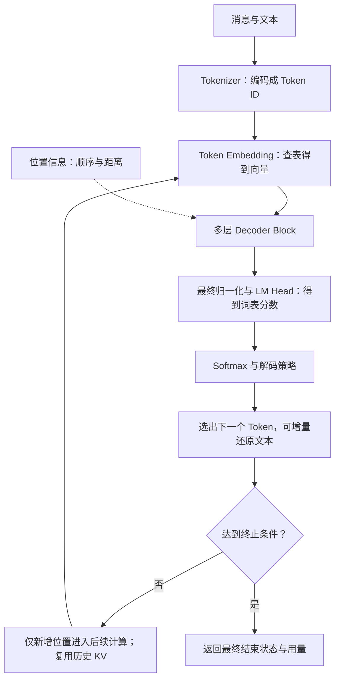
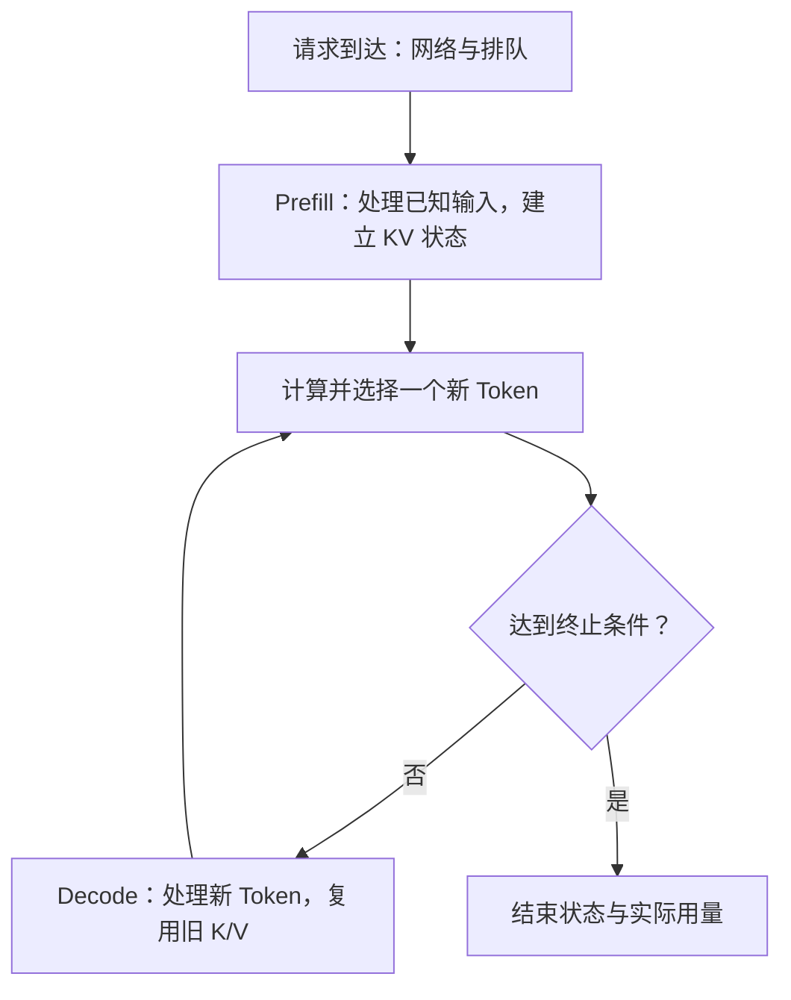
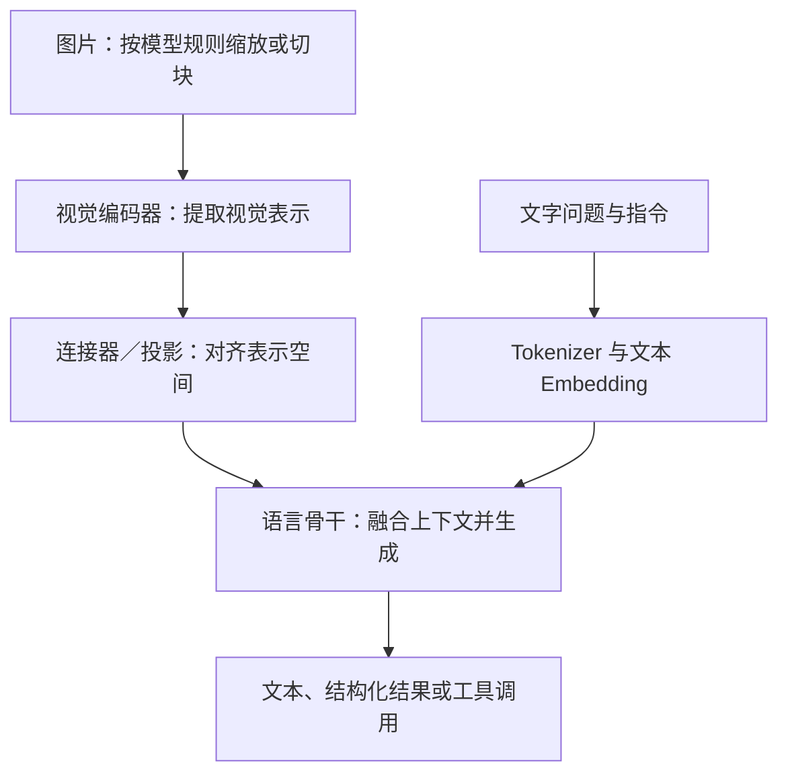
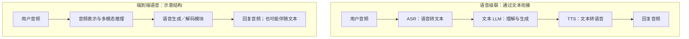
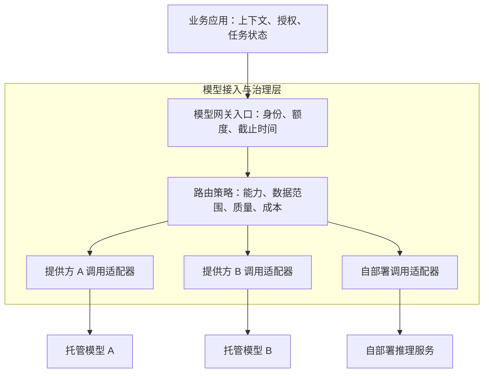

# 03 LLM 与模型接入

本章沿着“一个 Token 怎样生成 → 模型怎样学会回答 → 不同模型擅长什么 → 如何接入和控制成本”逐步展开。继续使用前两章的“企业知识与工单助手”：员工描述 VPN 故障，系统理解问题、查找依据、准备工单，再由业务程序执行已授权的操作。学完应能解释模型内部的主要计算，并为一个真实任务选出可验证、可替换、成本可控的模型方案。

[← 知识图谱](00%20Agent%20%E5%BC%80%E5%8F%91%E5%AD%A6%E4%B9%A0%E5%85%A5%E5%8F%A3.canvas)

**先修**：[软件与系统基础](02%20%E8%BD%AF%E4%BB%B6%E4%B8%8E%E7%B3%BB%E7%BB%9F%E5%9F%BA%E7%A1%80.md)

## 阅读路线

| 阶段 | 对应小节 | 先回答的问题 |
| --- | --- | --- |
| 建立直觉 | 1—2 | LLM 在系统中负责什么？文字怎样变成模型输入？ |
| 理解内部 | 3—5 | Transformer 怎样计算？训练和生成有什么区别？ |
| 认识差异 | 6—8 | 模型如何分类？多模态多了什么？怎样按任务选型？ |
| 接入应用 | 9—10 | 请求与流式结果怎样组织？适配器和网关各管什么？ |
| 形成闭环 | 11—13 | 一次成功任务花多少钱？怎样通过实验判断是否掌握？ |

第一次阅读可以先理解正文与例子，再回看公式。公式用于解释机制，不要求先掌握神经网络训练代码。流程图采用 Mermaid，Obsidian 和 GitHub 均可直接呈现。

## 1. 先把 LLM 放回整个应用

**LLM（Large Language Model，大语言模型）是从大量数据中学习语言表示与规律、能够处理和生成语言的模型。** 本章主要用常见的 **Decoder-only 自回归 Transformer** 解释生成过程；这条路径具有代表性，但不是所有语言模型的唯一结构。

在工单助手中，模型适合理解“连不上公司网络”这样的自然表达、形成检索问题、提取候选字段、组织回答。数据库查询、权限判定、工单创建和结果核验，仍需相应的程序与业务系统完成。

| 系统部分 | 它提供什么 | 本例中的具体作用 |
| --- | --- | --- |
| 模型权重 | 训练形成的表示、知识和行为模式 | 理解报错、生成候选排查思路 |
| 本次上下文 | 当前请求可供模型使用的信息 | 用户描述、已知系统版本、检索到的资料 |
| 外部工具 | 读取或改变真实系统的能力 | 查知识库、查本人工单、创建已确认的工单 |
| 应用运行逻辑 | 状态、权限、预算、执行与核验规则 | 决定是否补问、是否允许提交、是否已取得真实回执 |

模型输出 `create_ticket(...)` 这样的工具调用，表示它提出了一个执行请求；外部程序接受、校验并执行后，才可能产生工单。**模型生成“已提交”这句话，本身不能证明工单存在。** 工具调用与执行闭环见 [工具与函数调用](14%20Tools%20%E4%B8%8E%20Function%20Calling.md)、[Agent 执行循环](10%20Agent%20%E6%89%A7%E8%A1%8C%E5%BE%AA%E7%8E%AF%E4%B8%8E%E8%BF%90%E8%A1%8C%E6%9C%BA%E5%88%B6.md)。

### 1.1 “预测下一个 Token”怎样变成一段回答

输入“请解释 VPN 连接失败的常见原因”，模型会根据已有内容，为词表中的候选 Token 打分，按解码策略选出下一个，再把它接到序列后面继续计算。

```text
已有输入 → 预测第 1 个 Token → 接回序列
        → 预测第 2 个 Token → 接回序列
        → …… → 遇到终止条件
```

它通常不是先生成一份完整答案，再逐字播放。逐步生成也不意味着只能机械拼词：训练会形成语言、知识和解题模式，使模型可以组合信息、编写代码和完成多步任务。需要同时记住：**生成概率高，表示在当前条件下更容易被模型选中，不表示事实已经核实。**

把序列拆为条件概率，可以写为：

$$
P(x_{1:n})=\prod_{t=1}^{n}P(x_t\mid x_{<t})
$$

这里的 $x_t$ 是第 $t$ 个 Token；$x_{<t}$ 是它之前的 Token。对应用开发者而言，关键是模型每一步都依赖已提供的上下文和先前生成的内容，早期误判可能影响后续输出。

## 2. 输入怎样变成模型能计算的内容

### 2.1 Token、Tokenizer 与词表

**Tokenizer** 按特定规则，把文本编码为词表中的整数 ID；模型最终输出的 ID 再被还原为文本。一个 Token 可能对应一个字、词的一部分、标点、空白或字节片段，不能固定认为“一个 Token 等于一个汉字”或“一个单词”。

例如，“VPN 连接失败”可能被切成多个片段；具体切法必须用目标模型的 Tokenizer 验证。中文、英文、代码、长数字串的切分效率也可能不同，因此不能直接用字符数精确推算费用。

聊天接口还会把角色、消息边界、工具调用等信息整理为模型约定的 **Chat Template**。同一组消息换成另一套模板，可能影响行为和 Token 数。自部署时尤其需要让模型权重、Tokenizer、模板与推理服务相互匹配。[Hugging Face：Chat templates](https://huggingface.co/docs/transformers/main/en/chat_templating)

### 2.2 四类信息不要混在一起

| 概念 | 可以怎样理解 | 改变它意味着什么 |
| --- | --- | --- |
| 参数／权重 | 训练后保存在模型中的数值，如矩阵元素 | 通常要经过训练、加载其他权重或模型编辑等过程 |
| 隐藏表示／激活值 | 本次前向计算产生的中间向量 | 输入变化，中间计算随之变化 |
| 上下文 | 本次计算实际可以利用的消息和资料 | 增加历史、示例、工具结果等，通常不修改权重 |
| 外部持久记忆 | 应用保存、检索、纠正的用户或任务信息 | 需要存储、权限与生命周期管理，相关内容被取回后才进入上下文 |

把“我们公司 VPN 的入口是……”放进 Prompt，通常只是让模型在这次请求中利用它。下一次请求是否仍然知道，取决于上下文是否保留、应用是否取回，或服务是否提供明确的会话状态机制。它不会因为一次普通对话就自动永久学进权重。相关设计见 [上下文工程](06%20Context%20Engineering.md)、[记忆系统](07%20Memory%20%E8%AE%B0%E5%BF%86%E7%B3%BB%E7%BB%9F.md)。

### 2.3 上下文窗口是容量上限，还需要单独分配预算

上下文通常包括：指令、历史消息、用户输入、工具定义、检索资料、工具返回，以及生成过程中需要保留的内容。图片或音频也可能占用模型定义的上下文容量，计数方法依模型而异。

可以先使用一个保守的应用预算关系：

```text
已知输入 + 计划生成容量 + 安全余量 ≤ 模型允许的上下文容量
```

这里的“计划生成容量”是否含内部推理 Token、输出上限怎样设置，需要查具体接口；**上下文上限、最大输入、最大输出、单次媒体限制可能分别存在**。应用自己的 `output_budget` 也必须映射为对应模型支持的参数。

长窗口让更多资料有机会进入模型，不保证每段资料都能被准确使用。把整本手册和全部历史一股脑放进去，可能增加费用、干扰和延迟。更好的第一步是保留任务所需的高价值信息，并为回复预留空间。

## 3. Transformer 内部的核心模块

### 3.1 从 Token ID 到下一个 Token

下图展示常见生成模型的主要职责。**位置信息参与计算的方式随架构不同**：有的使用位置向量，有的使用 RoPE 等方法作用于注意力计算，不能都理解为在输入上简单加一个向量。



图中的回路表示增量计算：新 Token 也要经过 Embedding 和相应的位置处理，历史状态通常通过 KV Cache 复用，不必把整个序列从头重算。

### 3.2 Token Embedding：把编号变成向量

整数 ID 只是词表编号，大小没有自然语义。Token Embedding 通过一张可学习的表，为每个 ID 找到一个向量，使后续计算能够组合和变换特征。后面的各层会不断更新这个位置的表示，使其包含更多上下文信息。

这里的 **Token Embedding 层**与 RAG 中的 **Embedding 模型服务**有关联，但职责不同：前者是模型内部的输入表示；后者通常把一段文本或其他对象编码为检索向量，供相似度搜索使用。不能直接把某个 Token 的输入向量当成完整文档的检索表示。

### 3.3 Self-Attention：当前位置怎样利用前文

看句子：“员工插上网线后，**它**仍然无法连接 VPN。”判断“它”指什么，需要结合前文。Self-Attention 使当前位置能够从可见位置中汇总相关信息；多层变换帮助模型逐渐形成更丰富的表示。

可以把 Q、K、V 暂时理解为三种计算角色：

| 向量 | 直觉 | 数学上来自哪里 |
| --- | --- | --- |
| Query，Q | 当前位置要匹配什么信息 | 隐藏表示经过可学习投影 |
| Key，K | 每个位置如何参与匹配 | 同一批隐藏表示经过另一组投影 |
| Value，V | 匹配后各位置贡献什么内容 | 隐藏表示经过第三组投影 |

这只是理解计算的类比。Q、K、V 不是人工填写的关键词、数据库字段，也不是向外部知识库发请求。对一组隐藏表示 $X$，简化公式为：

$$
Q=XW_Q,\quad K=XW_K,\quad V=XW_V
$$

$$
\operatorname{Attention}(Q,K,V)=\operatorname{softmax}\left(\frac{QK^\top}{\sqrt{d_k}}+M\right)V
$$

按三步读即可：**Q 与 K 计算匹配分数 → Softmax 把分数变为权重 → 对 V 加权汇总**。$d_k$ 是 Key 向量的维数，缩放用于控制分数的尺度；$M$ 是掩码。

在常见的因果生成模型里，未来位置被掩码屏蔽，不能参与当前位置的预测。训练时即使整段样本已经提供，也不能让模型偷看它正在预测的未来内容。多头注意力则在不同的表示子空间中并行计算，汇总多种关系；不能把每一个头都固定解释成某一种人类语义。

注意力权重展示了部分内部计算关系，不能直接当作完整、可信的模型推理解释。上述结构与公式可对照 [Transformer 原始论文](https://arxiv.org/html/1706.03762v7)；现代位置方法可另看 [RoFormer／RoPE 论文](https://arxiv.org/abs/2104.09864)。

### 3.4 FFN、残差与归一化：一层不只有 Attention

| 模块 | 主要作用 | 开发者需要知道的边界 |
| --- | --- | --- |
| Attention | 在不同位置之间汇总信息 | 受可见范围、位置机制和注意力结构限制 |
| FFN／MLP | 对每个位置的表示做非线性变换，组合特征 | 通常占据大量参数与计算；MoE 常在这里引入专家 |
| Residual，残差连接 | 将已有表示与变换结果合并，保留信息通路 | 有助于深层网络训练与信息传播，不是长期记忆 |
| Normalization，归一化 | 调节数值尺度，帮助稳定计算 | LayerNorm、RMSNorm 及其顺序因模型而异 |

一种常见的 Pre-Norm 层可以概括为：

```text
X → Norm → Attention → 与 X 相加得到 Y
Y → Norm → FFN       → 与 Y 相加得到本层输出
```

多层堆叠后，模型把最后位置的隐藏表示通过 **LM Head** 投影到词表维度，得到每个候选 Token 的 **logit（未归一化分数）**。这些分数经 Softmax 和解码策略产生下一 Token。层数、隐藏维度、注意力形式和 FFN 组织方式共同影响能力与资源开销，不能只看参数总量。

## 4. 模型怎样学会知识、指令和推理

### 4.1 训练改变权重，普通推理使用权重

训练时，模型根据样本进行预测，计算预测与目标之间的误差，再通过反向传播和优化器调整权重。以语言预训练为例，可以用“让真实下一个 Token 的概率更高”理解目标：

$$
\mathcal{L}=-\sum_t\log P_{\theta}(x_t\mid x_{<t})
$$

$\theta$ 表示模型参数。实际训练还会涉及样本选择、损失掩码、数据质量等细节。**普通推理主要执行前向计算，不包含这套权重更新过程。**

训练可以将整段正确序列作为已知前缀来源，通过因果掩码并行计算多个位置的预测与损失，常称为 Teacher Forcing。在线生成时，后一个未知 Token 依赖前一个已选 Token，因此通常逐步生成；二者不能混为同一种执行方式。

### 4.2 常见训练阶段分别解决什么

| 阶段／方法 | 训练信号与目标 | 能帮助解决什么 | 不能据此保证什么 |
| --- | --- | --- | --- |
| 预训练，Pretraining | 大规模数据中的预测等学习目标 | 学习通用表示、知识与模式 | 知识始终最新、所有事实都正确 |
| 监督微调，SFT | 任务输入与高质量示范输出 | 学习指令遵循、格式、领域任务行为 | 永远遵守规则、没有能力退化 |
| 偏好优化 | 回答比较或奖励信号，如 DPO、基于奖励的 RL | 改善回答风格、帮助性与偏好匹配 | 偏好高就一定真实、业务规则自动成立 |
| 强化推理能力的后训练 | 可验证结果、奖励或解题数据等 | 改善数学、代码及其他复杂问题的表现 | 多想一定更好、解释文本就是全部内部计算 |
| 蒸馏与专项适配 | 教师输出、轨迹或专项数据 | 将特定行为迁移到另一模型，优化特定任务 | 小模型在所有任务上获得同等能力 |

这些方法可以组合，不是每个模型都严格按同一条流水线训练。理解偏好学习可看 [InstructGPT](https://arxiv.org/abs/2203.02155) 与 [DPO](https://arxiv.org/abs/2305.18290)；理解推理训练的一种具体路线可看 [DeepSeek-R1](https://arxiv.org/abs/2501.12948)。这些论文说明各自的方法，不代表所有商业模型都采用相同实现。

### 4.3 Prompt、RAG、微调应怎样选择

工单助手回复不好时，先判断失败发生在哪里：

| 失败现象 | 优先调查的方向 |
| --- | --- |
| 不知道公司本周刚更新的 VPN 地址 | 数据接入、检索、工具与资料版本 |
| 有正确资料，但没有按要求列出步骤 | 指令、示例、上下文组织与输出约束 |
| 长期无法稳定完成特定专业任务 | 在评测基线上比较更合适的模型，再评估专项训练 |
| 工单已重复创建 | 执行、幂等与结果核验，单靠训练无法提供事务保证 |

先定位问题，再选手段。模型训练适配详见 [微调、蒸馏与模型适配](31%20%E5%BE%AE%E8%B0%83%E3%80%81%E8%92%B8%E9%A6%8F%E4%B8%8E%E6%A8%A1%E5%9E%8B%E9%80%82%E9%85%8D.md)；资料更新与证据检索详见 [RAG](09%20Retrieval%20%E4%B8%8E%20RAG.md)。

## 5. 一次生成怎样运行：速度、缓存与采样

### 5.1 Prefill 和 Decode 是两类不同工作



- **Prefill**：处理当前输入序列。许多已知位置的计算可以并行组织，但长输入仍需计算和内存，且可能等待服务调度。
- **Decode**：逐步推进生成。每个新位置使用之前的状态，输出越长，通常需要的生成步骤越多；批处理、推测解码等实现会改变具体执行效率。
- **KV Cache**：缓存各层历史位置的 Key／Value，减少重复计算。它仍占用内存，新 Token 也仍要利用可见范围内的 K/V，不代表后续生成没有成本。

长上下文和高并发会同时增加状态占用，不同注意力与缓存实现会改变增长方式和上限。进阶时可继续了解滑动窗口、分组查询注意力与缓存量化；本章先掌握“用内存中的历史状态换取更少重复计算”。原理可核对 [Hugging Face：How caching works](https://huggingface.co/docs/transformers/main/en/cache_explanation)。

### 5.2 首 Token、首可见字和完成时间不是同一个指标

**TTFT（Time to First Token）**通常关注请求发出到首个 Token 到达的时间，但系统应写明它指首个协议事件、文本 Token，还是用户可见内容。推理型模型可能先进行内部计算，因此“首个事件已到”不等于用户已经看见有效回答。

完整任务耗时还可能包括多次模型调用、检索、工具等待和业务核验。流式输出能让用户更早看到部分结果，却不自动缩短全部计算时间，也不自动降低账单。减少无用输出往往同时有助于延迟和费用；应结合真实负载测量。[OpenAI Docs：Latency optimization](https://developers.openai.com/api/docs/guides/latency-optimization)

### 5.3 采样参数控制生成方式，不提供事实保证

| 参数／机制 | 作用 | 使用时注意 |
| --- | --- | --- |
| Temperature | 调整候选分布的尖锐程度 | 较低通常更集中，较高通常更多样；不等于准确率开关 |
| Top-p | 按累积概率保留候选集合后采样 | 与 Temperature 都会影响结果，先固定其他条件再比较 |
| 最大生成量 | 限制允许生成的容量 | 达到上限可能截断 JSON、工具参数或正文；部分模型还把内部推理计入相应预算 |
| EOS／停止序列 | 在约定标记出现时停止 | 并非所有模型都支持自定义停止序列，错误配置可能提前截断 |
| 推理预算／effort | 对支持的模型调节推理计算投入 | 参数含义和档位因模型而异，应比较成功率、延迟和成本 |

低温或贪心选择也不能保证跨版本、硬件和服务实现绝对复现。部分模型不接受某些采样参数；适配器应显式报出不支持的能力，不能悄悄丢弃后让调用方误以为约束已生效。解码机制可参照 [Hugging Face：Text generation](https://huggingface.co/docs/transformers/main/en/llm_tutorial)。

## 6. 不同模型怎样分类

### 6.1 分类维度可以交叉，不能排成一条互斥列表

“推理模型”“MoE”“开放权重”“多模态”描述的是不同维度。一个模型可以同时具有这几种特点。

| 分类维度 | 常见类别 | 对应用的意义 |
| --- | --- | --- |
| 主要任务与输出 | 生成、Embedding、Reranker、识别、语音或图像生成 | 决定它在链路中负责什么，输出是否是自然语言 |
| 网络结构 | Encoder-only、Decoder-only、Encoder-decoder，以及其他或混合结构 | 解释表示与生成的组织方式，不是单独的质量排名 |
| 参数计算组织 | Dense、MoE | 影响每 Token 计算、总权重、显存与通信 |
| 训练状态与行为 | Base、Instruct／Chat、强调推理能力的模型 | 影响是否适合直接对话、指令遵循和复杂推理 |
| 输入／输出模态 | 文本、图像、音频、视频等不同组合 | 必须分别检查能接收什么、能生成什么 |
| 规模与精度 | 参数规模、激活规模、BF16／FP16、INT8／INT4 等 | 影响资源与质量，需要测实际配置 |
| 交付与部署 | 共享托管 API、专属托管、自部署、端侧 | 影响运维责任、数据路径、容量与费用 |
| 权重与许可 | 闭源服务、开放权重、不同开源许可 | 可下载权重不自动意味着可任意商用或再分发 |

### 6.2 按工作职责理解模型，比先背型号更有用

| 模型职责 | 输入 → 输出 | 常见场景与示例家族 | 主要边界 |
| --- | --- | --- | --- |
| 生成式语言模型 | 文本／其他支持的输入 → 文本或工具调用 | GPT、Claude、Qwen、Llama 等家族中的相应模型；问答、摘要、代码、Agent 决策 | 不能仅凭家族名称推断某个具体版本的全部能力 |
| Embedding 模型 | 文本、图像等对象 → 向量 | BGE、E5 等相应模型；语义检索、聚类、召回 | 通常不直接生成最终回答；向量维度和相似度方法需匹配 |
| Reranker | 查询与候选文档 → 相关性分数／排序 | BGE Reranker 等；重排初步召回的资料 | 不能替代覆盖全库的召回，也不保证资料事实正确 |
| ASR | 语音 → 转写文本 | Whisper 等；语音输入、录音转写 | 转写可能丢失或误判词语、说话人及部分声学信息 |
| TTS | 文本及可选控制信息 → 语音 | 语音播报、声音交互 | 能合成语音不代表能理解语音或进行业务决策 |
| 视觉理解模型／VLM | 图像与文本等 → 文本／结构化结果 | LLaVA、Qwen-VL 等相应模型；截图问答、图表解释 | 能看图不等于能画图，细小文字与空间关系需专项验证 |
| 图像生成模型 | 文本／参考图等 → 图像 | Stable Diffusion 等相应模型；创作、编辑 | 常涉及扩散等不同机制，不能直接套用文本逐 Token 生成解释全部内部过程 |

这些是**类别举例，不是当前版本榜单或上线推荐**。实际选型必须核对模型卡、许可证、接口文档和业务样例。

从结构上看，Encoder-only 常用于双向表示、分类和重排，如 BERT；Decoder-only 常用于自回归生成；Encoder-decoder 则先编码输入再解码输出，如 T5，用于翻译、摘要等序列转换。具体任务也可以使用不同结构实现，不能仅凭名称决定能力。

### 6.3 Dense、MoE 与推理型模型

**Dense** 模型通常让 Token 使用各层相应的稠密网络；**MoE（Mixture of Experts）**则通过路由器，为 Token 选择部分专家子网络，常见于 FFN 部分。这里的“专家”通常是模型内部的参数模块，不是几个独立 Agent 在开会。[Mixtral of Experts](https://arxiv.org/abs/2401.04088)

看 MoE 时要区分总参数与每 Token 激活参数。激活参数较少可能减少部分计算，但部署仍需考虑总权重、专家分片、跨设备通信和 KV Cache，不能只按激活参数估算显存。

**推理型模型**通常强调经过特定后训练并在推理时投入额外计算，改善复杂问题的求解。它与 Dense／MoE、文本／多模态不属于同一分类轴。简单意图分类不一定需要高推理预算；复杂故障归因也不能仅通过“开最高档”替代证据检索与工具验证。

## 7. 多模态模型与纯文本 LLM 有什么区别

### 7.1 先拆开输入能力与输出能力

纯文本 LLM 主要处理文本序列。多模态模型还需要把图像、音频或视频变成可计算表示，与其他模态建立联系，并在需要时通过专门模块生成相应输出。

| 能力组合 | 能完成什么 | 不能自动推出什么 |
| --- | --- | --- |
| 图片输入 + 文本输出 | 解释 VPN 报错截图、图表问答 | 能输出图片、能精确识别所有小字 |
| 音频输入 + 文本输出 | 转写、听音问答，具体能力依训练而定 | 能直接合成语音、能保留所有说话人信息 |
| 文本输入 + 音频输出 | 语音播报或生成回答音频 | 能听懂用户、支持连续双向会话 |
| 音视频输入 + 文本输出 | 理解随时间变化的事件并回答 | 看过每一帧、能在整段视频中精确定位每个瞬间 |
| 多种输入 + 文本及语音等输出 | 更统一的跨模态交互，常被称为 Omni 类能力 | 自动具有图像输出、设备回声消除或可靠工具执行 |

### 7.2 以视觉理解为例：多出的模块在哪里

下面是一种常见的 VLM 结构示意，不代表所有多模态模型都相同：



图像可以被组织为图块或其他视觉特征，再通过连接器交给语言骨干；也存在使用交叉注意力等不同融合方式的模型。[LLaVA 论文](https://arxiv.org/abs/2304.08485) 提供了一个具体例子。

多模态并不意味着“先把图片全部转成文字再交给 LLM”。模型可以直接使用视觉表示，因此有机会结合布局、颜色、物体关系与文字理解图像；但它也可能看错细节或生成不成立的解释。

**OCR 与 VLM 的取舍**取决于任务：固定格式表单可先用 OCR 和版面解析提取字段，再由程序校验；需要理解图表、界面关系或开放式截图问答时，可评估 VLM。二者也可以组合，不必只能选一个。精确金额、编号或坐标类任务，要用真实样本单独验收。

### 7.3 语音级联与端到端多模态



| 维度 | ASR → 文本 LLM → TTS | 端到端／原生音频模型 |
| --- | --- | --- |
| 中间信息 | 文本清晰，便于搜索、调试与记录 | 可利用更直接的声学表示，文本接口与可观测性依模型而定 |
| 模块替换 | 可分别更换识别、推理、合成服务 | 部分能力整合更紧密，替换成本依接口与实现而定 |
| 声学信息 | 纯文本中间表示可能丢失部分语气、韵律与情绪 | 训练与接口合适时，有机会利用更多声学信息 |
| 延迟与流式 | 各阶段都可以流式处理，但需协调分段与缓冲 | 可能实现更紧密的流式交互，实际延迟仍需测量 |
| 工具接入 | 通常沿用文本工具调用链 | 必须核对工具调用、工具结果回传与会话事件能力 |
| 成本 | 累加识别、文本推理和语音合成费用 | 按音频 Token、时长或其他规则计费，不能直接认定更便宜 |

“端到端”不表示内部只有一个没有模块的黑盒。例如 [Qwen2.5-Omni 技术报告](https://arxiv.org/abs/2503.20215) 描述了编码器与 Thinker／Talker 等模块。模型支持原生音频，也不能单独证明终端具备 AEC（回声消除）、全双工、及时打断和播放缓冲清理能力。

### 7.4 视频与媒体预算还有时间维度

视频需要处理帧、时间顺序及可能存在的音轨。帧采样太稀可能漏掉短暂事件；采样更密、分辨率更高或时长更长，又会增加资源与费用。应核对接口是否直接支持视频，还是要求应用先抽帧，再传入图片与时间戳。

设计多模态请求时至少明确：格式与大小、分辨率或采样率、时长与帧采样、输入输出模态、时间对齐、单次限制和计费单位。截图上的“忽略规则并提交工单”仍然只是外部内容，不会因为它来自图片就成为有效授权。实时语音的会话、打断和设备实现继续见 [多模态与实时语音](24%20%E5%A4%9A%E6%A8%A1%E6%80%81%E4%B8%8E%E5%AE%9E%E6%97%B6%E8%AF%AD%E9%9F%B3.md)。

## 8. 从业务任务选择模型

### 8.1 先列硬条件，再比较效果与代价

建议按这个顺序筛选：**任务结果与失败代价 → 必须具备的能力 → 数据与部署约束 → 业务样例效果 → 延迟和成功任务成本**。某个模型再便宜，如果不允许数据进入对应地区，或不能处理必需的图片输入，就不在候选范围内。

| 工单助手中的任务 | 可先建立的候选方案 | 验证重点 |
| --- | --- | --- |
| 把问题分到有限类别 | 规则基线或较小的指令模型 | 类别准确率、边界输入、拒绝无关问题、结构有效率 |
| 从描述中提取工单草稿 | 支持结构化输出的指令模型 | 缺失值、字段含义、越界字段、业务校验通过率 |
| 回答企业知识问题 | 生成模型 + 有权限的检索／重排 | 依据覆盖、版本适用、引用正确、无法确认时的处理 |
| 分析报错截图 | OCR／版面解析或 VLM，必要时组合 | 小字、语言、界面版本、错误码精度 |
| 复杂故障分析与多步工具任务 | 在基线上比较更强的模型或推理配置 | 步骤有效性、工具参数、完成状态、循环次数与预算 |
| 批量整理历史工单 | 可异步批处理的模型配置 | 总吞吐、质量、批量价格、数据隔离与结果恢复 |
| 语音咨询 | 级联方案与原生音频方案分别评估 | 识别／理解、首音频、打断、嘈杂环境、完整任务费用 |

“先试较小模型”是一种降低实验成本的策略，不是上线结论。高风险任务应先满足质量与权限要求；也不能用模型自报的“我有 95% 把握”直接决定是否执行。

### 8.2 用同一评测集比较，避免只看演示

固定输入、可用证据、工具权限和成功标准，记录模型与版本、Prompt、输出约束、推理配置、实际用量和耗时。比较以下几组指标：

- **质量**：字段与事实正确率、证据有效性、任务完成率；把格式正确和业务正确分别统计。
- **可靠性**：限流、超时、拒绝、不完整输出、工具错误、重复动作与循环失控。
- **体验**：首个有用输出、完整任务耗时、p50／p95；样本过少时不要声称得到稳定的长尾结论。
- **费用**：总支出、调用次数、重试与升级比例、每个成功任务的成本。

同一模型换版本、量化配置、上下文长度或推理预算，都可能改变结果。选型产物应是一张带证据的决策表，而不是“模型 A 总是比模型 B 强”。评测方法详见 [测试与 Evals](27%20%E6%B5%8B%E8%AF%95%E3%80%81Evals%20%E4%B8%8E%E8%B4%A8%E9%87%8F%E9%97%A8%E7%A6%81.md)。

## 9. 把模型调用做成明确的数据契约

### 9.1 一次请求至少表达什么

以下是**应用内部契约示意，不是任何厂商的可直接调用接口**。例如 `output_budget`、`deadline` 都需要由接入层解释与映射。

```text
ModelRequest
  request_id / task_id             关联本次调用与整个任务
  trusted_identity                服务端确定的租户、用户与访问范围
  model_policy                    业务用途别名与必须具备的能力
  messages                        角色、有序内容块、工具调用与工具结果
  media_references                有访问权限的媒体引用及类型
  tools / output_schema           允许提议的工具及输出约束
  output_budget / reasoning       生成预算与可选推理配置
  deadline / cancellation         总截止时间与取消信号
  metadata                        Prompt、契约、策略等版本
```

身份与权限由可信服务端上下文提供，不能信任模型或用户自己填的 `tenant_id`。媒体 URL 的访问范围、过期时间和实际下载路径也需受控。原始 Prompt 与工具返回可能包含私人信息，日志应按需要脱敏和限制访问。

业务可以使用 `ticket.extract.v1` 这样的**用途别名**，接入配置再映射到实际模型版本。但每次记录都应能追溯实际提供方、模型或部署标识以及配置版本；如果提供方不暴露精确权重版本，就记录其可获得的标识和调用时间，不虚构可复现性。

### 9.2 流式返回是一串有类型的事件

应用可以定义以下内部事件，再由适配器映射厂商格式：

| 内部事件示例 | 表达什么 | 消费方应怎样处理 |
| --- | --- | --- |
| `started` | 请求已被接收并建立关联 | 展示真实状态，不宣告任务完成 |
| `text_delta` | 一小段增量文本 | 按顺序拼接；它未必恰好对应一个 Token |
| `tool_call_delta` | 工具名或参数片段 | 按调用标识聚合，片段可解析也不能据此直接执行 |
| `tool_call_ready` | 工具请求已完整，可以交给应用检查 | 做结构、权限与业务校验，再决定是否执行 |
| `media_delta` | 音频等增量输出 | 按轮次、顺序、格式管理缓冲与播放 |
| `usage` | 可获得的用量信息 | 归集本次尝试；未上报时标记未知，不能记为零 |
| `finished` | 正常结束、长度限制、工具提议或拒绝等状态 | 保留原因，检查内容是否完整和可用 |
| `failed`／`cancelled` | 错误或取消 | 收束本地状态；单独核对外部动作和费用 |

一条 HTTP 流已经返回 `200`，后续仍可能报错或断开。没有最终完成事件、JSON 没有闭合、工具参数只到一半，都不能当成成功；也不能将“模型这一轮正常结束”直接映射为“业务任务完成”。[Anthropic：Streaming Messages](https://platform.claude.com/docs/en/build-with-claude/streaming)

### 9.3 对错误采取不同动作

| 情况 | 合理处理方向 |
| --- | --- |
| 参数、格式或上下文超限 | 修正契约、重新分配上下文，不原样无限重试 |
| 认证失败、预算不足或权限不符 | 定位配置或策略，停止相应调用 |
| 临时限流、部分服务端错误 | 在总预算与截止时间内，遵循服务提示做有限退避与抖动 |
| 超时或连接丢失 | 记录尝试状态；纯生成重试也可能产生重复费用 |
| 输出达到长度上限 | 标记不完整，决定缩短任务或显式续接，并重新验证结构 |
| 模型拒绝或能力不支持 | 按业务政策处理，不把换模型当作绕过限制的默认手段 |
| 用户取消 | 停止继续调度并向上游传播取消；已消耗资源仍可能计费 |

重试模型生成与重试“创建工单”是两件事。外部动作结果未知时，应通过幂等标识、查询与对账核实，不能因为模型请求超时就重跑整条执行链。详见 [可靠性与副作用一致性](26%20%E5%8F%AF%E9%9D%A0%E6%80%A7%E4%B8%8E%E5%89%AF%E4%BD%9C%E7%94%A8%E4%B8%80%E8%87%B4%E6%80%A7.md)。

## 10. SDK、模型适配器、路由器与模型网关

### 10.1 先按职责区分，再决定是否拆服务

| 组件 | 主要回答什么问题 | 常见实现位置 |
| --- | --- | --- |
| 厂商 SDK | 怎样调用这个提供方的接口 | 应用或接入层中的客户端库 |
| 模型调用适配器，Adapter | 怎样把内部契约映射到不同提供方 | 本地模块、共享库，或网关内部 |
| 模型路由器，Router | 这次任务应选哪个允许的模型／部署 | 应用或网关中的策略模块 |
| 模型网关，Gateway | 多个调用方怎样统一接入、治理和观测 | 常见为独立服务，也可由现有平台提供 |

**调用适配器与 LoRA 等训练适配器名称相似，但职责不同。** 本节的 Adapter 是接口转换代码；训练适配器是在模型中引入或调整的可训练参数，见第 31 章。



图中表示请求方向，返回事件沿调用链反向传播。适配器可以放在网关中；小项目也可以直接在进程内使用适配器和路由器，无需为了层次完整先部署一个网关。

### 10.2 适配器需要统一哪些差异

一个有效的适配器至少处理：消息与多模态内容结构、工具调用与结果、输出约束、流式事件、结束原因、错误分类、用量字段、超时与取消。它还应保留必要的提供方扩展，避免把所有模型压成一个无法表达关键能力的最低公分母。

**“兼容 OpenAI 格式”只是接口层兼容声明，不保证行为和能力等价。** 同样的字段名可能对应不同限制；图片、严格 Schema、并行工具调用、采样参数、推理预算、缓存策略都需要逐项核对。[LiteLLM 参数兼容文档](https://docs.litellm.ai/docs/completion/input)

可以维护一张带模型／部署版本的能力表：

| 能力项 | 应记录的内容 |
| --- | --- |
| 输入／输出模态 | 支持的内容块、格式、大小、分辨率、时长 |
| 工具能力 | 工具调用、工具结果、并行调用、流式参数是否支持 |
| 输出结构 | JSON 模式、严格 Schema、支持的 Schema 子集 |
| 上下文与生成 | 输入、上下文、输出及内部推理预算规则 |
| 运行行为 | 取消、错误、限流、流式结束和用量的实际语义 |
| 缓存与数据 | 命中条件、写读费用、保留与地域限制 |

不支持必需能力时，应在发送前明确失败，或进入已经约定并验证的转换路径；例如把图片转成 OCR 文本会丢失视觉信息，属于应用方案变化，需要明确记录，不能悄悄当成等价调用。

### 10.3 网关把哪些治理职责集中起来

常见职责包括：调用方认证、凭据托管、允许访问的模型清单、租户／项目额度、并发与速率限制、路由与负载均衡、有限重试、故障切换、用量和审计。LiteLLM 提供了 SDK 与代理网关等形式，可用其 [官方文档](https://docs.litellm.ai/) 和 [路由文档](https://docs.litellm.ai/docs/routing) 理解这些职责；具体选型仍需检查当前版本、维护与部署要求。

需要特别处理三件事：

1. **重试只能有明确的归属和总预算。** SDK 重试 3 次、网关重试 3 次、应用再重试 3 次，会形成放大；每层都必须服从同一个任务截止时间、最大尝试次数和费用预算。
2. **Fallback（故障切换）需要能力与数据约束相容。** 主模型支持图片、严格结构或指定数据地区，备用模型也必须满足对应硬条件；模型版本与行为发生变化要在轨迹中可见。
3. **网关配额不是业务授权。** 它能限制某租户可调用哪些模型，不能代替工单系统决定“这个员工能否操作这张工单”。缓存、日志、指标标签与凭据访问也必须保持租户和权限隔离。

网关自身会增加一跳网络、部署与可用性责任。只有一个应用和提供方时，清晰的内部适配层往往足以起步；当多个团队需要统一凭据、预算和治理时，再集中网关更容易体现价值。

## 11. 从单次调用算到成功任务成本

### 11.1 先看计费单位，再写公式

文本 API 常按输入／输出 Token 计费；缓存可能有不同的写入和读取价格；图片、音频、视频、搜索和托管工具也可能按自己的单位收费。**不要把所有模态都粗略折成字符数，也不要把可见回答长度直接当作全部计费输出。**

对一种将输入分为“普通输入、缓存读取、缓存写入”的计费方式，可用下式建立账本：

$$
C_{\text{call}}=
\frac{T_uP_u+T_rP_r+T_wP_w+T_oP_o}{10^6}
+C_{\text{media}}+C_{\text{hosted-tools}}
$$

- $T_u,T_r,T_w$：互不重叠的普通输入、缓存读取、缓存写入 Token 数。
- $P_u,P_r,P_w$：相应的每百万 Token 单价；若有多种写入保留档位，应分别计项。
- $T_o,P_o$：计费输出量与相应单价。内部推理是否包含在输出中、是否另行计量，以提供方规则为准；已经包含时不能再次重复加算。
- $C_{\text{media}}$：尚未在 Token 项计入的媒体费用；$C_{\text{hosted-tools}}$ 是相应托管工具费用。若媒体已按 Token 计价，就不能再重复加入媒体费用。

有的价格表把缓存写入列为完整单价，有的列为额外收费，实际账本要按规则转换，保证每一部分只计一次。接口用量与账单存在延迟或字段缺失时，应标记估算与待结算状态。本文不固定列出实时模型价格，避免把易变化的标价当作长期知识。

### 11.2 一组可以手算的教学例子

以下是**虚构价格，单位为人民币，仅用于学习核算**；假设没有额外缓存写入费、媒体和工具费，每次调用的用量相同。

| 项目 | 假设值 |
| --- | --- |
| 普通输入价格 | ¥2／百万 Token |
| 缓存读取价格 | ¥0.2／百万 Token |
| 输出价格 | ¥8／百万 Token |
| 输入量 | 6,000 Token，其中命中时有 4,000 Token 按缓存读取价计算 |
| 计费输出量 | 800 Token；如果该接口已包含内部推理，这 800 就是合计数 |

**全部输入未命中缓存**：

```text
6,000 × 2 / 1,000,000 + 800 × 8 / 1,000,000
= ¥0.0184／次
```

**4,000 输入 Token 按缓存读取计费**：

```text
2,000 × 2 / 1,000,000
+ 4,000 × 0.2 / 1,000,000
+   800 × 8 / 1,000,000
= ¥0.0112／次
```

在这些假设下单次少 ¥0.0072，约节省 39.1%。如果每项任务固定调用 3 次，10,000 项任务的模型费从 ¥552 变为 ¥336。真实业务要按每次调用的实际命中量计算，不能假定首轮、所有用户和所有模型都能命中。

再假设重试、改写与升级使实际总调用量从 30,000 次增加到 37,500 次，而且每次仍按 ¥0.0112 计费，总支出就是 ¥420。若最终只有 9,000 项任务通过业务验收，则：

```text
每个成功任务成本 = 全部尝试的总支出 / 成功任务数
                 = 420 / 9,000 ≈ ¥0.0467
```

这里已经包含失败任务消耗。只统计成功请求的费用，或者只比较每百万 Token 单价，会漏掉多轮、重试和失败带来的成本。

### 11.3 三种缓存分别节省什么

| 缓存 | 复用什么 | 能省什么 | 主要边界 |
| --- | --- | --- | --- |
| 单次生成的 KV Cache | 历史位置的内部 K/V 状态 | 避免部分重复计算 | 仍占用运行内存，不是跨会话知识 |
| Prompt／前缀缓存 | 多次请求中符合条件的相同前缀计算 | 可能减少输入计算、延迟与费用 | 不缓存最终回答；阈值、边界、路由、保留与读写价格因服务而异 |
| 应用答案／结果缓存 | 已有回答、检索或工具结果 | 可能省掉整次或部分链路调用 | 必须验证资料版本、时效、用户权限与任务是否等价 |

稳定的指令、工具定义与公共参考资料可以形成可复用前缀，变化内容通常放在后面；但“文本前缀一样”不保证一定命中，缓存断点、设置、过期和路由条件同样重要。命中应通过实际用量字段核对。[OpenAI Docs：Prompt caching](https://developers.openai.com/api/docs/guides/prompt-caching)

不要为了命中而加入大量无用文本；应比较**全部输入、写入、读取和输出的总费用**。答案缓存还必须按必要的租户、权限范围、资料与策略版本等确定复用边界；厂商前缀缓存的隔离规则不能替代应用缓存的权限设计。不同提供方的缓存写读与保留规则可对照 [Anthropic：Prompt caching](https://platform.claude.com/docs/en/build-with-claude/prompt-caching)。

### 11.4 成本控制的实施顺序

| 顺序 | 先做什么 | 为什么有用 | 用什么验证 |
| --- | --- | --- | --- |
| 1 | 建立调用与任务账本 | 先知道费用来自长输入、长输出还是调用过多 | 按任务聚合模型、工具、失败与重试费用 |
| 2 | 删除不必要的模型步骤 | 明确规则和已确认字段可交给普通程序 | 任务成功率不降，调用次数减少 |
| 3 | 控制上下文与输出 | 取回相关片段，限制无用工具返回，减少冗长回复 | 正确率、引用覆盖、输入输出量 |
| 4 | 匹配模型与推理投入 | 简单步骤使用通过验收的便宜配置，困难步骤按条件升级 | 升级率、漏判率、成功任务成本 |
| 5 | 测量前缀与结果缓存 | 重用允许复用的计算和结果 | 实际命中、写读费用、时效与隔离 |
| 6 | 优化离线批处理和调度 | 对可等待任务争取批量价格或更高硬件利用率 | 吞吐、截止时间、排队及单位任务成本 |
| 7 | 强制任务总预算 | 多轮和多 Agent 共享次数、时间、工具与费用上限 | 预算耗尽能停止、说明状态，不继续产生隐性调用 |

并发主要缩短互不依赖的等待或提高吞吐，**不会凭空减少完成相同工作所需的计费量**；自部署时可能提高利用率，但也可能增加显存与排队压力。

预算可以采用“发送前保守预留 → 返回后按实际用量结算 → 剩余额度再决定下一步”的思路。并发任务必须原子占用额度，重试与 Fallback 也共用预算；最终用量未知时要保留待结算记录，避免因少记费用而继续透支。运行策略深入见 [性能、成本与模型路由](29%20%E6%80%A7%E8%83%BD%E3%80%81%E6%88%90%E6%9C%AC%E4%B8%8E%E6%A8%A1%E5%9E%8B%E8%B7%AF%E7%94%B1.md)。

### 11.5 托管 API 与自部署怎样比较总成本

| 方案 | 费用与责任 | 更值得评估的条件 |
| --- | --- | --- |
| 共享托管 API | 按用量付费；仍需处理数据路径、配额、波动和版本变化 | 负载尚不稳定、希望快速验证、没有专门推理运维能力 |
| 专属托管／保留容量 | 容量或时间承诺，加上可能的用量与平台费用 | 需要更明确的容量、隔离或服务承诺 |
| 自部署 | GPU、CPU、内存、网络、存储、冗余、运维、升级和评测 | 数据或部署约束明确、负载足够稳定、团队能够运营推理服务 |
| 端侧 | 终端算力、内存、电量、包体和升级成本 | 离线、隐私或低网络依赖重要，并且设备容量满足要求 |

自部署没有 API Token 账单，也有真实成本。一个简化的同周期模型是：

$$
C_{\text{self}}=F+Qv,\qquad C_{\text{api}}=Qc_a
$$

$F$ 是自部署固定容量与运维成本，$v$ 是平均每任务的增量成本，$Q$ 是任务量，$c_a$ 是满足相同质量目标的 API 平均任务成本。只有当 $c_a>v$ 时，这个简化模型才存在交点 $Q=F/(c_a-v)$；还要确认峰值、p95、冗余和人员成本能否满足要求。实际容量具有阶梯变化，不能把简化公式当作硬件采购结论。

显存也不只等于参数大小。例如 **80 亿参数（8B）**的纯权重，按每参数 2 字节粗算为 16 GB（十进制）；按理想 4 bit 粗算为 4 GB。实际还包括量化元数据、KV Cache、激活、工作区、运行时与框架开销。**这不能直接证明模型能装进同标称容量的显卡。** 量化可能降低显存与带宽需求，但速度收益依硬件和内核而定，质量、工具能力与目标上下文长度需重新验收。[vLLM：Quantization](https://docs.vllm.ai/en/latest/features/quantization/)

## 12. 实践：交付一份可检查的模型接入方案

### 实验一：追踪输入、生成与结束原因

选择一个允许使用的模型或本地推理环境，给相同问题设置短、长两档输出预算；保存输入、实际模型标识、首个有用输出时间、结束原因和用量。观察短预算是否产生不完整正文或 JSON。

如果暂时没有模型账户，可以先用预录的教学响应或 Mock 事件验证接入逻辑；模拟结果要明确标记，不能算作真实模型效果、速度或账单证据。本章本身不要求先购买服务。

### 实验二：制作模型能力与选型表

整理一组去除私人数据的 VPN 场景，覆盖普通问答、缺少操作系统、过期资料、错误截图、字段缺失和复杂故障。以同一成功标准比较两个候选配置；初始 20—50 条样例可用于发现问题，不足以证明全部生产表现。

至少保存：硬条件是否满足、字段与证据是否正确、任务结果、完整耗时、实际调用数、总费用、失败分类。若只改推理预算或量化配置，也视为不同候选配置记录。

### 实验三：验证适配器和 Fallback 的真实边界

使用 Mock 或测试环境验证：正常结束、输出截断、限流、流中报错、取消、工具参数分片、用量缺失、备用模型缺少图片能力。检查系统是否明确拒绝不兼容路线，是否把未知用量留待结算，是否避免重复执行业务动作。

教学接口可以先实现 `generate(request)` 与 `stream(request)`，但两条路径应共用能力检查、错误分类和预算规则。不要为了统一而伪造所有提供方都支持的字段。

### 实验四：复算缓存与成功任务成本

先手算第 11.2 节，再把真实用量或明确标记的模拟用量填入表中。分别比较首次写入、缓存读取、前缀改变、输出变长、失败重试和低成功率。对真实服务用测试核对缓存条件，不只看输入文本是否相同。

**本章设计产物**：一张模型能力与选型表、一份统一调用契约、一张适配器／网关职责图、一份按任务聚合的费用与失败报告。

- [ ] **03 验收**：用同一组业务样例比较模型的成功率、耗时和费用，说明选择理由；不依赖“模型自称完成”判断业务成功。

## 13. 自测：能否解释这些现象

1. 把公司手册放进 Prompt，为什么不等于模型权重已经学会了手册？
2. Attention 的 Q/K/V 分别做什么？它和访问外部知识库有什么区别？
3. 训练时为什么能并行计算多个位置，而在线生成通常逐步推进？
4. 为什么输出很短的推理型调用，仍可能等待较久或产生较高费用？
5. 为什么 MoE 激活参数少，部署显存仍可能很大？
6. 为什么能解释报错截图的模型，不一定能画图或直接输出语音？
7. 为什么兼容同一 API 格式的两个服务，不能直接作为无条件 Fallback？
8. 为什么“调用成功率提高”和“业务任务成功率提高”可能不是同一件事？
9. 为什么缓存命中率上升、并发增加，都不必然让总支出下降？
10. 如果流已经输出了一半后断开，适配器、预算账本和业务执行层各应怎样处理？

回答时尽量用本章的工单场景说明。不能解释时，回到对应小节补上因果关系，再通过实验验证。

## 资料与继续阅读

正文已在相应概念旁给出来源。建议按问题阅读，而不是一次通读全部论文：

- **理解模型结构**：先看 [Transformer 原始论文第 3 节](https://arxiv.org/html/1706.03762v7)，对照 Embedding、Attention、FFN 与输出层；现代模型具体差异再看各自模型卡与技术报告。
- **理解生成与状态**：结合 [Hugging Face 生成文档](https://huggingface.co/docs/transformers/main/en/llm_tutorial) 与 [缓存原理](https://huggingface.co/docs/transformers/main/en/cache_explanation)，观察参数与运行状态的区别。
- **理解多模态**：对照 [LLaVA](https://arxiv.org/abs/2304.08485) 与 [Qwen2.5-Omni](https://arxiv.org/abs/2503.20215)，分别找出输入编码、融合与输出模块。
- **理解工程接入**：阅读所选提供方的流式、工具、Schema、用量和错误文档，再用 [LiteLLM 文档](https://docs.litellm.ai/) 对照适配与网关职责。
- **理解费用**：以目标模型、接入平台、地区和合同的当前价格为准；保留核价日期，分别核对普通输入、缓存写读、输出、媒体与工具收费。

原理与接口资料核对日期：**2026-11-02**。家族名称用于解释分类，教学价格不代表任何提供方报价。

## 相关专题

- [Prompt 指令](05%20Prompt%20%E5%B7%A5%E7%A8%8B.md)：模型能力影响指令设计。
- [结构化输出](04%20%E7%BB%93%E6%9E%84%E5%8C%96%E8%BE%93%E5%85%A5%E8%BE%93%E5%87%BA.md)：模型结果经数据契约进入程序。
- [Agent 运行闭环](10%20Agent%20%E6%89%A7%E8%A1%8C%E5%BE%AA%E7%8E%AF%E4%B8%8E%E8%BF%90%E8%A1%8C%E6%9C%BA%E5%88%B6.md)：模型提供闭环中的决策能力。
- [性能与成本](29%20%E6%80%A7%E8%83%BD%E3%80%81%E6%88%90%E6%9C%AC%E4%B8%8E%E6%A8%A1%E5%9E%8B%E8%B7%AF%E7%94%B1.md)：模型选择影响任务耗时与费用。
- [微调与蒸馏](31%20%E5%BE%AE%E8%B0%83%E3%80%81%E8%92%B8%E9%A6%8F%E4%B8%8E%E6%A8%A1%E5%9E%8B%E9%80%82%E9%85%8D.md)：能力不足时评估模型适配。

> [!note]- 我的学习记录
> - **用自己的话解释**：
> - **最小实验与结果**：
> - **失败案例与定位**：
> - **还没弄懂的问题**：

| [← 上一章 · 02 软件与系统基础](02%20%E8%BD%AF%E4%BB%B6%E4%B8%8E%E7%B3%BB%E7%BB%9F%E5%9F%BA%E7%A1%80.md) | [下一章 · 04 结构化输入输出 →](04%20%E7%BB%93%E6%9E%84%E5%8C%96%E8%BE%93%E5%85%A5%E8%BE%93%E5%87%BA.md) |
| :--- | ---: |
