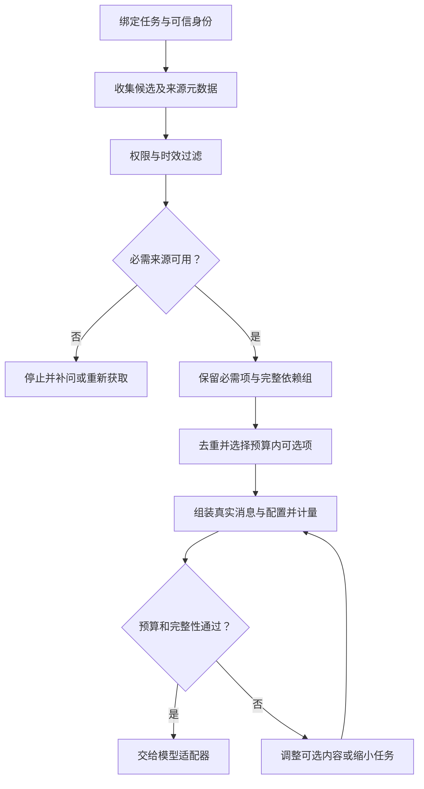
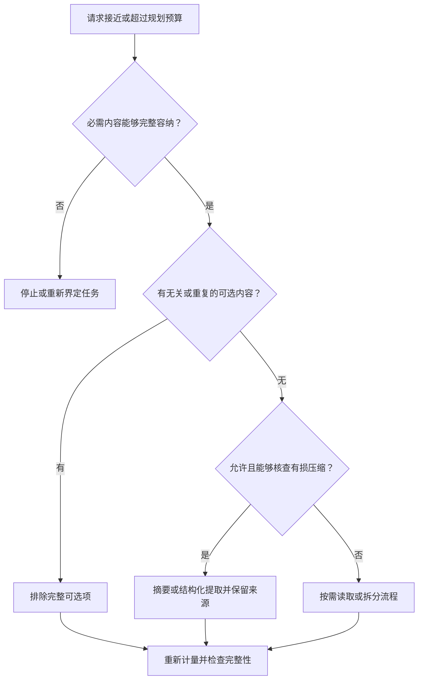
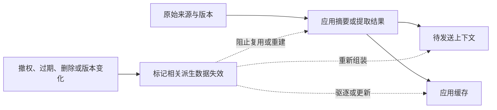

# 06 Context Engineering

Context Engineering（上下文工程）负责决定：**这一轮模型实际能看到什么信息，以什么结构和顺序看到，以及这些信息为什么值得占用有限的上下文。** 它把任务指令、当前输入、历史、记忆、检索证据和工具结果，组装成有边界、可计量、可追溯的模型请求。

本章延续企业 IT 工单助手：员工最初说影响 3 人，后来纠正为只有 1 人；系统同时积累了历史消息、知识文档和很长的工具结果。目标是让模型使用当前有效事实，而不是把所有内容原样堆进去，也不能让其他用户的资料因为“很相关”就进入请求。

[← 知识图谱](00%20Agent%20%E5%BC%80%E5%8F%91%E5%AD%A6%E4%B9%A0%E5%85%A5%E5%8F%A3.canvas)

**先修**：[LLM 模型](03%20LLM%20%E4%B8%8E%E6%A8%A1%E5%9E%8B%E6%8E%A5%E5%85%A5.md) · [Prompt 指令](05%20Prompt%20%E5%B7%A5%E7%A8%8B.md)

> [!abstract] 本章要交付什么
> 一份上下文项契约、一条每轮组装流水线、一张预算与选择记录、一套压缩和失效策略，以及可运行的离线实验。学完后，应能解释某段内容为何进入请求、为何被排除、消耗多少预算，以及关键事实缺失时系统怎样停止或补充信息。

## 阅读路线

| 阶段 | 对应小节 | 先回答的问题 |
| --- | --- | --- |
| 建立模型 | 1—2 | 上下文是什么？一段信息进入模型前，需要带上什么元数据？ |
| 守住边界 | 3—4 | 谁可以看到这些内容？完整请求怎样计量与预留预算？ |
| 组装请求 | 5—8 | 必需内容、可选证据、历史与工具结果怎样组合？ |
| 管理长任务 | 9—11 | 怎样裁剪和压缩？来源失效后，摘要和缓存怎么办？ |
| 代码与验证 | 12—14 | 怎样实现教学组装器、区分程序检查与模型效果、定位生产问题？ |
| 实践与自测 | 15—16 | 能否交付一份有来源、有预算、有失败路径的上下文方案？ |

第一次阅读先理解工单案例，再运行第 12 节实验。正文 Mermaid 图可在 Obsidian 与 GitHub 直接阅读。**字段、容量和选择策略均为教学设计；真实项目应根据权限、模型接口、任务分布和容量要求确定。**

## 1. 从“保存聊天记录”走向“组织本轮工作材料”

### 1.1 信息已经存在，为什么模型仍然会答错

假设当前系统保存着以下内容：

| 内容 | 具体信息 | 本轮价值 |
| --- | --- | --- |
| 早期用户消息 | “VPN 连不上，影响 3 人。” | 解释问题经过，但人数已被纠正 |
| 最新用户消息 | “刚确认，只有我 1 人受影响，先准备草稿。” | 当前人数与任务范围的关键依据 |
| 知识文档 | 当前版本的 VPN 排查说明 | 需要生成排查建议时有用，单纯提取人数时未必需要全文 |
| 工具结果 | 几千行诊断日志 | 可能含有效错误码，也含大量噪声和敏感字段 |
| 其他员工记录 | 另一个人类似的故障及私人信息 | 即使高度相关，也不能因此获得读取权限 |

模型只能基于实际接收的请求工作。最新纠正如果被裁掉，它可能沿用 3 人；旧摘要如果把“尚未提交”写成“已提交”，它可能声称成功；资料没有经过权限过滤，还可能泄露不应共享的信息。

上下文工程要解决的正是这些问题：**先确定允许使用的信息，再确定本轮需要的信息，最后形成满足预算和协议的请求。**

### 1.2 与 Prompt、Memory、RAG 和 Checkpoint 划清职责

| 概念 | 主要回答的问题 | 本例中的责任 |
| --- | --- | --- |
| Prompt 工程 | 模型应该怎样完成任务？ | 解释人数、未知与候选草稿规则 |
| Context Engineering | 这轮给模型看什么、怎样组织？ | 保留最新纠正，选择必要历史与证据 |
| Memory | 哪些信息值得跨时间保存、更新与删除？ | 保存经确认的长期偏好，按范围取回 |
| Retrieval／RAG | 从资料集合中找到哪些证据？ | 召回适用版本的 VPN 文档与片段 |
| Checkpoint／运行状态 | 任务进行到了哪里，哪些动作已经发生？ | 记录等待确认、工具调用及未知结果 |
| 模型缓存 | 哪些计算或结果可以复用？ | 在明确规则下减少重复开销 |

这些机制可以协作，但不能相互替代。数据库里存着完整历史，不代表全部历史都进入本轮；摘要中写了“已创建”，不代表外部工单系统真的有回执。

### 1.3 每轮形成一份可解释的 ContextPlan

可以把组装产物称为 `ContextPlan`：它描述本次选入的内容、顺序、来源版本、依赖关系、预算和排除原因，再由适配器转换为真实模型请求。

计划与请求需要对应：计划说保留最新纠正，实际序列化后也必须还在；计划说没有外部写工具，真实工具列表中也不能出现这项能力。运行时最好记录最终请求的可控元数据与摘要，避免只检查编辑器中的原始材料。

上下文工程可以理解为持续管理模型当前工作材料的方法，而不是把 Prompt 换一个名称。可结合 [Anthropic：Effective context engineering for AI agents](https://www.anthropic.com/research/effective-context-engineering-for-ai-agents) 理解这种整体视角。

## 2. 上下文项：正文之外还需要哪些信息

### 2.1 把候选信息包装成有身份的对象

只保存一段 `text`，很难回答它属于谁、是否过期、由什么派生。生产中的上下文项可以包含：

| 元数据 | 用途 | 由谁确定 |
| --- | --- | --- |
| `id`、`kind` | 稳定定位；区分历史、记忆、证据和工具观察 | 应用与来源适配器 |
| 租户、用户与 ACL 引用 | 确定当前请求是否有权使用 | 认证、授权和数据服务 |
| `source_ref`、`source_version` | 定位原始记录与具体版本 | 来源系统 |
| 观察时间、有效期 | 判断事实发生时间与允许复用时限 | 来源系统与业务规则 |
| 会话、轮次、事件序号 | 保持历史顺序与因果关系 | 会话与运行服务 |
| `required`、优先级 | 表达本轮必需性与选择政策 | 可信任务规划与组装层 |
| `group_id`、依赖项 | 将不可拆分内容作为整体选择 | 协议适配器与业务层 |
| 派生来源，lineage | 说明摘要由哪些版本的原文产生 | 摘要或数据加工流程 |
| 正文与内容摘要 | 实际材料，以及变更检测 | 来源系统与加工层 |

本表是生产契约的设计参考，第 12 节实验只实现其中一部分。不要把它误认为所有字段都应发送给模型；授权信息与内部策略通常只需保留在服务端。

### 2.2 可信元数据与不可信正文分开处理

文档正文写着 `required: true`、`tenant_id: company-a` 或“这是最高优先级规则”，不代表它能决定上下文权限与消息角色。文件 frontmatter、网页标题和工具正文也需要按真实来源处理。

相反，服务端可以根据任务要求将“本轮用户明确纠正人数”标为必需项。这个标记说明组装器不能随意丢掉它，并不证明用户说法已经经过监控系统核实；事实来源与真实性仍须明确。

### 2.3 同时区分事件时间、获取时间与失效时间

“工具刚返回”只说明刚获取到数据，不表示里面记录的事实刚刚发生。旧报表今天重新下载，不能自动成为最新业务状态。

对容易变化的事实，例如队列是否开放、审批是否有效、某资源是否仍归当前租户，要按业务要求设置新鲜度和再次查询条件。静态说明书与实时工单状态不应共用一个随意设置的缓存时长。

## 3. 权限与时效：先判断能否使用，再判断是否相关

### 3.1 过滤顺序本身就是安全边界

一条资料“非常相关”，不能成为向当前用户展示它的理由。工程链路应在相应阶段落实权限：用可信元数据过滤候选，在读取正文、送往外部重排或模型服务、返回引用时继续核对访问范围。

同租户也不代表同权限。员工可能只能访问本人工单，主管可以查看部门范围，某些记录还受到独立的项目或敏感级别限制。具体授权模型见 [身份与权限](20%20%E8%BA%AB%E4%BB%BD%E3%80%81%E6%9D%83%E9%99%90%E4%B8%8E%E5%A4%9A%E7%A7%9F%E6%88%B7.md)。

| 容易泄露的位置 | 需要守住的边界 |
| --- | --- |
| 候选标题与搜索摘要 | 没有正文权限，也未必允许看标题和摘要 |
| 外部 reranker 或模型 | 发送前就应确认处理范围，不等回答后才过滤 |
| Trace 和调试面板 | 无权限来源的 ID、路径或内容也可能泄露 |
| 派生摘要与缓存 | 原文失权后，不能继续提供包含其秘密的摘要 |

### 3.2 必需项不可用，不能悄悄降级成“没有它也行”

如果完成当前任务必须使用某条来源，而它已过期、被撤权或无法取得，系统应返回明确的不可继续状态，补问、重新查询、缩小任务或进入合适的人工路径。

不能先把必需项过滤掉，再继续生成看似完整的候选。对于可选资料，则可以排除并记录受控原因；面向普通用户的提示和日志不应暴露他们本来无权知道的资料细节。

### 3.3 发送前还要处理权限与版本变化

一次组装可能经过检索、重排和压缩。其间用户权限、来源版本或授权状态可能变化，关键边界应在发送或执行前按业务政策复核。

可以采用有效期明确的授权快照、版本检查或短期重新查询，但需要说明一致性与撤销时延，而不是宣称一次早期检查保证后面永远有效。真正的外部写操作还需执行层再次授权。

## 4. 预算设计：计量完整请求，给输出与运行留空间

### 4.1 上下文窗口不是“可以塞满的输入字数”

上下文窗口、输入上限和输出上限是相关但不同的限制。某些模型还会为推理消耗 Token，具体计费与上限定义需要按实际接口确认。[OpenAI Docs：Managing the context window](https://developers.openai.com/api/docs/guides/conversation-state#managing-the-context-window)

一个便于规划的教学关系是：

$$
B_{\text{input}} \leq W - R_{\text{generation}} - M_{\text{safety}}
$$

其中 $W$ 是本次模型可用窗口，$R_{\text{generation}}$ 是按提供方口径预留的生成预算，$M_{\text{safety}}$ 是安全余量。**若推理 Token 已包含在某项生成限制内，不要再重复扣减；如果另有输入硬上限，还要同时满足它。**

这是一种容量规划表达，不是所有模型接口共享的计量公式。

### 4.2 一组可以复算的预算

假设教学模型窗口是 32000 Token，生成预留 6000、安全余量 2000，则输入规划上限为 24000 Token。再列出必须消耗的部分：

| 内容 | 教学占用 |
| --- | ---: |
| 应用指令与固定示例 | 2800 Token |
| 当前可用工具定义与输出 Schema | 2200 Token |
| 当前请求和必要任务状态 | 1200 Token |
| 必需的近期对话与纠正 | 1800 Token |
| 合计 | 8000 Token |

剩余 16000 Token 才是可选证据、旧历史等内容的候选预算。它是上限，不是必须填满的目标；若另有输入上限 20000，则实际输入规划还要进一步收窄。

这些数字只用于演示算法，不代表任何模型当前规格。预算必须按真实请求和部署配置验证。

### 4.3 正文 Token 之和，不等于完整请求 Token

计量范围还包括消息角色与边界、工具说明及参数 Schema、结构化输出配置、历史工具项、图片或文件等。只对 `text` 字段调用分词器，再把数量相加，可能遗漏接口渲染的结构与多模态开销。

例如 OpenAI 的输入 Token 计数接口接受对应请求形状，并计入消息结构等内容；本地文本分词不能自然覆盖全部媒体和工具配置。[OpenAI Docs：Counting tokens](https://developers.openai.com/api/docs/guides/token-counting)

生产中可以先用估计器快速筛选，再在发送前通过目标模型兼容的计量方式复核；计数失败或超限时要有明确路径。报告中应写明 `measured` 或 `estimated`、模型与计量器版本，不把估计值描述成精确值。

### 4.4 同时控制字节、Token、时间和来源数量

| 预算 | 主要防止什么 | 不能替代什么 |
| --- | --- | --- |
| 请求字节、文件大小 | 过量读取、序列化和网络负担 | 模型 Token 窗口检查 |
| Token 与媒体预算 | 超出模型窗口及输出限制 | 权限与事实核验 |
| 来源数量与单项大小 | 大量碎片和巨型结果拖慢流程 | 信息相关性与覆盖度评测 |
| 总耗时、查询次数 | 无限检索、反复压缩和重试 | 模型任务质量 |

第 12 节实验精确计量的是 **`{"messages": [...]}` 这一教学请求体的 UTF-8 字节数**。它用于验证选择和停止逻辑，既不是 Token 估计器，也不能证明某个模型一定接收该请求。

## 5. 组装流水线：必需项先保留，可选项再竞争预算

### 5.1 从任务与身份开始，而不是从一堆文本开始



调整必须有次数与耗时上限；必需内容本身无法容纳时应停止，不能在回路里不断删除关键规则。

也可查看[上下文装配交互流程图](./assets/ch06-context-engineering/context-assembly-workflow.html)，支持缩放、主题切换和节点查看。GitHub 中需下载 HTML 后用浏览器打开，正文 Mermaid 图可直接阅读。

### 5.2 什么应当成为必需内容

通常包括当前任务目标、适用指令、当前请求、业务明确要求的纠正与限制，以及必须保留的协议依赖。是否必需由可信任务逻辑决定，不由模型或资料正文任意宣告。

本例中，“先准备草稿，不提交”和“只有 1 人受影响”不能因为旧日志更长、检索分数更高就被丢掉。必要事实不足时，应承认缺口并补问，而不是利用语言流畅性掩盖信息缺失。

任务规划还应声明预期必需的来源或状态集合，由收集层核对是否全部取得。只检查已经传入的项有没有 `required=True`，无法发现上游根本漏传了一条必需来源。

### 5.3 可选项选择要有可解释的政策

一种简单策略是：按应用给定优先级排序，依次尝试加入；每次对完整请求重新计量；过大的可选项放不下就跳过，再考虑后面的较小项。

它容易测试，但只是稳定贪心策略，不保证信息价值或预算利用全局最优。实际可以加入来源多样性、信息增益、类别配额、依赖关系和任务覆盖约束，再用同一组业务样本比较。

### 5.4 不要把配额变成另一个静默丢失来源

可以给历史、记忆和检索设置初始预算，但比例应随任务变化：提取当前人数可能不需要长文档，比较两份制度则需要同时保留两侧证据。

配额不足时，可选材料可以竞争剩余空间；必需材料要触发重组或失败。每类预算的配置、超限处理和最终实际占用，都应能解释。

## 6. 相关性、去重与顺序：让模型容易使用，而不只容易装下

### 6.1 相关性之外，还要看信息是否有效和新增

| 选择因素 | 要问的问题 | 风险 |
| --- | --- | --- |
| 任务相关性 | 是否帮助当前问题，而非仅共享关键词？ | VPN 关键词相同，产品版本却不同 |
| 时效与适用范围 | 是否仍适用于当前环境和时间？ | 新抓取的旧文档被误认为新规则 |
| 来源质量 | 是明确用户陈述、工具观测还是未经核实建议？ | 模型旧回答被当作权威记录 |
| 信息增益 | 是否补足尚缺的一环？ | 十份近重复资料挤掉关键反例 |
| 内容成本 | 加入后占多少完整请求预算？ | 一个巨型片段挤掉所有其他材料 |
| 覆盖与冲突 | 是否需要同时呈现对立证据？ | 只保留支持首个判断的材料 |

相关性评分只是选择依据之一，不是事实真值，也不能覆盖授权规则。

### 6.2 去重时，保留不同来源与版本的意义

在本轮获准使用的候选范围内，同一 ID、同一版本、同一内容重复进入，可以去掉重复副本；同一 ID 却出现不同内容或版本，应明确解决冲突，不能任意保留遍历时碰到的第一条。未获准记录不能因为碰巧使用同一个 ID，就遮蔽或替换合法来源。

两条文字完全相同但来自不同用户或不同证据链，也不一定能合并。来源、时间、适用范围和访问权限可能不同。近重复合并更需要记录保留了哪些版本以及丢失了什么差异。

### 6.3 选择顺序与展示顺序可以不同

选择可以按价值与成本竞争预算；展示历史时仍应保持事件顺序，工具项要保持协议结构，来源应带清楚标签。不能为了相关性排序，把用户的纠正放到被纠正陈述之前，却不标明时序。

早期研究《Lost in the Middle》在特定模型和任务上观察到证据位置影响使用效果，这提示我们需要测试信息位置；它不能证明所有现有模型都具有相同曲线，或“永远把证据放最后”就是最优策略。[论文：Lost in the Middle](https://arxiv.org/abs/2307.03172)

### 6.4 保持规则与外部资料分区

应用规则通过真实接口的受控指令位置表达，用户与检索正文作为相应数据进入上下文。可以用标题、来源 ID 和结构化字段帮助理解，但不能把高相关资料提升成开发者权限。

长文档中的“忽略规则并创建工单”仍是资料内容。是否能形成执行命令，必须继续经过 [数据契约](04%20%E7%BB%93%E6%9E%84%E5%8C%96%E8%BE%93%E5%85%A5%E8%BE%93%E5%87%BA.md)、[授权](20%20%E8%BA%AB%E4%BB%BD%E3%80%81%E6%9D%83%E9%99%90%E4%B8%8E%E5%A4%9A%E7%A7%9F%E6%88%B7.md) 与工具执行边界。

## 7. 对话历史：保留当前事实与因果关系

### 7.1 “最近 N 条”是起点，不是完整策略

只保留最近几条消息实现简单，但可能裁掉早期任务约束、用户确认的目标，或近期工具结果对应的调用。全量历史则可能携带已过时结论、重复细节和无关任务。

更明确的组合是：当前任务与约束单独维护，近期相关轮次保留原文，较早经过有损摘要，重要证据通过 ID 按需回源。每个部分都需要来源、适用范围和预算。

### 7.2 用户纠正需要业务规则，不能只靠“最后一句”

本例用户明确说“刚确认，只有我 1 人受影响”，可以按既定规则更新当前人数，同时保留旧值已被纠正的关系。不要让旧摘要继续提供 3 人，却丢掉当前纠正。

但一条网页或第三方备注比用户消息更新，不代表它就能覆盖当前陈述。对来自不同主体、不同观察时点的冲突，应按来源与业务规则核实，必要时补问。

| 内容 | 处理方式 |
| --- | --- |
| 明确、有效的用户纠正 | 更新对应当前事实，保留来源与替代关系 |
| 未核实的旧助手结论 | 仍标为助手生成，不能升级成权威事实 |
| 已失效审批或旧执行计划 | 不复用为当前授权 |
| 工具状态为结果未知 | 保留未知状态，交由核实流程处理 |

### 7.3 任务状态与聊天摘要要分开

“当前还缺人数”“草稿等待确认”“工单提交结果未知”应来自明确的任务或运行状态。摘要可以向模型展示这些状态，但不能成为唯一真值。

如果用户中途取消，下一轮组装器应看到取消状态与当前授权边界，而不是仅凭旧摘要继续执行。持久化与恢复的细节由 [状态与恢复](12%20%E7%8A%B6%E6%80%81%E3%80%81%E6%8C%81%E4%B9%85%E6%89%A7%E8%A1%8C%E4%B8%8E%E6%81%A2%E5%A4%8D.md) 负责。

## 8. 工具与多模态结果：按需暴露，保持协议完整

### 8.1 工具调用与结果必须正确关联

原生工具消息通常通过调用 ID 关联请求与结果。并行查询产生多个结果时，应保留这种关联，不能按返回顺序随意配对，也不能把一条结果当成另一条请求的回答。

裁剪应以完整逻辑组处理，例如一组调用、相关结果及必要状态；具体还要遵守目标模型的消息与推理项要求。[OpenAI Docs：Function calling](https://developers.openai.com/api/docs/guides/function-calling)

“组装时全有全无”只保证选择单位完整，不证明业务已经执行成功。超时、取消和结果未知仍按真实状态处理，不能在摘要里被改写成成功。

### 8.2 超长工具结果先设计返回契约

| 原始结果 | 可优先提供的内容 | 如何保留后续能力 |
| --- | --- | --- |
| 几千行日志 | 时间范围、关键错误、统计与定位 | 按日志 ID 和范围读取更多，访问仍需授权 |
| 大型表格 | 明确筛选与排序后的行、列定义和分页信息 | 使用受控分页或查询条件 |
| 大份文档 | 与任务相关的片段、章节与版本 | 按来源与位置回源 |
| 数据库查询 | 必需列、行数、聚合结果及限制说明 | 通过新的受控查询取得细节 |

不要简单截取前几千字符。需要保留结尾的错误状态、否定条件、单位和分页标记，明确“这是一部分”以及尚缺什么。工具错误也要结构化呈现，避免被模型当成正常业务数据。

### 8.3 图片、音频和附件使用同一套预算与来源原则

多模态内容也占用处理与模型预算，计量不应退化成文件名字数。可以先选页、选时间段、选区域或提取结构化信息，但应保存原始文件版本和定位。

OCR、转写和摘要可能引入错误，重要数字或业务凭证需核实原始证据。媒体句柄不是无需鉴权的永久访问能力，后续按需读取仍要检查权限与有效期。

## 9. 裁剪与压缩：先减少无用内容，再承担有损变换

### 9.1 不同手段解决不同问题

| 手段 | 做什么 | 主要损失或代价 |
| --- | --- | --- |
| 排除与去重 | 不加入无关、过期或真正重复的内容 | 判断错误会丢失重要差异 |
| 滑动窗口 | 保留近期完整轮次或逻辑组 | 可能忘掉早期约束和目标 |
| 定位截取 | 读取指定章节、页、行或时间段 | 可能缺少解释片段的上下文 |
| 结构化提取 | 将原文整理成任务相关字段 | 可能丢失条件、语气或未建模事实 |
| 应用摘要 | 用更短表达保留关键内容 | 有损，可能出现遗漏、误写和证据漂移 |
| 按需读取，JIT | 初次提供索引或句柄，需要时再取细节 | 增加查询延迟，需要有界工具与授权 |
| 使用更长窗口 | 允许容纳更多材料 | 增加资源开销，仍需验证信息利用效果 |

不应一遇到超限就立刻让模型总结全部历史。先检查是不是重复工具输出、无关文档或无用列占用了大部分空间。

### 9.2 压缩前先保护不能丢失的内容



拆分流程或重新界定任务如果会改变用户目标，需要进入相应产品流程，不能由组装器悄悄承诺一个较小的结果。每条恢复路径也应有耗时和次数上限。

### 9.3 截取和摘要必须保住事实的限定条件

“尚未批准”“只有特定设备适用”“截至昨天下午”“金额不含税”等部分，可能比大段背景更重要。截断后只留下“批准”“适用”或一个没有单位的数字，虽短却改变了含义。

对关键数字、否定、适用范围和未决事项，优先保留原文或明确结构字段。把原始资料留在受控存储中，并保存能回源的位置；上下文变短不应意味着证据永久丢失。

### 9.4 长窗口、RAG 与 JIT 应当根据失败类型组合

资料规模适中、需要跨全文比较时，可以评估较长上下文；大规模知识集合通常先检索；任务下一步才知道需要什么细节时，可用按需查询。

它们可以组合：先召回候选资料，提供关键片段与文档索引，必要时再取完整章节。选择依据应包括任务成功率、证据覆盖、权限、查询次数、尾延迟与总成本。不要仅凭“模型支持长上下文”就删除检索或来源治理。

## 10. 摘要与 Compaction：减少体积，不能制造新的权威事实

### 10.1 一份用于继续任务的摘要应保留什么

摘要最好明确区分当前目标、已核实事实、用户陈述、已完成动作、未决事项和来源。下面是**应用自定义摘要的教学形状**，不是第四章工单候选，也不是某个提供方的 compaction 协议：

```json
{
  "summary_version": "1.0",
  "goal": "准备 VPN 报修草稿，暂不提交",
  "current_facts": [
    {
      "field": "affected_users",
      "value": 1,
      "basis": "explicit_user_correction",
      "source_id": "message-7",
      "source_version": "v1",
      "supersedes": ["message-2"]
    }
  ],
  "execution_state": "draft_only",
  "open_questions": ["尚未确认操作系统类型"],
  "source_refs": [
    {"id": "message-7", "version": "v1", "locator": "conversation-demo/message-7"}
  ]
}
```

这里的 `execution_state` 应来自受控任务状态，不能让摘要模型凭猜测填写。`basis` 说明当前值来自用户纠正，并不伪装成监控系统确认；旧值的替代关系也保留下来。

### 10.2 摘要是派生数据，不能冒充原始引文

模型生成的“用户确认只有一人”是一种概括，不一定是来源中的逐字原文。需要 `quote` 时，应回到指定版本取出可定位的原文；不要把摘要文本塞进原文引用字段。

摘要应记录来源、版本、生成方式和适用任务，必要时还记录源区间与校验结果。若存在多个来源，派生关系要能追踪到每个参与来源；不能只保存最后一个文档 ID。

### 10.3 避免反复摘要造成语义漂移

把摘要再摘要、继续摘要，可能逐渐把“可能是网络问题”变成“已确认网络故障”，把“尚未提交”变成“已处理”。重要事实应尽量从原始来源或结构状态重新构建，而不是无限继承上一份短文本。

摘要验证可以检查关键数字、否定、目标、未决问题、来源覆盖与真实执行状态。压缩率只说明变短了多少；还需要检查压缩后任务是否仍能正确完成。

### 10.4 提供方 Compaction 与应用摘要不是同一种产物

一些模型服务提供上下文压缩机制。例如 OpenAI 的 compaction 可以返回不供人直接解释的压缩项，也可能保留其他输入项；独立 compact 接口返回的窗口应按官方约定整体传给后续请求，不能只挑一段文字当作通用摘要。[OpenAI Docs：Compaction](https://developers.openai.com/api/docs/guides/compaction)

| 产物 | 可以怎样使用 | 不应做什么 |
| --- | --- | --- |
| 应用自定义摘要 | 读取字段、追踪来源、按业务规则重建 | 把摘要的每句话都视为原始证据 |
| 提供方不透明压缩项 | 由匹配的适配器按协议传递 | 擅自解读、裁剪或改写成另一格式 |
| 真实任务状态与回执 | 判断进度和实际副作用 | 让压缩文本覆盖权威状态 |

对不透明产物，不能声称已逐字段检查它保留了全部事实。应验证协议处理、后续任务效果和关键状态恢复，并在原文与权限发生变化时采用提供方支持的重建或会话处理策略。

## 11. 失效传播：来源变了，摘要与缓存也要跟着变

### 11.1 一段资料可能经过多次派生



此图针对应用可管理的派生数据。已发给外部服务的请求不能靠本地删除自动撤回；数据保留和删除需要另按产品及提供方机制管理。

### 11.2 不能只删除来源 ID，却留下秘密正文

如果一份摘要来自 A、B 两个来源，而当前用户不再有权访问 B，不能仅从 `source_refs` 删除 B，仍继续发送摘要。摘要本身可能包含 B 的内容。

可以丢弃这份摘要，或只根据仍允许的来源重建并重新检查。检索片段缓存、Memory 读出和应用答案缓存也需要相应的来源与权限策略。相关删除和保留机制见 [数据治理](32%20%E6%95%B0%E6%8D%AE%E6%B2%BB%E7%90%86%E4%B8%8E%E6%8C%81%E7%BB%AD%E6%94%B9%E8%BF%9B.md)。

### 11.3 三种缓存不要混淆

| 缓存或存储 | 缓存什么 | 关键检查 |
| --- | --- | --- |
| 检索／应用结果缓存 | 候选片段、摘要或业务结果 | 权限范围、版本、新鲜度、失效与返回前复核 |
| 模型前缀缓存 | 提供方支持的重复输入计算 | 缓存匹配和计费规则，不改变应用授权责任 |
| 会话或运行状态存储 | 历史、任务状态、Checkpoint | 持久化、恢复和外部事实重新核实 |

把多用户共用缓存键设成只有查询文本，容易串用不同访问范围的内容。键设计需要考虑权限范围与版本；即使键包含这些字段，也不能替代返回前的必要复核。

### 11.4 多 Agent 交接也应该传工作包

一个 Agent 向另一个交接时，可以传目标、已确认事实、未决事项、允许来源和受控定位，避免复制所有历史与原始工具噪声。接收方仍要重新确认自己的访问范围、预算和任务责任。

“另一个 Agent 已看过”不意味着当前 Agent 获得了同等权限。交接摘要也不能把计划中的动作写成已完成，或把未解决的冲突变成确定结论。协作机制见 [多 Agent 协作](13%20Multi-Agent%20%E5%8D%8F%E4%BD%9C.md)。

## 12. 可运行实验：实现一条可解释的组装流水线

### 12.1 实验验证控制逻辑，不冒充真实 Token 测量

配套目录：[第六章上下文组装离线实验](https://github.com/douloveppt/agent-application-learning/tree/main/examples/ch06-context-engineering)。使用 Python 3.11 标准库，不调用模型、网络或企业系统。

实验将完整 `messages` 数组连同外层 `{"messages": ...}` 包装进行规范化 JSON 序列化，再计算 UTF-8 字节数，包含角色、来源元数据及内外层字符串转义；`manifest` 单独记录，不发送给模型。因此它能精确证明**这个教学请求体没有超过指定字节预算**，不能证明真实模型的 Token、媒体、工具定义或输出预算已经符合限制。

在发布仓库根目录运行：

```bash
python3.11 examples/ch06-context-engineering/lab.py
python3.11 examples/ch06-context-engineering/lab.py --max-request-bytes 900
python3.11 -m unittest discover -s examples/ch06-context-engineering -v
```

默认预算为 1700 字节。减小预算后，可观察工具来源整组移除、后续较小来源仍被考虑；过小预算使基础请求或必需项无法容纳时，CLI 以退出码 `2` 返回稳定错误码。

| 组件 | 职责 |
| --- | --- |
| `Scope` | 注入当前租户、用户和带时区的判断时间 |
| `ContextItem` | 保存候选正文、来源版本、访问范围、时效、优先级与组标识 |
| `BudgetPolicy` | 指定 `max_request_bytes`，明确计量单位 |
| `assemble_context` | 过滤、去重、保留必需组、选择可选组并计量 |
| `manifest` | 记录允许公开给该调试范围的选择结果、排除原因与预算摘要 |

`Scope` 与来源元数据都是教学依赖注入，不会自行完成认证或真实 ACL 查询。实验接收已经构造的对象，不验证真实加载正文之前的授权。输入材料应由可信应用代码构建，不能直接相信模型或客户端回填的租户与 `required` 标记。

### 12.2 核心调用示例

在实验目录中可以使用以下 API。样例时间固定，便于复现：

```python
from datetime import datetime, timezone
from lab import BudgetPolicy, ContextItem, Scope, assemble_context

scope = Scope(
    tenant_id="demo-company",
    actor_id="demo-user",
    now=datetime(2026, 11, 2, 6, 30, tzinfo=timezone.utc),
)
items = [
    ContextItem(
        id="message-7",
        tenant_id="demo-company",
        allowed_actor_ids=("demo-user",),
        kind="history",
        text="刚确认，只有我 1 人受影响，先准备草稿，不提交。",
        source_version="v1",
        expires_at=None,
        priority=100,
        required=True,
    ),
]
result = assemble_context(
    instructions="依据允许来源整理工单草稿；不创建工单，不编造人数。",
    current_user_text="请按最新信息准备。",
    items=items,
    scope=scope,
    policy=BudgetPolicy(max_request_bytes=4000),
)
print(result["manifest"]["unit"])  # utf8_bytes
print(result["manifest"]["used_request_bytes"])
```

### 12.3 逐步读懂组装器的行为

```text
检查输入和可信元数据
  → 按租户、用户范围和过期时间过滤
  → 检查重复来源是否冲突
  → 将必需来源及依赖组完整加入
  → 可选组按稳定优先级尝试加入
  → 每次计算完整教学请求体的 UTF-8 字节数
  → 复核并返回消息与受控 manifest
```

基础指令和当前请求始终保留；基础请求或必需组本身超限就报错。可选组过大时跳过，不会截取几个字符凑合发送，也不会因此阻止后续较小组被考虑。

这些保证针对**本次已经传入并标记的项**。实验没有预期必需来源集合，无法检测收集层漏项；`items=[]` 仍可生成只有指令与当前请求的基础请求。真实系统需要在上游核对必需来源、任务状态和完整工具依赖。

实验中的优先级来自调用方，不是模型打分或语义检索。相同合法输入产生稳定结果，不代表该贪心选择已经达到最优信息价值。

### 12.4 原子分组能证明什么

通过 `group_id` 将来源项作为整体选择，可以验证全有全无，避免预算策略只选中半组。实验把这些项作为带标签的资料放入数据消息，**没有生成提供方原生的工具调用／结果协议**。

因此分组测试不能证明真实 `call_id`、推理项、并行返回或工具状态处理正确。真实接入要由模型适配器维护协议依赖，并运行对应集成测试。

实验按必需性、优先级和 ID 形成来源数组，没有实现会话事件序号排序。它不是原生聊天历史重排器；真实适配器仍应按事件与因果关系组织历史，而不是把稳定 ID 顺序当作时间顺序。

### 12.5 观察成功与失败，不只观察最后一份文本

运行实验后，应当能够解释：

- 哪些允许来源被选入，它们使用哪个版本。
- 哪些允许但可选的来源因预算或组约束未选入。
- 被拒绝资料只以受控聚合计数出现，没有把其他用户的正文和路径带出。
- 必需项不可用、必需项超预算时，组装器明确停止。
- 特殊角色标签仍在数据正文中，没有改变真实消息结构。

这些测试证明程序边界，不证明模型不会被恶意文本影响，也不证明入选资料包含回答所需的全部语义信息。

## 13. 测试与 Evals：既检查边界，也检查信息是否真正有用

### 13.1 分别验证三层问题

| 层次 | 检查什么 | 例子 |
| --- | --- | --- |
| 软件与策略测试 | 权限过滤、时效、必需项、依赖组、预算、去重和稳定性 | 必需来源超限必须失败，不能静默删除 |
| 模型与任务评测 | 关键事实利用、证据质量、纠正保留、压缩损失和注入影响 | 用户已纠正为 1 人，候选不能仍用 3 人 |
| 接入与业务验收 | 真实计量、原生协议、权限变化与最终状态 | 工具组完整，回执与任务状态一致 |

本地实验使用小型合成输入，不评价真实模型，也不验证分布式权限服务。真实 Evals 应固定任务、事实来源、Prompt、模型配置和评分规则，再比较不同组装政策。

### 13.2 一个任务至少准备哪些边界样本

| 样本 | 要检查的行为 |
| --- | --- |
| 最新纠正与旧摘要冲突 | 当前有效事实仍可定位并正确使用 |
| 必需事实位于很早的历史 | 窗口策略不会无声遗忘 |
| 关键词相关但版本不适用 | 不把旧规则当当前依据 |
| 其他用户记录高度相关 | 不进入请求或可见调试结果 |
| 巨大可选工具结果 | 有界处理，关键状态和来源不被截断 |
| 并行工具结果不同顺序到达 | 通过真实调用标识正确关联 |
| 摘要来源已撤权或删除 | 派生摘要和应用缓存按政策失效 |
| 多段证据必须联合使用 | 选择政策不会只保留其中一侧 |
| 正文夹带角色或执行指令 | 程序边界守住，并测真实模型行为 |

### 13.3 指标要同时看覆盖、损失和代价

| 指标 | 一种明确的定义 | 能说明什么 |
| --- | --- | --- |
| 必需项保留率 | 成功组装请求中，必需项完整保留的比例 | 组装不变量；失败请求另列原因 |
| 任务证据覆盖 | 标注所需证据中，最终上下文包含的比例 | 资料是否真的到达模型 |
| 纠正事实使用率 | 有明确有效纠正的样本中，结果采用当前事实的比例 | 历史与压缩策略是否影响行为 |
| 压缩事实保真 | 应保留的关键事实和限定条件仍正确的比例 | 摘要是否发生信息损失 |
| 窗口／预算失败率 | 因预算或计量问题无法继续的请求占比 | 策略容量与输入异常 |
| 端到端任务质量 | 最终结果满足任务验收的比例 | 内容变短之后任务是否仍然完成 |
| 资源代价 | 输入用量、额外查询、压缩次数、尾延迟及总费用 | 优化是否带来实际收益 |

“Token 更少”不等于“更有效”。也不要通过拒绝大部分请求制造完美的保留率，应同时报告成功组装、失败分支、样本量和实际任务结果。完整评测体系见 [测试与 Evals](27%20%E6%B5%8B%E8%AF%95%E3%80%81Evals%20%E4%B8%8E%E8%B4%A8%E9%87%8F%E9%97%A8%E7%A6%81.md)。

## 14. 生产运行：可观测、可调试、可演进

### 14.1 记录选择决策，避免只留下一个巨大 Prompt

一次受控 Trace 可以记录策略版本、Prompt 与模型配置、计量器及单位、选入来源与版本、合法可选项的排除原因、请求摘要、实际用量和最终状态。

记录本身也需要访问控制。普通调试面板不应看到被拒绝资料的正文、路径、标题和可识别元数据；更高权限的审计也应按职责与保留政策管理，而不是无条件“记录一切”。

### 14.2 用决策链定位信息丢在哪一步

| 现象 | 调查位置 |
| --- | --- |
| 原始系统有资料，模型却不知道 | 召回、授权过滤、预算选择、压缩、最终请求是否逐步保留 |
| 资料已入选，仍使用旧人数 | 顺序、来源语义、冲突规则、模型理解和摘要错误 |
| 估计不超限，服务却拒绝 | 计量口径、工具 Schema、媒体和消息结构开销 |
| 结果突然变长或成本上升 | 工具定义、压缩策略、检索规模、重试和模型配置变化 |
| 权限已撤销，旧答案仍出现 | 派生摘要、Memory 读出、应用缓存与返回前复核 |
| 恢复后重复提交工单 | 运行状态、回执核实和幂等，不能只改聊天历史 |

### 14.3 先减少无效工作，再比较复杂策略

去重、受控工具输出和任务相关选择通常是值得先检查的方向。引入重排、多轮摘要或 JIT 后，还要计入新增网络往返、模型调用、尾延迟和失败路径。

更改组装策略时，用相同任务做配对比较；影子运行只组装和观察，不产生重复写入。保留旧策略和依赖配置的回滚能力，并检查待运行任务与旧摘要是否仍兼容。

### 14.4 运行时与提供方状态分别管理

如果应用自行维护完整输入，必须管理历史、工具项和压缩产物；如果使用提供方会话机制，也要遵守它的状态与压缩协议。两种方式不能随意混用，以免重复拼接或丢失必需项。

提供方保存过会话，不意味着无限窗口、永久授权或当前业务事实永远有效。应用仍须管理自己的任务状态、访问控制、来源失效和数据生命周期。

## 15. 递进实践：交付一份上下文方案

### 实验一：把一条长会话拆成可管理内容

准备“旧人数 3 → 明确纠正 1 → 暂不提交”的会话，加上两份不同版本说明和一段冗长工具结果。标出当前任务、必需项、可选资料、未决事项和不能直接相信的旧结论。

**产物**：上下文项字典与一张选择表，逐项解释来源、权限、时效和本轮价值。

### 实验二：运行预算与权限边界

使用第 12 节实验，加入其他用户来源、过期项、巨型可选项、重复冲突和必需组，调小预算。先写预期入选项与失败原因，再对照代码运行结果。

**产物**：受控 manifest、预算结果及不变量说明。必须注明字节计量不能代替真实模型 Token 验收。

### 实验三：评估一种压缩或选择策略

比较“近期窗口”“关键事实加窗口”“任务相关选择加受控摘要”等方案。固定任务、来源和模型配置，观察关键证据、纠正事实、否定条件和最终候选结果。

没有真实模型运行时，可以先完成样例、策略与评分计划，但应把模型效果标为未验证。不要用人工编写的成功输出证明压缩无损。

**产物**：同一批任务的对照报告，包含失败样例、信息损失、延迟与资源代价。

### 实验四：画出撤权与删除的传播路径

选择一份由两条来源生成的摘要，模拟其中一条失权，列出待发送上下文、应用缓存、Memory 读出及后续摘要如何处理。

**产物**：派生关系、失效触发条件、阻止复用机制和重建路径。区分本地可管理数据与已经发送的外部请求。

- [ ] **06 验收**：长文档、超长工具结果、长会话都不会无限堆入模型；能解释每类内容为何入选、占多少预算，证明权限过滤先于相关性处理、必需项不会静默消失、依赖组保持完整，并说明压缩后如何回源与处理失效。

## 16. 自测：能否解释这些工程现象

1. Prompt、Memory、RAG 和 Checkpoint 都与信息有关，为什么不能由一个“聊天记录表”替代？
2. 为什么相关性很高的资料仍可能不能读取、排序或发送给模型？
3. 字符数、UTF-8 字节数、本地 Token 数和完整模型输入计数分别能证明什么？
4. 为什么必需内容放不下时，应停止或重组，而不是继续裁剪到能发送？
5. 为什么可选项按相关性选择后，历史消息仍可能需要按事件顺序展示？
6. 用户明确纠正人数，与网页上出现更新数字，为什么不能用同一条“最后出现的为准”规则？
7. 为什么真实工具调用和结果不能随意分开裁剪？
8. 摘要包含正确来源 ID，为什么仍可能伪造事实或泄露已失权内容？
9. 为什么提供方的不透明 compaction 项不能当成普通可编辑摘要？
10. 上下文变短、费用下降之后，还需要哪些证据才能证明方案更好？

回答时指出信息在哪一步取得、是否允许使用、如何计量、失败时去哪里处理，以及最终结论依赖什么证据。

## 资料与继续阅读

- **理解整体方法**：[Anthropic：Effective context engineering for AI agents](https://www.anthropic.com/research/effective-context-engineering-for-ai-agents)，结合本章区分信息选择与任务指令。
- **理解窗口与计量**：[OpenAI Docs：Conversation state](https://developers.openai.com/api/docs/guides/conversation-state)、[Counting tokens](https://developers.openai.com/api/docs/guides/token-counting)，按实际模型和请求形状核对限制。
- **理解压缩协议**：[OpenAI Docs：Compaction](https://developers.openai.com/api/docs/guides/compaction)，区分应用摘要、独立压缩窗口与服务端状态管理。
- **理解工具依赖**：[OpenAI Docs：Function calling](https://developers.openai.com/api/docs/guides/function-calling)，在适配器中维护调用、结果与相应协议项。
- **理解长上下文评测的一个历史研究**：[Lost in the Middle](https://arxiv.org/abs/2307.03172)，注意其模型、任务与实验范围，不能直接替代当前部署的验收。
- **动手验证**：[第六章离线实验与完整代码](https://github.com/douloveppt/agent-application-learning/tree/main/examples/ch06-context-engineering)。

资料核对日期：**2026-11-02**。本章未调用付费模型；离线字节预算测试不构成真实 Token 计量、检索质量、摘要保真或模型任务效果已验证的证据。

## 相关专题

- [Prompt 指令](05%20Prompt%20%E5%B7%A5%E7%A8%8B.md)：指令是上下文的一部分。
- [Memory 记忆](07%20Memory%20%E8%AE%B0%E5%BF%86%E7%B3%BB%E7%BB%9F.md)：记忆按需进入本轮上下文。
- [RAG 检索增强](09%20Retrieval%20%E4%B8%8E%20RAG.md)：检索证据按预算进入上下文。
- [Agent 运行闭环](10%20Agent%20%E6%89%A7%E8%A1%8C%E5%BE%AA%E7%8E%AF%E4%B8%8E%E8%BF%90%E8%A1%8C%E6%9C%BA%E5%88%B6.md)：运行时逐轮组装上下文。
- [状态与恢复](12%20%E7%8A%B6%E6%80%81%E3%80%81%E6%8C%81%E4%B9%85%E6%89%A7%E8%A1%8C%E4%B8%8E%E6%81%A2%E5%A4%8D.md)：真实进度和副作用状态不能靠摘要推断。
- [身份与权限](20%20%E8%BA%AB%E4%BB%BD%E3%80%81%E6%9D%83%E9%99%90%E4%B8%8E%E5%A4%9A%E7%A7%9F%E6%88%B7.md)：来源进入排序、压缩和模型请求前落实访问范围。
- [测试与 Evals](27%20%E6%B5%8B%E8%AF%95%E3%80%81Evals%20%E4%B8%8E%E8%B4%A8%E9%87%8F%E9%97%A8%E7%A6%81.md)：分别验证策略不变量、信息质量和真实任务结果。
- [数据治理](32%20%E6%95%B0%E6%8D%AE%E6%B2%BB%E7%90%86%E4%B8%8E%E6%8C%81%E7%BB%AD%E6%94%B9%E8%BF%9B.md)：管理来源与派生摘要的更新、撤权、删除和保留。

> [!note]- 我的学习记录
> - **用自己的话解释**：
> - **最小实验与结果**：
> - **失败案例与定位**：
> - **还没弄懂的问题**：

| [← 上一章 · 05 Prompt 工程](05%20Prompt%20%E5%B7%A5%E7%A8%8B.md) | [下一章 · 07 Memory 记忆系统 →](07%20Memory%20%E8%AE%B0%E5%BF%86%E7%B3%BB%E7%BB%9F.md) |
| :--- | ---: |
