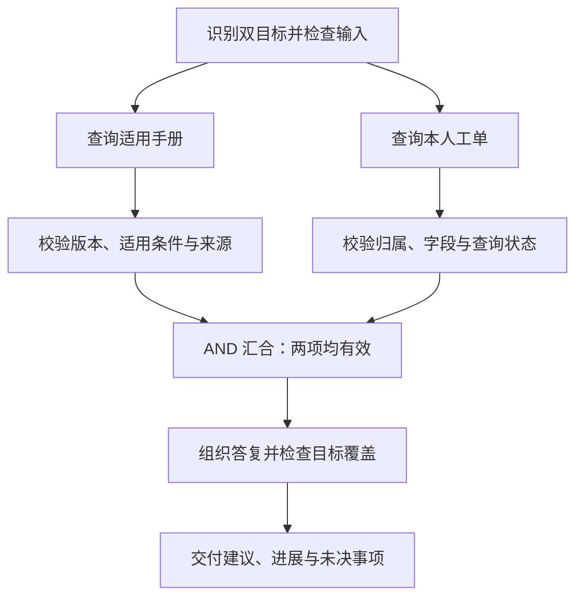
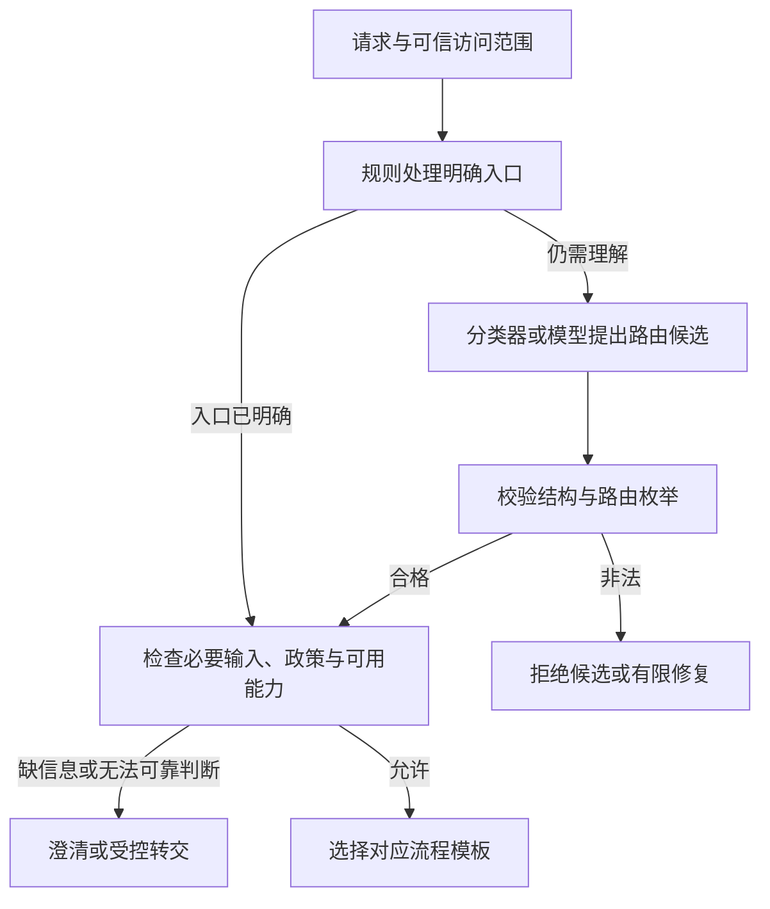
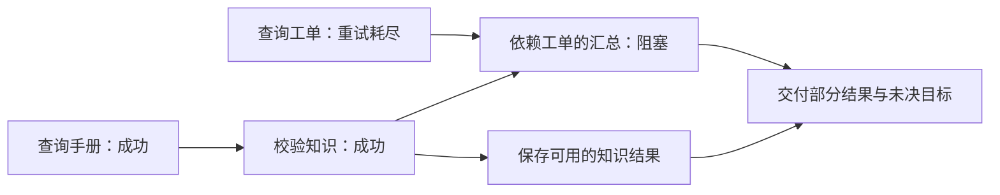
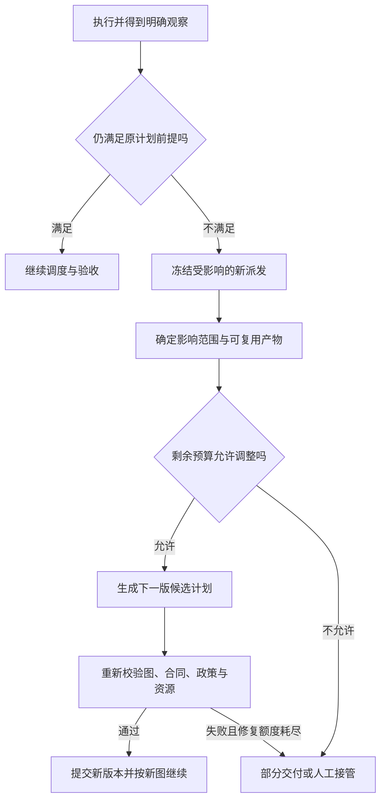

# 11 规划、路由与 Workflow

上一章解决了“模型提出一个动作后，程序怎样受控执行”。当任务需要多步合作时，还要回答：**请求应该进入哪条业务路径，任务怎样拆分，哪些步骤能同时做，失败会影响谁，什么时候必须重新计划？** 这就是规划、路由与 Workflow 的职责。

本章继续使用企业 IT 助手。员工说：“Windows 上 VPN 5.2 报 E104，我已经试过校时，还是连不上。请查一下当前手册，也帮我看看工单 IT-1042 处理到哪了，告诉我下一步怎么办。”我们先把这个只读任务做成可解释的流程，再加入条件分支、故障、重规划，以及涉及审批和写入时必须守住的边界。

[← 知识图谱](00%20Agent%20%E5%BC%80%E5%8F%91%E5%AD%A6%E4%B9%A0%E5%85%A5%E5%8F%A3.canvas)

**先修**：[结构化输入输出](04%20%E7%BB%93%E6%9E%84%E5%8C%96%E8%BE%93%E5%85%A5%E8%BE%93%E5%87%BA.md) · [Retrieval 与 RAG](09%20Retrieval%20%E4%B8%8E%20RAG.md) · [Agent 运行闭环](10%20Agent%20%E6%89%A7%E8%A1%8C%E5%BE%AA%E7%8E%AF%E4%B8%8E%E8%BF%90%E8%A1%8C%E6%9C%BA%E5%88%B6.md)。本章讲“流程怎样设计与推进”；跨重启保存进度和恢复见 [下一章](12%20%E7%8A%B6%E6%80%81%E3%80%81%E6%8C%81%E4%B9%85%E6%89%A7%E8%A1%8C%E4%B8%8E%E6%81%A2%E5%A4%8D.md)，外部写入一致性见 [可靠性与副作用一致性](26%20%E5%8F%AF%E9%9D%A0%E6%80%A7%E4%B8%8E%E5%89%AF%E4%BD%9C%E7%94%A8%E4%B8%80%E8%87%B4%E6%80%A7.md)。

> [!abstract] 本章要交付什么
> 一份任务合同、一套路由准入规则、一张带输入输出契约的任务图、一套汇合与失败处理政策、一份有限重规划方案，以及可运行的离线实验。验收重点是：**任何一步为什么执行、为什么等待、为什么失败、为什么还能继续，都能从明确的条件和证据中解释。**

## 阅读路线

| 阶段 | 小节 | 要解决的问题 |
| --- | --- | --- |
| 建立直觉 | 1—3 | 路由、规划、Workflow 与 Loop 有什么区别？什么时候值得增加复杂度？ |
| 形成执行合同 | 4—7 | 怎样描述目标、决定路线、拆分步骤，并在执行前检查计划？ |
| 正确推进任务 | 8—11 | 怎样判断就绪、并行与汇合？失败后哪些步骤应该停止？ |
| 应对动态变化 | 12—14 | 怎样局部重规划、复用结果、安排审批与控制整体预算？ |
| 做成工程交付 | 15—18 | 怎样组织代码、观测和评测？实验能证明什么？上线还缺什么？ |

正文用 Mermaid 小图解释局部机制；[可交互的编排总览图](./assets/ch11-workflow/workflow-orchestration.html)便于查看主链路与节点职责。GitHub 阅读时可下载 HTML 后用浏览器打开。**本章业务、字段、状态与参数均为教学设计；示例代码和设计方案的实现范围会分别说明。**

## 1. 先分清四件事：去哪、拆什么、怎样走、下一步做什么

### 1.1 路由、规划和流程各有职责

| 概念 | 回答的问题 | IT 助手中的例子 | 主要产物 |
| --- | --- | --- | --- |
| Routing：路由 | 这个请求该进入哪条处理路径？ | 知识咨询、查工单，还是两者都需要？ | 路由决定、缺失信息、决定依据 |
| Planning：规划 | 为完成目标，需要哪些步骤和依赖？ | 查适用手册、查本人工单，再合并说明 | 结构化计划与验收条件 |
| Workflow：工作流 | 各节点在什么条件下启动、等待或结束？ | 两个查询完成并通过校验后才能汇总 | 显式流程、分支与转移规则 |
| Agent Loop：执行闭环 | 根据最新观察，下一步还要尝试什么？ | 手册版本不符时调整检索问题 | 动作、观察、状态与终止判断 |

路由结果可以决定选用哪个预设 Workflow；Workflow 中的一个检索节点可以运行受限的 Agent Loop；模型也可以先生成候选计划，再由程序校验和执行。它们是可以组合的职责，不必互相替代。

### 1.2 Workflow 可以调用模型，Agent 也需要固定规则

“用了 LLM”不意味着整个流程都应由模型自由决定。例如，“提取问题字段 → 查资料 → 生成答复”可以是固定流程，每个节点内部仍然调用模型。

反过来，一个动态检索 Agent 也应受制于工具范围、调用预算、权限与完成条件。关键区别在于：**关键路径由程序事先规定，还是由模型依据观察动态选择。** [Anthropic 对 Workflow 与 Agent 的模式说明](https://www.anthropic.com/research/building-effective-agents)采用了这种区分；该文章适合帮助理解架构模式，具体框架能力仍需核对实际版本。

### 1.3 先区分“业务流程”与“任务计划”

业务流程包含稳定规则：“提交前必须完成授权与字段校验。”任务计划描述本次工作的安排：“先补充错误描述，再查询这两份材料。”

计划可以变化，业务约束不会因为换了计划就失效。模型发现新材料后，可以增加一次只读检索；它不能把“先审批再提交”改成“先提交再补审批”。企业应用需要让稳定约束进入代码、政策或业务接口，而动态判断在这些边界内进行。

## 2. 用一个完整任务建立直觉

### 2.1 把员工的话转换成可核验目标

这个请求有两个必需目标：取得当前适用的手册依据，查询本人工单的进展。最后说明要同时包含建议、依据、工单状态以及尚未确认的内容。

可信身份由服务端认证获得；Windows、VPN 版本与工单号是用户提供并经应用校验的任务输入，不能因此被当成经过设备证明的事实。工单接口仍需在查询时检查所属租户与归属关系。



这张图表示数据与控制依赖，不承诺实际同时执行。只有执行器、资源与外部接口允许时，两个查询才会并发；离线实验会串行模拟同一批就绪节点。

### 2.2 为什么两个查询可以独立推进

知识查询需要系统、版本和报错；工单查询需要工单号和可信访问范围。它们没有互相使用结果，也不修改同一业务对象，因此本例可以考虑并行。

最终答复却依赖两类结果。如果工单接口超时，已有手册仍然有价值，但不能宣称“完整查询已经完成”，更不能写成“未发现工单”。这时应交付部分结果，并明确“工单进展暂时未能确认”。

### 2.3 从三个层面看成功

| 层面 | 判断什么 | 反例 |
| --- | --- | --- |
| 节点执行 | 查询是否得到明确、可解释的结果？ | HTTP 成功但响应格式损坏，节点仍不合格 |
| 流程交付 | 本次要求的内容是否都有合格证据？ | 只查到手册，缺少工单状态，只能算部分交付 |
| 业务目标 | 员工的 VPN 问题是否真正解决？ | 已返回排查建议，不等于网络已经恢复 |

节点全绿、流程走到 END、模型生成一段通顺答案，都不能独自证明第三层成功。完成判定要对应本次约定的交付范围。

## 3. 从简单流程开始，再增加动态能力

### 3.1 六类常见组合模式

| 模式 | 适合什么任务 | 主要工程控制 | 本例中的用法 |
| --- | --- | --- | --- |
| 串行链：Chaining | 步骤稳定，后一步使用前一步产物 | 中间结果校验、失败停止 | 提取字段 → 校验字段 → 生成工单草稿 |
| 路由：Routing | 不同请求适合不同处理路径 | 枚举、拒识、澄清、多意图覆盖 | 知识咨询与工单查询分流 |
| 并行与汇合：Fan-out / Fan-in | 子任务可独立处理 | 并发上限、汇合条件、结果合并 | 同时查手册和工单 |
| 动态分工：Orchestrator-workers | 子任务集合难以事先确定 | 分解规模、子任务合同、整体验收 | 根据故障涉及的产品动态安排调查 |
| 生成—评估—修订 | 有明确标准，反馈能改善产物 | 独立标准、修订上限、保留最佳合格版本 | 检查草稿是否覆盖必填信息 |
| 观察驱动的 Loop | 下一步随中间发现变化 | 动作准入、预算、无进展停止 | 发现手册版本不符后调整查询 |

这些模式可以嵌套。[LangGraph 的 Workflows and agents 文档](https://docs.langchain.com/oss/python/langgraph/workflows-agents)给出了链式、路由、并行和动态分工等例子。是否采用某种模式，应看它能否改善真实任务效果与成本。

### 3.2 ReAct 与 Plan-and-Execute 的取舍

ReAct 强调行动与外部观察交替推进，适合需要边查边决定的任务；Plan-and-Execute 先形成计划，再按计划执行，必要时修改后续计划，适合步骤和依赖值得提前检查的任务。前者不要求展示完整内部推理，后者也不要求把一开始的计划当成永不变化的承诺。

| 方案 | 优点 | 常见问题 | 可增加的控制 |
| --- | --- | --- | --- |
| 每观察一步再决策 | 能及时适应新事实 | 调用轮数增多、局部绕圈、忽略原目标 | 保留目标清单、进度度量与硬预算 |
| 一次生成完整计划 | 便于检查依赖与预估资源 | 输入假设错误会使后续计划失效 | 执行前校验、阶段验收、局部重规划 |
| 固定骨架加动态节点 | 稳定规则清楚，局部仍有灵活性 | 需明确内外层责任与预算 | 子流程合同、统一停止与交付条件 |

关于原始模式，可参阅 [ReAct 研究项目](https://react-lm.github.io/)和 [LangChain 的 Planning agents 架构说明](https://www.langchain.com/blog/planning-agents)。这些材料不能替代本项目的效果与性能评测。

### 3.3 一个适合逐步交付的选择顺序

先尝试固定只读流程，再确认是否需要路由与并行；当固定流程确实无法覆盖任务变化时，再加入局部规划或受限 Loop。新增复杂度应对应一个观察到的问题，例如漏掉多意图、重复查询、分支等待过长或发现新事实后无法调整。

如果固定流程已经能高质量完成任务，动态生成 DAG 可能只增加计划错误、调试成本和模型调用。复杂度需要用收益证明。

## 4. 先定义任务合同，再让模型规划

### 4.1 输入不只有用户的一句话

规划器至少需要知道：用户要求什么、哪些信息已确认、可以使用什么能力、不能做什么、什么证据才算完成，以及整体还有多少资源。

```yaml
# 教学用合同；字段由应用验证和装配，不直接采用模型自报的权限
request_revision: 1
goals:
  - id: current_guidance
    required: true
    acceptance: 具有适用于当前系统与VPN版本的可访问证据
  - id: ticket_progress
    required: true
    acceptance: 查询本人工单并报告明确的观察状态
confirmed_inputs:
  os: Windows
  vpn_version: "5.2"
  error_code: E104
  ticket_id: IT-1042
allowed_capabilities:
  - search_current_manual
  - get_my_ticket
  - compose_answer
constraints:
  read_only: true
  no_device_changes: true
  no_ticket_creation: true
limits:
  max_plan_nodes: 8
  max_plan_revisions: 2
```

这些数值只用于说明字段与控制点。真实的时间、调用、费用与修复额度应通过任务分布、供应商限制和服务目标确定。

### 4.2 必需目标与可选增强要提前分开

“查询工单进展”在本次请求中是必需项；补充“相关常见问题”可以是可选增强。必需结果缺失时，不能因为可选内容写得很多就判为完成。

可选节点失败是否允许降级，要在产品合同中明确。不能等失败发生后，临时把原来的必需项改成可选项以获得成功状态。

### 4.3 任务修改需要新输入版本

用户后来纠正：“其实是 macOS，版本也是 6.0。”这会改变知识查询条件。应用应形成新的 `request_revision`，记录旧输入为何失效，再决定哪些结果需要重做。

如果新消息只是“请回答简洁一些”，知识与工单结果通常可以继续使用，答复生成节点需要重新组织。任务修改对依赖的影响应能明确计算，而不是一律重跑或一律复用。

## 5. 路由：把不确定的理解变成受控的执行决定

### 5.1 不同层次的路由不要混在一个标签里

| 路由层次 | 选择什么 | 例子 | 必须保留的限制 |
| --- | --- | --- | --- |
| 意图／业务路由 | 进入哪条业务路径 | 知识、工单、组合查询、澄清 | 完整保留用户目标，不扩张权限 |
| 能力／工具路由 | 使用什么能力 | 搜索手册还是查业务 API | 参数与资源都在允许范围 |
| 模型路由 | 哪个模型适合这个节点 | 小模型提取字段，强模型处理复杂归纳 | 数据范围、能力、延迟与预算约束 |
| 执行实例路由 | 哪个 Worker 或区域承载 | 发到对应租户允许使用的执行池 | 隔离、容量、区域与任务所有权 |

本章主要讲前两层。模型价格与性能选择见 [性能、成本与模型路由](29%20%E6%80%A7%E8%83%BD%E3%80%81%E6%88%90%E6%9C%AC%E4%B8%8E%E6%A8%A1%E5%9E%8B%E8%B7%AF%E7%94%B1.md)，Worker 调度见 [后端、调度与存储](25%20%E5%90%8E%E7%AB%AF%E3%80%81%E8%B0%83%E5%BA%A6%E4%B8%8E%E5%AD%98%E5%82%A8.md)。

### 5.2 模型输出是候选，程序形成最终决定

可以让模型提议一个有限结构：

```json
{
  "route": "combined",
  "confidence": 0.87,
  "rationale": "请求同时包含当前手册与已有工单进展"
}
```

这里的 `confidence` 是模型自报分数，**不是已经校准的正确概率**。`rationale` 是简短的可审查说明，不能用它授予权限，也不需要保存完整内部推理。

应用收到候选后，依次检查：结构与精确字段、有限路由枚举、输入是否足够、业务政策、当前能力与资源是否可用。候选不合法时应拒绝；候选可以解释但信息不足时进入澄清。两者不要都写成“路由成功”。

### 5.3 一条完整的路由准入链



显式按钮“查看我的工单”通常可以直接进入规则路由；开放文本再考虑分类器或模型。规则路由同样需要校验参数、权限与目标，不能因为绕过模型就绕过准入。

### 5.4 多意图、拒识与澄清怎么处理

| 输入情况 | 处理方式 | 不应出现的行为 |
| --- | --- | --- |
| “VPN 怎么配置？” | 知识路径；缺少系统或版本时按必要性补问 | 把猜测的系统当已确认事实 |
| “查 IT-1042 的进度” | 工单路径，执行时核对访问范围 | 仅凭工单号就允许访问 |
| “查手册，也查我的工单” | 组合路径，保留两个目标 | 单标签分类吞掉其中一个目标 |
| “帮我弄一下那个” | 澄清具体目标与对象 | 默认进入能力最大的一条路径 |
| “帮我重置所有人的 VPN” | 根据产品范围拒绝或转交 | 改写成普通咨询后偷偷执行高风险动作 |

拒识表示不能可靠确定已支持的路径；澄清表示可以通过补充信息继续。多意图可以使用组合模板，也可以拆成受控的多个目标，但需要限制数量并处理相互矛盾的请求。

### 5.5 路由评测不能只看总体准确率

分别检查每类请求的误分、漏分、多意图覆盖和未知意图误接收；再观察澄清比例、澄清后的完成率与每条路线的成本。对写入、高权限和跨域任务，要单独检查误放行。

低分走澄清可以是保守策略；高分也必须经过程序约束。如果要依据分数分流，应使用标注样本检查分数与真实正确率的关系，并评估不同阈值下的错误与成本，不能照搬示例阈值。

## 6. 规划：把自然语言待办变成可执行合同

### 6.1 按“可独立验收的产物”拆分

“分析问题 → 深入思考 → 给出方案”难以执行和验收。更好的节点是：“返回适用于 Windows / VPN 5.2 / E104 的当前手册证据”“返回本人工单的状态与更新时间”。

一个节点应有清楚的输入、结果和失败边界。如果要为一个节点设置很多独立重试、审批或补偿规则，往往应考虑拆开。反过来，单纯格式化一个字段也没必要再增加一次模型调用。

### 6.2 一个节点至少描述什么

| 字段 | 用途 | 示例 |
| --- | --- | --- |
| `step_id` | 稳定标识逻辑步骤 | `read_ticket` |
| `capability` | 从允许的能力中选择执行器 | `get_my_ticket` |
| `inputs` | 绑定已验证输入或上游输出 | `request.ticket_id` |
| `depends_on` | 明确前置依赖 | `compose` 等待两个读节点 |
| 输出契约 | 定义成功产物的结构与约束 | 结构化状态、更新时间、资源引用 |
| 验收规则 | 判断产物是否可供下游使用 | 所属范围正确，查询状态明确 |
| 资源与失败政策 | 超时、尝试次数和失败处理 | 只读超时可有限重试 |
| 作用类型 | 区分纯计算、读取与外部写入 | `read` |

输出 Schema、作用类型与允许的失败政策可以由服务端能力注册表固定，模型只选择受限标识。模型不应提交任意 Python、SQL、URL 或函数名，再让执行器直接运行。

### 6.3 一份小而完整的候选计划

```json
{
  "plan_revision": 1,
  "request_revision": 1,
  "steps": [
    {
      "step_id": "read_manual",
      "capability": "search_current_manual",
      "depends_on": [],
      "inputs": {
        "os": {"request": "os"},
        "version": {"request": "vpn_version"},
        "error": {"request": "error_code"}
      }
    },
    {
      "step_id": "read_ticket",
      "capability": "get_my_ticket",
      "depends_on": [],
      "inputs": {"ticket_id": {"request": "ticket_id"}}
    },
    {
      "step_id": "compose",
      "capability": "compose_answer",
      "depends_on": ["read_manual", "read_ticket"],
      "inputs": {
        "knowledge": {"step": "read_manual", "field": "evidence"},
        "ticket": {"step": "read_ticket", "field": "observation"}
      }
    }
  ],
  "delivery_step": "compose"
}
```

这是正文的概念性数据协议，用于说明责任。配套实验使用更紧凑的 Python 数据结构，不是对这段 JSON 的生产执行器。

服务端在执行时注入可信 `tenant_id`、`subject_id` 与访问范围。计划里的身份字段即使结构正确，也不能成为授权来源。

### 6.4 数据依赖与控制依赖都要表达

`compose` 消费查询结果，是数据依赖；“字段与授权确认后才能提交”，是控制依赖。后者即使不传递大段数据，也必须进入就绪判定。

输入引用应按已定义的字段路径解析，不能使用 `eval`。如果允许引用上游结果，应用必须验证目标字段存在、类型兼容，且该上游确实在声明的依赖范围内。为简化审查，本章实验要求跨节点引用来自直接依赖。

## 7. 计划准入：图能画出来，还远远不够

### 7.1 执行前做六层检查

| 层次 | 重点检查 | 本例应拒绝什么 |
| --- | --- | --- |
| 结构 | 字段、唯一 ID、节点数量、引用存在 | 两个同名步骤、指向不存在的节点 |
| 图关系 | 无环、依赖明确、交付可达、无无关步骤 | A 等 B、B 又等 A；额外执行一个无关查询 |
| 数据合同 | 输入绑定、类型、输出引用与依赖一致 | 不等待 `read_ticket` 就读取它的结果 |
| 能力与政策 | 允许的能力、作用类型、输入范围 | 只读任务里出现创建或修改工单 |
| 目标覆盖 | 必需目标均有可执行、可验收的路径 | 计划只查手册，却声称覆盖工单目标 |
| 整体资源 | 节点、尝试、扇出、预计成本与时间 | 每个节点都合法，但展开后有上千次调用 |

“无环”只证明依赖不存在闭环，不证明计划符合业务目标。模型写一句 `covers_all_goals=true` 也不能完成目标覆盖检查。稳定关键路径可以由程序模板装配，让模型只填写必要的受限参数。

### 7.2 为什么检查游离节点

一个节点既不影响交付，也不产生合同中约定的产物，却仍然访问数据或消耗额度，就需要解释它为什么存在。

本章只读 DAG 可以要求所有节点都是交付节点或其祖先。生产流程可能另有审计、通知、清理等附属节点，应在流程定义中单独声明其目标、权限与失败语义，不能直接套用“所有非祖先都是非法”的简化规则。

### 7.3 DAG 与状态机解决不同问题

DAG 是有向无环图，适合描述一轮计划中的先后依赖；状态机适合描述运行、等待、失败、重试与结束等生命周期。

```text
外层状态机：规划 → 校验 → 执行 → 验收
                ↑             ↓
                └── 有界重规划 ┘

每一版计划：read_manual ─┐
                        ├→ compose
          read_ticket ──┘
```

外层可以循环，每一版内部计划仍然可以保持无环。重试也不一定画成 DAG 的回边：同一逻辑节点可以有多次 Attempt，尝试记录与节点依赖分别管理。

### 7.4 静态通过不等于运行时永远允许

计划生成时有权限，执行前可能已经撤权；证据生成时有效，汇总时可能已有新版本；预估预算足够，真实返回可能超大。因此静态准入之后，派发前与结果使用前仍需相应复核。

图校验器可以拒绝明显不合理的计划，不能替代业务接口鉴权、数据时效检查与交付验收。

## 8. 调度：拓扑顺序只是开始

### 8.1 就绪的含义必须明确

对本章采用 AND 依赖的只读节点，可以把就绪条件写成：

```text
ready(step) =
  本版计划中该节点被激活
  且尚未执行或已有明确重试资格
  且全部必需依赖成功并通过验收
  且输入版本仍有效
  且当前授权、并发、配额与截止时间允许派发
```

拓扑排序给出一种不违反先后关系的顺序，却不会自动处理失败、分支、撤权和资源。Python 的 [graphlib.TopologicalSorter](https://docs.python.org/3.11/library/graphlib.html)提供就绪集合与完成标记等图操作；业务系统仍需定义什么才算可用的成功结果。

### 8.2 不要把“已经结束”当作“依赖已成功”

| 节点状态 | 含义 | 普通成功依赖能否放行 |
| --- | --- | --- |
| `pending` / `running` | 尚未执行／正在执行 | 否 |
| `succeeded` | 执行和该节点验收均通过 | 可以，仍要检查输入版本等条件 |
| `failed` | 明确失败，当前政策下不再尝试 | 否 |
| `blocked` | 因前置结果不可用而无法执行 | 否 |
| `skipped` | 未选中或被明确政策跳过 | 否，除非专门定义了对应合流语义 |
| `cancelled` | 本节点推进已取消 | 否 |
| `unknown` | 外部动作是否发生尚未确定 | 否，需要核实或接管 |
| `invalidated` | 旧输入或版本使已有结果不能继续使用 | 否 |

这是一套设计用术语，框架可能使用不同名称。错误处理节点可以接收失败观察，但应使用显式的错误路径与结果类型，而不是冒充普通成功依赖。

### 8.3 把“一波就绪”与“全局同步屏障”区分开

示例第一波有两个读节点；第二波是 `compose`。为了可复现，实验按稳定顺序处理第一波。

生产调度不必等整波所有任务都结束才推进无关后继。例如 A 完成后，依赖 A 的 C 可以在不依赖它的 B 仍运行时启动。应根据实际依赖更新就绪集合，避免为了代码方便增加全局屏障。

## 9. 分支、并行与汇合：先讲语义，再选 API

### 9.1 四种汇合不要都叫“等结果”

| 语义 | 等待谁 | 适用例子 | 主要陷阱 |
| --- | --- | --- | --- |
| AND 汇合 | 所有必需上游均合格 | 手册和工单都要查 | 把失败、跳过也算成功 |
| 互斥分支合流：XOR merge | 本次选中的唯一分支 | 知识路径或工单路径二选一 | 等待从未启动的另一支，造成卡住 |
| 已激活分支汇合：inclusive OR join | 本次实际激活的所有分支 | 可选多个查询领域 | 未记录激活集合，无法判断是否收齐 |
| 首个合格结果：first-valid race | 第一个通过验收的候选 | 两个允许使用的等价只读来源 | 首个返回可能是空结果、错误或过期结果 |

竞速还要处理其他在途任务的取消与迟到结果；第一个返回不等于第一个合格。仲裁规则、去重和费用归属要预先规定。

### 9.2 条件分支应返回有限转移

“工单是否存在”只有在查询成功且访问语义明确时才是可判断的条件。访问被拒、服务超时和明确无记录，应形成不同的观察；对外也可按安全政策统一缺失与无权信息。

```text
明确查到本人工单 → 报告进展
明确未找到且允许区分 → 说明查询范围与结果；按授权讨论下一步
超时或格式错误 → 有限重试或报告查询不可用
无权访问 → 拒绝相关数据访问；不改走另一个更宽的接口
```

不要让条件函数返回任意节点名。使用有限枚举到允许转移的映射；无法匹配时进入明确错误处理。

### 9.3 没有依赖边，也未必能够安全并行

两个节点可能修改同一记录、争用同一个文件、占用同一模型限流池，或分别读取无法形成一致快照的数据。计划里看不见边，不代表资源与业务上独立。

真正并发前，应检查作用类型、业务对象冲突、读一致性要求、供应商额度、租户公平性，以及在途请求的内存与费用预留。动态 fan-out 还要限制子任务数量、分页展开和最大深度，避免“先全部创建，再用信号量执行”本身就耗尽内存。

### 9.4 合并结果要有键、版本和冲突规则

可以按 `(run_id, plan_revision, step_id, input_signature)` 归档结果。不同节点写不同结果槽，合并器按稳定标识读取，不能假设返回顺序就是计划顺序。

重复事件应按逻辑标识去重；两个分支对同一字段有冲突时，应明确优先级、保留双方还是判为冲突。列表拼接未必能去重，也未必满足乱序或重放要求。多 Worker 推进时，还需要原子状态更新与旧执行者隔离，这部分在第 12、25 章展开。

### 9.5 框架的线条不能只凭画图直觉理解

以 LangGraph 为例，官方示例用 `add_edge(["c", "d"], "a")` 表达等待多个上游；普通多条入边不应未经验证就当成同样的 AND 汇合。不同长度分支还涉及延后执行等语义，见 [Use the graph API 的分支与汇合说明](https://docs.langchain.com/oss/python/langgraph/use-graph-api#create-branches)。

同一节点同时配置静态边和 `Command(goto=...)` 时，静态路径仍可能执行；动态转移不会自动覆盖它。见 [Graph API 的边与 Command 说明](https://docs.langchain.com/oss/python/langgraph/graph-api#command)。学习模式之后，要用所选版本验证真实触发次数、等待集合和状态合并规则。

## 10. 节点结果：先确认能用，再交给下游

### 10.1 把传输成功、数据合格与任务覆盖分开

一次查询可以分三步验收：

1. **执行结果明确**：有没有得到完整响应，是成功、明确失败还是结果未知？
2. **产物符合节点合同**：字段与类型正确，身份范围、产品版本、来源与时效满足要求吗？
3. **足以支持后续目标**：结果是否回答了本次子问题，还是只有空列表、无关文档或无法确认的状态？

知识接口返回五条记录，但全部适用于旧版本，不应给 `read_manual` 一个“有效证据已取得”的成功标记。工单接口明确返回“当前访问范围内没有匹配记录”，可以形成合法的查询观察；是否已满足任务目标，要由合同决定，不能自动推导为“用户没有工单”。

### 10.2 下游应收到带状态的结果信封

```json
{
  "step_id": "read_ticket",
  "plan_revision": 1,
  "input_signature": "sig-ticket-input-v1",
  "status": "error",
  "data": null,
  "error": {
    "code": "read_timeout",
    "retryable": true
  },
  "attempt": 2,
  "source_revision": null
}
```

`error`、成功的空结果、明确查到记录，应能从类型或判别字段中区分。错误也不能藏在一个看似正常的 `data` 字符串中，让下游模型自行猜测。

生产记录还需要观察时间、请求关联、数据分类与外部回执等字段。日志中保留必要摘要与受控引用，避免把工单全文、令牌或敏感个人信息直接写进事件。

### 10.3 最终验收按目标核对

| 目标 | 可程序核对的部分 | 仍需效果与业务评审的部分 |
| --- | --- | --- |
| 当前手册建议 | 引用存在，权限与版本适用，必需证据组齐全 | 建议是否受证据支持，是否遗漏重要条件 |
| 本人工单进展 | 查询成功，目标与归属范围正确，状态与观察一致 | 描述是否误导，是否把处理中说成已解决 |
| 下一步说明 | 必需字段齐全，缺失目标显式标记 | 是否易懂，是否避免重复用户已尝试的步骤 |

“引用 ID 存在”只能证明引用标识可解析，不能证明文字由该来源支持。生成节点自己的“我检查过了”也不能替代可执行规则或独立评测。

## 11. 失败处理：决定重试、替代、阻断还是接管

### 11.1 先分类，再决定动作

| 情况 | 优先处理 | 关键限制 |
| --- | --- | --- |
| 短暂只读超时、部分限流 | 按错误类别有限重试 | 检查剩余时间、重试间隔与全局尝试额度 |
| 参数缺失或业务输入不确定 | 澄清或修正受限参数 | 不重复发送同一个必然无效的请求 |
| 输出结构损坏 | 拒绝产物，按政策有限修复 | 修复仍要重新校验，不把坏数据下传 |
| 证据不适用、原假设被推翻 | 局部重规划 | 记录变化依据，使受影响产物失效 |
| 当前能力不可用，但有合格替代 | 使用允许的替代路径 | 重新检查输出合同、数据范围、成本与时效 |
| 无权、超出产品范围 | 拒绝或按政策转交 | 不换更宽的工具绕过限制 |
| 可选增强失败 | 显式降级 | 保留失败原因，不伪装成完整完成 |
| 必需步骤明确失败且不可恢复 | 阻断依赖后继，交付部分结果或接管 | 独立分支是否继续由剩余价值与预算决定 |
| 外部写入结果未知 | 进入核实与对账 | 不换计划、工具或幂等键重发同一业务动作 |

框架的 Retry / Catch 只是机制，应用需要定义哪些错误可重试、耗尽后走哪里，以及操作是否可能已发生。[AWS 的错误处理文档](https://docs.aws.amazon.com/step-functions/latest/dg/concepts-error-handling.html)提供了按错误匹配重试和捕获的具体例子；其他 Runtime 的默认行为需单独核对。

### 11.2 失败沿依赖传播，不必让所有节点一起失效



这个例子保留了有用知识，但完整汇总无法执行。部分交付由专门的降级处理构造，不能把本来依赖工单的正常汇总节点强行标为成功。

如果另一个分支只是可选的“查相关 FAQ”，它失败不必阻塞必需目标；应在计划合同中把它定义为可选，并让汇总器明确处理“缺失或失败”这一结果类型。依赖是否必需，要看边与目标的语义，不能只给节点写一个模糊的 `optional=true`。

### 11.3 重试、修复与重规划分别计数

- **重试**：同一逻辑操作、相同有效输入，再做一次 Attempt，例如只读接口短暂超时。
- **候选修复**：计划或参数未通过准入，要求产生合格候选，期间不执行非法计划。
- **重规划**：观察改变了目标、前提、依赖或实现路径，形成新的计划版本。

三种操作都消耗全局时间与资源。SDK、节点、子流程、外层 Run 都重试时，次数可能相乘；需要明确责任层，并在同一尝试账本中记录真实发出的调用。不能只限制每一层为三次，然后忽略组合后的最坏次数。

### 11.4 并行失败不会自动撤销已经发生的动作

一个分支失败后，停止新派发、取消在途任务和撤销业务效果是三件事。取消可能只阻止后续调度，已经发送的请求仍会完成。

例如 [AWS Parallel 状态的官方说明](https://docs.aws.amazon.com/step-functions/latest/dg/state-parallel.html)指出，分支失败可使并行状态失败，但已调用的 Lambda 或活动 Worker 不会因此自动停止。即使 Runtime 显示整个节点失败，也要准确记录每个分支的实际结果，尤其是已经提交或结果未知的外部写入。

## 12. 有限重规划：只修改需要变化的部分

### 12.1 什么时候值得重规划

重规划应由可观察事件触发，例如用户纠正系统与版本、当前证据不适用、某个必需能力持续不可用，或验证发现原方案不满足目标。

同一个只读查询第一次超时，通常先按错误政策重试，不需要立刻让模型重写整张图。已经没有权限时，重规划也不能产生新的权限。



这是外层控制流程，不意味着每次调整都会调用模型。明确的版本纠正也可以由程序模板确定失效范围并重建后续步骤。

### 12.2 用“Windows 改成 macOS”推演一次

| 已有结果 | 输入是否改变 | 新版本的处理 |
| --- | --- | --- |
| Windows / VPN 5.2 的手册结果 | 改成 macOS / VPN 6.0 | 失效，重新查询适用资料 |
| 本人工单 IT-1042 的查询结果 | 工单号与访问范围未变 | 还需复核时效、权限与版本，合格后才可复用 |
| 根据旧手册生成的答复 | 上游手册已失效 | 随依赖失效，重新生成 |
| 已经提交的外部业务操作 | 不能用“输入改变”抹掉历史 | 保留操作记录，另行核实与处理 |

**失效必须沿依赖向后传播。** 只替换手册节点，却继续使用基于旧手册生成的答案，会把旧事实藏在新计划中。

### 12.3 复用需要输入签名，也需要有效性复核

可以为只读结果构造签名：

```text
signature = H(
  capability_version,
  canonical_resolved_inputs,
  tenant_and_subject_scope,
  request_relevant_revision,
  data_or_policy_revision
)
```

签名帮助判断“是不是同一个有效输入下的同类计算”，不能单独保证结果仍新鲜。工单状态可能变化，权限可能撤销，文档可能删除，还需 TTL、版本查询、撤权失效或实际重新读取等机制。

不要把整个 `request_revision` 无差别放进每个节点键，又声称可以选择性复用；应明确哪些输入变化与该节点有关。也不能为了提高命中率，删去影响权限或业务含义的字段。

### 12.4 新计划版本不能接收旧执行者的任意结果

运行中修改计划时，旧 Worker 可能稍后返回。结果必须携带执行时的计划版本、步骤标识和输入签名。控制层按当前版本决定接收、隔离或记录为迟到结果，不能让它覆盖新结果槽。

多实例场景还涉及租约、fencing token 与条件写入，详见 [状态与持久恢复](12%20%E7%8A%B6%E6%80%81%E3%80%81%E6%8C%81%E4%B9%85%E6%89%A7%E8%A1%8C%E4%B8%8E%E6%81%A2%E5%A4%8D.md)。这里要先建立原则：**计划变更和结果接纳都应有版本条件，重规划不能靠直接覆盖共享列表实现。**

### 12.5 重规划必须能够结束

同时限制计划修复次数、重规划次数、实际调用次数、总费用和总截止时间。换计划不清零预算，换模型也不清零预算。

此外记录最近失败的假设与结构摘要，识别“新计划只是换了一种表述，却仍在重复同一失败路径”。即使难以准确判断语义等价，也应有不会被绕开的硬上限；达到边界后报告已完成的部分、停止原因与需要谁补充什么。

## 13. 用固定骨架承载动态节点

### 13.1 一个企业流程可以只在局部使用 Agent

```text
可信任务入口
  → 意图与必要输入准入
  → 受限调查子流程：允许有限检索、补问与局部规划
  → 形成带证据的结论或工单草稿
  → 固定的字段、政策与授权校验
  → 按业务规则取得有效批准
  → 受控提交
  → 回执核实与结果交付
```

调查阶段的动态能力可以提高覆盖度；固定骨架保证需要满足的业务前置条件不会因模型决定变化而丢失。是否需要审批由业务风险与既有授权决定，不必把所有只读请求都增加一道人工确认。

### 13.2 审批要绑定具体动作

如果流程扩展为创建工单，批准至少要对应操作类型、目标对象、关键字段、作用范围和有效版本。用户批准“向网络组提交这一份草稿”，不等于批准以后所有修改过的草稿。

草稿、目标或其他受批准内容变化后，原批准是否还能使用，必须按审批合同重新判断。即使内容未变，执行前仍需当前权限检查。审批暂停、恢复与并发变更见 [Human-in-the-loop](22%20Human-in-the-loop.md)。

### 13.3 让未知写入离开普通重规划路径

“提交超时”可能表示失败，也可能表示业务已成功但回执丢失。此时系统应该按稳定操作标识查询、对账或人工核实。

```text
同一业务操作处于 unknown
  → 保留原操作身份与提交证据
  → 核实是否已生效
  → 明确后再决定完成、允许的重试或人工处理
```

模型提出“改用另一个工单接口再提交”，不能解决未知结果。先前写入事实不会因为新计划出现而消失。完整幂等、对账与补偿设计见 [可靠性与副作用一致性](26%20%E5%8F%AF%E9%9D%A0%E6%80%A7%E4%B8%8E%E5%89%AF%E4%BD%9C%E7%94%A8%E4%B8%80%E8%87%B4%E6%80%A7.md)；本章实验全部只读。

## 14. 整体预算：限制一张图实际会做多少工作

### 14.1 不只限制节点数量

| 维度 | 为什么需要 | 检查位置 |
| --- | --- | --- |
| 计划节点数与展开深度 | 防止过度分解与递归生成 | 计划准入、动态展开前 |
| 动态扇出与待处理队列 | 防止一次创建过多子任务 | 分配子任务前 |
| 单节点与全局尝试 | 防止重试层层放大 | 每次真实调用前 |
| 并发与供应商速率 | 防止压垮接口或挤占其他租户 | 派发与资源预留时 |
| 模型输入输出与上下文 | 防止分支结果合并后过大 | 每次模型调用前 |
| 总费用与在途预留 | 防止并发各自看到“余额足够” | 原子预留，结算后释放 |
| 墙钟截止时间 | 防止合法步骤累积成超时任务 | 路由、规划、等待与执行边界 |
| 修复与重规划次数 | 防止不断换计划绕过停止条件 | 生成下一候选或版本前 |

预算由最外层 Run 统一约束，子流程可以分配额度，不能凭空扩张总额。为最终汇总与必要核实保留资源，也不要把查询阶段花光预算后才发现无法交付。

### 14.2 并行的收益与代价

假设手册查询 0.9 秒、工单查询 0.7 秒、汇总 1.1 秒，暂不计其他开销：串行约 `0.9 + 0.7 + 1.1 = 2.7` 秒；真正独立并发时约 `max(0.9, 0.7) + 1.1 = 2.0` 秒。

这只是理想化推算。排队、限流、重试、连接池和慢分支会影响真实长尾延迟；并行没有减少两次查询的工作量，还可能增加瞬时资源需求。应分别测量关键路径、排队时间、P95/P99 延迟与实际费用，而不是把“用了异步”当成性能结论。

## 15. 工程组织与观测：能解释每一次决定

### 15.1 让组件边界对应责任

```text
TaskContractBuilder  形成目标、已确认输入、可信范围与版本
RouteGate            接受／拒绝候选，形成澄清或执行路线
Planner               生成候选步骤；可以是模板或模型
PlanValidator         检查图、数据合同、能力、覆盖与资源
Scheduler             维护就绪集合，受控派发与处理等待
CapabilityExecutor    真实执行端鉴权、超时、回执与结果规范化
ResultValidator       检查节点产物能否进入下游
ReplanController      处理版本、影响范围、失效与有限调整
DeliveryVerifier      按原始目标判断完整、部分或未完成
```

这是职责拆分，不要求每项单独做成一个服务或一个类。小项目可以在同一进程里实现；需要隔离、扩容和独立发布时，再拆部署边界。

### 15.2 一段调度伪代码应该读出哪些约束

```python
# 责任示意，省略持久化、真实并发与外部写入核实；不是完整执行器
validate_plan(plan, contract)
while not run.is_terminal():
    check_control_and_global_budget(run)
    apply_validated_observations_and_invalidations(run)
    block_required_descendants_of_failed_nodes(run)

    ready = select_ready_nodes(run)
    if ready:
        # 预留资源和标记执行所有权必须在适用的一致性边界内完成
        admitted = reserve_and_claim(ready, run.remaining_budget)
        dispatch(admitted, plan_revision=run.plan_revision)
    elif run.has_inflight_work():
        wait_for_event_or_deadline()
    elif run.has_pending_clarification_or_approval():
        save_waiting_state_and_yield()
    elif can_replan_within_limits(run):
        propose_validate_and_commit_next_plan(run)
    else:
        finalize_with_verified_goals_and_unresolved_items(run)
```

真实实现还要处理“有就绪节点但没有可用资源”的等待，避免空转；事件投递要能唤醒调度，等待要有截止时间。未知写入必须进入独立核实控制，不进入通用 `can_replan` 分支。

### 15.3 每次决定应留下可核验记录

建议关联 `run_id`、请求与计划版本、路由政策版本、节点 ID、Attempt、输入摘要、能力版本、结果状态与错误类别。重规划再记录触发观察、受影响节点、复用或失效的原因，以及剩余额度。

一条事件可以表达为：“计划 v2 中 `compose` 尚未启动，因为 `read_manual` 的旧输入已失效，等待 macOS 6.0 的新证据。”这比只记“LLM 调用失败”更能定位真实问题。

### 15.4 指标按故障层次拆开

| 层次 | 重点指标 | 能定位什么 |
| --- | --- | --- |
| 路由 | 各类误分、未知接收、多意图漏项、澄清完成率 | 是否从入口就走错路径 |
| 计划 | 结构拒绝、缺失依赖、目标漏项、修复次数 | 是否把错误安排交给执行器 |
| 调度 | 等待时间、活跃节点、阻塞原因、扇出、超时 | 是否卡在依赖、资源或外部服务 |
| 执行 | 每类错误、真实尝试数、重试耗尽、返回体大小 | 哪些能力不稳定或成本过高 |
| 调整 | 重规划频率、触发原因、无效重复、复用与失效 | 是否不断推翻计划或错误复用 |
| 交付 | 完整／部分／失败、目标缺失、引用支持、总成本与延迟 | 流程结果是否满足用户任务 |

敏感输入与业务数据使用受控引用、脱敏摘要与访问策略。观测系统也要遵守数据权限，不能因为用于调试就收集全部原始内容。

## 16. 评测与发布：分别验证理解、控制和业务结果

### 16.1 按层准备失败样本

| 测试层 | 必须包含的样本 | 期望证据 |
| --- | --- | --- |
| 路由与目标识别 | 单意图、多意图、含糊、越界、缺必要输入 | 路线正确或明确澄清，没有目标被悄悄丢弃 |
| 计划准入 | 重复 ID、环、未知依赖、非法能力、漏目标、超资源 | 非法计划在任何能力执行前被拒 |
| 依赖调度 | 不同长度分支、失败上游、未激活分支、可选失败 | 不过早汇合，不永远等待不存在的结果 |
| 结果校验 | 结构合法但版本错、空结果、格式损坏、来源无权 | 坏结果不能成为成功依赖 |
| 重规划与复用 | 输入纠正、能力替代、撤权、旧结果迟到 | 受影响产物失效，旧执行者不能覆盖新结果 |
| 写入集成 | 回执丢失、重复投递、取消竞态、审批后字段变化 | 不重复业务操作，核实与批准范围正确 |
| 效果评测 | 事实正确但建议无用、漏掉已尝试步骤、部分结果误报完成 | 真实任务标准得到满足 |

### 16.2 用固定流程作为对照基线

比较“固定模板”“路由加模板”“动态计划”时，使用相同任务集与验收标准，分别观察完整完成率、错误放行、多意图覆盖、总尝试、成本和长尾延迟。

如果动态计划更贵却没有改善目标覆盖，先查分解是否过细、重复规划是否过多、工具契约是否缺信息。不要把每个问题都交给更强模型处理。

### 16.3 发布时固定整套决策版本

路由 Prompt、分类器、路线枚举、流程模板、能力 Schema、校验政策和模型版本共同决定行为。记录这些版本，灰度观察新旧路线分布与失败变化，并能停止新任务或回退新决策。

在途任务如何继续旧版流程、暂停等待任务如何迁移，属于运行版本兼容问题，不能仅靠回滚代码解决。详见 [部署、版本与 LLMOps](30%20%E9%83%A8%E7%BD%B2%E3%80%81%E7%89%88%E6%9C%AC%E4%B8%8E%20LLMOps.md)。路线回退也不能自动撤回已经发生的业务写入。

## 17. 可运行实验：观察路由、DAG 与失败传播

### 17.1 实验目标与运行方式

配套目录：[第十一章规划、路由与 Workflow 离线实验](https://github.com/douloveppt/agent-application-learning/tree/main/examples/ch11-workflow)。使用 **Python 3.11+ 标准库**，不需要 API Key，不调用网络、真实模型或企业系统。

在仓库根目录执行：

```bash
python3.11 examples/ch11-workflow/lab.py
python3.11 -m unittest discover -s examples/ch11-workflow -p 'test_*.py' -v
```

实验把候选路由交给程序检查，再从受限模板生成只读 DAG；它不会让真实模型生成计划。节点在确定的就绪波次中串行执行，便于直接观察依赖关系与调用记录，不能用它测量并行加速。

### 17.2 先跟踪正常任务

实验沿用“知识 + 本人工单”组合查询，使用合成工单 `IT-100`（正文场景中的 `IT-1042` 在夹具中对应这个演示编号）。按下面的责任顺序阅读代码：

1. 应用装配 `TaskRequest` 与 `Scope`。可信 Scope 表示固定测试身份；系统与版本是已确认任务输入，不代表真实设备证明。
2. `admit_route` 校验候选结构、有限路由、置信分数与路线所需字段；信息不足时返回 `clarify`，非法候选直接拒绝。
3. `build_plan` 为准入路线构造模板；`validate_plan` 在派发前检查节点、能力、依赖、输入绑定与资源限制。
4. `Executor.run` 找出全部依赖合格的节点，按稳定波次处理；第一次两个读节点均就绪，汇总节点尚未就绪。
5. 合成只读结果通过能力级结构约束后进入结果槽；两个必需分支都成功，汇总才执行。汇总还要检查必需知识证据非空，证据编号与工单内容来自上游；交付节点未成功时，不能得到 `completed`。

实验 API 的精确参数、输出和场景以[实验 README](https://github.com/douloveppt/agent-application-learning/tree/main/examples/ch11-workflow#readme)为准。

在实验目录启动 Python，可以跟踪正常轨迹和失败传播：

```python
from lab import Scope, TaskRequest, SyntheticBackend, route_candidate, run_workflow

scope, request = Scope(), TaskRequest()
candidate = route_candidate("combined")
normal = run_workflow(scope, request, candidate)
assert normal["waves"] == [["knowledge", "ticket"], ["deliver"]]
assert normal["status"] == "completed"

failed = run_workflow(
    scope, request, candidate,
    backend=SyntheticBackend(fail_first={"get_ticket": 2}),
)
assert failed["steps"]["ticket"]["error"]["code"] == "read_timeout"
assert failed["steps"]["deliver"]["status"] == "blocked"
assert failed["status"] == "partial" and failed["output"] is None
```

两次工单读取失败后，知识结果仍留在 `partial_results` 中。脚本不会调用汇总节点生成一段假装完整的答案。


### 17.3 故障比正常路径更值得观察

| 操作 | 应观察什么 | 说明什么 |
| --- | --- | --- |
| 降低路由候选置信分数 | 返回澄清，尚未生成执行计划 | 不确定性没有直接转成执行承诺 |
| 移除知识路线必需的版本字段 | 返回缺失信息，等待补充 | 不靠猜测补齐任务前提 |
| 增加未知能力或依赖环 | 计划拒绝，能力调用记录为空 | 校验发生在执行前 |
| 让工单读取持续超时 | 工单失败，依赖它的交付阻塞；知识结果保留 | 局部失败与整体交付状态分开 |
| 只注入一次可重试读失败 | 尝试次数增加，成功后后继才启动 | 重试是同一节点的多次尝试 |
| 将 VPN 版本改为夹具中没有资料的 5.3 | 重新查询，缓存未命中；查询成功但证据为空，交付因 `knowledge_evidence_missing` 失败，Run 为 `partial` | 参数变化不会复用旧结果，技术查询成功也不等于目标完成 |

### 17.4 这个实验刻意保持哪些边界

它演示候选路由准入、模板 DAG 校验、AND 依赖、就绪波次、有限读重试、失败传播、能力级结果结构检查、最小交付门禁、部分结果与成功只读结果的签名复用。空证据查询可以保留为成功观察，但不能据此获得完整交付；结构损坏的结果与工单身份不匹配会被拒绝。

它没有真实分类模型，也不能证明模型分数已校准；没有动态模型规划、完整目标覆盖推理、XOR / OR 汇合或结果竞速；没有真实异步调度、网络截止时间、退避和限流；没有持久化、崩溃恢复、多 Worker、审批、写操作与未知结果核实。跨次读取复用是受控夹具，不代表完整生产重规划与缓存一致性。

结构化结果通过，也不证明自然语言建议受到证据支持。生产认证、ACL、动态撤权、数据时效与真实模型效果，需要各自的集成测试与评测。

### 17.5 三个可以继续做的练习

1. 给组合任务增加一个可选 FAQ 分支。先定义可选失败如何进入汇总合同，再实现；不要只把失败状态改成成功。
2. 为分支选择记录激活集合，验证互斥路径未启动的分支不会阻塞合流，并测试不同长度分支不会导致重复汇总。
3. 在集成环境增加真实异步只读工具，设置有界并发与截止时间；对比串行结果、外部调用记录和长尾延迟，确认乱序结果不会配错。

## 18. 从离线实验走向企业交付

### 18.1 按依赖逐步补齐能力

| 阶段 | 本阶段交付 | 进入下一阶段前的证据 |
| --- | --- | --- |
| 只读固定基线 | 明确目标、模板图、结果与失败类型 | 正常与失败样本都能解释 |
| 接真实模型 | 路由、受限候选计划、结构与政策准入 | 标注集效果与恶意／越界候选测试通过 |
| 接真实业务读取 | 真实认证、ACL、网络控制、来源与时效复核 | 超时、撤权、脏结果与限流场景正确 |
| 增加并发与持久执行 | 任务所有权、检查点、版本化事件、恢复 | 重投递、崩溃、迟到结果与恢复竞态验证通过 |
| 增加写入与人工控制 | 具体批准、幂等操作、回执查询、核实与接管 | 提交成功但回执丢失不会产生重复操作 |
| 灰度与持续评测 | 版本记录、分层指标、限制与回退策略 | 真实任务效果、成本和故障行为可持续观察 |

离线测试为后续集成建立可复现基线，不能替代真实业务链路验证。只有源代码设计完成、真实依赖接通、故障演练通过和业务验收完成分别有证据，才知道系统的实际交付边界。

### 18.2 本章验收

- [ ] **11 验收**：为同一 IT 请求定义两个必需目标；说明路由、规划、Workflow 与 Loop 的责任；实现候选准入和执行前图校验；两个读节点独立推进，汇总明确等待全部必需结果；子任务失败时能定位受影响依赖，选择有限重试、合格替代、显式降级或人工接管；不会把失败查询变成“无记录”，不会把部分结果变成完整成功；输入变化后能解释复用与失效范围；明确跨重启恢复、真实并发和写入一致性的额外验证要求。

### 18.3 自测：能否解释这些现象

1. 一个流程中用了三个 LLM，为什么仍可能是固定 Workflow？
2. 模型选中了 `ticket_status` 路由，为什么还不能直接读取任意工单？
3. 同时要求知识与工单查询时，单标签路由可能漏掉什么？
4. 一张无环图为什么仍可能漏目标、越权或过度消耗资源？
5. 拓扑排序合法，为什么运行时的后继节点仍不能启动？
6. AND、互斥分支合流、已激活分支汇合与首个合格结果，有什么区别？
7. 两个节点没有依赖边，为什么仍可能不能安全并行？
8. 工单读取超时，知识读取成功，应该返回什么状态与说明？
9. 一次重试与一次重规划有什么区别？哪几种预算不能清零？
10. 用户改了系统版本，为什么已经生成的最终答复也要失效？
11. 参数完全相同，为什么上次工单结果仍可能不能复用？
12. 旧计划的 Worker 晚到，什么标识与条件阻止它覆盖新结果？
13. 流程取消后，为什么还要核实已经发送的外部请求？
14. 已批准草稿变化后，为什么不能默认继续沿用原批准？
15. 提交工单超时后，模型提出换接口再提交，问题在哪里？
16. 如果路由和图结构测试全部通过，哪些证据仍然缺失？

## 资料与继续阅读

正文中的任务合同、状态、路由政策与预算是教学设计建议；以下资料分别支持模式或具体 API 行为。框架接口会变化，采用时固定版本，并通过本项目失败样本核验。

- **Workflow 与 Agent、常用组合模式**：[Anthropic · Building effective agents](https://www.anthropic.com/research/building-effective-agents)。
- **路由、并行、动态任务与汇总**：[LangGraph · Workflows and agents](https://docs.langchain.com/oss/python/langgraph/workflows-agents)。
- **观察驱动与规划执行模式**：[ReAct 研究项目](https://react-lm.github.io/)、[LangChain · Planning agents](https://www.langchain.com/blog/planning-agents)。
- **条件边、Send、Command 与状态合并**：[LangGraph · Graph API overview](https://docs.langchain.com/oss/python/langgraph/graph-api)。
- **分支、显式等待与延后执行**：[LangGraph · Use the graph API](https://docs.langchain.com/oss/python/langgraph/use-graph-api#create-branches)。
- **拓扑顺序与就绪集合**：[Python 3.11 · graphlib](https://docs.python.org/3.11/library/graphlib.html)。
- **具体的并行和错误处理语义**：[AWS · Parallel workflow state](https://docs.aws.amazon.com/step-functions/latest/dg/state-parallel.html)、[AWS · Handling errors](https://docs.aws.amazon.com/step-functions/latest/dg/concepts-error-handling.html)。
- **配套代码**：[第十一章离线实验与测试](https://github.com/douloveppt/agent-application-learning/tree/main/examples/ch11-workflow)。

## 相关专题

- [目标与自治边界](01%20%E4%BA%A7%E5%93%81%E7%9B%AE%E6%A0%87%E4%B8%8E%E8%87%AA%E6%B2%BB%E8%BE%B9%E7%95%8C.md)：先约定交付目标、允许动作与完成证据。
- [结构化输入输出](04%20%E7%BB%93%E6%9E%84%E5%8C%96%E8%BE%93%E5%85%A5%E8%BE%93%E5%87%BA.md)：候选计划、输入绑定与结果合同。
- [上下文工程](06%20Context%20Engineering.md) · [Retrieval 与 RAG](09%20Retrieval%20%E4%B8%8E%20RAG.md)：规划材料、适用证据与失效传播。
- [Agent 运行闭环](10%20Agent%20%E6%89%A7%E8%A1%8C%E5%BE%AA%E7%8E%AF%E4%B8%8E%E8%BF%90%E8%A1%8C%E6%9C%BA%E5%88%B6.md)：单步候选、动作准入与观察。
- [状态与恢复](12%20%E7%8A%B6%E6%80%81%E3%80%81%E6%8C%81%E4%B9%85%E6%89%A7%E8%A1%8C%E4%B8%8E%E6%81%A2%E5%A4%8D.md)：检查点、暂停、重放、版本与旧执行者隔离。
- [多 Agent 协作](13%20Multi-Agent%20%E5%8D%8F%E4%BD%9C.md)：动态任务如何分工；多节点不必等于多 Agent。
- [Tools](14%20Tools%20%E4%B8%8E%20Function%20Calling.md) · [业务集成](17%20Connectors%20%E4%B8%8E%E4%B8%9A%E5%8A%A1%E9%9B%86%E6%88%90.md)：能力合同、真实鉴权与回执。
- [身份与权限](20%20%E8%BA%AB%E4%BB%BD%E3%80%81%E6%9D%83%E9%99%90%E4%B8%8E%E5%A4%9A%E7%A7%9F%E6%88%B7.md) · [人工控制](22%20Human-in-the-loop.md)：可信访问范围、批准与接管。
- [后端与调度](25%20%E5%90%8E%E7%AB%AF%E3%80%81%E8%B0%83%E5%BA%A6%E4%B8%8E%E5%AD%98%E5%82%A8.md) · [副作用一致性](26%20%E5%8F%AF%E9%9D%A0%E6%80%A7%E4%B8%8E%E5%89%AF%E4%BD%9C%E7%94%A8%E4%B8%80%E8%87%B4%E6%80%A7.md)：并发派发、持久执行、幂等与未知结果。
- [Evals](27%20%E6%B5%8B%E8%AF%95%E3%80%81Evals%20%E4%B8%8E%E8%B4%A8%E9%87%8F%E9%97%A8%E7%A6%81.md) · [可观测性](28%20%E5%8F%AF%E8%A7%82%E6%B5%8B%E6%80%A7%E4%B8%8E%E8%B0%83%E8%AF%95.md) · [性能与成本](29%20%E6%80%A7%E8%83%BD%E3%80%81%E6%88%90%E6%9C%AC%E4%B8%8E%E6%A8%A1%E5%9E%8B%E8%B7%AF%E7%94%B1.md) · [发布与版本](30%20%E9%83%A8%E7%BD%B2%E3%80%81%E7%89%88%E6%9C%AC%E4%B8%8E%20LLMOps.md)：效果、观测与持续交付。
- [Coding Agent](33%20Coding%20Agent%20%E4%B8%8E%E8%BD%AF%E4%BB%B6%E5%B7%A5%E7%A8%8B%E4%BB%BB%E5%8A%A1.md)：将调查、修改、测试与交付组织为有边界的工程任务。

> [!note]- 我的学习记录
> - **用自己的话解释**：
> - **最小实验与结果**：
> - **失败案例与定位**：
> - **还没弄懂的问题**：

| [← 上一章 · 10 Agent 执行循环与运行机制](10%20Agent%20%E6%89%A7%E8%A1%8C%E5%BE%AA%E7%8E%AF%E4%B8%8E%E8%BF%90%E8%A1%8C%E6%9C%BA%E5%88%B6.md) | [下一章 · 12 状态、持久执行与恢复 →](12%20%E7%8A%B6%E6%80%81%E3%80%81%E6%8C%81%E4%B9%85%E6%89%A7%E8%A1%8C%E4%B8%8E%E6%81%A2%E5%A4%8D.md) |
| :--- | ---: |
