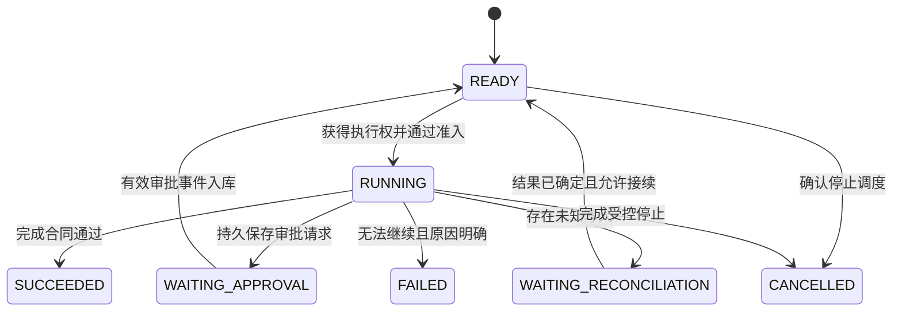
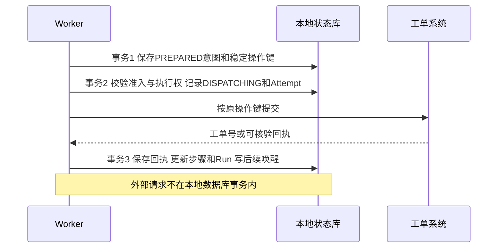
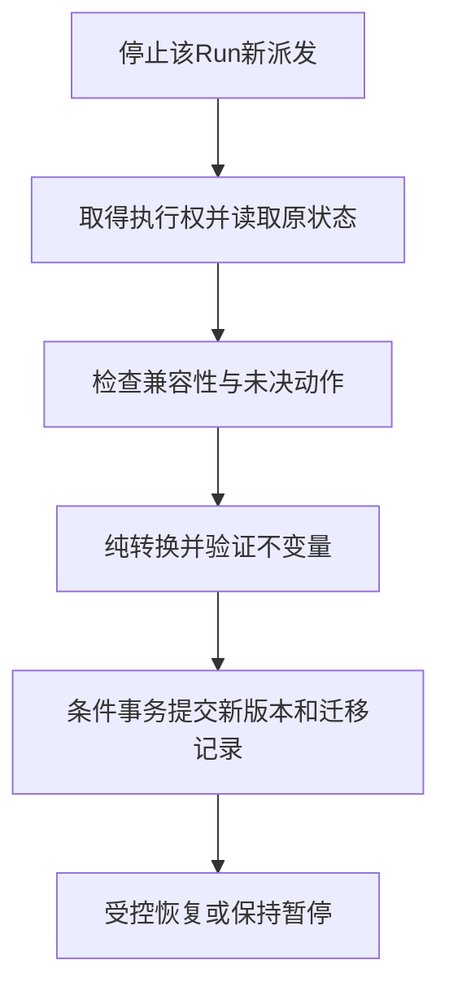

# 12 状态、持久执行与恢复

上一章解决“任务怎样拆分与推进”。这一章处理更贴近生产的情况：**任务还没完成，进程却退出了；用户隔天才批准；请求已经发出，结果却没收到。系统怎样知道该从哪里继续，以及哪些动作绝不能再做一次？**

继续使用企业 IT 助手。员工说：“VPN 仍然连不上，请根据刚才的排查结果帮我创建工单，提交前让我确认。”助手需要整理草稿、等待审批、创建工单、保存工单号并告知用户。整个过程可能跨越多次 HTTP 请求、多个 Worker 和一次服务发布。我们用这个例子逐步建立一套可恢复的执行合同。

[← 知识图谱](00%20Agent%20%E5%BC%80%E5%8F%91%E5%AD%A6%E4%B9%A0%E5%85%A5%E5%8F%A3.canvas)

**先修**：[Agent 运行闭环](10%20Agent%20%E6%89%A7%E8%A1%8C%E5%BE%AA%E7%8E%AF%E4%B8%8E%E8%BF%90%E8%A1%8C%E6%9C%BA%E5%88%B6.md) · [规划与 Workflow](11%20%E8%A7%84%E5%88%92%E3%80%81%E8%B7%AF%E7%94%B1%E4%B8%8E%20Workflow.md)。本章讲状态保存、恢复决策与并发推进；外部幂等协议、退避、对账与补偿深入见 [可靠性与一致性](26%20%E5%8F%AF%E9%9D%A0%E6%80%A7%E4%B8%8E%E5%89%AF%E4%BD%9C%E7%94%A8%E4%B8%80%E8%87%B4%E6%80%A7.md)，服务与存储部署见 [后端与调度](25%20%E5%90%8E%E7%AB%AF%E3%80%81%E8%B0%83%E5%BA%A6%E4%B8%8E%E5%AD%98%E5%82%A8.md)。

> [!abstract] 本章的核心交付
> 一套身份关系、两层状态机、一份恢复合同、一条明确事务边界的执行链，以及故障注入验收。最重要的原则是：**恢复依据持久证据决定下一步；重启不会清除已经发生的动作、已经消耗的预算和仍未解决的不确定性。**

## 阅读路线

| 阶段 | 小节 | 要回答的问题 |
| --- | --- | --- |
| 建立直觉 | 1—3 | 为什么聊天记录不够？Run、Step、Checkpoint 和 Memory 各管什么？ |
| 设计恢复合同 | 4—7 | 状态怎样划分？保存哪些字段？在哪些边界落盘？ |
| 控制恢复执行 | 8—11 | 怎样判定重用、执行、核实与等待？怎样处理多个 Worker、审批与取消？ |
| 应对长期运行 | 12—15 | 重放、并行、版本变化、存储治理和运维怎样配合？ |
| 动手与验收 | 16—18 | 实验能证明什么？如何注入故障并逐步交付？ |

正文中的 Mermaid 图解释局部机制；[可交互的恢复决策总览](./assets/ch12-durable-execution/durable-recovery-workflow.html)可用于查看主链路与分支职责。GitHub 阅读时可下载 HTML 后在浏览器打开。本章的状态命名、业务字段和 SQL 是教学设计；配套实验的实现范围在第 16 节单独说明。

## 1. 先看三个中断现场

### 1.1 调用前退出：知道还没做，才能继续做

助手已经生成工单草稿，审批也有效，正在准备提交，Worker 却重启了。

如果持久记录能够证明动作仍处于“准备完成、尚未跨过派发边界”，恢复程序可以重新检查权限和审批，再提交。若只看到一条 `running`，却不知道请求有没有发出，就不能作出相同判断。

**“进程没来得及保存结果”与“业务动作没发生”是两件事。** 恢复设计首先要把它们分开。

### 1.2 外部成功、本地失忆：最危险的重复窗口

工单系统已经创建了 IT-2048，但返回包丢失；或者 Worker 收到工单号后，还没保存就崩溃了。

恢复时，本地仍然没有成功回执。如果把这理解成“失败，重新创建”，用户就可能得到两张工单。正确处理是保留原业务操作身份，进入结果核实：按稳定业务键查询、按外部接口合同取得原回执，或转人工处理。

### 1.3 等待审批后重启：等待也是需要保存的进度

用户看过草稿，关掉页面，第二天才点批准。此时最初处理请求的进程早已不存在。

系统应从数据库找到待审批 Run、被批准的准确草稿、有效期和接续位置。它不需要保留一个等待了整晚的 Python 协程，更不能只依赖内存中的 `approved = False`。

| 中断点 | 恢复时必须知道 | 正确方向 |
| --- | --- | --- |
| 明确尚未派发 | 准备内容、准入条件、下一步 | 复核后执行 |
| 可能已发出，缺少确定回执 | 原操作身份、请求摘要、核实方式 | 核实，不能盲目重放 |
| 正在等审批 | 审批对象、输入版本、期限、恢复条件 | 保持等待，或消费有效审批 |

> [!tip] 一个有用的类比
> Checkpoint 像交班记录：谁在处理、处理到哪、手里有什么证据、还欠什么。业务系统的真实工单像仓库里的货物。交班记录漏写“已经发货”，不会让货物自动回到仓库。

## 2. 建立稳定身份：一次任务不等于一次请求

### 2.1 从用户到一次网络尝试

| 标识 | 表示什么 | 示例与生命周期 |
| --- | --- | --- |
| `tenant_id`、`principal_id` | 哪个租户、谁发起或被代理 | 隔离与授权依据，由可信入口确定 |
| `conversation_id` / `session_id` | 产品中的会话或交互会期 | 一个会话可以发起多个独立任务 |
| `run_id` | 一次有目标、预算与结束条件的执行 | “创建本次 VPN 工单”；恢复沿用同一 Run |
| `step_id`、`plan_version` | 计划中的逻辑工作及计划版本 | `prepare_draft`、`submit_ticket` |
| `tool_call_id` | 模型或 Runtime 发起的一次调用关联 | 把请求与工具消息配对；保留其所属轮次 |
| `operation_id` / `operation_key` | 需要追踪的一次逻辑业务动作 | “为本次请求创建这一张工单” |
| `attempt_id` | 一次实际执行或网络尝试 | 同一业务操作可能有多个合法尝试 |
| `checkpoint_id`、`revision` | 快照身份与运行状态修订号 | 用于定位恢复点、阻止旧状态覆盖新状态 |

模型重新生成 Tool Call 时，可能得到新的 `tool_call_id`。因此，**它通常不能单独承担业务去重键的职责**。业务操作需要独立、持久且有明确作用域的身份。

不同框架对 `thread`、`session`、`run` 的定义并不完全一致。接入时建立映射表，说明谁是产品会话、谁是框架持久游标、谁是本次执行，不能因为名字相近就直接合并。

### 2.2 哪些身份应该保持，哪些应该变化

- 同一个未完成任务重启：保持 `run_id`，记录新的执行者与执行代次。
- 同一写入进行合法重试：保持 `operation_key` 和已确认的请求内容，新增 `attempt_id`。
- 用户修改工单正文或附件：提升输入版本，重新判断审批与业务操作是否仍适用。
- 用户明确要求“再创建一张”：这是新的业务意图，经过正常准入后分配新操作身份。
- 重新规划发现原写入结果未知：先解决原操作，不能用新计划编号掩盖未决副作用。

幂等键也不是永久有效的魔法字符串。需要约定生成范围、同键异参行为、外部保留期限和查询能力；这些属于接口合同，见 [Connectors](17%20Connectors%20%E4%B8%8E%E4%B8%9A%E5%8A%A1%E9%9B%86%E6%88%90.md) 与 [可靠性与一致性](26%20%E5%8F%AF%E9%9D%A0%E6%80%A7%E4%B8%8E%E5%89%AF%E4%BD%9C%E7%94%A8%E4%B8%80%E8%87%B4%E6%80%A7.md)。

## 3. 分清状态、检查点、事件、记忆与业务事实

### 3.1 五种信息各有用途

| 信息 | 主要问题 | 典型内容 | 不能替代什么 |
| --- | --- | --- | --- |
| Runtime State | 现在运行到什么位置？ | 已完成节点、待执行集合、预算、等待原因 | 不能证明外部写入真实成功 |
| Checkpoint | 能从哪个持久边界重建运行？ | 状态快照、版本、恢复游标、引用 | 不能单独提供外部 exactly-once |
| 执行事件与动作账本 | 发生过哪些转移、派发与确认？ | 审批消费、派发尝试、回执、核实结果 | 普通文本日志不能自动拥有这些语义 |
| Memory | 将来哪些信息值得跨任务复用？ | 用户偏好、稳定事实、经验 | 不能充当当前 Run 的精确进度表 |
| 外部业务记录 | 业务事实究竟是什么？ | 工单记录、外部事务号、可核验回执 | 模型回答“已完成”不能替代它 |

聊天记录可帮助理解任务，却常常缺少派发边界、审批版本、尝试次数、执行权和事务提交状态。让模型重新阅读聊天并猜测进度，会把恢复变成一次新的推理任务，难以形成可验证保证。

### 3.2 事件记录不等于完整事件溯源

可以选择“数据库当前状态 + 必要审计事件”，也可以选择“事件历史 + 可重建投影”。后者需要定义事件顺序、重复处理、版本、重建算法和完整性，不能仅靠把日志集中存储来实现。

同样，Trace 适合诊断调用链，可能采样、截断或过期；决定能否再次提交的记录应有独立的持久合同。不要让“日志刚好保留了”成为恢复正确性的前提。

### 3.3 先确定每个字段的权威来源

例如，`ticket_id` 来自工具回执或可靠查询；`approved_action_digest` 来自可信审批流程；`remaining_budget` 来自受控账本；`next_steps` 来自 Workflow 状态转移。

模型可以提出候选内容，程序核验后才能写入对应状态。尤其不要允许模型通过输出 `status: succeeded`、`approved: true` 或新的 `tenant_id` 自行改变控制事实。

## 4. 设计两层状态机，避免一个 status 包办所有含义

### 4.1 Run 表达整体推进状态



这张图展示主要路径；拒绝审批、等待超时、等待期间取消和不可迁移等情况还需要业务转移规则。状态数量不求多，重点是每条转移都能回答：谁触发、需要什么证据、更新哪些记录、如何防重复。

`FAILED` 不必意味着所有业务动作都未发生；`SUCCEEDED` 必须绑定本任务的完成合同。本例最多能证明“工单已创建并取得可靠工单号”，不能据此证明 VPN 已修复。

### 4.2 Operation 表达外部动作的执行确定性

| 状态 | 准确含义 | 恢复政策 |
| --- | --- | --- |
| `PREPARED` | 意图已保存，按执行协议尚未取得派发资格 | 重新准入后可派发 |
| `DISPATCHING` | 已跨过允许发送的持久边界，请求可能发出 | 孤儿执行需按未知处理，不能直接退回准备态 |
| `SUCCEEDED` | 有已核验、已持久保存的成功证据 | 复用回执，推进符合条件的后继 |
| `FAILED_CONFIRMED` | 有证据确定本次失败及副作用情况 | 按失败分类决定结束或合法重试 |
| `UNKNOWN` | 可能发生，但缺少确定结果 | 查询、对账或接管；阻断冲突写入 |

`DISPATCHING` 不声称网络包真的到达；它故意把“已经允许发送，却无法证明未发送”的窗口包起来。宁可进入可解释的核实，也不要错误地认为没有动作发生。

一个业务系统可能返回“已受理，仍处理中”。这时应增加 `PENDING_EXTERNAL` 等状态并轮询或等待回调，不能把 HTTP 202 当成业务成功。异步业务状态与网络调用状态需要分别保存。

### 4.3 取消意图与未决副作用是独立维度

`cancel_requested_at` 表达用户希望停止；`open_operation_count` 或独立对账任务表达还有哪些业务事实未核实。Run 停止后，动作账本可以继续接受核实结果，但不能因此自动恢复被取消的后继动作。

这比给一个 `status` 增加几十种组合值更清晰：**控制是否继续，与事实是否明确，可以同时有各自的状态。**

## 5. 一份真正能恢复的检查点应该保存什么

### 5.1 保存“继续执行所需的最小充分信息”

下面是恢复合同的摘要，省略字段放在有外键或稳定引用的关联记录中，不代表生产环境只需要一个 JSON 列。

```json
{
  "tenant_id": "tenant-demo",
  "principal_id": "employee-demo",
  "conversation_id": "conv-1042",
  "run_id": "run-vpn-ticket",
  "revision": 17,
  "execution_epoch": 4,
  "state_schema_version": 2,
  "workflow_version": "ticket-v3",
  "input_version": 2,
  "plan_version": 1,
  "status": "WAITING_APPROVAL",
  "completed_steps": ["prepare_draft"],
  "ready_steps": [],
  "waiting_steps": ["submit_ticket"],
  "operation_ref": "op-create-ticket",
  "approval_ref": "approval-7",
  "draft_ref": "artifact://draft/sha256-example",
  "tool_contract_version": "create-ticket-v2",
  "policy_version_at_creation": "policy-v5",
  "budget": {
    "model_calls_used": 2,
    "tool_attempts_used": 0,
    "cost_reserved_units": 0,
    "deadline_at": "2026-11-03T09:00:00+08:00"
  },
  "cancel_requested_at": null,
  "last_event_seq": 31
}
```

不同框架有不同的持久模型。实际字段可以拆表或由 Runtime 管理，但必须能回答以下问题。

| 信息组 | 恢复时要回答的问题 |
| --- | --- |
| 身份与资源范围 | 为谁执行？访问哪些租户、工单和产物？ |
| 流程位置 | 哪些步骤完成、就绪、等待或被跳过？等待哪个条件？ |
| 动作与证据 | 哪次写入未决？原始参数摘要、尝试与回执在哪里？ |
| 版本 | 哪个状态 Schema、流程、工具合同和输入解释这些数据？ |
| 预算与时间 | 已花多少、已预留多少、何时必须停止？ |
| 控制与唤醒 | 是否取消？等哪个审批、定时器或外部事件？ |
| 并发与一致性 | 当前修订号、执行代次、事件水位和检查点引用是什么？ |

### 5.2 不把所有东西塞进快照

大文件、长工具正文和模型原始输出可放入受控对象存储，快照保存不可变引用、内容摘要与权限信息。恢复前校验对象存在、摘要匹配、当前主体有权读取。

数据库连接、协程、锁对象、临时访问 Token 和可执行代码都不应直接序列化进检查点。可恢复的是业务状态，连接与短期凭据在恢复时按当前环境重新获得。

### 5.3 保存频率取决于能承受多少重算

纯计算可以批量落盘；耗时模型输出通常值得保存；审批等待、动作意图与可能派发的边界需要明确持久保证。若使用异步写快照，崩溃时可能退回较早边界，重复计算和预算策略就要覆盖这一窗口。

“每个 Token 都保存”会放大存储与写入压力，也未必提升业务正确性。先列出不可丢失的决策事实，再确定快照频率和恢复粒度。

## 6. 用数据模型表达约束，而不只写注释

### 6.1 一个便于落地的关系模型

| 表或集合 | 关键字段 | 主要约束 |
| --- | --- | --- |
| `runs` | 租户、Run、状态、修订、epoch、租约、版本、取消与预算 | `(tenant_id, run_id)` 唯一；条件更新控制推进 |
| `steps` | Run、计划版本、Step、输入摘要、状态、结果引用 | 同一计划中的逻辑步骤唯一 |
| `operations` | 操作键、请求摘要、状态、外部键、回执引用 | 同租户同业务操作唯一；同键异参拒绝 |
| `attempts` | Operation、Attempt、执行代次、开始结束、分类 | 每次真正尝试可追踪，不能覆盖历史 |
| `checkpoints` | Run、修订、Schema、状态引用、事件水位 | 快照与其事件范围可对应 |
| `approval_requests` | 动作摘要、输入版本、审批人范围、期限、决定 | 同一审批决定最多有效消费一次 |
| `inbox`、`outbox`、`timers` | 事件身份、唤醒条件、投递和消费状态 | 重复投递可去重；等待有持久唤醒来源 |

这些职责可以由框架、应用数据库和业务适配器共同实现，不要求重复造七套存储。需要避免的是同时存在两个互不协调的“当前状态”。例如应用说 Run 已完成，框架检查点却仍会重新执行提交节点。

### 6.2 唯一约束是一条边界，语义检查是另一条

操作键唯一只能阻止第二条同键记录。遇到同键请求时，还应比较规范化请求摘要：目标、正文、附件和关键版本是否一致？不同内容不能因为键相同就直接返回旧成功。

预算也不能在恢复时重新初始化。准备真正的尝试前先持久记录预留或计数，收到实际使用量后结算。外部用量未知时保留未结预留或明确的估算策略，不能因本地缺少回执就认定没有成本。

### 6.3 跨记录更新必须有事务合同

保存成功回执、更新操作状态、标记 Step 完成、更新 Run 修订、写事件和后续唤醒记录，若属于同一个本地存储，应在一个事务中完成或由等价一致性机制保证。

若 Runtime 与应用账本分属不同数据库，就不能口头称为“原子提交”。需要指定权威记录、可重入状态转移和修复流程；不能让两边互相猜测对方是否提交。

## 7. 持久执行的关键：明确每个崩溃窗口

### 7.1 先保存意图，再跨过派发边界，最后保存结果



三次本地事务是教学分解，也可以合理合并其中的本地准备动作。关键是不能出现“外部请求已可能发送，却仍有记录证明它一定尚未发送”的错误。

### 7.2 为什么在发送前落盘也不能消除未知

`DISPATCHING` 刚提交，Worker 还没发包就崩溃，本地会认为可能发送；请求已经成功、事务 3 之前崩溃，本地同样认为可能发送。

这两种情况本地看起来相同，但外部事实不同。**仅靠一个本地事务，无法把远程 HTTP 副作用和本地成功记录变成同一次原子提交。** 因而需要稳定操作身份、外部能力和核实路径，不能只调整 `save()` 的先后顺序。

### 7.3 同库原子保存进度和“之后要唤醒”

假设事务已把下一步改成 READY，进程却在发送队列消息前退出。任务可能永远没人处理。

一种常见做法是在同一事务写入 Outbox 唤醒记录，再由投递器发送。消息重复也没关系：接收者重新读取 Run 并争取推进权，而不是见到一条消息就直接创建工单。也可以由受控扫描器发现到期任务，具体采用哪种方式由调度设计决定。

Outbox 保证的是本地状态与待投递意图一致；它不会自动保证工单系统只创建一次。完整协议见 [可靠性与一致性](26%20%E5%8F%AF%E9%9D%A0%E6%80%A7%E4%B8%8E%E5%89%AF%E4%BD%9C%E7%94%A8%E4%B8%80%E8%87%B4%E6%80%A7.md)。

## 8. 恢复算法：先判定，再行动

### 8.1 一张恢复决策表

| 读取到的事实 | 恢复动作 | 禁止的捷径 |
| --- | --- | --- |
| 完成证据已持久化且匹配当前输入 | 复用结果，按状态机决定后继 | 再调一次以便“确认” |
| PREPARED，协议保证尚未派发 | 检查当前授权、审批、预算与前置条件，再争取派发 | 直接复用旧授权 |
| DISPATCHING 的执行者已失去推进权，且无确定回执 | 进入 UNKNOWN 与核实流程 | 超时就改成 READY |
| 权威查询确认原操作成功 | 保存原回执，继续允许的后继 | 换新键重提 |
| 查询可靠确认未执行，且排除旧请求迟到提交 | 按合同判断能否执行原操作 | 把一次空查询当作绝对未执行 |
| 查询不确定、外部暂不可用或仍在处理 | 有界等待、继续核实或转人工 | 不确定时重新创建 |
| 等待审批但无有效决定 | 保持等待并检查期限 | 默认批准 |
| 版本不兼容、权限失效或输入已变化 | 阻止自动继续，进入明确处置 | 尽量解析后继续写 |

“查不到”未必是“没发生”。可能有读写延迟、查询范围不对、去重记录过期或旧请求仍在外部排队。只有外部合同足以支持这个结论，才可解除未知状态；否则继续核实。

### 8.2 恢复器的职责可以写得很清楚

下面是设计伪代码，`atomic_transition` 等函数表示应用必须实现或委托 Runtime 提供的事务接口。

```python
def resume_run(wakeup):
    # 唤醒是线索；租户和调用者仍须由可信入口验证。
    claim = claim_execution(wakeup.tenant_id, wakeup.run_id)
    if claim is None:
        return "another_worker_owns_progress"

    state = load_consistent_state(claim)
    require_minimal_recovery_access(state)
    require_supported_versions(state)

    if state.cancel_requested:
        return stop_scheduling_and_assign_reconciliation(state, claim)

    if state.is_terminal:
        return reconcile_open_operations_without_advancing(state, claim)

    if state.waiting_for_approval:
        return consume_valid_approval_or_keep_waiting(state, claim)

    operation = load_operation(state.operation_ref)
    # 验证原操作的租户、Run、不可变请求摘要和回执关联。
    require_original_operation_integrity(state, operation)

    if operation.is_confirmed_success:
        require_current_business_authorization(state)
        require_current_input_and_plan_allow_successor(state, operation)
        return advance_with_saved_receipt(state, operation, claim)

    if operation.may_have_been_dispatched:
        # 此分支只查询或核实，不再创建新的业务操作。
        require_historical_reconciliation_access(state, operation)
        return reconcile_original_operation(state, operation, claim)

    if operation.status != "PREPARED":
        return handle_non_dispatchable_state(state, operation, claim)

    require_run_and_step_ready(state)
    require_current_business_authorization(state)
    require_current_input_and_approval(state, operation)
    require_budget_and_deadline(state)
    # 条件事务检查修订、epoch、取消与准入，登记尝试。
    attempt = atomic_transition_to_dispatching(state, operation, claim)
    result = call_adapter(attempt)
    # 不确定结果进入UNKNOWN；迟到/过期执行者不能推进Run。
    return record_and_classify_result(result, attempt, claim)
```

这段伪代码聚焦已经建好操作记录的写入阶段。核实原操作不要求新版本输入重新获批；核实后若要推进后继，仍需检查当前输入、计划和控制条件。等待、已失败或业务未决等状态各走自己的政策，不能落入一个“其他情况都重试”的默认分支。

核实可以由另一个受控任务承担。原用户权限失效时，核实服务也不能借此扩大数据访问；需要独立、最小化的服务授权与审计。是否继续业务动作与是否有责任核清历史副作用，应分别判断。

### 8.3 恢复不是无条件重试

重试关注“某个已分类动作是否再尝试”；恢复关注“从持久事实重建位置，并决定接下来允许做什么”。恢复可能只读取回执，也可能保持等待、迁移状态、核实未知结果或结束任务，完全不发送写请求。

## 9. 多 Worker 与并发：谁有资格推进

### 9.1 三类机制解决不同问题

| 机制 | 解决的问题 | 边界 |
| --- | --- | --- |
| 租约 Lease | 一段时间内由谁负责推进 | 旧 Worker 可能暂停后复活 |
| 修订号与 CAS 条件写入 | 我读取后，状态是否已经被别人修改？ | 所有关键写路径都需使用条件更新 |
| 执行代次 / Fencing Token | 这个执行者是否属于旧一代？ | 只有接收方校验它才有约束力 |

队列重复投递、手工恢复、定时扫描和原 Worker 返回，都可能同时指向同一个 Run。数据库应决定当前状态，队列不应成为执行次数的权威。

### 9.2 一段条件提交 SQL

下面是 PostgreSQL 风格的事务片段，展示提交边界；参数由可信运行环境提供，不是一份可直接部署的完整表结构。

```sql
BEGIN;

UPDATE runs
SET revision = revision + 1,
    status = 'READY',
    checkpoint_ref = :new_checkpoint_ref
WHERE tenant_id = :tenant_id
  AND run_id = :run_id
  AND revision = :expected_revision
  AND execution_epoch = :claimed_epoch
  AND lease_owner = :worker_id
  AND lease_until > clock_timestamp()
  AND status = 'RUNNING'
  AND cancel_requested_at IS NULL
RETURNING revision;

-- 应用必须确认恰好返回1行，否则ROLLBACK并停止推进。
-- 在同一事务继续保存已核验回执、Step结果和后续Outbox。
COMMIT;
```

这段 SQL 对应“执行中保存结果并使后继就绪”的一条转移；执行前还需按该转移合同核对 Step、Operation、输入版本与回执。其他来源状态使用各自的转移条件，不能把等待审批或终态无条件改成 READY。

新检查点对象应在引用提交前准备好；失败事务留下的未引用对象由受控垃圾回收处理。操作结果入库、条件更新与事件写入必须遵循同一个事务协议，不能先无条件覆盖结果，再检查 Run 是否仍归自己。

行锁可以保护短事务中的状态变更，但不要拿着数据库锁等待模型或远程 API。PostgreSQL 对行锁的冲突与事务释放规则有明确说明，可参考[官方显式锁文档](https://www.postgresql.org/docs/current/explicit-locking.html)。

### 9.3 两个 Worker 的典型交错

1. A 取得 epoch 8，发出请求后长时间停顿。
2. 租约到期，B 取得 epoch 9，发现原 Operation 可能已派发，进入核实。
3. A 恢复并携带 epoch 8 提交进度，条件更新返回 0 行，必须停止推进。
4. A 得到的外部回执可通过受控接收路径作为核实证据，但它不能直接启动下一步。

**数据库中的 fencing 不能阻止已经在外部执行的旧请求。** 若外部接口不检查代次，只能结合其幂等与业务约束、统一派发入口及核实流程处理；不能把一个分布式锁当成跨系统 exactly-once。

## 10. 审批、等待与唤醒：把暂停做成协议

### 10.1 审批的对象必须具体

只保存 `approved = true` 不够。用户批准的是“用这些字段创建这一张工单”，而不是授权未来任意版本的提交。

审批请求至少应绑定：`approval_id`、租户与 Run、操作身份、规范化动作摘要、输入版本、允许的审批主体或角色、有效期和一次性消费状态。摘要覆盖目标系统、操作类型、目标资源、正文、附件摘要及重要参数。

内容摘要用于匹配，不替代认证与授权。审批事件必须验证发送者身份、当前批准权限与防伪机制；不能因为知道一个摘要就获得批准能力。

### 10.2 等待时释放执行资源

把草稿、审批请求、等待原因与期限持久化，然后结束这次 Worker 执行并释放租约。用户批准或定时器到期时，只投递一个唤醒事件，由新的执行尝试读取事实。

不要把 Worker 占用几小时当作“持久暂停”。内存中的 `sleep()`、未完成 Future 或浏览器连接，都会随进程退出消失。

### 10.3 消费审批需要与状态转移协同

审批接口在本地事务中完成：记录事件到 Inbox、去重、验证审批仍待决且版本匹配、记录决定、改变可推进条件、写入 Outbox。重复点击应返回已有决定，不能重复提交；不一致的第二个决定需要明确冲突政策。

实际派发前仍须复核有效期、当前权限和关键业务前置条件。审批期间用户改了正文、目标或附件，应让原批准失效或重新审批，不能静默沿用。

### 10.4 防止丢失唤醒与过期事件误唤醒

“先挂起，再等事件”有竞态：审批可能比等待状态提交更早到达。可靠做法是先持久接收事件，再按审批身份匹配；消费方从数据库判断条件，而不是只监听瞬间通知。

定时器也需要稳定身份、截止时间与消费状态。审批和超时同时到来时，在同一状态机的事务条件下决定谁生效；旧输入版本的批准、旧定时器与重复回调都不得推进新版任务。

更完整的人机预览与接管设计见 [Human-in-the-loop](22%20Human-in-the-loop.md)。

## 11. 取消与迟到结果：停止推进，仍然诚实记录事实

### 11.1 取消要分别回答四个问题

| 问题 | 可实现的动作 |
| --- | --- |
| 是否还创建新的工作？ | 持久保存取消意图，禁止新的调度与派发 |
| 在途请求能否停止？ | 发出协作式取消，遵循适配器与服务支持能力 |
| 已发生的业务动作能否撤回？ | 走独立撤销或补偿合同，可能需要新授权 |
| 未知动作由谁继续核实？ | 保留 Operation 与核实责任，不随 Run 终态丢弃 |

关闭页面不等于取消后台任务，HTTP 连接断开也不等于外部事务回滚。产品应展示“已停止后续处理，工单提交结果仍在核实”等准确状态。

### 11.2 取消与成功同时到来时

以数据库串行化的状态转移边界解释竞争：若取消先提交，后到的成功证据只更新动作事实，不启动后继；若成功先提交，取消不能把已有工单抹掉，但可以阻止尚未开始的后续工作。

在派发边界后才收到取消时，已经授权的请求仍可能发出或完成。将这个边界写进产品合同，比声称“随时立即撤销一切”更可验证。需要更强的撤销保证时，必须由外部系统提供相应协议。

### 11.3 预算停止也保留未决账务

超时、费用上限和无进展终止可以结束 Run，但不能丢掉未知写入与未知费用。核实任务可有独立的运行预算、截止时间和升级责任，避免原任务停止后无人追踪。

## 12. 重放、重新执行与历史分叉

### 12.1 Durable Execution 的保证从哪里来

持久执行是把运行进度和必要结果保存到可靠存储，并按明确规则恢复推进。它通常不等于序列化整个操作系统线程或 Python 调用栈。

有的 Runtime 从节点或任务边界重新进入，有的根据事件历史重放编排逻辑，并复用已记录的结果。必须问清：恢复粒度多大、哪些代码会再运行、哪些输出已落盘、落盘失败会怎样。

### 12.2 模型输出也是非确定性输入

重跑同一 Prompt，模型可能生成不同计划、参数或最终回答；读取当前时间、随机数和外部查询也可能产生新值。需要区分两种意图：

- **恢复原执行**：复用已提交的模型决定和观察，保持原来批准的内容与业务身份。
- **基于最新事实重新判断**：显式创建新输入或计划版本，重新做权限、预算、审批及副作用分析。

不要在无意中重新调用模型后，把新生成的参数挂到旧批准上。模型输出已产生但尚未保存时崩溃，调用也可能再次发生并产生费用；这同样需要预算与记录策略。

### 12.3 框架的暂停语义需要读到代码边界

LangGraph 区分 thread 范围的 Checkpointer 与跨 thread 的 Store；内存 Saver 不能跨进程重启保留数据。[官方 Persistence 文档](https://docs.langchain.com/oss/python/langgraph/persistence)解释了这两类持久范围。

LangGraph 的 `interrupt()` 恢复会从所在节点开头重新执行，所以暂停前代码可能再次运行。将写入放在审批后，也仍有“写入成功后节点失败”的窗口，不能省掉业务去重与核实。[官方 Interrupts 文档](https://docs.langchain.com/oss/python/langgraph/interrupts#resuming-interrupts)

Temporal 使用事件历史支持工作流恢复，编排重放与 Activity 执行是不同层次；应遵守所用 SDK 的确定性约束。外部 Activity 的不确定执行结果仍需业务幂等和处理策略。[Temporal 事件历史](https://docs.temporal.io/workflow-execution/event)、[幂等与持久执行](https://temporal.io/blog/idempotency-and-durable-execution)

这些机制可以帮助实现恢复合同，却不能替应用定义“工单成功”“批准有效”与“重复提交安全”。不要因为接入了框架就省掉业务验收。

### 12.4 历史分叉不能复制副作用

从旧检查点进行调试或“重新生成”，应明确创建分支，并默认禁止真实外部写入。旧状态里可能已经带有成功 Operation、仍有效的批准或敏感产物引用。

真正要再次执行写入，必须形成新的业务意图并重新准入；只读历史查看也要检查当前访问权。Time Travel 是状态操作，不是业务世界的时间倒流。

## 13. 并行节点和子任务怎样恢复

### 13.1 单一 next_step 不能表达整个 DAG

并行检索手册与查询历史工单时，需要分别保存节点状态、输入版本和结果引用。一个分支成功后另一个崩溃，恢复可以复用满足有效性条件的成功结果，而不是把所有分支清零。

检查点应能表达就绪集合、等待集合和依赖完成情况；汇合节点只在既定 Join 条件成立时启动。成功结果过期、权限改变或输入版本不符时，按明确规则重新获取。

### 13.2 分支结果不能相互覆盖

两个分支同时返回时，可使用独立 Step 结果、每分支版本号和受控归并事务。避免各自拿着旧的全量状态 JSON 保存，导致后返回的分支覆盖先返回的结果。

归并顺序有业务意义时明确排序；重复事件以稳定身份去重。Reducer 应解释如何处理重复和冲突，而不是假设每个结果只到一次。

### 13.3 子 Agent 也需要持久任务合同

父 Run 保存子任务身份、输入版本、权限范围、预算委派、结果引用与等待政策。父 Worker 重启后通过这些身份查找既有子任务，不直接启动新的同类任务。

父任务取消是否向子任务传播、子任务完成后父任务已终止怎么办，都需要显式政策。多 Agent 不会消除恢复问题，只会增加需要关联的边界，详见 [下一章](13%20Multi-Agent%20%E5%8D%8F%E4%BD%9C.md)。

## 14. 版本变化与状态迁移

### 14.1 至少区分四类变化

| 版本 | 变化例子 | 恢复风险 |
| --- | --- | --- |
| 状态 Schema | 字段改名、状态枚举增加 | 旧快照无法解释或被误读 |
| Workflow / 代码 | 节点拆分、条件与顺序变化 | 旧游标失去意义、重放路径不一致 |
| 工具合同与业务输入 | 参数必填、目标或草稿改变 | 批准与请求不再对应 |
| Prompt、模型与政策 | 决策方式或权限政策变化 | 新决定与旧证据、旧批准不兼容 |

JSON 能解析，只证明语法兼容，不能证明行为兼容。旧节点 `submit` 在新版变成“先发通知再提交”，即使字段完全不变，也可能重复或越界执行。

### 14.2 三条可选路线

1. **旧版排空**：已有 Run 继续由兼容旧版处理，新 Run 使用新版；保留版本路由与容量。
2. **显式迁移**：在受控状态边界转换 Schema、游标与等待条件，记录前后版本和迁移身份。
3. **暂停接管**：无法解释旧状态或无法守住原业务合同，停止自动写入，由有权限的人处理。

迁移不能把 UNKNOWN 改成 PREPARED，不能重置操作键、预算或已消费审批。对账中的外部动作尤其需要保留原查询与回执语义。

### 14.3 一次可审查的迁移流程



先在旧快照样本上干跑迁移，比较业务身份、预算、审批与未知动作是否保留，再逐步放量。迁移失败保持原状态可解释；代码回滚不保证新状态能够自动降级，更不会撤销已经发生的业务写入。

## 15. 存储、治理和运维：长期可恢复才有意义

### 15.1 按职责选择存储

关系数据库适合事务状态、条件更新、动作账本和索引查询；对象存储适合大型不可变产物；消息系统负责分发唤醒，不能单独取代权威进度。

本地 SQLite 很适合学习和受控单机任务。企业部署是否适用，要按多实例写入、持久卷、备份、故障转移与访问方式判断。`InMemorySaver` 或内存字典则只能证明进程内逻辑，无法证明重启恢复。

先估算活跃 Run 数、平均快照大小、每天事件数、保留期与恢复读写放大。简单估算可从“每天新增运行数 × 每 Run 检查点数 × 平均检查点字节数”开始，再计入事件、索引、副本与产物，不能只计算最新一份状态。

### 15.2 恢复能力也需要权限与数据生命周期

- 读写状态、历史快照和产物时都校验租户与主体范围，不能只在创建 Run 时检查。
- 保存脱敏摘要与必要证据，凭据留在受控凭据系统；恢复时取得当前短期凭据。
- 未决 Operation、审批记录、回执与引用产物的保留期相互协调，避免状态还在，关键证据先被删除。
- 清理从可达引用和业务保留政策出发；删除请求需要处理历史快照、索引、缓存与恢复后的防复活规则。

保留政策由业务和适用要求确定，不存在适合所有企业的统一天数。长期历史和当前可执行状态可以分层存储，但查询与审计合同要清楚。

### 15.3 备份恢复会重新制造“不知道”

假设数据库恢复到上午 10 点，而工单系统仍保留 10 点以后创建的记录。那些本地丢失的成功动作不会因此消失；若直接重新开放派发，可能再次提交。

恢复演练要验证状态库、产物和事件水位的一致范围，并对恢复点之后可能发生的动作进行核实。达到备份目标不等于已达到业务一致性目标；应先限制新写入，再核清缺口和执行版本。

### 15.4 让运维能看见“为什么没继续”

| 信号 | 应回答的问题 |
| --- | --- |
| 等待 Run 数与最长等待时间 | 是正常审批，还是丢失唤醒？ |
| UNKNOWN 数量与最老未决年龄 | 哪些业务动作需要核实与升级？ |
| 租约过期、CAS 冲突、旧 epoch 拒绝 | 是否有重复唤醒、Worker 停顿或并发缺陷？ |
| Checkpoint 保存错误与延迟 | 是否仍有可靠的恢复边界？ |
| 版本不兼容与迁移失败 | 哪些在途任务无法被当前执行器理解？ |
| 恢复时延、复用次数与重复业务记录 | 恢复是否有效，是否造成重复副作用？ |

指标通常使用低基数标签，具体 `run_id`、`operation_id` 放在受权限保护的事件与 Trace 中关联。排障入口应直接呈现最后持久修订、等待原因、未决操作、下一次核实时间与责任人。

人工恢复也走同一状态机和审计：附证据确认成功、重新查询、终止后续或创建单独补偿任务。不要通过手改 `status = READY` 清掉告警，这会绕过最重要的派发判断。

## 16. 动手实验：让进程真的退出，再恢复同一任务

配套实验：[第十二章持久恢复实验与完整代码](https://github.com/douloveppt/agent-application-learning/tree/main/examples/ch12-durable-execution)。它使用 Python 3.11 标准库和两个独立 SQLite 文件：一份保存运行状态，一份模拟外部工单系统。二者没有跨库事务，便于直接观察副作用窗口。

在仓库根目录执行：

```bash
python3.11 examples/ch12-durable-execution/lab.py
python3.11 -m unittest discover -s examples/ch12-durable-execution -v
```

### 16.1 先预测三条恢复轨迹

| 场景 | 中断时本地事实 | 中断时外部事实 | 期望恢复行为 |
| --- | --- | --- | --- |
| 准备后、派发前退出 | PREPARED | 没有工单 | 重新准入，提交一次 |
| 外部成功、保存回执前退出 | 已取得派发资格，缺少回执 | 已有一张工单 | 核实原操作，取得原回执，不再创建 |
| 等待审批时退出 | WAITING_APPROVAL | 没有工单 | 重启仍等待，有效批准后再推进 |

实验通过子进程中断保留已提交的文件状态，恢复时重新打开数据库。验证需要同时看本地状态、外部工单数和实际创建尝试，避免“本地最终成功”掩盖重复写入。

### 16.2 再观察几条保护规则

实验验证：重复审批事件被去重；正文改变后旧摘要的批准被拒绝；批准后参数被冻结；已确认的成功直接复用；查询回执的参数摘要不符时拒绝成功；查询结果仍不确定时保持 UNKNOWN。审批前修改参数还使用修订号检查，过期修订不能覆盖新值。

这些规则分别检验身份、输入绑定、结果确定性和本地并发边界。不要通过把全部执行包进同一个数据库事务来掩盖“外部系统不属于本地事务”的问题。

### 16.3 实验与生产验收的距离

实验验证受控、单执行者教学模型中的文件持久化、跨进程恢复和指定故障窗口。模拟外部查询的权威性由夹具规定；它没有接入真实供应商，不证明真实网络延迟、外部幂等保留期或查询一致性。实验审批只绑定内容摘要，尚未绑定输入版本、审批者身份和有效期；内容由 A 改成 B 再改回 A 时，旧 A 摘要仍会匹配。生产协议应按第 10 节补齐这些条件。

租约续期与 fencing、多 Worker 交错、真实授权、持久消息基础设施、完整对账服务和灾备均需单独实现与演练。正文中的 SQL、数据表和伪代码是设计说明，不是实验已经提供的完整生产 Runtime。

## 17. 企业验收：同时核对进度与业务事实

### 17.1 按故障窗口测试，而不只按函数测试

| 故障注入位置 | 期望状态或行为 | 必查证据 |
| --- | --- | --- |
| 意图事务前退出 | 无合法派发记录，不应发出写入 | Operation 与外部记录 |
| PREPARED 后退出 | 可重新准入 | 同一操作键、当前批准、一次创建 |
| DISPATCHING 后但发包前退出 | 保守进入核实 | 无盲目重放，未知有责任人 |
| 外部成功后、回执落盘前退出 | 原操作核实成功 | 原工单号，外部只新增一次 |
| 本地成功事务提交后、队列确认前退出 | 重复唤醒只复用结果 | 同一回执，后继转移不重复 |
| WAITING_APPROVAL 时重启 | 等待可恢复 | 原草稿摘要、有效审批身份 |
| 同一批准重复到达或早于等待提交 | 去重且不丢失唤醒 | Inbox、决定与一次消费 |
| 取消与成功回执竞争 | 事实可保存，取消后不继续 | 提交顺序、动作状态、后继数 |
| A 租约过期，B 接手后 A 返回 | 旧 epoch 无法推进 | 条件更新 0 行、外部动作核实 |
| 恢复时权限被撤销 | 禁止新业务执行 | 当前授权决定与拒绝原因 |
| 旧状态遇到新版本 | 兼容恢复、受控迁移或暂停 | 版本路由、迁移记录、不变量 |
| 从旧备份恢复 | 先核实恢复缺口 | 外部新增记录与本地丢失水位 |

### 17.2 不变量比“最后显示成功”更重要

最少检查：同一业务意图没有重复创建、已批准内容未被替换、UNKNOWN 没有被清成待执行、旧 Worker 没有覆盖进度、预算没有因重启清零、租户范围没有变化、停止后没有未授权后继。

Run 的最终状态、动作账本、外部业务记录和用户可见状态应相互解释。若四者不一致，即使测试进程退出码为 0，也不能认定恢复合同已经通过。

### 17.3 分阶段交付

1. **持久只读基线**：保存输入、步骤结果、预算和版本，证明重启可继续，重复唤醒不重复推进。
2. **受控写入基线**：加入稳定 Operation、派发边界、回执与 UNKNOWN 核实，演练提交成功但失去回执。
3. **长等待与并发**：加入审批、持久定时器、取消、租约、CAS、迟到结果和多 Worker 故障交错。
4. **发布与长期运营**：补齐在途版本、迁移、清理、灾备、运维接管和真实服务验收。

每一阶段先建立可检查的不变量，再增加下一层复杂度；不要用框架 Demo 的成功替代外部业务事实验收。

- [ ] **12 验收**：在工具调用前、调用后但回执丢失、等待审批三个位置中断并恢复；保持 Run 与业务操作身份，正确复用结果、核实 UNKNOWN、校验批准与当前权限；重复事件和旧 Worker 不重复推进，预算不重置；分别核对本地状态与外部实际记录，并说明离线实验、多 Worker 演练和真实业务验收的覆盖范围。

## 18. 自测：能否解释这些现象

1. 为什么保存了全部聊天消息，仍可能不知道工单到底有没有创建？
2. 同一个 Run 重启后，哪些身份必须保持？为什么 Tool Call ID 不一定适合作为业务幂等键？
3. PREPARED 与 DISPATCHING 的边界为什么要明确？先记录派发再发包会带来什么保守判断？
4. 工单查询返回空列表，为什么有时仍不能重新提交？
5. 本地回执已经存在，为什么恢复不应再调用一次创建接口？
6. 审批只保存一个布尔值，会在哪些输入变化下出错？
7. 用户取消了 Run，为什么动作账本还可能继续变化？
8. A 的租约过期后，CAS 与 epoch 分别阻止什么？为什么仍不能阻止所有外部重复写入？
9. 恢复含 `interrupt()` 的节点时，哪些代码可能再运行？
10. 两个并行分支同时保存全量状态，为什么会丢结果？
11. 新代码能成功读取旧 JSON，为什么仍不代表可以安全接续？
12. 为什么数据库备份恢复成功后，还需要核实外部系统记录？
13. 如果 Trace 已被采样或清理，系统还能否判断一次写入是否需要核实？
14. 运行预算耗尽时，谁继续处理未知写入与未知费用？

## 资料与继续阅读

- [LangGraph Persistence](https://docs.langchain.com/oss/python/langgraph/persistence)：理解 Checkpointer 与 Store 的不同范围，以及内存持久器的边界。
- [LangGraph Interrupts](https://docs.langchain.com/oss/python/langgraph/interrupts)：重点查看恢复重新进入节点、暂停前代码再次运行和副作用约束。
- [Temporal Events and Event History](https://docs.temporal.io/workflow-execution/event)：理解通过历史恢复工作流的机制。
- [Temporal Idempotency and Durable Execution](https://temporal.io/blog/idempotency-and-durable-execution)：理解持久运行与外部幂等为何需要配合。
- [PostgreSQL Explicit Locking](https://www.postgresql.org/docs/current/explicit-locking.html)：理解行锁与事务边界；具体并发方案需结合状态转移与条件写入。
- [本章离线实验](https://github.com/douloveppt/agent-application-learning/tree/main/examples/ch12-durable-execution)：用受控中断观察运行状态与外部业务事实的差异。

## 相关专题

- [Memory 记忆](07%20Memory%20%E8%AE%B0%E5%BF%86%E7%B3%BB%E7%BB%9F.md)：跨任务复用的信息与本次精确进度分开管理。
- [Agent 运行闭环](10%20Agent%20%E6%89%A7%E8%A1%8C%E5%BE%AA%E7%8E%AF%E4%B8%8E%E8%BF%90%E8%A1%8C%E6%9C%BA%E5%88%B6.md) · [规划与 Workflow](11%20%E8%A7%84%E5%88%92%E3%80%81%E8%B7%AF%E7%94%B1%E4%B8%8E%20Workflow.md)：恢复的是受控执行位置和任务依赖。
- [Multi-Agent](13%20Multi-Agent%20%E5%8D%8F%E4%BD%9C.md)：父子任务身份、预算与取消传播。
- [Connectors](17%20Connectors%20%E4%B8%8E%E4%B8%9A%E5%8A%A1%E9%9B%86%E6%88%90.md) · [身份与权限](20%20%E8%BA%AB%E4%BB%BD%E3%80%81%E6%9D%83%E9%99%90%E4%B8%8E%E5%A4%9A%E7%A7%9F%E6%88%B7.md)：外部回执、当前授权和租户范围。
- [人工控制](22%20Human-in-the-loop.md) · [交互事件](23%20%E4%BA%A4%E4%BA%92%E4%BD%93%E9%AA%8C%E4%B8%8E%E6%B5%81%E5%BC%8F%E4%BA%8B%E4%BB%B6.md)：审批、接管、等待和准确的用户状态。
- [后端与调度](25%20%E5%90%8E%E7%AB%AF%E3%80%81%E8%B0%83%E5%BA%A6%E4%B8%8E%E5%AD%98%E5%82%A8.md) · [可靠性与一致性](26%20%E5%8F%AF%E9%9D%A0%E6%80%A7%E4%B8%8E%E5%89%AF%E4%BD%9C%E7%94%A8%E4%B8%80%E8%87%B4%E6%80%A7.md)：事务、唤醒、幂等、对账与补偿。
- [Evals 与门禁](27%20%E6%B5%8B%E8%AF%95%E3%80%81Evals%20%E4%B8%8E%E8%B4%A8%E9%87%8F%E9%97%A8%E7%A6%81.md) · [可观测性](28%20%E5%8F%AF%E8%A7%82%E6%B5%8B%E6%80%A7%E4%B8%8E%E8%B0%83%E8%AF%95.md) · [部署与版本](30%20%E9%83%A8%E7%BD%B2%E3%80%81%E7%89%88%E6%9C%AC%E4%B8%8E%20LLMOps.md) · [数据治理](32%20%E6%95%B0%E6%8D%AE%E6%B2%BB%E7%90%86%E4%B8%8E%E6%8C%81%E7%BB%AD%E6%94%B9%E8%BF%9B.md)：故障演练、状态排障、迁移与保留。

> [!note]- 我的学习记录
> - **用自己的话解释**：
> - **最小实验与结果**：
> - **失败案例与定位**：
> - **还没弄懂的问题**：

| [← 上一章 · 11 规划、路由与 Workflow](11%20%E8%A7%84%E5%88%92%E3%80%81%E8%B7%AF%E7%94%B1%E4%B8%8E%20Workflow.md) | [下一章 · 13 Multi-Agent 协作 →](13%20Multi-Agent%20%E5%8D%8F%E4%BD%9C.md) |
| :--- | ---: |
