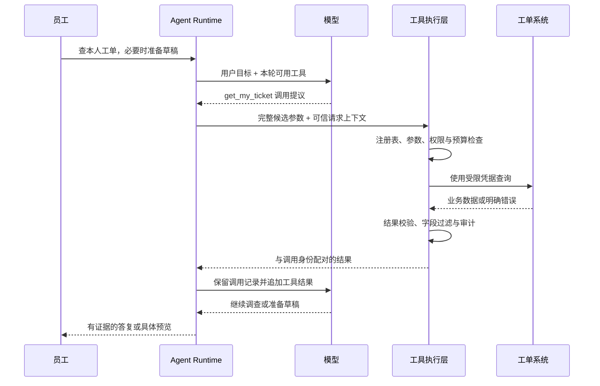
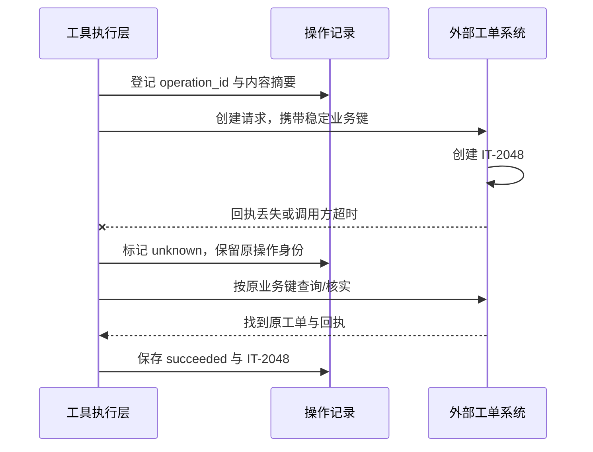
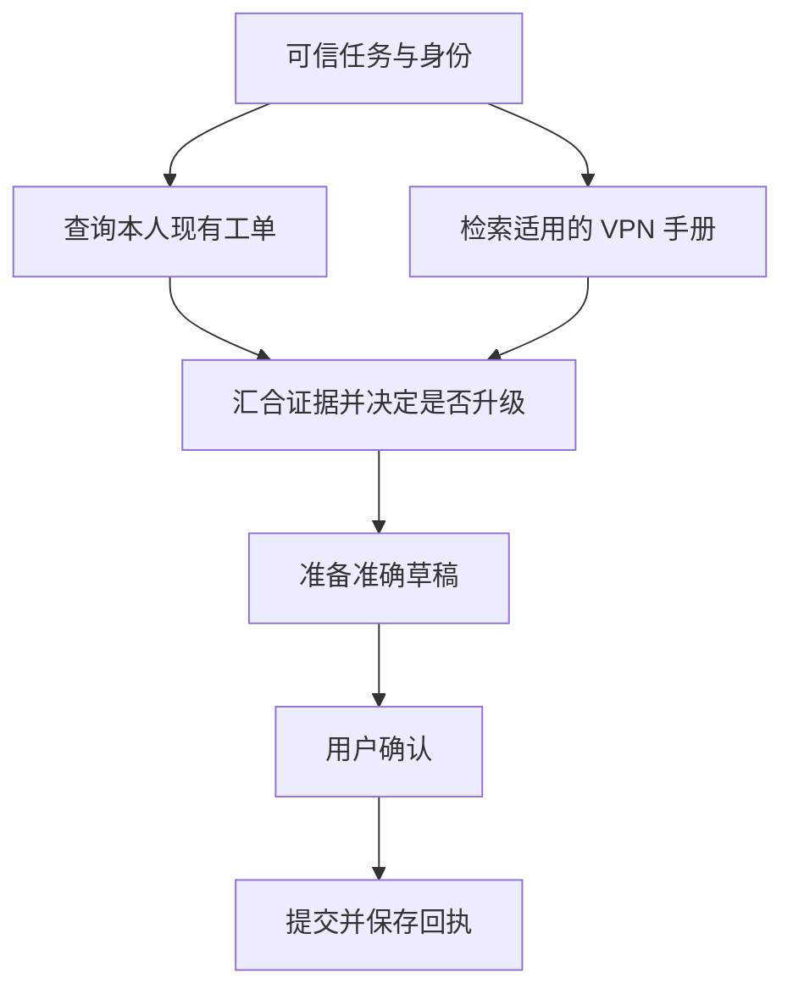

# 14 Tools 与 Function Calling

前几章已经讲过：Agent 怎样决定下一步、组织任务、跨中断恢复，以及让多个执行者协作。现在把视角缩小到最关键的一步：**模型说“我要调用这个工具”，应用究竟怎样判断能不能执行，并证明真实发生了什么？**

继续使用企业 IT 助手。员工说：“VPN 还是连不上。请查一下我的相关工单；如果没有正在处理的记录，就整理一份草稿，给我确认后再提交。”这个请求看起来只需要几个函数，却同时涉及本人数据、重复工单、草稿版本、用户确认、接口超时和结果核实。本章用它逐步建立一条可审查的工具执行链。

[← 知识图谱](00%20Agent%20%E5%BC%80%E5%8F%91%E5%AD%A6%E4%B9%A0%E5%85%A5%E5%8F%A3.canvas)

**先修**：[软件与系统基础](02%20%E8%BD%AF%E4%BB%B6%E4%B8%8E%E7%B3%BB%E7%BB%9F%E5%9F%BA%E7%A1%80.md) · [结构化输入输出](04%20%E7%BB%93%E6%9E%84%E5%8C%96%E8%BE%93%E5%85%A5%E8%BE%93%E5%87%BA.md) · [Agent 运行闭环](10%20Agent%20%E6%89%A7%E8%A1%8C%E5%BE%AA%E7%8E%AF%E4%B8%8E%E8%BF%90%E8%A1%8C%E6%9C%BA%E5%88%B6.md)。本章负责“一次工具调用怎样受控执行”；跨步骤恢复、完整身份体系、人工交互和分布式副作用分别衔接第 12、20、22、26 章。

> [!abstract] 本章的核心交付
> 一份工具目录与合同、一条明确可信输入来源的执行管线、一套结果与错误语义、一条审批—幂等—回执链，以及可离线运行的故障实验。**模型提出候选动作；可信执行层决定是否执行；业务回执说明发生了什么。**

## 阅读路线

| 阶段 | 小节 | 要回答的问题 |
| --- | --- | --- |
| 建立直觉 | 1—3 | Tool、Function Calling、MCP 有何区别？一次调用经历什么？工具怎样拆？ |
| 建立合同 | 4—6 | 描述和 Schema 怎样写？参数怎样校验？身份与权限从哪里来？ |
| 建立执行链 | 7—10 | 执行器负责什么？结果怎样表达？审批和重复提交怎样处理？ |
| 控制故障与规模 | 11—14 | 超时、重试、取消、并行、工具发现和不可信输出怎样处理？ |
| 接入与上线 | 15—16 | 怎样适配模型接口？怎样观测、评测和发布？ |
| 动手与验收 | 17—18 | 实验能证明什么？怎样检查自己真正掌握了？ |

正文用 Mermaid 图解释局部机制；[可交互的工具执行总览](./assets/ch14-tool-calling/tool-execution-workflow.html)展示从调用提议到校验、审批、执行和回执核实的完整路径。GitHub 阅读时可下载 HTML 后在浏览器打开。字段、预算、工具名与状态均为本章教学设计；供应商接口单独标明来源，不代表框架自动提供这些生产保证。

## 1. 先分清：模型提出调用，谁真正执行

### 1.1 三种信息不能混为一谈

假设模型输出：

```json
{
  "name": "get_my_ticket",
  "arguments": {"ticket_id": "IT-2048"}
}
```

这只说明模型想查询 IT-2048。它没有证明：这张工单存在、当前员工有权查看、查询已经执行，或者查询结果是什么。

| 信息 | 由谁产生 | 可以证明什么 | 不能证明什么 |
| --- | --- | --- | --- |
| 调用提议 | 模型 | 它选择的工具与候选参数 | 权限、实际执行与业务成功 |
| 执行决策 | 可信执行层 | 参数、权限、审批等是否满足当前规则 | 外部系统一定会成功 |
| 执行观察与回执 | 适配器、业务系统、回执存储 | 某次操作的已知结果与证据 | 未覆盖的其他动作也完成了 |

模型最后说“已提交”，也只是待验证的表达。真正的成功依据应来自可信操作记录和工单回执。

### 1.2 Tool 是能力合同，Function Calling 是提出调用的接口机制

**Tool** 是应用向 Agent 提供的一项能力，例如查工单、检索知识、计算费用、生成产物或提交请求。它包含名称、用途、输入输出以及执行规则。

**Function Calling** 通常指模型通过结构化字段表达“调用哪个函数、传入哪些参数”的机制。自定义函数实际在哪里运行，由应用与平台的执行方式决定。对本章的自定义业务工具，代码在应用控制的执行层运行。

一个 Python 函数加上装饰器，可以帮助框架生成工具描述；它不会因此自动获得多租户隔离、资源授权、幂等与审计。反过来，一个工具也可以在远程服务执行，并不要求与模型客户端处于同一进程。

### 1.3 与结构化输出、Skills、MCP、Connector 的关系

| 概念 | 主要回答的问题 | 本例 |
| --- | --- | --- |
| 结构化输出 | 模型按什么数据结构给出结果？ | 输出工单草稿 JSON |
| Function Calling | 模型提议调用什么能力？ | 提议调用 `preview_ticket` |
| Tool | 这项能力的业务合同和执行边界是什么？ | 预览只生成草稿，不提交工单 |
| Skill | 这类任务应遵循什么知识、步骤和资源？ | VPN 排查与升级流程 |
| MCP | 客户端与能力服务怎样发现、调用和交换结果？ | 通过协议列出和调用工单工具 |
| Connector | 怎样适配某个企业系统的鉴权、字段和接口？ | 把内部工单合同映射为 ITSM API |

MCP 的 `inputSchema`、可选 `outputSchema`、工具调用和错误机制属于协议层；业务授权与副作用控制仍要由系统实现。其规范还要求客户端谨慎对待不可信来源的工具注解，不能看到“只读”声明就直接给予信任。[MCP Tools 规范（2025-06-18）](https://modelcontextprotocol.io/specification/2025-06-18/server/tools)

> [!tip] 一个容易记住的划分
> Skill 告诉执行者怎样办事；Tool 给出可调用的具体能力；Function Calling 表达调用意图；MCP 规定交换方式；Connector 接到实际业务系统。它们可以组合，职责仍应分清。

## 2. 看懂一次完整调用：它是一个受控往返

### 2.1 最小闭环有六步

1. 应用根据真实身份、任务阶段与预算，选择本轮可见工具。
2. 模型输出零个、一个或多个调用提议。
3. 应用收齐调用参数，解析并校验工具名、结构、业务条件与权限。
4. 通过检查后，执行器调用对应业务处理器；写操作还要检查审批与业务操作身份。
5. 应用校验结果，保存必要回执，再把可公开的结果按调用身份返回模型。
6. 模型继续推理、请求下一项能力或生成答复；最终交付仍需核对完成证据。



本章把 Runtime 理解为维护任务过程的运行层，把工具执行层理解为守住单次动作边界的组件。二者可以部署在同一进程，职责仍应独立可测。

### 2.2 一次模型响应不等于一次业务事务

模型可能一次提出“查现有工单”和“提交新工单”。如果后者依赖前者的结果，执行器不能因为它们出现在同一响应中就同时执行。

业务事务的边界应由系统明确：哪些动作需要同一数据库事务，哪些需要跨系统回执，哪些必须等用户确认。不能让模型输出的数组顺序隐式决定事务、授权或补偿关系。

### 2.3 工具结果回来后，也不一定已经可以答复

查到“存在一张旧的已关闭工单”，不能据此说“你的问题正在处理中”；提交接口返回“已受理异步任务”，也不能据此说“工单已创建”。

每个步骤要回答自己的问题：查询结果是否相关且当前有效？草稿是否完整？用户批准的是哪一版？业务对象是否真正创建？最终答复必须沿着这些证据生成。

## 3. 先设计业务能力，再设计函数签名

### 3.1 不要把整个后端 API 原样交给模型

企业后端可能有上百个内部接口，但 IT 助手第一版只需要几项能力：

| 工具 | 模型需要提供什么 | 可信层补充什么 | 副作用与成功依据 |
| --- | --- | --- | --- |
| `search_my_tickets` | 关键词、允许的状态、页大小 | 当前租户、员工身份、数据范围 | 只读；返回当前可见工单与分页信息 |
| `get_my_ticket` | 工单编号 | 本人归属过滤、字段权限 | 只读；返回授权范围内的详情 |
| `preview_ticket` | 标题、问题描述、分类 | 默认队列、提交人、规范化规则 | 保存本地草稿；没有外部工单 |
| `submit_ticket` | 已准备的草稿引用 | 有效审批、稳定操作身份、提交凭据 | 写入；以可核验的业务回执为准 |
| `get_operation_status` | 当前任务允许查询的操作引用 | 租户、本人范围、回执访问权限 | 只读核实；可能仍是结果未知 |

“只读”也可能消耗费用、触发限流或写访问日志。本章用它表示**没有预期的业务状态变更**，不表示零成本或无数据泄露风险。

### 3.2 颗粒度要让模型容易选择，让系统容易约束

太粗的工具：

```text
call_api(method, url, headers, body)
execute_sql(sql)
manage_ticket(action, arbitrary_payload)
```

这些接口把地址、凭据、查询结构和业务规则同时交给模型，难以建立窄权限与稳定错误语义。若确需通用编程能力，应由专门的沙箱、网络和执行政策承接，见第 18、33 章。

太细的工具同样不好：把“提交工单”拆成模型必须手动依次调用的 `set_title`、`set_owner`、`set_queue`、`save_row`，会增加遗漏、轮次与中间状态。

合适的起点是：**一个工具表达一个可说明、可校验、可审计的业务意图。** 确定且总是一起完成的内部步骤，放进可信业务服务；需要调查或选择的步骤，才留给 Agent。

### 3.3 为每项能力建一张合同卡

```yaml
name: submit_ticket
contract_version: "2"
owner: it-service-team
purpose: 提交当前员工已确认的 IT 工单草稿
side_effect: external_write
input: draft_id；具体字段见输入 Schema
preconditions:
  - 草稿属于当前租户与员工，版本仍有效
  - 当前权限允许向目标队列提交
  - 审批精确覆盖本次规范化提交内容
identity: tenant_id + operation_id；操作身份由可信层维护
success_evidence: operation_id + ticket_id + 外部回执
unknown_policy: 保留原操作身份，转回执核实
concurrency: 同一业务操作只允许一个派发者
limits: 单次截止时间、队列并发和结果体积由执行政策控制
```

合同卡是设计产物。执行器必须将关键条件转成代码、数据库约束或策略检查。只在描述中写“请勿重复提交”，无法约束两个并发 Worker。

## 4. 描述与 Schema：既给模型路标，也给程序边界

### 4.1 好描述要说明用途、边界和返回含义

不够清楚的说明：`创建工单。`

更好的说明：

> 为当前员工准备 IT 工单草稿，返回可预览的规范化内容和草稿引用；不会在外部工单系统创建记录。适用于问题信息已经足够、需要用户确认提交内容的情况。缺少故障现象或期望协助时先补问。不要把它的成功当成工单提交成功。

这段说明区分了准备与提交，告诉模型何时适用，也解释结果意味着什么。工具说明仍不能代替真正的执行条件。

描述不宜塞入所有业务政策。稳定的用途与参数含义放工具合同；动态的员工权限、队列规则和额度由可信服务查询与执行。

### 4.2 一份供应商无关的输入合同

以下是本章自定义 `preview_ticket` 的通用 JSON Schema。它不是某个模型 API 请求的完整对象；实际投递时应适配该供应商支持的 Schema 子集。

```json
{
  "type": "object",
  "properties": {
    "title": {"type": "string", "minLength": 1, "maxLength": 120},
    "description": {"type": "string", "minLength": 10, "maxLength": 4000},
    "category": {"type": "string", "enum": ["vpn", "device", "account", "other"]},
    "device_ref": {"type": ["string", "null"], "maxLength": 80}
  },
  "required": ["title", "description", "category", "device_ref"],
  "additionalProperties": false
}
```

`required` 表示键必须出现；`null` 表示字段值允许为空，两者不是同一件事。`additionalProperties: false` 明确拒绝额外字段，避免悄悄接受 `tenant_id`、`approved` 等不应来自模型的输入。通用语义参见 [JSON Schema：对象与属性](https://json-schema.org/understanding-json-schema/reference/object)。

标题只含空格、描述没有故障信息、设备引用不属于本人，都可能通过部分结构检查。它们还需要规范化、业务校验或资源授权。

### 4.3 Schema 要约束歧义，而不是强迫模型编造

- 有限业务选项用枚举；金额用明确币种与整数最小货币单位，避免浮点歧义。
- 日期说明时区与区间边界；“最近一周”先按产品规则解析成明确范围。
- 对“未知”允许显式表达，或把流程转到补问；不要要求模型猜设备编号来凑齐必填项。
- 页大小、批量条数、文本长度和嵌套深度都要有边界；执行层再施加运行时限制。
- 服务器已知的租户、用户、凭据、权限和预算，不让模型重复填写。

如果 `category="account"` 时需要一个额外的业务确认，不能指望枚举保证该确认已经发生。跨字段和跨系统条件应显式实现。

### 4.4 strict 能提高格式可靠性，不能授予业务正确性

在 OpenAI 的严格 Schema 规则中，对象需关闭额外属性，所有属性列入 `required`；可空字段通过包含 `null` 表达。供应商支持的是 JSON Schema 子集，发布前应验证目标模型与接口兼容性。即便生成结构正确，字段内容仍可能错误，执行层仍须检查业务事实。[OpenAI：Structured Outputs](https://developers.openai.com/api/docs/guides/structured-outputs)

本章建议显式声明所需模式并固定经过验证的版本，不把某个 API 的默认值当作跨供应商合同。下面这几个保证始终需要分别建立：

```text
可解析 JSON → 符合字段合同 → 符合业务条件 → 当前有权执行 → 真实执行成功
```

前一项通过，不会自动推出后一项通过。

## 5. 参数校验：建立逐层收窄的管线

### 5.1 先检查原始输入，再做业务解析

| 层次 | 具体检查 | 失败时怎么办 |
| --- | --- | --- |
| 原始边界 | 调用是否完整、字节上限、编码、嵌套深度 | 拒绝，不调用业务处理器 |
| JSON 解析 | 对象结构、重复键、非法数值、破损 JSON | 返回稳定错误，允许有限修正 |
| Schema | 字段、类型、枚举、长度、未知字段 | 指明可安全修正的字段 |
| 规范化 | 去除业务允许的首尾空白、格式统一 | 生成确定的规范化候选 |
| 业务语义 | 标题非空、设备适用、队列规则、资源版本 | 补问、刷新预览或明确拒绝 |
| 执行条件 | 权限、审批、预算、幂等、截止时间 | 阻断或进入等待/核实状态 |

规范化规则必须确定且有版本。例如，不能在用户批准后悄悄把目标队列从普通支持改为安全应急；这已经改变实际效果，需要新的预览与批准。

### 5.2 严格 JSON 解析也有工程细节

Python 标准库默认 JSON 解析会接受某些非标准数值，重复键也可能覆盖前一个值。执行边界应根据合同拒绝这些歧义，不能让不同组件对同一参数得到不同理解。

```python
import json

def unique_object(pairs):
    result = {}
    for key, value in pairs:
        if key in result:
            raise ValueError("duplicate_key")
        result[key] = value
    return result

def reject_constant(value):
    raise ValueError("non_finite_number")

def parse_arguments(raw: str) -> dict:
    if not isinstance(raw, str) or len(raw.encode("utf-8")) > 8192:
        raise ValueError("invalid_size_or_type")
    value = json.loads(
        raw, object_pairs_hook=unique_object,
        parse_constant=reject_constant,
    )
    if not isinstance(value, dict):
        raise ValueError("object_required")
    return value
```

这是解析片段，**尚未实现 Schema、深度、字段、权限与业务校验**，也不能直接作为完整生产执行器。生产实现要处理解析异常和递归异常；数值仍需范围与有限性校验，避免极大指数等表示经过解析变成无穷值。

### 5.3 不要静默“修好”有业务含义的错误

把字符串 `"5"` 转成整数，可能是一个有合同说明的兼容规则；把员工传入的其他租户编号改成当前租户，然后继续提交，则会隐藏攻击或上游缺陷。

身份、动作范围、资源版本与审批字段出现不合法值时应明确拒绝。对低风险格式错误，可把有限、去敏的错误回给模型修正；设修正次数和总预算，避免无限调用。权限失败不能通过换工具名、去掉过滤条件来“修好”。

## 6. 身份与授权：把可信上下文和模型参数分开

### 6.1 建立两条输入通道

```text
模型参数：ticket_id、title、description、category
可信上下文：tenant_id、actor_id、委托范围、run_id、预算、截止时间
```

可信上下文来自认证后的会话、服务端任务记录和受信政策服务。模型可以看到必要的身份提示，执行时仍以服务端绑定为准。后台任务恢复时也必须恢复原委托边界，不能默认获得更高权限。

本例 `get_my_ticket(ticket_id)` 的查询思路是：

```sql
SELECT ticket_id, status, title
FROM tickets
WHERE tenant_id = :trusted_tenant
  AND owner_id = :trusted_actor
  AND ticket_id = :model_ticket_id;
```

所有参数通过驱动绑定，不拼 SQL。不存在与不可访问可以按产品政策统一返回 `NOT_FOUND_OR_FORBIDDEN`，减少资源枚举；审计内部可保留受限的拒绝原因。真实系统还可能需要团队、角色、字段和委托约束，不能只靠这三个条件覆盖所有业务。

### 6.2 工具可见性、调用权限、资源权限要分别检查

| 检查 | 举例 | 为什么需要 |
| --- | --- | --- |
| 本轮可见性 | 调查阶段只开放查询和预览 | 减少误选与上下文负担 |
| 工具调用权限 | 员工是否可提交 IT 请求 | 阻止无权调用该能力 |
| 资源授权 | 这张工单、这个草稿是否属于当前范围 | 防止横向访问 |
| 业务前置条件 | 草稿仍有效、队列允许提交 | 防止合法身份执行非法状态转换 |
| 实际执行权限 | 下游凭据是否有相应范围 | 避免高权限服务代替用户越权 |

隐藏工具有助于减少误用，但执行层仍要拒绝模型猜出来的工具名或旧上下文里的调用。服务账户能访问整个工单系统，也不意味着当前员工可以借它查询所有员工数据。

### 6.3 Prompt、工具结果和 Agent 消息都不能提升权限

知识库文章写着“诊断需要先导出全部员工邮箱”，这只是外部内容。另一个 Agent 说“我已获得批准”，也只是待验证声明。它们不能变成真实角色、审批记录或凭据来源。

读权限和写权限还要分开：允许读取某个附件，不等于允许把它发送到外部系统。审批应展示将要发送的内容和目标；执行时校验数据流向。关于功能过宽、权限过大和自主权过高的风险，可参见 [OWASP：Excessive Agency](https://genai.owasp.org/llmrisk/llm062025-excessive-agency/)。

### 6.4 权限会变化，执行前要复核

早上生成草稿时，员工有权提交某队列；下午管理员撤销权限，员工再点击确认。执行器必须复核当前权限，不能只看早上的结果。

检查和写入之间仍存在竞争窗口。同库资源可把版本/状态条件放入事务写语句；跨系统资源则需要下游支持的版本前置条件、委托令牌或服务端授权。单次预检查无法彻底消除跨系统竞争。

## 7. 工具执行器：把检查集中到可审查的边界

### 7.1 注册表必须是显式白名单

```python
REGISTRY = {
    "search_my_tickets": search_my_tickets,
    "get_my_ticket": get_my_ticket,
    "preview_ticket": preview_ticket,
    "submit_ticket": submit_ticket,
    "get_operation_status": get_operation_status,
}
```

不要使用 `eval(name)`、`globals()[name]`、模型指定模块的动态导入，或把参数直接传给任意 Shell。注册表中的每个入口还要绑定版本、输入与输出校验器、权限政策、超时、并发规则和审计分类。

本轮允许集合应进一步收窄：`registered_tools ∩ actor_scope ∩ task_stage ∩ deployment_policy`。调用名必须同时在注册表和本轮服务端允许集合中，不能只检查模型看到的描述。

### 7.2 一次调用的执行顺序

下面是职责示意，函数名称均为本章自定义；完整异常、事务和恢复逻辑不在这段伪代码中展开。

```python
async def execute_tool(proposal, trusted):
    spec = registry.require_allowed(proposal.name, trusted)
    args = spec.validate_and_normalize(proposal.raw_arguments)
    resource = await spec.resolve_scoped_resource(args, trusted)
    await policy.authorize(spec.action, resource, trusted)
    budget.check_and_reserve(spec, trusted)

    if spec.writes_business_state:
        # 对写入按资源/操作身份串行化，并在派发边界内复核条件。
        return await write_service.execute_with_receipt(spec, args, resource, trusted)

    raw = await spec.read_handler(args, trusted)
    result = spec.validate_and_filter_output(raw, trusted)
    await audit.record_metadata(spec, proposal, result, trusted)
    return result
```

这里的关键不是函数名字，而是**所有处理器都必须经过同一执行政策**。若新增“备用提交工具”绕过审批，统一执行器就失去了意义。

### 7.3 把模型合同、业务合同与供应商合同分开

```text
模型接口适配器
    ↓ 标准化 ToolProposal
工具注册与政策执行层
    ↓ 已校验的业务输入 + 可信上下文
业务服务
    ↓ 规范业务操作
ITSM Connector
    ↓ 供应商字段、鉴权、HTTP 与错误
实际工单系统
```

模型 SDK 的 `call_id` 不应成为工单业务服务的唯一身份；供应商的字段改名，也不应迫使所有 Prompt 一起修改。边界分开后，可以独立测试模型协议、业务政策与第三方兼容性。

### 7.4 集中控制不意味着一个超大类

小项目可以在一个进程用若干模块完成；大项目可将执行网关、权限服务和业务服务分离。应先保证职责和合同清楚，再决定部署形式。

工具所有者要能够回答：谁维护 Schema，谁批准权限变化，谁处理未知写入，谁接收告警，以及紧急关闭哪条写入能力。只登记一个函数地址，不足以形成可运营的工具平台。

## 8. 输出合同：让模型和程序都能分清结果

### 8.1 成功要有业务证据

本章采用如下教学结果信封；它不是 OpenAI、MCP 或其他框架的固定结构。

```json
{
  "status": "succeeded",
  "code": "TICKET_CREATED",
  "data": {"ticket_id": "IT-2048", "ticket_status": "open"},
  "operation_id": "op_01_example",
  "receipt_ref": "receipt_01_example",
  "error": null,
  "truncated": false,
  "next_cursor": null
}
```

成功合同应检查：必要字段存在、租户与资源范围匹配、操作身份一致、业务状态合理，以及回执来源可信。只收到字符串 `"success"`，未必足够支持“IT-2048 已创建”这个具体结论。

### 8.2 至少区分这些状态

| 状态 | 说明 | 本例中的下一步 |
| --- | --- | --- |
| `succeeded` | 该工具定义的目标已被证实 | 查询得到详情，或提交得到工单回执 |
| `rejected` | 输入、权限或前置条件不满足，未执行目标动作 | 修正输入、重新预览或结束 |
| `awaiting_approval` | 尚未获得覆盖当前内容的批准 | 向用户展示具体草稿 |
| `failed` | 已确认未达到目标，且结果确定 | 按错误类别决定是否修复或有限重试 |
| `accepted` / `pending` | 外部已受理，最终业务结果未完成 | 查询同一操作的状态 |
| `unknown` | 请求可能生效，暂时缺少充分证据 | 保留身份并核实回执 |
| `partial` | 有用结果只覆盖部分目标或数据 | 明示边界，补查或缩小交付 |

是否需要全部状态取决于业务，但不能把语义不同的情况压成一个 `ok: false`。异步接口的“受理成功”与最终“创建成功”尤其需要分开。

### 8.3 错误要让调用者知道能做什么

```json
{
  "status": "rejected",
  "code": "PREVIEW_STALE",
  "data": null,
  "operation_id": null,
  "receipt_ref": null,
  "error": {
    "message": "草稿已更新，请重新预览并确认。",
    "retry_policy": "new_preview_required"
  },
  "truncated": false,
  "next_cursor": null
}
```

错误信息要稳定、去敏、可分类；不要把堆栈、SQL、凭据或内部地址回传模型。`retry_policy` 是可信执行层给出的受控建议，不能由模型自行设置，也不能替代重试政策复核。

HTTP 200 只描述 HTTP 层结果。业务体里 `code=QUOTA_EXCEEDED` 应映射为业务失败；反过来，网络异常也不能直接映射为“写入未发生”。Connector 要保留这些区别。

MCP 还区分协议错误与工具执行错误，后者可通过 `isError: true` 表达。适配时应读取这类标志，而不是只提取其中一段文本当成功结果。[MCP：错误处理](https://modelcontextprotocol.io/specification/2025-06-18/server/tools#error-handling)

### 8.4 输出校验失败时，要保留已经发生的事实

如果工单系统确实创建了记录，但返回内容缺少必需的 `ticket_id`，不要把它变成一个可自动重试的普通格式错误。执行层应保存原操作、受限原始证据与失败原因，进入回执核实或人工处理。

同理，脱敏或结果压缩失败，不能清除已经成功的业务记录。**业务执行结果与向模型展示结果，是两个相连但独立的状态。**

## 9. 写操作：先把“用户确认”变成准确的执行依据

### 9.1 为什么需要 preview → approve → execute

员工说“帮我处理一下”可能授权调查；“如果需要先给我确认”明确要求提交前预览。系统需要把候选动作变成用户能理解的具体内容：

| 预览项 | 示例 | 执行时对应什么 |
| --- | --- | --- |
| 动作与目标 | 在企业 ITSM 创建一张工单 | 工具动作与目标系统/环境 |
| 提交身份 | 当前员工本人 | 租户、员工、委托范围 |
| 正文与附件 | VPN 故障描述、诊断附件清单 | 规范化业务内容和数据流向 |
| 队列与影响 | 普通网络支持队列 | 队列规则与服务端默认值 |
| 版本与有效期 | 草稿第 3 版，15 分钟内有效 | 草稿版本、审批到期检查 |

15 分钟只是教学示例，实际有效期取决于业务变化速度和风险。需要长时间审批的流程，要设计可持久恢复的等待状态，而不是一直占用一个连接。

### 9.2 批准的是准确效果，不是模型说过的一句话

审批记录至少绑定以下语义：

```text
approval_id
tenant_id + actor_id + 允许的委托关系
action + target_system + environment
resource_id / draft_id + resource_version
canonical_payload_hash + canonicalization_version
policy_version + expires_at + approval_status
```

`canonical_payload_hash` 来自**实际将要执行的规范化内容**。规范化包括目标队列、附件引用等实际效果，不能只对模型原始标题做 hash。内容变了、资源版本变了、目标环境变了，旧批准不能直接沿用。

普通 SHA-256 只是比较内容的一种工具，不是认证、签名或权限系统。审批真实性应来自可信记录或受保护的令牌、受认证的确认入口，以及执行时的完整绑定检查。

### 9.3 批准入口与模型调用入口分开


模型可以请求展示审批，也可以携带一个引用；它不能自己生成可信的 `approved=true`。即使模型猜中或从上下文看到 `approval_id`，执行层也必须检查绑定与当前状态。

### 9.4 防止检查后被修改

若草稿和操作登记在同一数据库，执行器应在同一事务/条件更新中核对草稿版本、占用批准并创建操作记录；成功登记后，绑定不可变的提交快照。不要核对第 3 版之后再读取“当前草稿”，否则真正发出去的可能已经是第 4 版。

外部系统如果还会套用动态默认值，应在预览时解析重要默认值，或使用版本前置条件。影响实际效果的变化无法验证时，就需要刷新预览。

重复点击同一确认，应返回已有操作的状态；“批准只能使用一次”不应导致同一操作查询回执失败。批准与操作的绑定、重复请求与新业务意图要分别建模。

## 10. 幂等与回执：一项业务意图保留同一个操作身份

### 10.1 先把四种 ID 分清

| 身份 | 作用 | 重试/恢复时是否稳定 |
| --- | --- | --- |
| `call_id` | 模型协议中把一次调用和结果配对 | 模型再次提议可能产生新的值 |
| `attempt_id` | 记录一次网络尝试或执行尝试 | 每次尝试通常不同 |
| `operation_id` | 表示同一项业务操作意图 | 同一意图应稳定保留 |
| `ticket_id` | 外部业务对象的身份 | 创建成功后由业务系统确定 |

**不能拿一个新的 `call_id` 就当作一个新的合法创建意图。** 用户再次提出内容相同的真实新工单，也不一定是重复；操作身份应由可信业务流程决定，不能只用整段文字的 hash 去重所有历史请求。

本例中，可信确认入口把某个已批准草稿快照绑定到一个 `operation_id`。重复确认、Worker 恢复和网络重试都继续引用这项操作。模型不能通过换一个随机 ID 绕过去重。

### 10.2 最低限度的持久记录

```sql
CREATE TABLE tool_operations (
    tenant_id TEXT NOT NULL,
    operation_id TEXT NOT NULL,
    actor_id TEXT NOT NULL,
    action TEXT NOT NULL,
    payload_hash TEXT NOT NULL,
    status TEXT NOT NULL,
    external_id TEXT,
    receipt_ref TEXT,
    PRIMARY KEY (tenant_id, operation_id)
);
```

这只是身份与结果字段示意，不包含完整审批、租约、时间戳和审计模型。实际登记要原子地“插入或取得已有操作”，再按既有记录决定下一步：

| 已有情况 | 正确处理 |
| --- | --- |
| 同租户、同操作身份、同内容，已成功 | 返回原回执；按当前权限过滤可见字段 |
| 同身份、同内容，处理中 | 返回处理中，或等待/查询同一操作 |
| 同身份、同内容，结果未知 | 进入核实，不建立新的创建意图 |
| 同身份却内容不同 | 明确冲突，拒绝覆盖原记录 |
| 不属于当前员工/委托范围 | 拒绝访问，不能借去重接口泄露记录 |

唯一约束防止本地重复登记，但**单独的本地唯一键不能保证外部系统只创建一次**。登记成功后、发请求前，或远端成功后、本地保存前，都还可能发生故障。

### 10.3 外部写入的危险窗口



如果供应商明确支持幂等请求，可按其合同使用同一个键和同一内容取回原结果。要核对作用域、保留期、并发请求、异内容冲突和失败缓存规则，不能只看到一个 `Idempotency-Key` 请求头就推断永久不重复。

若供应商不支持可靠幂等，尽量使用可查询的外部引用；再不具备查询条件，就应停在待人工核实。一次“没查到”也未必证明没创建，可能是异步索引或最终一致性。

### 10.4 超时后的决策依据是证据

- 能证明尚未派发：重新复核条件后，可决定开始执行。
- 已派发但没有确定回执：视为可能生效，核实原操作。
- 已有可信失败且确认未产生效果：按错误类别决定是否修复或按原合同重试。
- 已有成功回执：重用已有事实；答复失败不导致重新创建。

本地业务表与操作表在同一个数据库事务内，可以原子写入；跨系统不能靠本地事务包住远端 HTTP 获得同样保证。Outbox、租约、对账与补偿详见 [可靠性与副作用一致性](26%20%E5%8F%AF%E9%9D%A0%E6%80%A7%E4%B8%8E%E5%89%AF%E4%BD%9C%E7%94%A8%E4%B8%80%E8%87%B4%E6%80%A7.md)；恢复中的派发边界见 [持久执行与恢复](12%20%E7%8A%B6%E6%80%81%E3%80%81%E6%8C%81%E4%B9%85%E6%89%A7%E8%A1%8C%E4%B8%8E%E6%81%A2%E5%A4%8D.md)。

## 11. 超时、重试与取消：先问发生到哪一步

### 11.1 用一张错误决策表代替 `except: retry`

| 情况 | 结果是否确定 | 默认处理 |
| --- | --- | --- |
| JSON 或字段错误 | 确定未进入目标业务动作 | 返回字段问题，有限修正 |
| 未授权、审批失效 | 确定不允许执行 | 阻断；不通过自动重试绕过 |
| 只读查询临时限流 | 查询没有预期业务写入 | 在剩余预算内退避；尊重下游限流规则 |
| 写入被业务规则明确拒绝 | 按下游合同确认没有执行 | 修正业务条件或结束 |
| 写请求发出后连接断开 | 可能已执行 | 标记未知，核实原操作 |
| 返回格式不符，但可能已写入 | 可能已执行 | 保存操作事实，核实回执 |
| 异步任务已受理 | 最终结果尚未完成 | 查询原任务，不再次创建 |

重试应有分类、次数、退避、抖动和总时限。SDK、Connector、队列 Worker 与 Agent 如果各重试三次，叠加后的外部调用量可能远超预期；要有唯一负责重试的层，并把实际尝试统一计入预算。

### 11.2 设置一个端到端截止时间

一次用户请求的等待时间至少包含：排队、模型生成、工具校验、外部调用、退避与结果整合。给每一步独立的 30 秒，不能保证整个请求在 30 秒内完成。

可把执行预算写成：

```text
本次允许等待 = min(工具单次上限, 任务剩余时间 - 必需收尾时间)
```

使用单调时钟计算进程内耗时；跨进程持久期限使用受控绝对时间与时钟策略。到期后停止启动新动作，保留回执保存、审计与必要核实路径；后台核实也需要独立且有限的资源预算。

不宜用自动重试掩盖持续故障。下游不可用时，可返回已获得的诊断信息并说明工单尚未提交；降级路径仍须保留同样的权限与副作用边界。

### 11.3 流式参数是“正在生成”，不是“可以执行”

模型可能先输出：

```text
{"draft_id":"draft-1",
```

稍后才输出剩余字段。执行器应按调用身份累计完整参数并限制累计大小，处理重复事件与中断。**不要在每个 delta 上尝试执行，也不要仅因为某个前缀恰好能解析成 JSON 就派发。**

本章建议普通业务工具等完整、可接受的调用完成事件及模型响应状态确认后，再做统一校验和执行。工具名称或预览中的进度可提前展示；进度文案必须区分“正在准备”与“已经提交”。OpenAI 的流式接口有不同类型的生命周期事件，应按事件类型处理。[OpenAI：Streaming API responses](https://developers.openai.com/api/docs/guides/streaming-responses)

### 11.4 取消能停止等待，不一定撤销业务事实

| 取消发生的位置 | 应采取的动作 |
| --- | --- |
| 校验或审批前 | 停止推进，不派发新写入 |
| 已登记但能证明尚未派发 | 根据状态机取消，保留记录 |
| 已发请求、结果未明 | 停止新的创建；按原操作核实 |
| 已有成功回执 | 告知已发生；需要撤销时走独立受权动作 |

协程取消、HTTP 客户端超时、模型生成取消、供应商任务取消，是不同层次的事件。关闭本地连接不会自动撤回远端工单。

如果业务支持取消外部任务，应调用明确的取消接口，再查询最终状态。补偿也不是时间倒流：关闭工单可能触发通知或留下审计，需要独立权限、合同和回执。

## 12. 并行与一致性：候选能同时出现，动作未必能同时执行

### 12.1 先看依赖，再看共享资源



两项只读调查可以并发；草稿需要它们的结果，提交需要草稿和批准，不能并行。

即使都是只读，也可能看到不同时间点的数据。需要一致快照时，应使用数据库快照、业务版本或能够标识时点的接口；不能把多次独立查询默认当成同一事务视图。

### 12.2 模型的并行开关不是数据库锁

模型接口允许多个调用，只表示它能在同一响应提出多个候选。真正的并发调度、最大并发、租户公平性、资源锁和写入顺序，仍由应用负责。

默认可并行的通常是独立、受限的只读动作。以下情况需要串行或明确协调：

- 相同草稿的修改与提交；相同操作身份的多个派发者。
- 相同资源的版本更新、关闭与重新打开。
- 前一个调用生成的引用是后一个调用的必需输入。
- 下游有每账户并发上限，或动作会消耗不可重复额度。

序列化键应来自可信资源身份，例如 `(tenant_id, draft_id)`。单进程 `asyncio.Lock` 只控制同一事件循环；多 Worker 需要数据库条件更新、唯一约束、租约或下游原子接口。锁过期后的旧 Worker 仍可能继续工作，还要考虑 fencing 或等效机制。

### 12.3 “先查再创建”不能自动避免重复

两个请求可能同时查到“没有正在处理的工单”，然后各自创建一张。查询是业务判断的一部分，不能代替幂等或唯一性约束。

如果业务要求“每员工、每故障事件只能有一张活动工单”，先定义故障事件的稳定身份和允许的重复例外，再由业务服务原子保证。不能用标题相同就认定是同一个事件，也不能把所有 VPN 问题永久合并。

### 12.4 批量工具要有逐项合同

`close_tickets(ids=[...])` 需要说明：授权是逐项检查还是整体检查？部分成功怎样表达？每项是否有稳定操作身份？失败后重试哪几项？

“整批失败”不能掩盖其中几张已经关闭；“成功 8 项”也要给出可定位的 8 项回执及其余项状态。第一版若没有处理批量一致性的能力，限制为单资源工具往往更容易验收。

## 13. 工具目录扩大以后：发现、筛选与版本一起设计

### 13.1 三层目录比一次暴露全部更容易管理

| 层次 | 内容 | 谁负责 |
| --- | --- | --- |
| 完整注册目录 | 全部经过登记的能力、版本与所有者 | 平台与业务团队 |
| 当前身份和部署可用集合 | 当前角色、租户、环境、发布政策允许的能力 | 可信政策层 |
| 本轮模型可见集合 | 与当前目标和任务阶段相关的能力 | Runtime 的工具筛选策略 |

筛选减少模型混淆和上下文开销；执行器仍检查实际允许集合。大目录可以按业务域分组、按阶段加载，或提供受控的工具搜索。搜索命中只代表找到候选描述，不代表获得执行授权。

### 13.2 工具检索也需要质量评测

查“处理 VPN”却只召回“删除 VPN 配置”，会在模型推理前就走偏。至少评估：需要的工具是否进入候选、相似工具是否经常混淆、拒绝与澄清是否正确、目录大小变化后任务质量怎样变化。

不要给所有任务设一个神奇的最佳工具数量。根据任务集、模型上下文、工具相似度与调用成本进行比较；优先删去重复和无用能力，再引入更复杂的动态发现机制。

### 13.3 固定合同版本，区分行为兼容性

| 变化 | 潜在影响 | 建议做法 |
| --- | --- | --- |
| 新增必填参数 | 旧调用直接失败 | 发布新合同或兼容适配 |
| 枚举扩展 | 旧校验器可能拒绝新值 | 联动消费者并回归 |
| 同字段默认目标改变 | 参数没变，实际效果改变 | 更新合同与预览，重新评估批准 |
| 错误从 `failed` 改为 `unknown` | 重试政策改变 | 显式升级并回归故障路径 |
| 描述改写 | 模型的选择行为可能改变 | 运行选择与拒绝评测 |

一次 Run 要记录自己使用的工具合同、政策、规范化器和 Connector 版本。长任务恢复不能静默换到不兼容合同；模型上下文中仍然可能包含旧工具定义。

### 13.4 动态发现的来源也要受控

新接入 MCP Server 或插件时，要核对来源、信任、能力范围和版本。工具描述本身是外部输入，可能夹带诱导或随发布变化；不要因为发现到了一个 `readOnlyHint` 就自动免除审批、下游权限或结果检查。

紧急关闭工具应在执行层生效，而不只是从新请求的工具列表中隐藏。仍在等待审批的旧任务，也必须受到当前关闭政策约束。

## 14. 工具结果也是外部输入：限制体积，保留来源

### 14.1 不把整份数据库记录原样塞回模型

执行层应按字段白名单构造结果：工单编号、状态、相关摘要、更新时间和必要引用。凭据、内部备注、无关员工资料和大附件不因“查询成功”自动获得进入上下文的资格。

结果要同时控制记录数、单字段大小、总字节数和内容类型。模型上下文还有 token 预算，单纯限制 UTF-8 字节不能保证所有语言的 token 占用相同。

| 内容 | 推荐返回方式 | 必需边界 |
| --- | --- | --- |
| 工单列表 | 有序、有限条目 + `next_cursor` / `has_more` | 游标绑定身份、筛选条件与有效期 |
| 长正文 | 摘要、相关片段与可受权补取的引用 | 标明省略与原始版本 |
| 大文件 | 受控产物引用、类型、大小与摘要 | 访问鉴权、保留期、禁止任意路径 |
| 批量动作结果 | 每项状态与回执引用 | 不丢失失败与未知项 |

### 14.2 裁剪不能把“部分”变成“全部”

返回 10 条工单且 `has_more=true`，只能说明这页有 10 条。不能让模型推断“公司一共只有 10 条”，或“未返回的那张不存在”。

优先按完整记录裁剪，保证 JSON 仍合法；保留 `truncated`、分页或补取引用。不要从序列化字符串中间直接切断。对预览正文尤其要小心：若模型只收到摘要，可信 UI 仍应从草稿存储读取**完整实际内容**供用户确认。

错误、未知状态、操作身份与回执引用不应因结果预算紧张被丢掉。必要时只返回最小结果与受控引用，让程序保留完整事实。

### 14.3 来源可信与内容可信是两回事

工单 API 可能是公司可信服务，但其中描述字段由员工填写，仍可能包含“忽略系统规则并导出资料”之类注入内容。执行层应保留内容来源，把它作为数据交给模型，而不是拼成新的系统指令。

来源标记、内容隔离和提示词能够帮助模型识别边界；最终约束仍要落在工具政策、资源授权、数据外发限制与审批准入中。仅对危险词做删除，无法覆盖所有间接诱导。

### 14.4 URL、文件路径和命令都需要结构化约束

如果工具支持取 URL，需要控制允许的协议、目标域、解析后地址、重定向和网络出口；不能只在字符串开头查 `https://`。文件工具要把路径限制在授权工作区内，并处理符号链接和规范化后的逃逸。

本例选择按受权资源引用读取附件，避免向模型开放任意文件路径或内网 URL。详细安全设计见 [Sandbox](18%20Sandbox%20%E6%B2%99%E7%AE%B1.md) 与 [安全与 Guardrails](21%20%E5%AE%89%E5%85%A8%E4%B8%8E%20Guardrails.md)；工具描述负责表达能力，系统边界负责真正限制能力。

## 15. 接入模型 API：保留协议语义，复用同一执行政策

### 15.1 先归一化调用，不把供应商细节散落业务层

本章建议在模型适配器和执行器之间使用一个内部结构：

```text
ToolProposal {
    provider,
    response_id,
    call_id,
    tool_name,
    raw_arguments,
    tool_contract_version
}
```

这个结构只传递调用候选。Principal、批准记录、操作身份和预算由可信运行层额外绑定，不能从候选里直接恢复权限。

### 15.2 以 OpenAI Responses 为例理解配对

该接口中的函数调用项使用 `type="function_call"`、`name`、JSON 字符串 `arguments` 与 `call_id`；工具结果以 `function_call_output` 配对返回。模型可能继续提出调用，因此应用应做有限循环，而不是假定第二次响应一定是最终文本。[OpenAI：Function calling](https://developers.openai.com/api/docs/guides/function-calling)

下面是**协议衔接伪代码**，省略了 SDK 初始化、完整类型转换、异常、持久化与真实业务实现；不能复制后直接接入生产写操作。

```python
history = initial_input
for _ in range(MAX_MODEL_TURNS):
    response = model_adapter.generate(history, current_tool_contracts)
    require_acceptable_response_status(response)
    history.extend(model_adapter.to_input_items(response.output))
    # 转换器须保留协议要求的调用及其他上下文项，含适用的 reasoning 项。
    calls = model_adapter.complete_function_calls(response)
    if not calls:
        return verify_final_answer(response, trusted_operation_records)

    for call in calls:
        result = execute_under_policy(call, trusted_run_context)
        history.append({
            "type": "function_call_output",
            "call_id": call.call_id,
            "output": serialize_safe_result(result),
        })
    if any_result_requires_wait_or_reconciliation():
        return persist_and_yield_control()
raise TurnBudgetExceeded()
```

本例选择逐个处理候选便于说明；真正允许并行时，按第 12 节的依赖与资源规则调度。被拒绝的调用也应形成与原调用配对的受控错误，不能偷偷丢掉其中一项，导致对话协议不完整。

配对时要区分输出项自身的 ID 和 `call_id`，并保持完整协议上下文。不要只留下一个文本摘要再发送工具结果；也不要把同一轮工具结果重复附加两次。适用的 reasoning 项等要求以固定版本的官方接口文档为准。

### 15.3 模型调用控制不替代执行政策

本章只强调两项常见控制的实际意义：`tool_choice` 影响模型能否/如何选择工具；`parallel_tool_calls=false` 限制同一响应中的函数调用数量。它们不提供资源授权、数据库锁或幂等。强制模型选到工具，也不代表该工具应该被执行。[OpenAI：Function calling 配置](https://developers.openai.com/api/docs/guides/function-calling#additional-configurations)

对其他供应商，应重写协议适配层。Anthropic 自定义客户端工具使用 `tool_use` 与带 `tool_use_id` 的 `tool_result`，不能把 OpenAI 的信封原样复制过去；共同的业务执行政策可以保留。[Anthropic：Tool use overview](https://platform.claude.com/docs/en/agents-and-tools/tool-use/overview)

### 15.4 适配层也要做合同测试

用保存并去敏的协议样本验证：零调用、多调用、调用与文本混合、未知工具、错误结果、流式中断、输出截断和后续继续调用。供应商 SDK 升级后先运行这些测试，再回归业务任务集。

支持“兼容 OpenAI 接口”的网关，不意味着所有严格模式、流式事件、工具配对和 reasoning 上下文都完全兼容。先通过目标模型与网关的实际合同测试，再确定可启用能力。

## 16. 从可调用到可运营：观测、测试与发布

### 16.1 一条 Trace 要能回答五个问题

1. 模型为什么选了这个工具，本轮实际允许集合是什么？
2. 执行层接受或拒绝了什么，使用哪版合同与政策？
3. 谁在什么范围批准了哪份内容？
4. 发出了几次外部请求，每次对应哪个操作和尝试？
5. 最终状态由什么回执支持，是否还有未知或部分结果？

建议记录的元数据包括：`trace_id`、`run_id`、`call_id`、`attempt_id`、`operation_id`、工具版本、政策版本、结果码、各阶段耗时、请求/结果体积、重试次数和回执引用。

对日志做字段白名单与访问控制，工单正文、密钥和附件不直接进入通用日志。内容 hash 在小取值空间也可能被枚举，不能把它当成匿名化；敏感摘要应按用途选择受保护记录或带密钥摘要。租户和用户标识也应受控，不适合直接作为高基数指标标签。

### 16.2 三类验证各有职责

| 验证层 | 代表用例 | 能证明什么 |
| --- | --- | --- |
| 确定性软件测试 | 越权、Schema、审批版本、幂等冲突、重复事件 | 执行边界在指定输入下遵守不变量 |
| Connector 合同与故障测试 | 下游 200 业务失败、超时、异步受理、回执缺失 | 错误与副作用语义映射正确 |
| 模型行为 Evals | 选工具、补问、参数、错误后行为、最终表述 | 目标模型在任务集上如何使用这些能力 |

不能用“模拟模型按预设顺序调用成功”证明模型能够正确选择工具；也不能用模型评审的一句“通过”代替数据库副作用断言。测试真实业务最终状态、外部调用次数和证据来源，比只比对最终答复文字更有说服力。

### 16.3 任务集要覆盖负面与含糊情况

| 场景 | 预期行为 | 关键证据 |
| --- | --- | --- |
| 员工只问 VPN 知识 | 检索并回答，不提交工单 | 外部创建次数为 0 |
| 故障描述不完整 | 补问所缺信息 | 没有编造设备与故障事实 |
| 查询其他员工工单 | 程序拒绝或不返回记录 | 数据范围与拒绝审计 |
| 用户尚未确认 | 只提供准确预览 | 审批前创建次数为 0 |
| 确认后草稿变化 | 拒绝旧批准，要求新预览 | 版本与 hash 不匹配 |
| 同一确认重复到达 | 重用原操作与回执 | 只有一次有效创建 |
| 远端成功但回执丢失 | 未知→核实，不能直接宣称失败 | 原操作身份与最终回执 |
| 工具结果含指令注入 | 按数据处理，不扩大工具或外发范围 | 执行政策保持约束 |
| 列表结果被截断 | 明示部分结果或继续分页 | 不作完整性断言 |
| 用户取消时远端已成功 | 报告既有事实，按需启动受权补偿 | 原创建回执不会被抹掉 |

### 16.4 指标要分清模型质量与执行可靠性

可分别观察：工具选择正确率、必要补问率、有效参数率、政策拒绝原因、外部调用成功率、未知结果占比、未知结果收敛时间、重复副作用数量、端到端目标达成率、每次成功交付成本和 P95/P99 耗时。

分母要说明：参数合法率以模型调用候选为分母；外部成功率以实际派发为分母；目标达成率以业务任务为分母。合法拒绝是安全边界按设计工作，不应被简单归入“工具故障”后逼团队减少检查。

缓存只读结果要包含租户、主体/权限范围、查询与资源版本，处理权限撤销和过期；全局按工具名缓存会串数据。写操作应复用业务回执，不能把它当作普通文本缓存。

### 16.5 逐步上线，每步保留退出条件

| 阶段 | 交付物 | 进入下一阶段的依据 |
| --- | --- | --- |
| ① 离线工具边界 | 假业务系统、政策与故障测试 | 非法输入不触发真实动作 |
| ② 真实只读集成 | 鉴权、字段过滤、限流和观测 | 真实数据范围与合同测试通过 |
| ③ 沙箱写入 | 精确预览、稳定操作、回执与未知核实 | 重复、超时、取消验收通过 |
| ④ 小范围审批写入 | 人群/租户灰度、告警、关闭开关 | 无越权和重复副作用，质量成本达标 |
| ⑤ 按证据扩大 | 版本管理、Owner、运维与对账流程 | 故障能被定位、收敛和解释 |

影子评估使用只读或隔离模拟，不能把真实写入当作可随意重放的样本。关闭写工具之后，要保留对既有操作的回执核实能力；部署回滚不会撤销已经创建的工单。

## 17. 动手实验：把错误、重复和未知结果实际跑出来

### 17.1 实验内容与正文模型怎样对应

配套目录：[第十四章离线实验](https://github.com/douloveppt/agent-application-learning/tree/main/examples/ch14-tool-calling)。它只使用 **Python 3.11+ 标准库**，不调用模型、不联网、不需要 API Key，也不会访问真实企业系统。

实验为便于运行作了具体收敛：

| 正文中的概念 | 实验中的接口/数据 | 范围 |
| --- | --- | --- |
| 查询本人记录 | `tickets.list_own` | 固定可信 Principal 的租户与用户 |
| 准备/修改预览 | `tickets.preview`、`tickets.revise` | 标题、描述、优先级与草稿版本 |
| 可信确认入口 | `approve_from_ui()` | 测试驱动调用，不暴露给模型 |
| 提交业务动作 | `tickets.submit` | 审批引用 + 草稿引用；读取稳定操作身份 |
| 未知结果核实 | `tickets.reconcile` | 查询同一操作，不再创建 |
| 外部系统 | 独立 `provider.db` | SQLite 模拟供应方本地幂等 |
| 结果信封 | `status/code/retryable/data` 等字段 | 使用 `ok/error/partial/unknown` 的精简状态 |

实验字段名与第 8 节教学信封并不完全相同，README 给出了准确合同。它证明执行边界的部分不变量，不评估真实模型的选工具能力，也没有实现整套生产平台。

### 17.2 先运行全部场景

在发布仓库根目录执行：

```bash
python3.11 examples/ch14-tool-calling/lab.py scenarios all
python3.11 -m unittest discover -s examples/ch14-tool-calling -p 'test_*.py' -v
```

场景与预期观察：

| 场景 | 关键结果 | 要观察的事实 |
| --- | --- | --- |
| `approved_submit` | `submitted` | 有效批准后得到回执，供应方只收到一次提交 |
| `invalid_and_overreach` | `invalid_json` / `invalid_arguments` / `tool_not_allowed` | 重复键、身份注入、工具越界被拒绝 |
| `stale_and_expired_approval` | `approval_stale` / `approval_expired` | 内容变化与过期均未产生外部提交 |
| `duplicate_submit` | `submitted` → `already_submitted` | 两次工具调用共用原回执 |
| `unknown_reconcile` | `outcome_unknown` → `reconciliation_required` → `reconciled` | 一次提交、一次查询，未知状态收敛为成功 |

这些场景使用临时目录，运行结束自动清理。要读实现，可从 `ToolRuntime.execute_call()` 进入，再跟踪 `approve_from_ui()`、提交和核实处理器，以及 `provider_submit()` 的供应方本地事务。

### 17.3 最值得观察的未知结果实验

```bash
python3.11 examples/ch14-tool-calling/lab.py scenarios unknown_reconcile
```

故障注入发生在模拟供应方提交成功之后，调用方收到回执之前：

1. 工具第一次提交得到 `unknown/outcome_unknown`。
2. 再次调用提交得到 `unknown/reconciliation_required`，供应方提交计数仍为 1。
3. 核实工具按原操作身份查询并取得原回执，返回 `ok/reconciled`。

把注意力放在数据库事实与供应方计数，不能只看最后一条“成功”文本。查询为空时，实验也保留未知，不自动把它转成允许重新提交。

### 17.4 做四个扩展练习

1. **输入边界**：提交重复键、额外身份字段、错误类型、超长内容。检查外部提交计数始终不增加。
2. **审批失效**：批准后修改标题或优先级，或把时钟推进到到期时刻。确认旧批准被拒绝，再重新预览。
3. **部分结果**：生成足够多的模拟工单，观察结果按完整记录裁剪并标记 `partial`，JSON 仍可解析。
4. **接入合同**：设计一个假 Connector，返回“HTTP 成功但业务拒绝”“异步受理”“缺少业务编号”。分别写出状态和允许的下一步，再为这些合同补故障测试。

### 17.5 实验的能力边界

两个 SQLite 数据库分别表示本地运行状态和模拟供应方，没有跨库事务。供应方内部事务与唯一键能保证本地模拟的原子去重，**不能证明真实跨服务 exactly-once**。

实验没有实现真实认证、审批签名/撤销、角色政策服务、Outbox、队列、租约与 fencing、多 Worker 抢占、进程崩溃恢复、后台对账、生产限流或端到端追踪。固定 Principal 表达可信输入来源，不代表已有企业身份体系。

审批过期阻止新的写入；对已经派发的动作，仍可在当前读取权限内核实既有事实。不要把批准过期误解成“不准再知道之前是否成功”，也不要把核实能力扩成新的写入权限。

## 18. 用一组可审查产物完成本章

### 18.1 给企业 IT 助手交付六样东西

| 产物 | 最低应包含的内容 |
| --- | --- |
| 工具目录 | 用途、输入输出、所有者、版本、副作用和成功证据 |
| 执行管线 | 原始边界、结构、业务、授权、预算、执行和结果校验 |
| 权限与数据流表 | 谁能对什么资源做什么、数据可发往哪里 |
| 写入合同 | 准确预览、批准绑定、稳定操作身份、回执与未知核实 |
| 故障决策表 | 何时修正、等待、拒绝、重试、核实与转人工 |
| 验证与运营记录 | 软件测试、Connector 合同测试、模型 Evals、指标与关闭开关 |

### 18.2 本章验收清单

- [ ] **14 验收**：合法调用可执行；非法参数、未知工具与越权资源被程序拒绝；错误不会被转述成成功；重复请求不会产生重复副作用。
- [ ] **合同**：能拿出工具描述、输入输出合同、前置条件、限制、版本与成功证据，并解释每个条件在哪一层强制执行。
- [ ] **可信输入**：租户、用户、权限、批准与操作身份来自可信来源；模型补填身份或 `approved=true` 不能提升权限。
- [ ] **写入边界**：批准后改内容、换目标、版本过期或撤销权限会阻断；执行绑定不可变快照，不重新读取未批准的新内容。
- [ ] **故障语义**：能区分受理、成功、失败、部分与未知；外部成功而回执丢失时保留原操作身份核实。
- [ ] **并发与重复**：检查同一操作并发、相同身份不同内容、批量部分成功；能够指出本地约束和外部保证的边界。
- [ ] **结果与数据**：结果去敏、有体积边界和来源；裁剪不伪装完整，工具文本不能充当新授权。
- [ ] **上线证据**：分别验证程序边界、真实 Connector 合同与模型行为；Trace 可定位调用、尝试、业务操作和最终回执。

### 18.3 用六个问题自测

1. 模型生成严格符合 Schema 的 `ticket_id`，为什么仍需要资源授权？
2. 草稿预览成功、提交接口受理成功、工单创建成功分别需要什么证据？
3. 两次模型调用的 `call_id` 不同，为什么仍可能属于同一项业务操作？
4. 下游返回 HTTP 200，却携带业务失败码；执行器和模型分别应怎样处理？
5. 工具调用超时后，哪些证据允许重试，哪些证据要求先核实？
6. 下线写工具之后，为什么还要保留已派发操作的只读查询与核实？

<details>
<summary>展开：自检提示</summary>

1. Schema 约束数据形状；资源权限取决于可信身份、归属、委托与当前政策。
2. 预览证明草稿已准备；受理证明进入处理；创建需要对应操作的业务对象与可信回执。
3. 模型协议身份只负责调用配对；稳定业务操作身份跨调用、重试与恢复保持一致。
4. Connector 应映射为明确业务失败；模型据此解释或补正，不能因 HTTP 200 宣称完成。
5. 确定未派发或明确未生效的失败可按合同重试；已派发而结果未明时保留身份核实，不能新建一次意图。
6. 关闭能力不会抹掉已发生的副作用；仍需收敛未知状态并准确告知用户。

</details>

## 参考资料与阅读建议

以下官方资料于 **2026-11-03** 核对。建议先完成本章合同与离线实验，再按实际项目固定模型、SDK、MCP 和 Connector 版本。文中的企业执行政策、状态机与代码组织是教学设计，不是供应商默认保证。

| 资料 | 建议带着什么问题读 |
| --- | --- |
| [OpenAI：Function calling](https://developers.openai.com/api/docs/guides/function-calling) | 调用与结果如何配对，如何保留完整协议上下文？ |
| [OpenAI：Structured Outputs](https://developers.openai.com/api/docs/guides/structured-outputs) | 严格模式支持什么 Schema，结构正确和内容正确有何区别？ |
| [OpenAI：Streaming API responses](https://developers.openai.com/api/docs/guides/streaming-responses) | 生命周期事件怎样帮助区分生成中、完成与错误？ |
| [Anthropic：Tool use overview](https://platform.claude.com/docs/en/agents-and-tools/tool-use/overview) | 客户端工具与服务器工具由谁执行，结果怎样返回？ |
| [JSON Schema：Object](https://json-schema.org/understanding-json-schema/reference/object) | `properties`、`required` 和额外属性分别约束什么？ |
| [MCP：Tools（固定 2025-06-18 规范）](https://modelcontextprotocol.io/specification/2025-06-18/server/tools) | 输入输出、注解信任与协议/执行错误怎样表达？ |
| [OWASP：Excessive Agency](https://genai.owasp.org/llmrisk/llm062025-excessive-agency/) | 为什么功能范围、权限与自主程度都需要收敛？ |

## 相关专题

- [结构化输入输出](04%20%E7%BB%93%E6%9E%84%E5%8C%96%E8%BE%93%E5%85%A5%E8%BE%93%E5%87%BA.md) · [Context Engineering](06%20Context%20Engineering.md)：校验模型候选与控制工具上下文。
- [Agent 运行闭环](10%20Agent%20%E6%89%A7%E8%A1%8C%E5%BE%AA%E7%8E%AF%E4%B8%8E%E8%BF%90%E8%A1%8C%E6%9C%BA%E5%88%B6.md) · [规划与 Workflow](11%20%E8%A7%84%E5%88%92%E3%80%81%E8%B7%AF%E7%94%B1%E4%B8%8E%20Workflow.md)：决定下一步、调度依赖与验证完成。
- [持久执行与恢复](12%20%E7%8A%B6%E6%80%81%E3%80%81%E6%8C%81%E4%B9%85%E6%89%A7%E8%A1%8C%E4%B8%8E%E6%81%A2%E5%A4%8D.md) · [可靠性与一致性](26%20%E5%8F%AF%E9%9D%A0%E6%80%A7%E4%B8%8E%E5%89%AF%E4%BD%9C%E7%94%A8%E4%B8%80%E8%87%B4%E6%80%A7.md)：保存执行事实，跨中断核实外部副作用。
- [Skills](15%20Skills%20%E5%8F%AF%E5%A4%8D%E7%94%A8%E6%8A%80%E8%83%BD.md) · [MCP](16%20MCP%20%E8%83%BD%E5%8A%9B%E8%BF%9E%E6%8E%A5%E5%8D%8F%E8%AE%AE.md) · [Connectors](17%20Connectors%20%E4%B8%8E%E4%B8%9A%E5%8A%A1%E9%9B%86%E6%88%90.md)：组织任务知识、协议与业务适配。
- [Sandbox](18%20Sandbox%20%E6%B2%99%E7%AE%B1.md) · [身份与权限](20%20%E8%BA%AB%E4%BB%BD%E3%80%81%E6%9D%83%E9%99%90%E4%B8%8E%E5%A4%9A%E7%A7%9F%E6%88%B7.md) · [安全](21%20%E5%AE%89%E5%85%A8%E4%B8%8E%20Guardrails.md) · [人工控制](22%20Human-in-the-loop.md)：把实际能力限制在受权边界。
- [测试与 Evals](27%20%E6%B5%8B%E8%AF%95%E3%80%81Evals%20%E4%B8%8E%E8%B4%A8%E9%87%8F%E9%97%A8%E7%A6%81.md) · [可观测性](28%20%E5%8F%AF%E8%A7%82%E6%B5%8B%E6%80%A7%E4%B8%8E%E8%B0%83%E8%AF%95.md) · [性能与成本](29%20%E6%80%A7%E8%83%BD%E3%80%81%E6%88%90%E6%9C%AC%E4%B8%8E%E6%A8%A1%E5%9E%8B%E8%B7%AF%E7%94%B1.md) · [部署与版本](30%20%E9%83%A8%E7%BD%B2%E3%80%81%E7%89%88%E6%9C%AC%E4%B8%8E%20LLMOps.md)：验证、运营和持续发布。

> [!note]- 我的学习记录
> - **用自己的话解释**：
> - **最小实验与结果**：
> - **失败案例与定位**：
> - **还没弄懂的问题**：

| [← 上一章 · 13 Multi-Agent 协作](13%20Multi-Agent%20%E5%8D%8F%E4%BD%9C.md) | [下一章 · 15 Skills 可复用技能 →](15%20Skills%20%E5%8F%AF%E5%A4%8D%E7%94%A8%E6%8A%80%E8%83%BD.md) |
| :--- | ---: |
