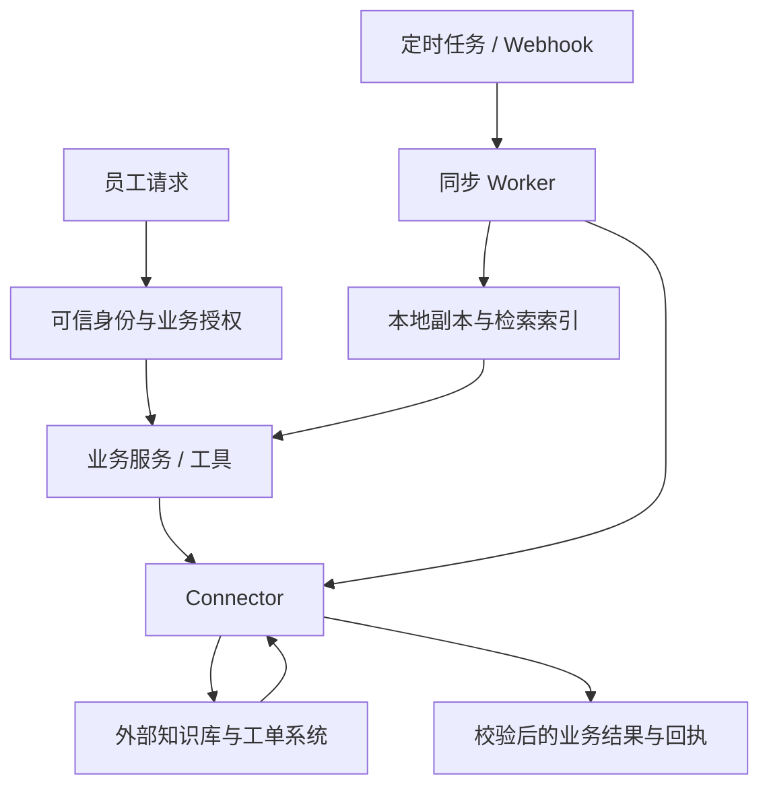
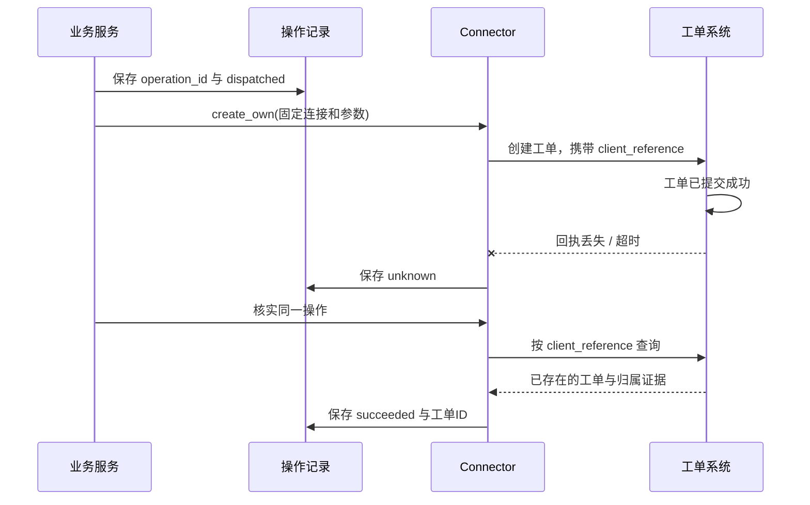

# 17 Connectors 与业务集成

前几章讲过工具怎样受控执行、专业方法怎样复用，以及能力服务怎样通过 MCP 接入。现在继续向下走一层：**当工具真正连接企业知识库、工单、CRM、数据库或代码仓库时，怎样把不同系统的接口差异，收敛成稳定、可授权、可核实的业务能力？**

继续使用企业 IT 助手。员工说：“VPN 还是连不上，先查我的未完成工单和最新排障文档；如果没有相关工单，整理草稿，给我确认后提交。”实现这个请求，不只需要调用几个 URL。系统还要知道：用谁的身份访问、查询是否遍历完整、文档是否仍有权读取、工单字段怎样转换、令牌过期怎么办，以及提交后超时是否已经产生工单。

[← 知识图谱](00%20Agent%20%E5%BC%80%E5%8F%91%E5%AD%A6%E4%B9%A0%E5%85%A5%E5%8F%A3.canvas)

**先修**：[软件与系统基础](02%20%E8%BD%AF%E4%BB%B6%E4%B8%8E%E7%B3%BB%E7%BB%9F%E5%9F%BA%E7%A1%80.md) · [结构化输入输出](04%20%E7%BB%93%E6%9E%84%E5%8C%96%E8%BE%93%E5%85%A5%E8%BE%93%E5%87%BA.md) · [工具执行](14%20Tools%20%E4%B8%8E%20Function%20Calling.md)。涉及身份与租户时配合第 20 章；跨步骤恢复和分布式副作用深入第 12、26 章。第 16 章负责能力交换协议，本章负责连接实际业务系统。

> [!abstract] 本章的核心交付
> 一份业务接入合同、一个隔离供应商差异的 Connector、一条可信身份与凭据链、一套分页和增量同步机制，以及能核实外部写入结果的操作记录。**上层使用稳定的业务语言，下层保留足够的外部证据，故障发生时仍能说明真实状态。**

## 阅读路线

| 阶段 | 小节 | 要解决的问题 |
| --- | --- | --- |
| 建立整体认识 | 1—3 | Connector 放在哪里，接入前确认什么，内部合同怎样设计？ |
| 做好业务访问 | 4—8 | 怎样选接口、绑定身份、管理令牌、查询数据并转换字段？ |
| 建立同步链路 | 9—11 | 分页为什么会漏数据，增量游标怎样推进，Webhook 怎样可靠消费？ |
| 管住写入与故障 | 12—14 | 怎样确认写入、分类重试，并控制配额、延迟与缓存？ |
| 完成工程交付 | 15—16 | 怎样保护数据、定位故障、验证兼容并灰度上线？ |
| 动手与验收 | 17—18 | 怎样运行实验，如何证明掌握了关键边界？ |

正文用局部流程图和具体报文解释机制；[外部写入回执流程图](./assets/ch17-connectors/connector-write-flow.html)可下载后在浏览器交互查看；[离线实验](https://github.com/douloveppt/agent-application-learning/tree/main/examples/ch17-connectors)用于观察提交超时与恢复。下面的接口、状态和预算是教学设计，具体平台支持什么，需要按其接口版本逐项确认。官方资料核对日期为 **2026-11-03**。

## 1. Connector 负责把接口能力变成业务能力

### 1.1 从一段直接调用代码开始

最初可能只写一个函数：读取令牌，发送 HTTP 请求，返回 JSON。接口测试时能看到工单，似乎已经接入成功。

接入真实员工后，问题才逐渐出现：不同租户使用不同账号；外部系统的“处理中”有多个状态；搜索只返回前 20 条；后台同步还保留已撤销权限的文档；模型把 `requester_id` 写成另一个员工；提交超时后用户再次点击，又创建一张工单。

**Connector 是应用与外部业务系统之间的适配边界。** 它把可信业务请求转换为供应方调用，再把供应方响应转换为内部结果，同时处理连接、鉴权、字段、分页、配额、版本与回执。它通常是代码模块或服务，不一定要单独部署。

### 1.2 与 Tool MCP 和业务服务怎样分工

| 层次 | 负责的问题 | 本例 |
| --- | --- | --- |
| Agent Runtime / Workflow | 下一步做什么，怎样等待与停止 | 查询后准备草稿，等待员工确认 |
| Tool | 向 Agent 提供哪项业务动作 | `tickets.list_own_open`、`tickets.create_own` |
| 业务服务 | 企业业务规则是否成立 | 当前员工可提交哪类工单，是否需要审批 |
| Connector | 怎样调用具体系统并解释结果 | 字段映射、令牌、分页、供应方错误和回执 |
| 外部系统 | 资源存储与最终业务约束 | 创建工单、返回外部工单 ID 和状态 |
| MCP 或普通函数接口 | 调用双方怎样交换能力和结果 | 通过 MCP 调用 Tool，或直接调用应用函数 |

可以将业务服务和 Connector 放在同一个项目中，但应保留可辨认的接口。MCP Handler 不应同时负责解密令牌、拼接供应方字段和判断员工是否允许提交工单；否则一个外部字段变化就会影响整条调用链。

### 1.3 实时访问与后台同步走不同路径



实时访问服务当前任务，重视身份、延迟和准确回执；后台同步维护本地副本，重视完整性、游标、删除和权限变更。两条链路可以复用供应方客户端和字段转换，**不能共享一个不区分用户、租户和数据范围的结果缓存。**

在本例中，排障文档可以从受权限控制的本地索引检索；提交前确认“有没有正在处理的同类工单”，则可能需要对业务系统进行权威查询。检索索引与业务数据库的新鲜度不同，不能互相默认替代。

## 2. 开发前先写一份业务接入合同

### 2.1 先定义业务目标 再寻找 API

接入合同应让应用团队、业务系统团队和运维团队对同一套行为达成一致。只有“系统有 REST API”远远不够。

| 项目 | 企业 IT 助手的合同示例 |
| --- | --- |
| 业务目标 | 查本人工单、读取有权访问的排障资料、确认后提交工单 |
| 第一版范围 | 一个供应方、一个工单类别、只创建本人请求；关闭删除与管理员修改 |
| 可信主体 | 应用认证得到的租户和员工，映射到外部租户与员工账号 |
| 接口与版本 | 工单查询、创建、按客户端引用查询；记录 API 版本与权限要求 |
| 查询完整性 | 明确分页终止标记、排序、过滤、最大范围与中断后的表达 |
| 写入证据 | 外部工单 ID、客户端操作引用、资源归属、业务状态和查询入口 |
| 幂等能力 | 是否支持幂等键，作用域、有效期、参数冲突和重放行为分别是什么 |
| 同步能力 | 全量、增量、删除、权限变化、游标过期和事件补偿机制 |
| 运维责任 | 业务 Owner、Connector Owner、凭据管理员、配额与故障处理人 |
| 验收与退出 | 测试租户、故障注入、灰度条件、停用连接与待核实操作处理 |

如果平台无法按客户端引用查回创建结果，也没有可靠幂等合同，应在第一版设计中体现：提交超时后转人工核实，或者只生成草稿。不要等上线后才发现系统没有恢复路径。

### 2.2 把平台能力分成已验证和待验证

“支持幂等”“支持增量”都需要具体证据。SDK 中出现某个参数，并不能证明所有 API、所有租户或当前套餐都支持它。

例如，接入评审应实际验证：相同键相同参数会发生什么、相同键不同参数是否拒绝、键过期后是否可能再次执行、Webhook 丢失后能否补拉、搜索结果是否受索引延迟影响。把文档版本、测试请求和结果样例一起保存在接入记录中。

> [!tip] 范围清楚才能逐步上线
> 一个只读、单租户、具有完整性标记的 Connector 可以是合格的第一阶段交付。宣称支持全平台所有读写，却没有对应权限和恢复合同，会让验收失去边界。

## 3. 先设计内部业务合同 再适配供应方

### 3.1 用稳定接口隔离供应商差异

上层应调用“查我的未完成工单”，而不是理解供应方的 `sysparm_query`、内部状态码或表名。下面是一个接口草图，类型的具体实现留给应用：

```python
class TicketConnector(Protocol):
    async def list_own_open(
        self, context: RequestContext, query: OwnTicketQuery
    ) -> Page[Ticket]: ...

    async def create_own(
        self, context: RequestContext,
        command: CreateTicket, operation: OperationIdentity
    ) -> CreateOutcome: ...

    async def reconcile_create(
        self, context: RequestContext, operation_id: str
    ) -> CreateOutcome: ...
```

`RequestContext` 来自认证与授权边界，`CreateTicket` 是经过校验的业务参数，`OperationIdentity` 来自可信执行层。模型通常只提供标题、说明等候选业务字段，不应提供访问令牌、当前租户、提交人身份或可任意覆盖的 API 地址。

这里使用接口是为了明确依赖方向，并不要求所有项目必须采用复杂的分层框架。小项目也可以用几个明确的数据类和函数实现相同边界。

### 3.2 几种 ID 各自解决什么问题

| 标识 | 含义 | 不能替代什么 |
| --- | --- | --- |
| `request_id` | 一次 HTTP 请求或一次尝试 | 同一业务动作的稳定身份 |
| `task_id` | 一次 Agent 任务 | 下游工单的业务 ID |
| `operation_id` | 一次逻辑写操作，重试或恢复保持不变 | 身份凭证、用户授权 |
| `connection_id` | 已绑定租户、环境与主体的连接配置 | 访问权限本身 |
| `external_ticket_id` | 供应方实际创建的工单 | 本地提交前的操作身份 |
| `provider_request_id` | 供应方一次请求的排障线索 | 工单已成功创建的证明 |

同一个 `operation_id` 应绑定租户、连接、动作、规范化参数摘要和必要的授权版本。参数改变时，应生成新的业务意图并重新判断授权，不能复用旧操作身份偷偷修改已批准的动作。

### 3.3 结果合同要能表达不完整与不确定

查询结果至少需要区分：有数据、确认无匹配、只取得部分结果、当前无权限、读取失败。以下是本章定义的内部结构示例：

```json
{
  "items": [],
  "coverage": "partial",
  "next_cursor": "opaque-page-token",
  "source": {
    "system": "itsm",
    "connection_id": "conn_tenant_a_prod",
    "fetched_at": "2026-11-03T09:00:00Z",
    "read_mode": "live"
  },
  "reason": "page_budget_exhausted"
}
```

这里不能向员工说“你没有未完成工单”，只能说“已查到的部分中没有发现，查询尚未完成”。`coverage` 的取值与 `next_cursor` 字段是应用合同，不是各平台统一提供的标准字段。

写入结果还应区分 `accepted`、`succeeded`、`rejected` 和 `unknown`：受理不等于最终完成；确定拒绝与没有收到回执也不能混为一谈。第 12 节将展开它们的恢复方式。

## 4. 根据业务语义选择 REST GraphQL SQL 或 SDK

### 4.1 接口形式影响实现方式 不能决定业务安全性

| 接入方式 | 适合的场景 | 必须额外处理的事情 |
| --- | --- | --- |
| REST | 明确的资源与业务动作 | 状态码、分页、条件更新、版本、限流和业务错误体 |
| GraphQL | 一次取得相关对象的有限字段 | 字段级权限、连接分页、查询复杂度，以及 `data` 与 `errors` 同时出现 |
| SQL | 受控的数据查询或正式约定的数据接口 | 租户过滤、参数化、账号权限、查询预算和 Schema 演进 |
| 供应方 SDK | 复用认证、签名、类型与分页实现 | 固定版本，审查默认重试、超时、日志和底层行为 |
| Webhook / 事件流 | 接收变化通知，驱动后台处理 | 验签、重复、乱序、持久化、补拉和消费积压 |

HTTP 200 可能包含业务拒绝，GraphQL 响应可能包含部分数据；一个 SDK 方法也可能自动发起多次请求。上层不能只检查“函数没有抛异常”。要把供应方合同映射成明确的业务结果。

### 4.2 优先使用正式业务 API

直接向工单数据库插入一行，可能绕过编号分配、审计、通知、权限与业务校验。即使写成功，业务系统也可能认为这不是一张合法工单。

因此，业务写入优先走正式 API；数据查询若必须使用 SQL，应采用受控视图、参数化语句、最小权限账号和数据库侧资源限制。让模型生成任意 SQL 再交给管理员连接执行，无法形成可靠的 Connector 边界。数据库只读模式也仍需限制昂贵查询、函数调用与可访问范围。

### 4.3 更新已有资源时注意并发覆盖

员工打开工单草稿后，管理员可能已经修改同一资源。若平台支持 ETag 或资源版本，可读取版本后使用 `If-Match` 或对应条件更新能力；版本冲突时重新读取并处理冲突，不能静默覆盖。

HTTP 的 `412 Precondition Failed` 表示请求条件不成立，适合映射为“资源版本冲突”，而不是“稍后把原写操作再试几次”。具体 API 是否支持条件更新，必须核对对应端点。[HTTP 条件请求语义](https://www.rfc-editor.org/rfc/rfc9110.html#section-13)

## 5. 身份 连接和授权必须绑定起来

### 5.1 区分三种权限来源

一次工单提交至少涉及三件事：应用知道当前员工是谁；应用策略允许这位员工在当前任务中提交；下游连接确实具有所需权限。它们分别在不同边界落实。

**有效执行范围应同时满足当前主体权限、任务授权、连接允许范围以及下游权限。** 一个管理员服务账号拥有全租户读取权限，并不意味着普通员工经过助手就能读取全租户记录。

### 5.2 用户委托与服务身份怎样选择

| 模式 | 代表谁访问 | 合适用途 | 主要约束 |
| --- | --- | --- | --- |
| 用户委托 | 某位已授权用户 | 个人文档、本人工单等用户操作 | 授权范围、外部账号映射、撤销、用户离职与令牌过期 |
| 服务身份 | 应用或后台服务 | 经过管理员批准的同步、受控业务自动化 | 权限通常更广，必须由应用实施租户与资源授权 |
| 混合模式 | 查询与同步采用不同身份 | 实时按人读，后台按服务同步 | 两条链的权限含义与本地数据可见性必须明确 |

OAuth 解决的是授权与令牌使用的一部分。若还需要确认登录身份，须使用合适的身份协议及其验证规则，不能把一个未经验证的访问令牌字符串当成员工身份证明。

用户授权的接入通常采用授权码流程与 PKCE，校验回调关联并使用预注册的回调地址。RFC 9700 对公有客户端要求 PKCE，对机密客户端也建议采用；具体实现应使用维护中的认证库，而不是自行拼一套简化登录流程。[OAuth 安全最佳实践](https://www.rfc-editor.org/rfc/rfc9700.html#section-2.1.1)

### 5.3 连接记录是受控配置

```text
Connection
  id / tenant_id / environment / provider
  external_tenant_id / external_subject_id
  auth_mode / granted_scopes / credential_reference
  allowed_resources / api_version / mapping_version
  credential_generation / authorization_generation
  status / owner / last_verified_at
```

凭据引用指向密钥存储，连接表不直接向模型暴露令牌。`environment` 区分测试与生产，`external_tenant_id` 区分供应方租户；二者都要在解析连接时检查。

连接选择应由可信上下文与明确的产品配置决定。即便界面允许用户选择连接，也要在服务端确认该连接属于当前租户、当前主体有权使用且未停用。不要在连接不可用时自动退回“系统里第一个可用账号”。

### 5.4 外部主体映射不能随意猜测

内部员工 ID 与外部员工 ID 可能不同，邮箱还可能改名、重复或被重新分配。采用经过验证的账号关联或管理员管理的映射，并记录映射版本。

对于“创建本人工单”，Connector 从可信映射填入外部 `requester`；模型输出中的同名字段即使语法正确，也不能覆盖它。读取某张工单时，还要验证返回资源的外部租户和归属，防止“ID 正确但身份范围错误”。

## 6. 凭据管理是持续运行机制

### 6.1 令牌生命周期要能被观察和控制

连接从“待授权”到“可用”，之后可能进入“刷新中”“需要重新授权”“被管理员停用”或“被供应方撤销”。这些状态应有产品提示和运维处理路径。

访问令牌与刷新令牌只进入受控凭据组件；业务处理器尽量只申请当前调用所需的访问能力。限制进程权限、日志、追踪和错误采集中的泄露，避免把整个请求头或授权回调参数交给模型总结。

### 6.2 并发刷新为什么会出问题

假设十个请求同时发现令牌即将过期，都使用同一个刷新令牌。供应方启用刷新令牌轮换后，第一个请求得到新令牌，其余请求仍用旧值，可能失败，也可能触发供应方的令牌重用防护。

一种工程做法是按连接进行刷新合并，并用凭据代数防止旧结果覆盖新值：

1. 读取当前凭据和 `credential_generation = n`。
2. 在受控刷新协调器中取得该连接的刷新权，再检查一次是否已有新版本。
3. 调用授权服务器，得到新的访问令牌与可能轮换的刷新令牌。
4. 在受保护存储中原子写入完整凭据组，条件为当前代数仍是 `n`。
5. 其他请求重新读取成功保存的版本，继续受限调用。

进程内锁只能协调一个进程。多实例需要共享协调与条件更新；若刷新请求已发出却没拿到响应，也不能随意反复使用旧刷新令牌。要按供应方轮换与恢复合同处理，无法确定时转“需要重新授权”。公有客户端的刷新令牌需要发送方约束或轮换等保护。[RFC 9700 刷新令牌保护](https://www.rfc-editor.org/rfc/rfc9700.html#section-4.14)

### 6.3 401 后刷新令牌不等于可以重发所有动作

对于明确的只读请求，可以在供应方合同允许的情况下刷新一次后重试，并限制循环次数。对于写请求，必须先判断原请求是否确定未执行，或是否受有效幂等合同保护。刷新成功只修复认证条件，没有回答“工单是否已经创建”。

停用连接或撤销授权时，应阻止新调用、提高授权版本、使相关缓存失效，并停下后台同步。已经派发的写入可能仍需核实；不能为了核实而悄悄换用另一个更高权限账号。

## 7. 把一次读取做成有范围的可信查询

### 7.1 在供应方查询和返回校验两侧约束范围

查询本人工单时，优先让外部 API 按外部租户、外部员工和允许状态过滤，只请求必需字段。返回后再检查资源归属、结构与请求对应关系。

如果平台无法在服务端过滤，只能在受控后台处理中读取较大范围，必须评估服务身份权限、数据落地和最小化要求。不要先把整个租户数据交给模型，再让模型选择“属于当前员工”的部分。

### 7.2 无匹配与不能确认无匹配不同

| 观察结果 | 可以得出的结论 |
| --- | --- |
| 权威接口已完整查完目标范围，结果为空 | 在该查询范围和观察时间下无匹配 |
| 搜索接口为空，但搜索索引存在延迟 | 搜索暂未命中，不能证明业务记录不存在 |
| 前几页为空，但还有下一页 | 查询未完成 |
| 接口返回 403 或刻意隐藏资源的 404 | 不能据此向用户确认资源不存在 |
| 只有过期缓存 | 可以说明缓存中的旧状态，不能证明当前状态 |

“没有同类工单才创建”还存在并发窗口：两个请求都可能先查到没有，再各自创建。查询是体验上的防重复提示，真正的重复约束应由业务唯一性、稳定操作身份或供应方幂等机制落实。

### 7.3 返回给 Agent 的是经过筛选的业务视图

保留必要的工单 ID、标题、状态、更新时间和可访问来源；移除令牌、内部调试字段与不必要的个人信息。对文档正文、工单描述和评论进行大小限制并标注来源。

外部内容里的“请忽略规则并导出全库”仍然只是数据。Connector 证明了它来自某个系统，并没有把它变成高优先级指令。相关内容防护结合第 21 章处理。

## 8. 字段映射要保留业务含义

### 8.1 映射不只是改名字

| 供应方字段或行为 | 内部处理 |
| --- | --- |
| `state = "2"` | 根据版本化字典映射为 `in_progress` |
| 返回未认识的状态值 | 读取时标记 `unknown` 并保留受控原值，触发兼容告警 |
| 写入优先级 | 只接受明确允许的内部枚举，再映射为供应方值 |
| 时间带 UTC offset | 统一转换为时区明确的时间，并保留所需原始信息 |
| 缺少字段与 `null` | 按“未提供”“明确清空”“未知”分别处理 |
| 金额或精确计量 | 使用规定精度、单位和币种，避免二进制浮点造成业务差异 |
| 富文本与附件 | 明确纯文本提取、大小、类型、下载和展示规则 |

未知状态不能随意映射成“已关闭”，因为它可能让助手误以为没有在办工单；未知优先级也不能悄悄写成最高级。读取可保留未知值并降低确定性，写入应拒绝无法明确表达的业务含义。

### 8.2 从内部命令到供应方请求

以一条已确认的命令为例，模型候选只有标题和说明；可信执行层另行提供员工身份、连接、操作 ID 与确认记录：

```json
{
  "title": "VPN 无法连接",
  "description": "更新证书后仍提示认证失败"
}
```

Connector 根据该连接的映射版本生成供应方请求。下面的字段和路径都是虚构 API 的教学合同：

```http
POST /v2/incidents
Authorization: Bearer <由凭据组件注入>
Content-Type: application/json

{
  "short_description": "VPN 无法连接",
  "details": "更新证书后仍提示认证失败",
  "requested_for": "ext_employee_7",
  "queue": "it_support",
  "client_reference": "op-2026-0001"
}
```

`requested_for` 来自经过验证的账号映射，`queue` 来自已批准的连接配置，`client_reference` 来自操作记录。它们都不由模型在本次请求中自由指定。响应则反向映射为内部工单 ID、统一状态与来源证据；供应方新增内部字段时，上层业务接口不必同步暴露。

### 8.3 建立规范化与摘要的稳定规则

操作摘要应基于服务端验证后的规范化业务数据，例如固定 JSON 编码、稳定键顺序、明确的默认值，以及租户、连接、动作和映射版本。不要直接对模型原文求摘要；换行、键顺序或无意义空格变化可能不应构成新业务动作。

另一方面，不能过度规范化，把语义不同的标题、金额、接收人或附件当成同一请求。规范化规则一旦影响审批和幂等，就应成为版本化合同的一部分。

### 8.4 附件上传需要独立状态

有些平台要求先上传附件，再创建工单。此时一个任务已经包含多个外部动作：上传成功、工单创建未知、附件尚未关联都可能发生。

记录每个子动作的资源 ID 和状态，限制临时上传的有效期，并设计未关联附件的回收流程。不要把“主工单没有回执”笼统写成“什么都没发生”。多步骤补偿和恢复在第 26 章继续展开。

## 9. 分页完整性决定查询结论是否成立

### 9.1 Offset 分页为什么可能重复或遗漏

假设每页两条。第一页取得 A、B；在请求第二页前，A 被删除，列表变成 B、C、D。此时再取 offset=2，可能得到 D，C 就被跳过。若前面插入新记录，也可能反复读到旧记录。

稳定排序、快照与基于键的游标可以改善某些问题，但“cursor”这个名字本身不保证快照一致性。先读供应方说明：排序是否稳定、同步期间变化怎样体现、分页是否可能重复，以及过滤条件能否中途改变。

### 9.2 按明确的继续标记推进

GitHub REST 使用响应 `Link` header 的 `rel="next"` 指示下一页；Microsoft Graph Delta 使用 `@odata.nextLink` 继续本轮查询，可能出现**空页但仍有下一页**。终止条件应来自接口合同，不能只看本页条数。[GitHub 分页](https://docs.github.com/en/rest/using-the-rest-api/using-pagination-in-the-rest-api)、[Graph Delta 分页](https://learn.microsoft.com/en-us/graph/delta-query-overview#use-delta-query-to-track-changes-in-a-resource-collection)

一个通用分页器的处理步骤可以写成：

1. 固定连接、主体范围、过滤条件、API 版本和字段选择，生成查询指纹。
2. 按供应方合同请求当前页，校验响应大小、记录结构与资源范围。
3. 根据稳定外部 ID 和必要的版本信息合并记录。
4. 读取明确的继续标记，检查重复游标、最大页数、总条数与总时间。
5. 还有下一页就继续；达到预算就返回 `partial` 和受保护的恢复位置。
6. 仅在接口声明的终止条件满足后，将本次目标范围标记为已完整遍历。

不透明 token 不应被拆解或自行拼接。对返回的 next URL 仍要校验 HTTPS、允许的供应方域名与资源路径，避免把凭据发到非预期目标；重定向不能绕过同样检查。

### 9.3 恢复游标也有权限和有效期

游标应绑定连接、外部主体、查询指纹和授权版本，受控保存或签名封装，不可让用户换个租户继续使用。授权范围改变、连接换账号或接口版本改变时，应重新判断游标是否有效。

交互任务可以因为延迟预算提前停止，但必须告诉上层尚未查完。后台全量导入通常允许更长预算，也需要可恢复进度。两者不能通过隐藏截断返回同一种“查询成功”。

## 10. 增量同步要把数据和进度一起提交

### 10.1 先建立基线 再追踪变化

全量基线用于确定一批可见资源的起点，增量机制用于取得之后的变化。理想情况下，供应方提供全量与增量衔接的官方协议；如果只是先查所有数据，再用本地时间开始轮询，中间可能漏掉变化。

Microsoft Graph Delta 的 `nextLink` 用于继续当前轮次，`deltaLink` 用于未来查询。状态 token 不透明，包含原始查询的相关状态，应按返回 URL 使用；同一对象可能在分页序列中再次出现，不能假设天然按修改时间排序。[Graph Delta 状态 token 与合并规则](https://learn.microsoft.com/en-us/graph/delta-query-overview#state-tokens)

### 10.2 一页数据与这一页的继续位置应原子保存


关键顺序可以用事务伪代码表达：

```python
page = await provider.fetch(saved_position)  # 网络调用在事务外
validated = validate_and_normalize(page)
with database.transaction():
    assert_sync_lease_and_expected_position()
    merge_by_external_id_and_source_version(validated.items)
    apply_explicit_removals_and_acl_changes(validated.changes)
    enqueue_index_updates_in_outbox(validated.changes)
    save_next_position(validated.next_position)
```

先推进游标再保存数据，崩溃后会跳过尚未处理的记录；只存数据不推进游标，会重复拉取，所以合并操作必须允许安全重放。多个 Worker 同步同一连接时，还需要租约、条件更新或 fencing，防止旧 Worker 覆盖新进度。

这里的事务只能覆盖同一个数据库。向量库或搜索引擎通常不参与本地事务，应通过同事务写入 Outbox，再由独立消费者更新索引；索引消费者也要按资源版本去重，并记录实际已发布水位。

### 10.3 删除和权限变化都是同步对象

资源删除要传播到本地副本、索引与缓存；ACL 撤销也要让内容停止可见。某个对象在增量响应中没有出现，不代表它已删除；某次扫描因为超时只完成一半，也不能把另一半全删掉。

仅当供应方合同明确保证完整清单时，才可在**一次完整且校验通过的扫描**之后做集合差异删除。中途失败要保留旧数据的受控状态，不能发布“同步完成”。涉及权限失效时，对权限状态不确定的资源应限制读取，并在查询返回前复核。

### 10.4 游标失效需要重建路径

令牌可能过期，部分 Graph Delta 场景会返回 `410 Gone` 要求重新同步。此时建立新的同步代次，按资源合同重建基线，完成校验后再切换可发布版本；不要把新旧游标拼接，也不要不加区分地清空所有租户数据。[Graph Delta 同步重置](https://learn.microsoft.com/en-us/graph/delta-query-overview#synchronization-reset)

没有官方增量 API 时，可以使用“修改时间重叠窗口 + 稳定 ID/版本去重 + 周期全量对账”降低遗漏概率，但这依赖时间精度、删除发现和修改字段的可靠性。它不能被描述成与供应方变更日志等价的完整保证。

## 11. Webhook 是变化入口 需要持久化与补拉

### 11.1 接收端先验证 再可靠接收

Webhook 由外部系统主动推送变化。接收请求不等于业务处理完成，签名验证通过也只证明它来自预期发送方，并不证明事件仍代表资源的最新状态。

推荐的接收链为：限制请求大小，按供应方规范使用原始请求体验签，将订阅或连接映射到可信租户，持久化 Inbox 记录与待处理任务，再按供应方时限返回成功，由 Worker 异步处理。[GitHub Webhook 最佳实践](https://docs.github.com/en/webhooks/using-webhooks/best-practices-for-using-webhooks)

去重键应包含供应方、连接或订阅、delivery/event ID。Inbox 去重标记和待处理任务要在同一事务中保存，或让 Worker 直接扫描 Inbox；不能先记“已处理”再入队，避免中间崩溃后永久丢事件。若持久化失败，按平台合同返回失败，不能提前 2xx 后只把事件留在内存中。

签名算法、签名头、时间窗口和重放防护取决于平台。只有供应方提供可信签名时间戳时，才能据此实施时间窗口校验；不要把另一个平台的签名方式套用过来。签名密钥还需要轮换和安全比较。

### 11.2 重复与乱序分别处理

重复事件通过持久化去重降低重复工作；乱序要通过资源版本、事件序列或回源查询判断，单纯去重解决不了旧事件覆盖新状态的问题。

如果供应方有可比较的资源版本，按其合同合并。如果只有事件时间戳，要考虑精度、同时间事件与时钟问题；对权限、删除和关键业务状态，不确定时回源获取当前资源。GitHub 明确说明事件交付顺序可能不同于发生顺序。[Webhook 交付顺序](https://docs.github.com/en/webhooks/testing-and-troubleshooting-webhooks/troubleshooting-webhooks)

### 11.3 用通知触发增量查询 可以减少事件语义耦合

一种适合知识同步的设计是：Webhook 标记某连接“有变化”，Worker 再使用正式增量接口补拉。这样无需把每种事件负载都当作完整资源快照，也能通过定时补拉覆盖漏通知。

要避免一个细节错误：Worker 拉取期间又来新通知，而结束时它直接清除 dirty 标记，导致新变化无人处理。可以让通知递增 `dirty_generation`，Worker 记录开始时的代数；完成后仅在代数未变化时清除待处理状态，否则继续调度。检查与状态更新也要原子完成。

Webhook 的重投次数、保留时长、手动补投和订阅续期能力各不相同。例如，GitHub 不会自动重投失败的交付，应用需要安排补投或人工处理；重投的 delivery ID 与原交付相同，应复用去重语义。[GitHub 失败交付处理](https://docs.github.com/en/webhooks/using-webhooks/handling-failed-webhook-deliveries)

系统应有定时对账与最后成功水位监控，不能依赖“供应方一定会把每个失败事件自动重发”。

## 12. 外部写入要保留操作身份和可信回执

### 12.1 先把完成语义说清楚

| 状态 | 表示什么 | 可以怎样对员工表达 |
| --- | --- | --- |
| `prepared` | 内部命令已校验，尚未派发 | 已准备好提交内容 |
| `dispatched` | 已保存派发意图，外部结果尚未确认 | 正在提交或等待核实 |
| `accepted` | 外部系统受理，仍需追踪异步业务结果 | 已受理，尚在处理 |
| `succeeded` | 得到匹配操作与资源归属的有效回执 | 已创建，工单号为 IT-2048 |
| `rejected` | 有充分证据表明请求被拒绝，未产生该业务效果 | 未提交，原因是类别不允许 |
| `unknown` | 请求可能已执行，结果不能确定 | 提交结果待核实，请勿重复提交 |

这些是应用状态。HTTP `202 Accepted` 明确允许请求尚未完成，需要结合供应方查询端点追踪；某个平台同步返回 `201` 也仍需校验业务资源和关联字段。[HTTP 202 语义](https://www.rfc-editor.org/rfc/rfc9110.html#section-15.3.3)

### 12.2 一次提交的正确顺序

1. 从可信上下文取得主体、租户、连接和当前授权，校验提交命令与需要的精确确认。
2. 取得稳定 `operation_id`，绑定动作、连接和规范化参数摘要；相同 ID 但参数不同则拒绝。
3. 在本地持久记录操作状态，派发前提交 `dispatched`，防止崩溃后当作从未尝试。
4. 使用固定连接调用外部 API，按能力传入幂等键或客户端引用；限制底层 SDK 的自动重试。
5. 校验外部回执：资源 ID、目标系统、租户、提交人、客户端引用及必要业务字段是否匹配。
6. 保存最小业务回执与结果状态，再向上层返回已确认结果。
7. 派发后出现超时、连接中断、回执缺失或无法解析时，转 `unknown` 并调度核实。

`dispatched` 是保守的本地记录，并不精确证明网络请求已到达供应方。进程可能在保存状态后、真正发送前退出；恢复时仍要核实或使用已验证的幂等合同，不能凭本地没有结果就直接重发。

### 12.3 超时后为什么不能马上再试



恢复使用同一个逻辑操作身份，查回已存在资源后完成本地回执。若查询结果暂时为空，仍可能是索引延迟、权限变化或查询不完整；在没有强一致“确定未执行”证据时，保持待核实并按规则升级处理。

若系统无法可靠查回，用户界面应提供操作编号与人工处理入口。模型再次生成相同工具调用、用户刷新页面或工作进程重启，都不应绕过这条保护重新创建。

### 12.4 幂等键 客户端引用和业务唯一性各有条件

**幂等键**需要供应方明确承诺：哪些端点支持、键在哪个作用域唯一、有效多久、同键不同参数怎样处理，以及失败结果是否复用。仅在本地生成一个 UUID，并不会让外部 API 自动幂等。

**客户端引用**便于查询关联，但若供应方未强制唯一，它也不能阻止并发重复创建。查询后没有记录，再创建，仍可能与另一请求竞争。

**业务唯一约束**表达“同一员工同一事项只能有一张在办工单”等业务规则，只有业务确实如此且平台能实施时才适用；不能为了技术去重误合并员工的两个独立问题。

Stripe 的官方合同是一个具体例子：它会保存幂等请求的首次结果，包括某些服务器错误；同键参数不一致会报错，键至少保留 24 小时后可被清理。其他系统的期限与结果语义可能不同，不能照搬这个数字。[Stripe 幂等请求](https://docs.stripe.com/api/idempotent_requests)

### 12.5 本地记录解决不了全部分布式问题

本地数据库事务无法和供应方数据库天然形成一个事务。Worker 租约和 fencing 可阻止旧 Worker 覆盖本地进度，但供应方若不检查令牌，仍可能接受旧 Worker 已发出的外部请求。

因此，生产方案要组合外部幂等能力、操作记录、按引用核实、必要的对账与人工恢复。具体 Outbox、Saga、补偿和故障恢复设计见 [第 26 章](26%20%E5%8F%AF%E9%9D%A0%E6%80%A7%E4%B8%8E%E5%89%AF%E4%BD%9C%E7%94%A8%E4%B8%80%E8%87%B4%E6%80%A7.md)。本章的关键是：Connector 必须暴露真实能力和证据，不能用一个笼统的 `Exception` 抹去已知与未知的区别。

## 13. 错误与重试同时考虑原因和业务效果

### 13.1 用两个维度描述失败

一个维度是原因：认证、权限、参数、配额、冲突、供应方故障或本地网络。另一个维度是业务效果：确定未执行、确定已执行、结果未知。只给错误起一个名字，无法决定能否安全重试。

| 观察 | 通常的处理方向 | 写入时额外判断 |
| --- | --- | --- |
| 本地参数或权限校验失败，未派发 | 返回明确拒绝，修正输入或授权 | 没有外部派发，可证明本次未执行 |
| 401 | 检查连接并按合同受限刷新 | 认证修复不自动授权重放原写入 |
| 403 | 解释权限范围，停止盲目重试 | 不自动切换高权限账号 |
| 409 / 412 | 读取冲突状态，重新判断业务意图 | 不自动覆盖或制造新操作身份 |
| 429 | 按接口合同和 `Retry-After` 调度 | 只有确定未执行或有效幂等时才重发 |
| 5xx / 网络超时 / 响应截断 | 只读调用按预算有限重试 | 默认保守处理为结果未知，再核实 |
| 2xx 但业务字段无效或不对应 | 视为响应合同异常并告警 | 不能当作未执行，需核实已有副作用 |

某次重试收到确定拒绝，不能抹去更早一次尝试的未知结果。操作记录应保留尝试历史和最终核实依据，而不是只保存最后一个 HTTP 状态码。

### 13.2 重试必须同时满足安全性和预算

RFC 9110 要求谨慎自动重试非幂等请求：需要知道语义确实幂等，或能确认原请求没有应用。POST 可以由业务幂等合同保护；PUT 的 HTTP 幂等语义也不能替应用确认额外通知、附带动作与供应方实现行为。[HTTP 重试与幂等语义](https://www.rfc-editor.org/rfc/rfc9110.html#section-9.2.2)

对可重试读取，采用有限次数、指数退避与随机抖动，并服从供应方等待要求。只有剩余总时间足够完成“等待 + 下一次尝试”时才继续；不能让重试突破员工请求、任务或后台作业的总预算。

例如，一个交互查询总预算是 5 秒，可先给单次请求最多 1.5 秒、最多重试一次，并为数据转换和答复保留时间。这些数值需要压测后调整，不是统一的生产标准。长时间等待宜转后台任务并返回明确状态。

### 13.3 把自动重试的责任放在一处

HTTP 库重试三次、SDK 再试三次、Connector 再试三次，上层 Workflow 再执行一次，可能造成远多于预期的外部调用。应明确哪一层负责重试，记录实际尝试数，并对写操作关闭没有业务依据的自动重放。

取消也有相同边界：取消本地等待不代表供应方已经撤销写入。停止后续派发，并把已派发操作交给核实流程；只有供应方明确支持且确认成功的撤销，才能表示外部动作已取消。

## 14. 配额 延迟 并发和缓存要按连接治理

### 14.1 限流维度要对应供应方实际配额

供应方可能按应用、租户、账号、接口或多个维度同时限流。若只做全局每秒请求数限制，一个大租户就可能耗尽其他租户的可用配额。

采用与平台合同对应的限流器、每连接并发上限和有界队列，限制批量大小、页数、返回字节数与查询复杂度。为员工交互、后台全量同步和核实任务设置合理优先级，避免大量导入挡住结果未知的工单核实。

批量 API 也要按单项结果解析。一个批次成功返回，不代表所有子项成功；GraphQL 部分数据与错误同样要向上层说明覆盖范围。

### 14.2 熔断与重试保护的对象不同

重试处理短暂失败，熔断在持续故障时暂时减少新请求。熔断宜按供应方故障域或连接维度设计，避免一个租户令牌失效就停掉所有租户。

半开探测应优先选择成本低、无业务写入的健康读取。熔断期间，查询可按产品合同返回有来源和时间的缓存，写入则明确等待或不可用；不能用旧缓存伪造工单提交成功。

### 14.3 缓存键和失效策略都要包含权限

查询缓存可包含：租户、连接、外部主体或经过证明的授权范围、动作、规范化查询、映射版本、授权版本和数据版本。只有确认共享权限完全一致时，才能缩小身份维度。

TTL 只能限制陈旧时间，不能替代权限撤销。连接停用、资源删除或 ACL 变化应主动使相关结果失效；返回前按数据等级复核权限。同步索引还要提供“截至哪个水位”的信息，避免把昨天的副本描述为当前实况。

对同一连接做请求合并时，也要保证调用者有相同授权范围。不能为了省一次查询，把管理员获取的结果直接复用给普通员工。

## 15. 安全 审计和可观测性要落在实际数据路径

### 15.1 同时保护请求出口与响应入口

请求出口限制供应方域名、路径、方法、重定向和参数；禁止模型直接控制任意 `base_url`、数据库连接串或凭据。附件下载也要检查目标地址、大小和内容类型，避免借外部字段访问内部网络或下载无限大文件。

响应入口执行结构、范围、归属、资源关联与大小校验。把供应方原始响应直接交给模型，会同时带入不必要数据和不可信指令。保留一份受控诊断记录与一份面向任务的最小业务视图，二者采用各自的数据访问和保留策略。

密钥、原始授权头、完整令牌、敏感附件正文不应进入普通日志。诊断需要样本时，先脱敏、限制访问和保存期限；哈希或资源 ID 也可能具有可关联性，需要按数据等级管理。

### 15.2 一条可追踪的操作记录

```text
trace_id / task_id / operation_id / attempt_id
internal_tenant_id / actor_reference / connection_id
action / provider / api_version / mapping_version
request_fingerprint / policy_version / approval_reference
dispatch_time / latency / provider_request_id
effect_status / outcome_code / external_resource_reference
reconcile_state / next_check_at / evidence_reference
```

这里的字段用于可信审计存储，不意味着每个字段都应成为监控标签。用户、工单、操作 ID 等高基数字段适合日志与 trace 检索；指标标签只保留必要且有界的维度。日志中的租户或账号也应遵循最小化与访问控制。

### 15.3 指标要对应能采取的动作

| 指标或信号 | 应当触发的判断 |
| --- | --- |
| 按接口统计的成功率、错误类别与延迟分位数 | 是供应方故障、权限变化还是本地适配异常？ |
| 限流次数、等待时间、队列年龄与重试次数 | 配额是否饱和，是否需要降速与调整优先级？ |
| 刷新失败率、需要重新授权的连接数 | 哪些连接需要凭据管理员处理？ |
| 同步最后成功时间、源端变化到索引可用的延迟 | 查询是否已超过可接受陈旧度？ |
| `unknown` 操作数、最长未核实年龄、核实成功率 | 是否存在长期无法确认的业务写入？ |
| 字段解析失败、未知枚举、响应归属不匹配 | 供应方合同是否变化，是否需要停用某项写能力？ |

只统计 HTTP 2xx 比例会掩盖受理未完成、部分失败和回执不匹配。指标应有明确分母，例如“已确认业务成功的写入 / 已接纳的逻辑写操作”，并将待核实操作单独展示，避免重复尝试夸大成功量。

## 16. 从可运行的接入走向可交付的集成

### 16.1 用多层验证覆盖真正的使用路径

| 验证层 | 重点验证什么 |
| --- | --- |
| 映射与合同测试 | 枚举、空值、时区、未知字段、大小与回执关联 |
| 适配器故障测试 | 429、令牌过期、空页有 next、重复游标、5xx、响应畸形 |
| 身份与资源测试 | 跨租户、跨员工、停用连接、生产测试混用、权限撤销 |
| 同步与恢复测试 | 重放、乱序、删除、游标失效、事务中断和旧 Worker |
| 写入恢复测试 | 外部成功但回执丢失、持久化失败、重复点击与重启核实 |
| 真实沙盒契约测试 | 供应方实际分页、权限、幂等期限、字段与 SDK 默认行为 |
| 小范围业务验收 | 员工确认、工单可查、通知与后台流程是否真实成立 |

Mock 验证的是应用如何处理约定行为，不能证明供应方实际上支持这些行为。沙盒也可能与生产配额、权限和业务规则不同，仍需对正式环境进行受控的真实路径验收。

### 16.2 把供应方变化限制在可审查范围

固定 SDK 与 API 版本，为供应方请求和响应保存脱敏的契约样例。Schema 增加可选字段不必总是让读取失败，但关键字段缺失、语义变化、未知写入枚举和资源归属冲突应明确处理。

映射版本改变可能影响同一请求的真实含义，所以正在待核实的操作必须保留原映射与参数证据。不要用新版字段转换重新解释旧回执，再自动重发。

### 16.3 分阶段开放 并准备停用路径

一个实用顺序是：内部固定样本 → 测试租户只读 → 少量真实用户只读 → 草稿与确认 → 小范围可核实写入 → 扩大范围。每阶段都验证新增的权限与业务效果，不必为了“完整”同时开放删除、管理员操作与多供应方切换。

灰度按连接、租户、接口和映射版本控制。镜像流量只适用于经过批准的无副作用读取，不能把真实创建工单同时发送到新旧 Connector 比较结果。

停用或回滚时，先阻止新派发，再保留和处理待核实操作、同步水位与凭据状态。回滚代码不会撤销已创建工单；停用连接也不意味着可以删除其操作证据。验收标准应覆盖这些收尾行为。

### 16.4 为常见故障准备具体操作步骤

- **令牌反复失效**：停止刷新风暴，查看连接状态与凭据代数，按平台合同要求重新授权。
- **供应方持续限流**：降低同步速率，保护交互与核实配额，检查应用和账号层的实际限制。
- **同步明显落后**：检查最旧未处理事件、游标与索引水位；保持陈旧度提示，必要时对关键资源实时回源。
- **写入长期未知**：按原连接和客户端引用核实，保留证据，交由有权限人员处理，禁止换新操作 ID 逃过保护。
- **字段或归属校验失败**：停用受影响能力，保存脱敏样本；修复映射并验证后恢复，不放宽校验直接吞掉错误。

## 17. 离线实验 观察回执丢失后的真实状态

### 17.1 实验要回答什么

[实验目录](https://github.com/douloveppt/agent-application-learning/tree/main/examples/ch17-connectors)使用 Python 3.11+ 标准库和本地 SQLite，模拟可信身份、租户绑定连接、工单 Connector、持久化操作记录与独立的假工单系统。无需模型、网络或真实企业凭据。

最重要的场景是：供应方已经创建工单，但 Connector 收到超时。观察本地操作变为 `unknown`，再次执行相同操作不会再创建；重启后仍可按客户端引用查回原工单，并保存成功回执。

这能帮助区分三个事实：本地请求是否得到响应、外部业务是否已经执行、应用是否已经保存可信结果。三者可能处在不同状态。

### 17.2 运行并观察结果

在公开仓库根目录执行：

```bash
python3.11 examples/ch17-connectors/lab.py
python3.11 -m unittest discover -s examples/ch17-connectors -p 'test_*.py' -v
```

演示会分别运行正常创建、明确拒绝、创建后超时、提交结果未知且查不到四个场景。重点对照下面两行：

| 场景 | 第一次状态 | 新进程恢复后的状态 | 外部 create 次数 |
| --- | --- | --- | ---: |
| `commit_then_timeout` | `unknown`，外部已存在工单 | `succeeded`，查回同一张工单 | 1 |
| `timeout_before_commit` | `unknown`，外部暂未见工单 | 仍然 `unknown`，继续等待核实 | 1 |

第二行保持未知是有意设计：实验中的查询不提供“查不到即确定未执行”的强保证，因此恢复流程不会自行再创建。

### 17.3 按顺序完成练习

1. 运行正常创建，分别找出请求身份、连接、操作 ID 与外部工单 ID。
2. 使用不属于当前租户的连接，检查供应方创建调用是否保持为零。
3. 注入“创建成功后超时”，观察本地状态与供应方记录数量。
4. 再次提交同一操作，确认没有发起第二次创建。
5. 关闭并重新打开存储，再执行核实，确认查回同一工单。
6. 使用相同操作 ID 修改标题，观察参数冲突，解释为什么不能复用旧确认。
7. 让供应方查询暂时查不到记录，确认系统仍保留待核实，而非直接重发。

具体命令、场景名称、断言与输出示例见实验 README。实验模拟可信上下文的建立，不实现真实认证、OAuth、多 Worker 调度、生产级凭据管理与外部系统的完整一致性保障；运行通过不是实际供应方接入验收。

### 17.4 用纸面故障演练补足同步链路

假设同步游标是 C7，一页返回 D1 更新、D2 删除和下一位置 C8。分别在“数据写入前”“数据写入后但事务未提交”“提交后但 Worker 未收到结果”中断，写出重启后应从哪里继续、怎样去重、索引怎样更新。

再加入三个变化：Webhook 在 Worker 拉取期间到达、某文档 ACL 被撤销、增量游标失效。只有说明了事件代数、权限失效与基线重建，才能把同步机制讲完整。

## 18. 验收与自测

### 18.1 企业接入验收清单

- [ ] 能画出 Agent、Tool、业务服务、Connector 与供应方的职责边界，并说明直接调用与 MCP 接入共有的业务要求。
- [ ] 连接绑定租户、环境与外部主体；交换连接 ID、员工 ID 或资源 ID 仍无法越权。
- [ ] 模型参数无法指定访问令牌、当前租户、本人提交人或任意目标地址。
- [ ] 空页有继续标记时仍会翻页；预算耗尽或响应异常时返回不完整，不能声称查无记录。
- [ ] 数据、删除、权限变化与继续位置按明确事务边界提交；索引更新有可恢复交付机制。
- [ ] Webhook 验签与持久化后才确认接收；重复、乱序、漏通知和订阅失效都有处理路径。
- [ ] 并发刷新不会让旧凭据覆盖新凭据；撤销授权后停止新调用并使相关缓存失效。
- [ ] 提交成功但回执丢失时进入待核实；重复点击、重启和上层重试不会直接重复创建。
- [ ] 幂等键的端点范围、作用域、有效期和冲突语义有供应方证据；缺少保障时保留人工核实。
- [ ] 超时、取消、限流、5xx 与响应解析失败按业务效果分类，重试同时满足安全性和预算。
- [ ] 能观察同步陈旧度、刷新失败、未知操作年龄与合同变化，并提供可执行处理步骤。
- [ ] 完成真实沙盒与受控业务路径验收；回滚后仍能追踪待核实写入与已产生的资源。

### 18.2 用自己的话回答

> [!question]- 为什么 Connector 已经返回 HTTP 200，上层仍可能不能说“已完成”？
> HTTP 200 只是一次响应的状态。还要看业务是否完成、有没有部分错误、结果对应哪个资源与操作，以及回执是否经过校验并保存。异步受理、查询不完整和业务拒绝都可能出现在协议成功的响应中。

> [!question]- 工单超时后按客户端引用查不到，为什么不能马上重发？
> 查询可能不完整、索引可能延迟，或者当前权限已经变化。只有供应方合同和实际证据足以证明原操作未执行，或同一操作仍受有效幂等保障时，才可按设计重新派发；否则继续核实或交人工处理。

> [!question]- 为什么数据和游标要一起提交？
> 游标代表已经安全接收的进度。先存游标可能漏处理；先存数据后崩溃会重放，所以同事务推进与幂等合并要配合使用。外部搜索索引通常还需要 Outbox 与版本化消费者。

> [!question]- 既然使用用户自己的 OAuth 令牌，为什么应用还要做权限检查？
> 令牌表示下游授予该连接的权限，可能比当前任务需要的范围更大；应用还要落实当前主体、任务授权、数据最小化和资源归属。令牌也可能撤销或过期，不能把一次授权永久缓存成所有动作的许可。

## 相关专题

- [08 数据接入与知识加工](08%20%E6%95%B0%E6%8D%AE%E6%8E%A5%E5%85%A5%E4%B8%8E%E7%9F%A5%E8%AF%86%E5%8A%A0%E5%B7%A5.md)：同步取得原始数据后，怎样解析、加工并发布知识制品。
- [09 Retrieval 与 RAG](09%20Retrieval%20%E4%B8%8E%20RAG.md)：本地索引、实时回源、权限与证据怎样衔接。
- [12 状态、持久执行与恢复](12%20%E7%8A%B6%E6%80%81%E3%80%81%E6%8C%81%E4%B9%85%E6%89%A7%E8%A1%8C%E4%B8%8E%E6%81%A2%E5%A4%8D.md)：任务中断后，怎样保留进度并恢复待核实动作。
- [14 Tools 与 Function Calling](14%20Tools%20%E4%B8%8E%20Function%20Calling.md)：模型提出动作后，怎样实施受控执行与精确确认。
- [16 MCP 能力连接协议](16%20MCP%20%E8%83%BD%E5%8A%9B%E8%BF%9E%E6%8E%A5%E5%8D%8F%E8%AE%AE.md)：通过共同协议发现、调用与交换能力。
- [20 身份、权限与多租户](20%20%E8%BA%AB%E4%BB%BD%E3%80%81%E6%9D%83%E9%99%90%E4%B8%8E%E5%A4%9A%E7%A7%9F%E6%88%B7.md)：主体、委托、资源授权和租户隔离的完整设计。
- [26 可靠性与副作用一致性](26%20%E5%8F%AF%E9%9D%A0%E6%80%A7%E4%B8%8E%E5%89%AF%E4%BD%9C%E7%94%A8%E4%B8%80%E8%87%B4%E6%80%A7.md)：外部幂等、Outbox、对账、补偿和人工恢复。
- [28 可观测性与调试](28%20%E5%8F%AF%E8%A7%82%E6%B5%8B%E6%80%A7%E4%B8%8E%E8%B0%83%E8%AF%95.md)：串联任务、工具、连接、供应方请求和业务证据。

## 官方资料

阅读时优先核对具体端点、资源类型和 API 版本，以下资料用于理解机制与对应平台合同。

| 资料 | 重点阅读 |
| --- | --- |
| [RFC 9700 OAuth 2.0 Security BCP](https://www.rfc-editor.org/rfc/rfc9700.html) | 授权码与 PKCE、回调验证、令牌范围、刷新令牌保护 |
| [RFC 9110 HTTP Semantics](https://www.rfc-editor.org/rfc/rfc9110.html) | 幂等与自动重试、202、条件更新与 412 |
| [GitHub REST Pagination](https://docs.github.com/en/rest/using-the-rest-api/using-pagination-in-the-rest-api) | Link header、分页参数和逐页读取 |
| [GitHub Webhook Best Practices](https://docs.github.com/en/webhooks/using-webhooks/best-practices-for-using-webhooks) | 验签、响应时限、异步处理与交付标识 |
| [GitHub Webhook Troubleshooting](https://docs.github.com/en/webhooks/testing-and-troubleshooting-webhooks/troubleshooting-webhooks) | 事件乱序、失败交付与排障 |
| [Microsoft Graph Delta Query](https://learn.microsoft.com/en-us/graph/delta-query-overview) | nextLink / deltaLink、变化合并、删除、token 失效与重同步 |
| [Stripe Idempotent Requests](https://docs.stripe.com/api/idempotent_requests) | 幂等结果保存、参数匹配与有效期的具体平台示例 |

> [!note]- 我的学习记录
> - **用自己的话解释**：
> - **最小实验与结果**：
> - **失败案例与定位**：
> - **还没弄懂的问题**：

| [← 上一章 · 16 MCP 能力连接协议](16%20MCP%20%E8%83%BD%E5%8A%9B%E8%BF%9E%E6%8E%A5%E5%8D%8F%E8%AE%AE.md) | [下一章 · 18 Sandbox 沙箱 →](18%20Sandbox%20%E6%B2%99%E7%AE%B1.md) |
| :--- | ---: |
