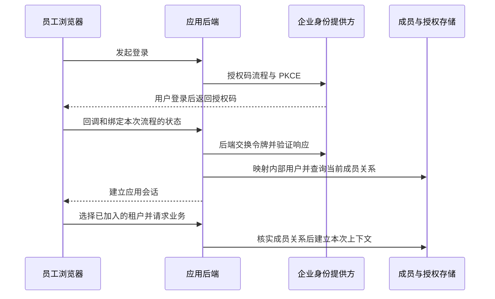
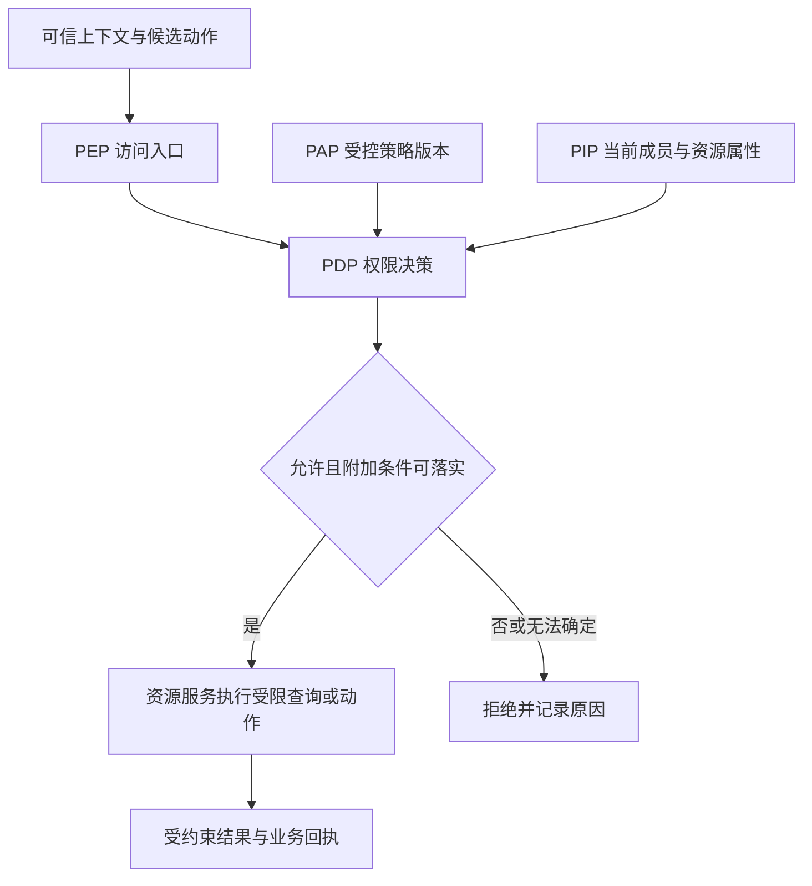
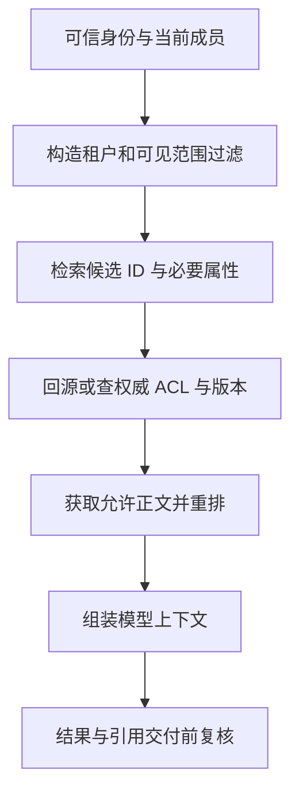
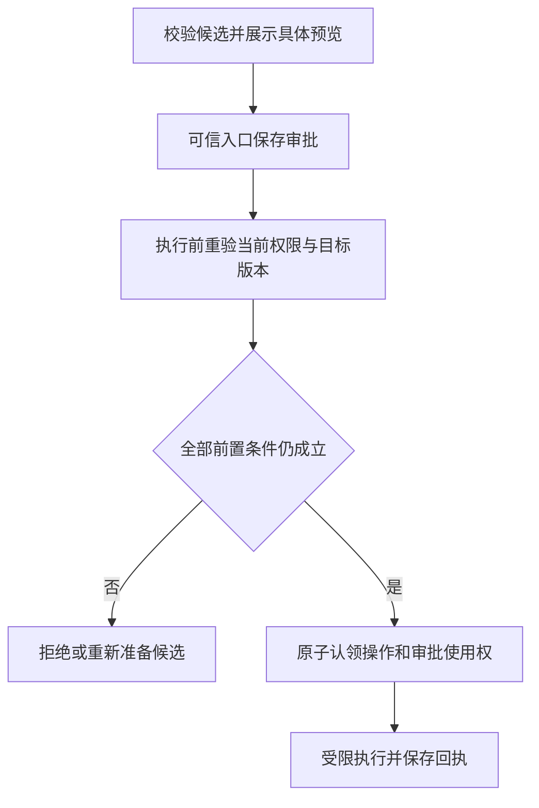

# 20 身份、权限与多租户

员工说：“查一下我的 VPN 工单，参考公司排障文档，整理补充说明，确认后提交。”在演示里，只要模型能找到资料、调用工具，任务就完成了。进入企业环境后，每一步都多了一个条件：**当前执行者在这个时刻，是否有权代表这位员工，对这个租户的这项资源执行这次动作？**

同一个工单 ID 可能来自另一家公司；同一家公司里的两位员工也不应互看私人故障附件。文档昨天允许读取，今天可能已经撤权。任务排队时用户还是支持工程师，执行时却已调岗。即使模型没有受到攻击，这些变化也会让一个“功能正常”的 Agent 泄露数据或越权写入。

**企业身份与权限系统，要把可信身份、资源范围、当前授权和实际执行连成一条可验证的链。** 模型可以提出候选，可信服务决定允许什么，资源服务落实限制，审计记录说明谁代表谁做了什么。

[← 知识图谱](00%20Agent%20%E5%BC%80%E5%8F%91%E5%AD%A6%E4%B9%A0%E5%85%A5%E5%8F%A3.canvas)

**先修**：[目标与自治边界](01%20%E4%BA%A7%E5%93%81%E7%9B%AE%E6%A0%87%E4%B8%8E%E8%87%AA%E6%B2%BB%E8%BE%B9%E7%95%8C.md) · [软件与系统基础](02%20%E8%BD%AF%E4%BB%B6%E4%B8%8E%E7%B3%BB%E7%BB%9F%E5%9F%BA%E7%A1%80.md) · [工具执行](14%20Tools%20%E4%B8%8E%20Function%20Calling.md)。本章负责身份、授权与租户隔离；恶意内容与注入防护见第 21 章，执行环境限制见第 18 章，人工确认与接管体验见第 22 章。

> [!abstract] 本章的核心交付
> 一份身份与资源模型、一张动作权限矩阵、一条可信上下文传播链、一套覆盖数据和执行路径的隔离规则，以及能够证明跨租户、同租户越权和撤权处理有效的验收证据。**登录成功、企业授权、用户确认、业务执行成功，分别回答不同的问题。**

## 阅读路线

| 阶段 | 小节 | 要解决的问题 |
| --- | --- | --- |
| 建立身份与授权模型 | 1—5 | 要保护什么，谁代表谁，登录如何变成可信上下文，角色怎样落到具体资源？ |
| 让权限贯穿数据路径 | 6—9 | 决策放在哪里，数据库、RAG、Memory、会话与缓存怎样保持一致？ |
| 约束真实执行 | 10—13 | 工具委托、具体审批、排队恢复、撤权和密钥怎样落地？ |
| 形成企业交付 | 14—16 | 租户运营、审计、测试和灰度上线怎样配合？ |
| 动手并验收 | 17—18 | 运行离线实验，完成设计题，用失败场景验证关键约束。 |

正文用局部流程图解释机制；[完整授权流程图](./assets/ch20-identity/authorization-workflow.html)可下载后在浏览器打开，[SVG 静态图](./assets/ch20-identity/authorization-workflow.svg)便于预览。完整图按列从左到右、每列从上到下阅读；[离线实验](https://github.com/douloveppt/agent-application-learning/tree/main/examples/ch20-identity)用合成用户与 SQLite 演练权限边界。下面的字段、角色和状态是教学设计，不是某项协议规定的统一格式。官方资料核对日期：**2026-11-03**。

## 1. 先把要保护的边界画清楚

### 1.1 用一个贯穿案例限制讨论范围

假设我们为多家企业提供 IT 助手。甲公司与乙公司分别是两个租户；每家公司的员工可以提问、读取被授权的知识、查询本人工单，并确认后提交补充说明。支持工程师还可以处理分派给自己或所属支持队列的工单。

| 对象或动作 | 本例的范围 |
| --- | --- |
| 普通知识 | 只有明确发布到相应租户或用户组的文档可以使用 |
| 本人工单 | 员工只读本人记录，不能通过替换 ID 访问同事记录 |
| 支持工单 | 支持工程师访问当前获授权队列中的记录，敏感字段另行控制 |
| 写入 | 本例的补充说明需要核对具体内容；审批不能扩大企业权限 |
| 私人记忆 | 按租户与用户隔离；团队知识通过独立的发布流程共享 |
| 后台任务 | 保存受限任务授权，执行和结果交付时重新验证 |
| 平台运维 | 默认管理服务状态，读取客户内容需要单独的受控路径 |

“企业管理员”也要拆解：管理成员与账单，不必然意味着可以读取所有员工附件。若业务确实需要这项能力，应单独定义权限、理由和审计，避免把一个 `admin` 角色变成所有路径的通行证。

### 1.2 区分四类问题

| 问题 | 核心检查 | 典型错误 |
| --- | --- | --- |
| 认证 Authentication | 这份凭证是否证明了受信任的调用者？ | 只解码 JWT，没有验证真实性 |
| 授权 Authorization | 这个主体现在能对这项资源做这个动作吗？ | 只检查“已登录”或 `role=employee` |
| 用户确认或审批 | 本次具体动作是否已有覆盖它的有效同意？ | 把“好的”保存成可重复使用的万能批准 |
| 租户隔离 | 数据、执行和运营路径是否保持租户边界？ | 主接口隔离了，缓存或导出接口仍然串租户 |

例如，员工已登录、有权修改本人工单，但还没有确认这次补充说明，系统应等待确认。若工单属于另一家企业，即使员工点击“确认”，也必须拒绝。若工单已经关闭，授权允许也不能替代“禁止继续补充”的业务状态校验。

### 1.3 把攻击面与正常变化一起考虑

不只考虑攻击者主动换 ID，也要考虑正常用户切换公司、成员权限更新、连接器账号重新绑定、缓存未失效、Worker 恢复旧检查点，以及模型把从文档里读到的 `tenant_id` 原样传给工具。

第一轮设计至少列出三条不可破坏的约束：**不把未获授权的数据交给模型；不让委托扩大权限；不让旧任务绕过当前授权。** OWASP 将默认拒绝、每次请求校验以及对象级访问控制列为授权设计基础。[OWASP Authorization Cheat Sheet](https://cheatsheetseries.owasp.org/cheatsheets/Authorization_Cheat_Sheet.html)

## 2. 建立主体 租户与资源模型

### 2.1 一次调用里可能有多个身份

“Agent 的身份是谁”不能只用一个 `user_id` 回答。至少需要区分以下角色：

| 概念 | 含义 | 本例 |
| --- | --- | --- |
| 用户主体 Subject | 业务上代表的用户或服务主体 | 提出请求的员工 |
| 执行者 Actor | 当前实际调用下游的主体 | Agent Worker 的工作负载身份 |
| 租户 Tenant | 本次业务归属与管理边界 | 甲公司 |
| 成员关系 Membership | 用户在某租户中的有效关系 | 员工在甲公司的在职成员资格与角色 |
| 资源 Resource | 被访问的具体对象及其属性 | 工单、文档、附件、会话、审批、任务 |
| 资源拥有者 Owner | 资源归属或业务权利相关方 | 工单申请人；可能与当前执行者不同 |
| 委托 Delegation | 代表主体执行受限动作的授权 | 允许 Worker 为员工提交这一条补充说明 |

一个用户可以属于多个租户，在不同租户里拥有不同角色。因此，角色应挂在成员关系上；不要把“用户曾经在某处是管理员”存成全局 `is_admin=true`。

外部登录主体通常以可信 `issuer + subject` 组合映射到内部用户，不能只靠邮箱字符串合并账号。邮箱可能更改，多个身份源可能出现相同显示地址，企业域名也不足以证明成员关系。

### 2.2 让资源天然携带归属

建议在资源模型中明确写出 `tenant_id`、稳定资源 ID、拥有者或所属项目、敏感级别、版本、生命周期状态，以及支持权限判断的关系。

```text
User                         内部用户
Tenant                       企业租户
Membership(tenant, user)      成员状态、租户内角色、授权版本
Ticket(tenant, ticket)        申请人、队列、状态、版本
Document(tenant, document)    来源、ACL 引用、密级、版本
Task(tenant, task)            代表谁、允许动作、委托期限、取消状态
Approval(tenant, approval)    谁批准了哪个动作、参数摘要和目标版本
```

ACL 是访问控制列表，描述哪些用户、组或角色可以访问资源。资源 ID 即使采用随机 UUID，也只降低猜测概率，不能代替权限校验。批量查询、历史版本、附件下载和任务状态接口都要验证归属。

### 2.3 平台控制面与租户数据面分别授权

控制面负责租户开通、成员管理、连接配置、配额和账单；数据面负责读取文档、查询工单、执行动作和交付结果。两者可以共用基础身份设施，但权限必须区分。

平台管理员可能有权暂停某租户，仍然没有权读取其工单。租户管理员可能有权接入知识库，仍然不能把来源系统不允许共享的文档发布给所有员工。对“管理资源”和“读取内容”分别定义动作，可以减少权限扩散。

## 3. 把企业登录接成可靠的认证边界

### 3.1 SSO OAuth OIDC 和会话各做什么

SSO 是跨应用单点登录的体验与体系；OIDC 在 OAuth 2.0 之上表达用户认证；OAuth 主要表达访问资源的委托授权。企业也可能使用 SAML 登录，再由应用建立自己的会话。

| 凭证 | 通常交给谁 | 应检查什么 |
| --- | --- | --- |
| OIDC ID Token | 登录客户端 | 可信签发者、客户端受众、签名、期限以及流程要求的 nonce 等 |
| OAuth Access Token | 目标资源 API | 该 API 的受众、令牌有效性与所需权限 |
| Refresh Token | 获准续期的客户端后端或受控客户端 | 续期规则、轮换或发送方约束、撤销与安全存放 |
| 应用会话 Cookie | 应用自己的后端 | 会话状态、期限、用户绑定及请求防护 |
| 工作负载凭证 | 服务与服务之间 | 工作负载身份、目标服务、允许的调用范围 |

ID Token 表达面向客户端的认证结果，不应被当作任意 API 的通用访问凭证；Access Token 也不要求一律是 JWT，可能是需要向授权服务器核实的不透明字符串。[OpenID Connect Core 1.0](https://openid.net/specs/openid-connect-core-1_0.html)

### 3.2 一个常见的 Web 登录链路



使用成熟认证组件处理重定向地址、登录事务绑定、令牌验证和密钥轮换。对采用授权码的现代接入，可按平台能力使用 PKCE 的 `S256` 方法，并验证本次流程所需的 `state`、`nonce` 等关联值，防止把别人的登录结果接入当前会话。RFC 9700 也强调限制令牌的权限与目标受众。[OAuth 2.0 Security BCP](https://www.rfc-editor.org/rfc/rfc9700.html)

Cookie 会话需要适当的 `Secure`、`HttpOnly`、`SameSite` 设置，并对修改状态的请求实施 CSRF 防护。跨站部署按具体登录架构配置；把 Cookie 设为 `HttpOnly`，并不能自动阻止浏览器携带它发送被诱导的请求。

### 3.3 验证 JWT 要比解码多做几步

Base64 解码只能读取声明。JWT 验证还要依据受信任配置选择签发者、允许的算法与密钥，检查签名、目标受众、有效期及必要声明；不能由令牌自己指定一个任意密钥地址供服务端信任。不同用途的令牌应有清楚的验证规则，避免用一种有效令牌冒充另一种用途。[JWT Best Current Practices](https://www.rfc-editor.org/rfc/rfc8725.html)

密钥更新时应按可信签发者管理缓存与刷新，遇到未知密钥不能直接跳过签名检查。不要在日志里打印完整令牌来“方便定位”；使用内部请求 ID、签发者标识和安全的失败原因即可。

### 3.4 登录生命周期与成员生命周期分别管理

登录尚未过期，不代表用户仍在职、仍属于原租户，或仍具备原角色。企业目录、SCIM 或成员管理事件可以同步加入、停用与调岗信息，但要定义同步延迟和失联时的行为。

本例让身份凭证回答“你是谁”，让当前成员与策略数据回答“你现在可以做什么”。关键写入查权威状态；普通读取如果使用短期授权缓存，要明确最大陈旧窗口。仅把 Access Token 寿命设短，不能替代所有撤权处理。

## 4. 构造可信请求上下文并贯穿调用链

### 4.1 客户端可以选择租户 服务端负责证明选择有效

用户切换公司时，客户端可以提交一个租户选择值；服务端必须验证当前用户确实是该租户的有效成员。`X-Tenant-ID`、URL 路径、JSON 参数都只能作为选择线索，不能直接变成授权事实。

模型工具参数中的 `user_id`、文档中的“当前组织”，甚至上一条模型回复，也不能用来建立真实身份。对“为本人创建工单”的工具，最好不向模型开放可任意填写的申请人字段，由服务端从可信上下文注入。

### 4.2 形成不可由业务候选改写的上下文

下面是自定义内部类型的示意。它不是身份令牌，也不能因为使用了不可变对象就自动可信；可信性来自认证入口、成员查询和传播边界。

```python
from dataclasses import dataclass

@dataclass(frozen=True)
class RequestContext:
    tenant_id: str
    subject_id: str          # 本次代表的业务主体
    actor_id: str            # 实际调用的工作负载或用户
    membership_version: int # 建立上下文时观察到的版本
    request_id: str
    delegation_ref: str | None
```

上下文与模型候选分别传给业务服务：`execute(ctx, candidate)`。不要先把它们合并成一张字典，再允许候选通过同名键覆盖 `tenant_id`、`subject_id` 或 `delegation_ref`。

`membership_version` 是检测陈旧状态的依据，不能代替执行时查询。已有上下文里写着 `support_engineer`，也不能证明这位员工现在仍拥有该角色。

### 4.3 传播方式要符合信任边界

| 边界 | 可用方式 | 需要避免的问题 |
| --- | --- | --- |
| 同一进程 | 显式传递上下文，必要时辅助使用请求局部变量 | 全局变量被并发请求覆盖，后台协程继承了错误上下文 |
| 服务之间 | 认证服务调用者，使用可验证的受众受限令牌或受控内部合同 | 公网可伪造的身份 Header 直接透传到内部 |
| 消息队列 | 受控任务记录引用、完整性保护及 Worker 身份 | 消费者把队列中的 `role=admin` 当作当前授权 |
| 外部 Connector | 服务端映射到指定租户和账号绑定 | 使用池中任意可用凭证，跨租户回退 |

如果网关注入身份 Header，应剥离外部同名字段，并让后端只接受可信网关路径；服务间仍应验证真实调用者。服务网格的 mTLS 能证明某个服务建立了连接，不能单独证明它代表哪个员工、有权读取哪张工单。

## 5. 从权限矩阵走到可执行策略

### 5.1 先写动作与资源矩阵

权限名应反映业务意图，例如 `ticket.read_own`、`ticket.append_own`、`ticket.handle_assigned`、`tenant.members.manage`。不要只用 `read`、`write` 两个大开关。

| 主体 | 动作 | 资源条件 | 本例的附加要求 |
| --- | --- | --- | --- |
| 员工 | 读取工单 | 当前租户，申请人为本人 | 返回员工可见字段 |
| 员工 | 补充说明 | 当前租户，本人工单仍开放 | 具体内容确认、版本匹配、限制附件去向 |
| 支持工程师 | 处理工单 | 当前租户，当前分派或队列关系成立 | 敏感字段按职责授权 |
| 知识编辑者 | 发布文档 | 当前租户，拥有编辑与发布权限 | 不突破来源 ACL 和目标人群范围 |
| 租户管理员 | 管理成员 | 当前租户，有相应管理权限 | 关键角色变更按企业规则复核 |
| 同步服务 | 更新文档索引 | 指定连接和租户的同步范围 | 不能用同步凭证直接向员工返回全部内容 |

矩阵同时包含纵向权限与横向范围。普通员工调用管理员动作属于纵向越权；替换成同事的工单 ID 属于横向越权。只检查角色，通常只能覆盖其中一部分。

### 5.2 RBAC ABAC 和 ReBAC 可以组合使用

| 方法 | 依据 | 适合的部分 | 单独使用的局限 |
| --- | --- | --- | --- |
| RBAC 基于角色 | 员工、支持工程师、成员管理员 | 组织职责与操作集合 | 难以仅靠角色表达“本人且仍开放的工单” |
| ABAC 基于属性 | 租户、资源密级、状态、时间、认证强度 | 细粒度条件与动态约束 | 属性来源与规则组合需要治理 |
| ReBAC 基于关系 | 属于项目、被分派、文档共享给用户组 | 协作资源与关系传播 | 关系撤销、嵌套与一致性需要处理 |

实践中可以先用角色决定候选动作，再用资源属性与关系判断这次访问。角色不要细分到“甲公司 VPN 工单 102 的临时审批人”这种程度；具体对象适合由属性或关系表达。

用一句可读的规则描述本例：**有效成员可以在当前租户读取自己申请的工单；支持工程师可以读取当前被授权队列的工单；返回字段仍受敏感级别约束。** 然后再把它翻译成代码或策略语言。

### 5.3 有效权限取多个约束的交集

```text
有效范围 = 当前主体的业务权限
         ∩ 当前执行服务允许的能力
         ∩ 租户与资源关系
         ∩ 任务委托的动作和期限
         ∩ 下游系统实际授予的范围
```

对于需要用户确认的动作，还要满足“具体批准覆盖当前候选”；业务状态、预算和数据去向同样要合法。这里的交集是设计原则，不是一项 OAuth 协议自动完成的计算。

新增角色、动作或资源类型默认没有权限。企业规则也应明确冲突如何处理，例如显式禁止优先、无法取得必要属性时拒绝。不要让模型通过解释一段自然语言来临时决定冲突的优先级。

## 6. 将权限决策与执行限制接起来

### 6.1 四个职责可以先放在一个服务里

PAP 管理策略，PIP 提供身份与资源属性，PDP 作出决策，PEP 在真实访问处执行限制。它们是职责划分，不要求第一版就部署四个微服务。



模型只看到它获准使用的工具，能够减少误用；真正的权限检查仍放在工具执行器和资源服务。未暴露给模型的接口，也不能因为“模型不知道它存在”而省略校验。

### 6.2 决策应返回可执行的约束

```json
{
  "effect": "allow",
  "decision_id": "dec-demo-17",
  "policy_version": "it-policy-v4",
  "action": "ticket.read_own",
  "resource": {"type": "ticket", "id": "ticket-42"},
  "obligations": {
    "row_scope": "current_tenant_and_requester",
    "field_set": "employee_visible",
    "max_rows": 1,
    "audit_required": true
  }
}
```

这是教学用内部格式。`obligations` 表示“允许的前提必须由执行器落实”，例如只返回指定字段。执行器不认识某条必要约束时，不能忽略它继续执行。`decision_id` 用于关联证据，不是可重复兑换的访问令牌。

对外通常只暴露安全的原因码和下一步，对内记录准确的策略与属性版本。需要更多身份信息时可以要求重新认证；策略不可用或属性未知时返回明确的不可执行状态，不能悄悄放行。

### 6.3 选策略实现时关注可验证性

小团队可以从集中式业务授权函数开始；动作与租户规则增多后，再考虑嵌入式或远程策略引擎。关键选择包括：谁更新策略、如何审查和回滚、属性从哪里来、如何处理缓存、决策延迟能否满足业务，以及所有访问路径是否经过 PEP。

远程 PDP 带来独立治理，也增加网络依赖；嵌入式决策减少网络开销，但策略分发和版本一致性需要管理。无论使用哪种引擎，都不能替代数据库范围约束、可信身份传播与负向测试。

## 7. 在数据库与存储边界落实租户范围

### 7.1 先缩小查询范围 再读取数据

以下参数由服务端上下文提供，`ticket_id` 才是候选目标。SQL 示例中的 `:name` 表示由数据库驱动绑定的参数，实际占位符语法按所用驱动调整：

```sql
SELECT ticket_id, title, public_status
FROM tickets
WHERE tenant_id = :trusted_tenant
  AND ticket_id = :candidate_ticket
  AND requester_id = :trusted_subject;
```

对本人读取，这种查询让“没有访问范围”直接表现为没有可返回记录。它也减少了先取出另一租户完整对象再检查的机会。某些复杂策略需要先读取少量授权属性，此时同样要限定可信租户，不能先把正文、附件和秘密全部加载。

更新时同时带上资源归属与预期版本，检查受影响行数：

```sql
UPDATE tickets
SET public_note = :validated_note, version = version + 1
WHERE tenant_id = :trusted_tenant
  AND ticket_id = :candidate_ticket
  AND requester_id = :trusted_subject
  AND status = 'open'
  AND version = :expected_version;
```

零行更新意味着预条件没有满足，不能报成功。参数绑定防止 SQL 注入；`WHERE` 中的范围条件防止访问越界，两者分别解决不同问题。

### 7.2 在数据结构中保留租户关系

```sql
-- 结构示意；字段类型和 ID 策略按实际数据库确定。
CREATE TABLE tickets (
    tenant_id TEXT NOT NULL,
    ticket_id TEXT NOT NULL,
    requester_id TEXT NOT NULL,
    version INTEGER NOT NULL,
    PRIMARY KEY (tenant_id, ticket_id)
);

CREATE TABLE attachments (
    tenant_id TEXT NOT NULL,
    attachment_id TEXT NOT NULL,
    ticket_id TEXT NOT NULL,
    object_ref TEXT NOT NULL,
    PRIMARY KEY (tenant_id, attachment_id),
    FOREIGN KEY (tenant_id, ticket_id)
        REFERENCES tickets (tenant_id, ticket_id)
);
```

复合外键可以阻止甲公司附件误挂到乙公司工单，不能自动证明当前用户有权读取附件。还要验证成员、工单关系、字段权限和对象存储访问。

对象存储路径可带租户命名空间；下载入口先授权，再签发目标明确、短时有效的下载凭证。路径前缀不是权限本身，预签名链接也可能被持有人转用；若要求撤权后立即拒绝下载，应采用能再次检查授权的代理或等效机制。

### 7.3 PostgreSQL RLS 作为数据库中的范围约束

下面仅展示**租户层**的行级安全，不包含本人工单、队列关系、字段权限或完整数据库角色配置：

```sql
ALTER TABLE tickets ENABLE ROW LEVEL SECURITY;
ALTER TABLE tickets FORCE ROW LEVEL SECURITY;

CREATE POLICY tenant_scope ON tickets
    USING (tenant_id = current_setting('app.tenant_id', true))
    WITH CHECK (tenant_id = current_setting('app.tenant_id', true));

-- 应用在每次受控事务开始后设置；值来自认证上下文。
BEGIN;
SELECT set_config('app.tenant_id', :trusted_tenant, true);
-- 执行本事务的受限业务查询。
COMMIT;
```

`USING` 控制可访问的既有行，`WITH CHECK` 约束插入或更新后的行。运行角色应与迁移和表所有者角色分离；超级用户和 `BYPASSRLS` 角色能够绕过 RLS，表所有者通常也会绕过，`FORCE` 可让所有者受规则约束，但不能消除前两类角色的绕过能力。[PostgreSQL Row Security Policies](https://www.postgresql.org/docs/current/ddl-rowsecurity.html)

使用连接池时，租户设置应有明确的事务范围，所有异常、回滚和连接复用路径都要验证。若应用允许不可信 SQL 自行更改会话变量，这个示例就不能提供所期待的隔离；它适用于应用代码可信、查询入口受控的场景。

视图、提权函数、批量任务、统计接口和备份使用不同访问路径，需分别检查。数据库中的租户约束也不会自动覆盖向量库、缓存和对象存储。

## 8. 让 RAG 在数据进入模型之前完成授权

### 8.1 数据接入时就保留来源权限

文档切块后，每个片段仍应关联租户、来源对象、当前版本、ACL 引用与权限更新信息。不能只保存 `text + embedding`，等回答时才想起“这段文字原本谁能看”。

例如，一篇 VPN 排障说明的正文对所有员工可见，但附件只向支持组开放。把附件文字合入正文的公共片段，会改变实际可见范围。拆分、摘要与合并都需要保留权限语义；跨来源合成不能把受限部分悄悄提升为公共内容。

### 8.2 一个受权限约束的检索链路



过滤条件由服务端构造。模型可以提出检索关键词，不能把 `tenant_id` 改为另一家公司，也不能删除 ACL 过滤器。对于复杂用户组，先形成授权候选集合或通过受控检索服务执行，不依赖模型枚举“我应该属于哪些组”。

向量数据库支持元数据过滤，并不自动代表已实现完整授权；需要验证过滤是在何时执行、分页与召回是否受影响，以及无正文权限的候选会不会被发到外部重排服务。

### 8.3 为什么只在索引里保存 ACL 还不够

索引与源系统常有同步延迟。文档撤权、删除、重新共享或成员离组后，旧片段可能仍然存在。对敏感内容，应在正文读取前根据权威状态复核，无法验证的片段不进入上下文；同时推进索引失效与重建。

权限过滤可能让结果不足。此时可以在相同授权范围内扩大候选、重试检索或返回证据不足；不能取消过滤来补满 Top K。搜索标题、命中数量、自动补全和聚合统计也可能透露信息，应采用与内容相称的可见范围。

### 8.4 撤权还会影响已经形成的答案

把秘密发给模型后，再要求它“不说出来”，已经越过了数据边界。把秘密总结成一句话，也不会自动消除其访问限制。

需要为答案保存使用过的来源和版本。若生成期间权限发生变化，敏感业务可在交付前重验依赖，取消本次回答并基于剩余授权内容重新生成。流式输出应定义分批交付的权限检查与停止机制；已经发出的内容不能靠后续撤权追回。具体时效承诺要与第 12 节的撤权语义一致。

## 9. 隔离会话 Memory 与各种缓存

### 9.1 会话 ID 不能直接兑换聊天记录

用户提供 `conversation_id`、`run_id`、`task_id`、`artifact_id` 时，先验证租户及可见关系。查询状态、订阅 SSE / WebSocket、断线重连、取消任务、下载结果都属于访问路径。

一个难发现的泄露是：新请求的数据库查询已经隔离，但复用了别人的对话历史。上下文装配要验证会话的当前归属；租户切换后不能自动带入上一家公司的正文、文件与模型缓存会话。

### 9.2 私人记忆与团队知识采用不同写入规则

私人记忆可按 `(tenant, subject, memory)` 管理；团队知识通过明确的发布入口、目标人群和来源审查进入共享范围。模型从私人对话中提炼出“有用经验”，不能直接写入所有员工共享记忆。

Memory 的读取、写入、纠正、搜索、删除与导出都要验证权限。离职、退组和账号合并时，处理成员变化与业务归属；不要只删除当前数据库行，却保留可命中的旧向量、摘要和恢复快照。具体保留与删除规则见 [数据治理](32%20%E6%95%B0%E6%8D%AE%E6%B2%BB%E7%90%86%E4%B8%8E%E6%8C%81%E7%BB%AD%E6%94%B9%E8%BF%9B.md)。

### 9.3 缓存命中仍然是一场新的访问

```text
危险键：answer:{question_hash}

受限答案键示意：
answer:{tenant}:{subject_or_acl_scope}:{authz_epoch}:
       {source_versions}:{prompt_version}:{question_hash}
```

键需要包含所有会改变结果或可见范围的因素，但键隔离仍不能替代授权。先检查当前身份，再读取缓存；命中后还要判断授权和来源依赖是否仍有效。仅给缓存设置十分钟 TTL，就意味着在缺少其他机制时可能有十分钟的陈旧窗口。[OWASP Multi Tenant Security](https://cheatsheetseries.owasp.org/cheatsheets/Multi_Tenant_Security_Cheat_Sheet.html)

权限变化可增加租户、成员或资源的授权版本，配合失效事件和权威复核。只有版本真正随相关变化更新，版本号才有意义。跨用户共享答案必须证明其来源对整个共享范围都可见；不确定时采用更窄的范围。

### 9.4 不同缓存有不同的数据边界

| 缓存或复用对象 | 需要关注的范围 |
| --- | --- |
| 检索候选与正文缓存 | 租户、资源版本、当前 ACL、必要的用户组关系 |
| 最终答案与摘要 | 所有依赖来源的可见范围、用户上下文、生成配置 |
| 授权决策缓存 | 主体、动作、资源、相关属性与版本、失效机制 |
| LLM 前缀或会话缓存 | 内容是否受限，供应方隔离与保留能力，缓存引用归属 |
| 幂等回执 | 租户、主体或业务委托范围、动作、操作键与参数摘要 |

哈希只改变表示方式，不会把敏感正文变成公共数据。缓存索引、调试页面、批处理临时文件和评测样本也需要采用对应的范围控制。

## 10. 对工具 Connector 与多 Agent 实施受限委托

### 10.1 工具参数表达业务目标 凭据由服务端选择

下面这个工具只接受目标和业务内容：

```json
{
  "name": "ticket.append_own",
  "arguments": {
    "ticket_id": "ticket-42",
    "note": "已重装 VPN 客户端，仍出现连接超时。",
    "expected_version": 7
  }
}
```

执行器从上下文取得真实租户和用户，检查动作与资源，再选取该租户已绑定的 Connector。工具不接受任意 `credential_ref`、目标 URL、申请人或租户覆盖值。确实需要“代他人操作”时，建立单独动作与权限，不能复用本人接口再偷偷开放一个 `user_id` 参数。

连接器账号切换、重新授权或租户重新绑定后，要让旧任务引用失效或重新校验。不能因甲公司的凭证过期就改用乙公司的可用凭证。

### 10.2 服务账号范围更大时 要防止受诱导的代理越权

假设连接器持有能读取甲公司所有工单的服务账号。员工虽然只请求本人工单，模型却传来另一位员工的 ID。如果连接器只检查“我的服务账号能够读取”，就会利用自己的大权限替员工越权。

这类问题常称为 confused deputy：拥有更大权限的服务被诱导替调用者做它无权请求的事。应在服务账号权限之外，落实当前主体、租户、资源关系与任务委托限制；下游支持用户委托时，优先使用能表达该范围的凭证。必须使用宽权限服务账号时，对应用层授权与审计承担更高要求。

### 10.3 令牌交换只是一种实现委托的手段

下游支持时，可以通过受控令牌交换取得目标服务受众明确、动作和期限受限的凭证。RFC 8693 区分代表用户执行的委托与在某个范围内表现为用户的模拟身份，并提供表达主体与执行者的机制；具体交换策略由部署方决定。[OAuth 2.0 Token Exchange](https://www.rfc-editor.org/rfc/rfc8693.html)

不要把给 Agent API 的 Access Token 原样传给任意下游。下游必须验证自己是合法受众，并验证调用者、委托关系与业务权限。模型上下文只需要知道能力是否可用，不需要看到令牌正文。

### 10.4 子 Agent 继承范围时只能收窄

协调者可以把“检索甲公司可见 VPN 文档”委托给检索 Agent，不能让后者自行改成“搜索所有租户”。子任务应携带受控委托引用、动作集合、资源范围、期限和父任务关联；子 Agent 的服务身份不等于用户权限。

结果返回后，父层也要核实来源、资源范围和当前有效性。多一层模型不会增强授权可信度。若子 Agent 需要超出父任务范围，应通过可信入口建立新的有效授权，不能靠模型互相声明“管理员已同意”。

## 11. 将具体审批与当前授权绑定

### 11.1 企业允许与用户同意需要同时成立

本例要求员工核对补充说明后提交。这是一项产品规则，不意味着所有写入都必须多弹一次确认；已经明确覆盖具体动作的有效授权可以直接使用。需要审批时，审批对象应是确定的业务动作。

```text
审批绑定内容：
租户 + 代表的主体 + 合法批准者 + 动作 + 目标资源
+ 参数规范化摘要 + 目标版本 + 委托或任务引用
+ 有效期 + 使用状态
```

批准者通过可信认证入口操作，且其本人有资格批准该动作。模型参数里的 `approved=true`、文档里的“领导已审批”、别的用户提供的审批 ID，都不能构成批准证据。拿到审批引用后，也必须验证它属于当前范围。

### 11.2 参数摘要需要稳定且覆盖实际副作用

先按工具合同校验参数，补齐服务端确定的默认值，再按稳定序列化规则生成摘要。标题、正文、收件人、附件、可见范围、目标系统等会改变实际效果的字段都应纳入；执行器使用同一份不可变候选。

摘要用于比较，真实性来自服务端审批记录或可验证授权，不能凭一个 SHA-256 值证明用户已经同意。附件应引用稳定内容版本或内容摘要，避免批准的是文件 A，执行时同一路径被替换成文件 B。

### 11.3 处理检查与使用之间的状态变化

用户在 10:00 批准版本 7，10:01 工单被转交或关闭。10:02 Worker 执行时，应重新查询当前成员、资源关系、状态和版本；变化使原审批不再适用时，重新形成候选或返回冲突。



这属于检查与使用之间的时间差问题，也称 TOCTOU。单机里“先检查一次，再执行”仍存在并发窗口。本地事务中的权限变更和动作提交，需要通过适当锁、条件更新或版本控制确定先后；重复点击还要由操作记录保证只对应同一业务操作。

### 11.4 单次审批与幂等操作共同工作

审批使用状态应关联操作 ID。相同操作的重复请求可以在当前读取权限允许时返回原回执，不应再次调用外部写入。换一份参数使用同一操作键应报冲突；换一个操作键也不能重复消费同一份单次审批。

外部调用结果未知时，保留这次操作与审批的绑定，进入查询核实；不能为了重试把审批恢复成“未使用”，再发起第二次业务写入。完整副作用一致性见 [可靠性与副作用一致性](26%20%E5%8F%AF%E9%9D%A0%E6%80%A7%E4%B8%8E%E5%89%AF%E4%BD%9C%E7%94%A8%E4%B8%80%E8%87%B4%E6%80%A7.md)。

## 12. 在排队 恢复与撤权后重新建立执行资格

### 12.1 入队时有权不代表出队时仍有权

任务记录应保存租户、代表的主体、受限委托引用、允许动作、目标范围、截止时间、取消状态与必要版本。Worker 通过自身工作负载身份加载任务，再按当前权威状态验证。

| 时点 | 重点检查 |
| --- | --- |
| 接收任务 | 当前成员、目标范围、请求是否有权建立委托 |
| 从队列认领 | 任务归属、Worker 能力、委托期限、成员状态与取消状态 |
| 读取受限资料前 | 当前资料 ACL、版本、数据去向 |
| 发生写入前 | 当前动作权限、资源状态、具体审批、操作认领与幂等约束 |
| 恢复检查点后 | 旧身份快照是否陈旧，委托和审批是否仍适用 |
| 交付结果时 | 结果接收方和订阅者是否仍有权访问 |

服务端允许的长期自动化可以使用独立的服务主体和长期任务授权，并不一定要求员工浏览器一直在线。但它仍要有明确所有者、范围、到期或复核规则；不要把过期的用户登录令牌直接当作永久任务授权。

### 12.2 撤权必须定义可观察的生效语义

“立即生效”要说明具体从哪里开始算。可将权限变更写入权威存储，并增加相关授权版本，发布失效事件，停止旧任务与缓存复用。关键动作读取最新版本；无法核实时暂停或拒绝。

事件广播用于加速各节点获知变化，不能保证所有节点瞬间同步。需要为普通读、关键写和结果交付分别承诺陈旧窗口，并记录撤权提交到各执行边界生效的延迟。例：关键写在提交边界串行化检查，普通查询缓存最多允许一个明确且经业务接受的短窗口。这些是产品与系统合同，不是任意填写一个 TTL 就能保证的事实。

### 12.3 对在途动作说明先后顺序

若撤权与本地写入共用数据库，可用事务和锁使它们在同一授权边界有明确顺序：撤权先完成，则后续动作拒绝；动作先提交，则不能谎称撤权撤销了已提交结果。

跨服务或外部 API 无法靠一次本地查询消除所有窗口。可使用短时凭证、下游再校验、带版本的提交合同或取消机制缩小窗口，并明确哪个时点视为动作已获准发出。已经发送的请求若不能可靠取消，进入结果核实与受控补救，不能报告“肯定没有执行”。

### 12.4 恢复不能扩大权限

恢复快照保存了过去的执行依据，不证明今天仍允许继续。旧策略版本用于解释历史；新动作应按当前策略重验。策略收紧、连接器重绑、成员停用或审批过期，都可能使任务进入 `authorization_revoked`、`approval_expired` 或需要重新准备的状态。

任务失败后，普通业务用户不一定还有权读取失败前的敏感中间结果。操作人员可以凭审计权限核实状态；不能为“方便恢复”默认把旧上下文完整展示给所有排障人员。

## 13. 管理凭据与密钥生命周期

### 13.1 模型只接触能力描述 执行器按需取凭据

凭据由受控密钥设施管理，应用存储受租户与连接绑定的引用。执行器在授权后按需读取，连接器只把必要字段带到目标服务。将访问令牌、刷新令牌、API Key、私钥和浏览器 Cookie 排除在 Prompt、工具结果、任务序列化和普通日志之外。

工作负载身份能够替代部分静态服务密钥；无法避免静态密钥时，应限制访问者、目标系统、动作与期限，并设计轮换。加密落盘保护存储介质，不会阻止已获解密权限的应用越权使用。

### 13.2 把创建 续期 轮换与撤销做成状态机

| 阶段 | 需要落实的行为 |
| --- | --- |
| 创建或授权连接 | 验证当前租户与管理员资格，确认外部账号和授予范围 |
| 使用 | 按连接绑定选择凭据，限制目标地址，防止日志与异常泄露 |
| 续期 | 对同一连接协调并发刷新，保护轮换后的新令牌，处理失效 |
| 轮换 | 在可恢复的切换窗口验证新凭据，淘汰旧版本并记录引用 |
| 撤销或解绑 | 阻止新取用，撤销可撤的下游凭据，处理缓存与旧任务 |
| 泄露响应 | 停止使用、轮换或撤销、调查影响范围，核实下游实际状态 |

续期失败不能切换到权限更大的“备用管理员账号”。秘密意外进入模型上下文或日志后，只删除界面显示不足以完成处置，需要按实际暴露范围采取撤销、轮换与保留数据处理。

### 13.3 调试与测试使用独立能力

测试环境使用合成数据、专用租户和受限凭据，不复制生产管理员令牌。调试接口、Notebook、SQL 控制台和离线评测容易绕过正式 PEP，应有单独身份和访问规则。一次方便的排障脚本，不应获得整个客户库的常驻读取能力。

## 14. 把租户隔离延伸到平台运营

### 14.1 按实际需求选择隔离层次

| 方案 | 适用考虑 | 仍需处理的边界 |
| --- | --- | --- |
| 共享表加租户字段 | 成本与运维较低，适合统一应用模型 | 范围查询、RLS、缓存、作业与导出路径 |
| 按租户分 Schema 或数据库 | 需要更独立的迁移、备份或恢复范围 | 连接路由、迁移编排、错连与凭据管理 |
| 按租户独立部署 | 需要更独立的故障、网络或定制边界 | 控制面操作、版本漂移、容量与运维成本 |

隔离方案可以按租户等级组合。独立数据库不会自动修复应用把甲租户请求路由到乙租户连接的问题；共享数据库也不意味着可以省略隔离验证。选择时考虑故障半径、恢复目标、数据驻留、扩容与团队运维能力。

### 14.2 数据隔离之外还需要资源公平

按租户和必要的用户范围限制并发任务、队列长度、模型预算、连接池和外部调用配额。这样一个租户的批量总结不会耗尽其他租户的工作线程。

资源配额不能代替数据授权，但会影响隔离体验。应观测租户级队列等待与配额拒绝，避免用无界排队掩盖过载。指标维度需要控制规模；高基数资源 ID 适合受控日志或追踪，不适合无限增加指标标签。

### 14.3 开通 停用与删除都属于正式流程

开通租户时，绑定身份源、默认策略、存储命名空间、凭据引用、预算和审计范围，并验证新租户默认看不到旧租户数据。用户首次登录不应仅凭邮箱后缀自动获得管理员资格。

停用时先阻止新任务与新凭据取用，再处理排队和在途任务、活动订阅、缓存与外部连接。删除还涉及业务保留、法律保留、备份、对象存储、向量索引、供应方存储及恢复策略，应由独立治理流程协调。

租户迁移与备份恢复也必须验证目标路由、密钥与引用是否匹配；恢复旧备份后，不能把已撤销成员重新视为有效。恢复的是历史业务数据，当前授权仍由权威身份和策略数据约束。

### 14.4 提供单独的运维应急访问路径

确有必要查看客户内容时，使用临时、范围明确的应急权限，绑定租户、理由、时间与操作人，按企业规则复核并完整审计。应急入口与 Agent 正常工具权限分开，不能通过 Prompt 指令开启。

支持人员代用户排障时，同时记录执行者与被代表者，避免全部归到“员工自己做的”。客户可见的审计与平台内部审计可有不同字段范围，但应能够可靠关联同一次操作。

## 15. 记录能够解释授权与结果的审计

### 15.1 既记录拒绝 也记录实际效果

```json
{
  "event": "tool_execution_finished",
  "tenant_id": "tenant-a",
  "subject_id": "employee-demo",
  "actor_id": "worker-demo",
  "task_id": "task-demo",
  "action": "ticket.append_own",
  "resource_ref": "ticket-42",
  "decision_id": "dec-demo-17",
  "policy_version": "it-policy-v4",
  "membership_version": 9,
  "approval_ref": "approval-demo",
  "operation_ref": "operation-demo",
  "effect": "allow",
  "outcome": "succeeded",
  "receipt_ref": "receipt-demo",
  "reason_code": "CURRENT_SCOPE_MATCHED"
}
```

权限允许与动作成功是两个维度。`allow + unknown` 表示获准发起，但业务结果尚未核实；`deny` 不应同时出现一次新的外部写入。审计应保存足够的决定依据与版本引用，支持复盘，避免收集完整 Prompt、令牌和敏感正文。

审计记录本身也包含客户信息。需要租户访问范围、最小查看权限、保留期限和防篡改措施；客户管理员查询本租户事件时，不能读取平台其他租户的拒绝日志。

### 15.2 对外错误与内部原因采用不同粒度

| 情况 | 对外行为示例 | 内部定位信息 |
| --- | --- | --- |
| 凭证无效或失效 | `401`，要求重新登录 | 认证失败类别，不含秘密 |
| 已认证但无动作权限 | `403`，说明不能执行 | 动作与策略拒绝原因 |
| 对象不存在或不可向调用者透露 | 按接口合同统一返回 `404` | 区分不存在与越权的受限原因 |
| 版本变化或操作键参数冲突 | `409`，重新核对候选 | 版本或摘要不匹配 |
| 权威授权服务暂不可用 | `503` 或明确的暂不可执行状态 | 依赖超时、失败策略与请求关联 |

统一 `404` 可减少存在性泄露，但不是完整防护。响应正文、列表计数、下载地址和明显的处理时间差也要纳入接口设计。不要向模型返回“这是乙公司的保密工单所以拒绝”，把拒绝原因本身变成泄露。

### 15.3 审计可用性也要有业务规则

关键写入可要求先持久记录操作尝试，再提交业务动作，并确保最终回执可关联；本地可用事务或 Outbox，外部写入仍需要恢复核实。不能业务已成功后因日志写入失败就盲目重试业务请求。

普通读取与高风险写入可以采用不同的审计可用性要求，但需要预先定义。安全事件告警优先关注持续的跨租户探测、异常批量访问、凭据重绑、应急权限使用，以及撤权后仍出现的新动作。

## 16. 用测试与灰度证明授权持续有效

### 16.1 构造多维度测试矩阵

授权测试需要明确的主体、动作、资源与时点。成功路径证明“应该允许的能完成”，拒绝路径证明“不能通过另一条入口绕过”。

| 维度 | 至少覆盖的场景 | 需要断言的事实 |
| --- | --- | --- |
| 租户 | A 用户替换为 B 的资源、会话、任务和附件 ID | 无正文、摘要、回执或副作用泄露 |
| 同租户 | 员工读取同事记录，支持人员离开队列 | 资源关系真正参与决策 |
| 功能与字段 | 员工调用管理员动作，读取敏感附件字段 | 动作与字段权限分别生效 |
| 时间变化 | 撤销成员、角色降级、ACL 更新、审批过期 | 旧上下文与缓存不继续放行 |
| 参数变化 | 修改收件人、正文、附件或资源版本 | 原审批不覆盖新效果 |
| 并发与恢复 | 两个 Worker 认领、检查后撤权、进程重启 | 授权顺序明确，单次操作不重复写 |
| 访问入口 | 列表、搜索、批量、导出、流式订阅与下载 | 所有入口遵守同一业务范围 |
| 依赖故障 | PDP 不可用、目录同步延迟、凭据续期失败 | 按合同停止或拒绝，不能扩权回退 |
| 数据库与连接池 | 非所有者角色，跨租户交替复用连接 | 实际运行角色下仍隔离，无上下文残留 |

测试应检查数据库和模拟下游是否发生了写入，不能只断言接口返回 `403`。使用当前生产形态的数据库角色、连接池与路由做集成验证；以超级用户运行的 RLS 测试不能代表应用角色。

### 16.2 把不变量变成批量验证

可以从几条性质生成更多组合：改变租户选择值不能增加非成员可见资源；子任务权限不能超过父委托；授权过期后不能创建新写入；同一操作键改变参数必须冲突；失去读取权限后不能继续取出旧缓存或旧回执。

对权限代码进行有控制的变异验证也有价值：在测试副本中去掉 `tenant_id` 条件、跳过成员状态或取消摘要比较，相关测试应失败。否则“测试全绿”可能只是没有覆盖真正的边界。

### 16.3 策略发布采用可回滚的版本

先为策略和属性模式建立版本，离线回放允许与拒绝样本，再在已授权的流量范围进行影子决策或小范围灰度。影子模式比较新旧结论，不应把旧策略拒绝的数据实际取出给新策略试验。

关注拒绝率变化、误拒绝申诉、决策延迟、属性缺失、撤权传播和旧任务失败原因。回滚策略版本前核实是否会重新放开已经收紧的访问；紧急修复不应通过关闭所有授权检查实现。

### 16.4 完整企业验收需要分层证据

离线实验适合验证确定性规则；集成环境验证真实身份源、数据库、对象存储和连接器；预发布环境验证并发、故障、撤权与审计链。它们各自证明不同部分，单元测试通过不能替代企业 SSO 与真实访问边界的验收。

## 17. 运行身份与多租户离线实验

### 17.1 实验范围与运行方式

[配套实验目录](https://github.com/douloveppt/agent-application-learning/tree/main/examples/ch20-identity)使用 Python 3.11 标准库和内存 SQLite，预置两家企业与合成成员。不接入外部服务，不使用真实密钥，不实现 JWT、OAuth 或密码系统。

在发布仓库根目录执行：

```bash
python3.11 examples/ch20-identity/lab.py --scenario all
python3.11 -m unittest discover -s examples/ch20-identity -p 'test_*.py' -v
```

也可以单独运行跨租户场景：

```bash
python3.11 examples/ch20-identity/lab.py --scenario cross_tenant_resource
```

为便于观察单次状态变化，实验采用“员工确认后关闭本人工单”的 `ticket.close` 动作；正文的 `ticket.append_own` 采用同样的身份、授权和审批原则，具体业务前置条件分别定义。实验只允许拥有者读取工单、当前具有 `employee` 角色的拥有者关闭工单；名为 `tenant_admin` 的控制面角色不会因此获得他人工单内容或关闭权限。

固定 session 是服务端测试夹具，用来模拟“真实认证已经完成”的入口，不能复制到生产作为登录方案。`RequestContext` 中的主体在这个单进程实验里同时代表业务请求人；企业服务之间仍需另外认证实际 Worker，并记录完整委托链。

### 17.2 按攻击与变化观察结果

| 观察组 | 场景 | 应看到什么 |
| --- | --- | --- |
| 正常操作 | `success` | 受限读取、具体批准、写入与回执形成闭环 |
| 租户与对象替换 | `tenant_spoof`、`cross_tenant_resource`、`same_tenant_other_owner` | 伪造归属与替换资源不能扩大范围 |
| 陈旧身份 | `revoked_membership`、`role_downgrade` | 旧上下文不能掩盖当前成员或角色变化 |
| 审批绑定 | `forged_approval`、`changed_args`、`resource_changed`、`approval_replay` | 伪造、改参数、换版本和重复消费被阻止 |
| 数据与复用 | `memory_isolation`、`retrieval_filter`、`cache_acl_change` | 私人记忆、检索正文和缓存仍受范围与当前 ACL 约束 |
| 操作范围 | `idempotency_scope` | 同一操作键在不同租户中不能串用业务回执 |

配套的 **41 项测试**还验证角色快照、审批到期、入队准入、幂等冲突和事务失败回滚。合法入队不会提前消费审批，执行时仍按当前状态重验。实验的细节与实际支持场景以目录 README 为准。重点阅读服务端建立上下文、按范围查询、执行前重验、审批绑定和缓存命中校验的位置，并检查拒绝之后是否确实没有业务变化。

### 17.3 从实验走向生产还缺什么

实验把权威权限与业务状态放在同一 SQLite 数据库中，便于观察事务中的确定性结果。生产仍需要成熟认证组件、真实工作负载身份、跨进程任务存储、密钥设施、生产数据库约束、下游授权与故障恢复。

它也不证明外部写入 exactly-once、跨系统瞬时撤权、向量库隔离或供应方缓存保留正确。扩展时应逐项接入并验证，不能将实验中的合成会话和内存审计直接作为企业安全设施。

## 18. 完成一份可以评审的企业设计

### 18.1 按顺序交付六份产物

1. **主体与资源图**：用户、工作负载、租户、成员、资源和委托的关系，标明权威数据来源。
2. **权限矩阵**：每项动作的角色、关系、属性、字段与审批条件，包含明确拒绝案例。
3. **身份传播合同**：每个边界如何验证调用者、绑定租户、传递主体及拒绝伪造。
4. **隔离与撤权方案**：覆盖数据库、RAG、Memory、缓存、附件、任务、订阅和结果交付，注明时效承诺。
5. **凭据与运营流程**：授权、续期、轮换、解绑、停用、迁移、恢复与应急访问。
6. **验收证据**：允许与拒绝样本、真实集成结果、并发与故障测试、审计关联和灰度回滚方案。

第一版可以从本人数据、一个租户内角色集合、一个 Connector 和明确的受限动作开始。先让每条访问路径可解释、可拒绝、可审计，再增加团队共享、细粒度关系和多个身份源。

### 18.2 三个递进设计练习

**练习一：员工同时属于两家公司。** 画出切换租户后的会话、检索、Memory 与缓存路径。说明哪些状态需要重新绑定，哪些可以复用，以及为什么邮箱相同不代表数据应共享。

**练习二：支持工程师排队后被撤权。** 任务已经完成检索，但还没有写工单。指出哪些资料不能继续使用，哪个时点检查当前成员和队列关系，如何停止旧缓存与结果交付，以及已经发出的外部请求怎样核实。

**练习三：从本人操作扩展到代部门提交。** 新增一项独立动作，定义谁有资格代理、可代表哪些人、谁确认内容、附件发给谁，以及审计如何同时记录执行者和被代表者。比较修改一张权限矩阵与直接开放任意 `requester_id` 的后果。

### 18.3 验收与自测

- [ ] **20 验收**：两个用户或租户交换问题、资源 ID、会话 ID、任务 ID 与审批 ID，仍无法读取或修改对方数据；成员撤销、ACL 更新、缓存命中与任务恢复后也遵守当前授权。
- [ ] 能逐步解释“已登录、有企业权限、有具体确认、业务成功”的不同证据。
- [ ] 能指出系统中真实身份的建立位置，以及模型候选无法改写它的原因。
- [ ] 能证明同租户的对象与字段权限生效，并说明数据库、缓存和外部系统的限制。
- [ ] 能说明撤权与在途动作的先后语义，区分拒绝新动作、停止交付与补救已执行结果。

<details>
<summary>展开自测参考</summary>

**为什么不相信模型传入的 tenant_id？** 因为模型生成内容来自用户、文档和工具结果，不能证明成员关系；服务端要从已认证身份和当前成员数据建立范围。

**为什么登录后还要每次查权限？** 登录凭证证明身份，业务角色、资源关系、审批与成员状态可能变化；每次访问仍需要有效的授权判断，可按合同使用具有明确失效语义的缓存。

**有了 RLS 是否还需要业务授权？** 需要。租户级 RLS 不表达所有者、队列、字段、任务与审批，也不覆盖向量库、对象存储、外部系统和缓存；运行角色与提权路径还可能影响其效果。

**为什么命中缓存仍可能拒绝？** 缓存保存过去的结果，当前成员、来源 ACL 或委托可能已经失效。缓存不能给调用者重新授予权限。

**批准后为什么还可能不执行？** 具体批准只是必要条件之一；当前权限、资源状态、参数、目标版本或委托期限变化，都可能使原动作不可执行。

**撤权能否撤回所有影响？** 可以阻止后续获准的新动作，并按合同停止未交付数据；已发送的内容和已提交的外部副作用需要分别核实与补救，不能用一个撤权事件抹掉。

</details>

## 相关专题

- [上下文工程](06%20Context%20Engineering.md)：数据进入模型前的授权与来源约束。
- [Memory 记忆](07%20Memory%20%E8%AE%B0%E5%BF%86%E7%B3%BB%E7%BB%9F.md)、[RAG 检索](09%20Retrieval%20%E4%B8%8E%20RAG.md)：私人记忆、来源 ACL、索引新鲜度与答案依赖。
- [持久执行与恢复](12%20%E7%8A%B6%E6%80%81%E3%80%81%E6%8C%81%E4%B9%85%E6%89%A7%E8%A1%8C%E4%B8%8E%E6%81%A2%E5%A4%8D.md)、[副作用一致性](26%20%E5%8F%AF%E9%9D%A0%E6%80%A7%E4%B8%8E%E5%89%AF%E4%BD%9C%E7%94%A8%E4%B8%80%E8%87%B4%E6%80%A7.md)：旧任务重验、操作认领、未知结果与恢复。
- [工具执行](14%20Tools%20%E4%B8%8E%20Function%20Calling.md)、[MCP](16%20MCP%20%E8%83%BD%E5%8A%9B%E8%BF%9E%E6%8E%A5%E5%8D%8F%E8%AE%AE.md)、[Connectors](17%20Connectors%20%E4%B8%8E%E4%B8%9A%E5%8A%A1%E9%9B%86%E6%88%90.md)：能力入口、受限委托与真实下游授权。
- [Sandbox](18%20Sandbox%20%E6%B2%99%E7%AE%B1.md)、[Guardrails](21%20%E5%AE%89%E5%85%A8%E4%B8%8E%20Guardrails.md)、[人工控制](22%20Human-in-the-loop.md)：执行环境、恶意内容和具体审批共同守住边界。
- [测试与质量门禁](27%20%E6%B5%8B%E8%AF%95%E3%80%81Evals%20%E4%B8%8E%E8%B4%A8%E9%87%8F%E9%97%A8%E7%A6%81.md)、[可观测性](28%20%E5%8F%AF%E8%A7%82%E6%B5%8B%E6%80%A7%E4%B8%8E%E8%B0%83%E8%AF%95.md)、[数据治理](32%20%E6%95%B0%E6%8D%AE%E6%B2%BB%E7%90%86%E4%B8%8E%E6%8C%81%E7%BB%AD%E6%94%B9%E8%BF%9B.md)：负向验证、授权审计、保留与删除。

## 参考资料

| 资料 | 建议关注 |
| --- | --- |
| [OpenID Connect Core 1.0](https://openid.net/specs/openid-connect-core-1_0.html) | 用户认证、ID Token 与验证流程 |
| [RFC 9700 OAuth 2.0 Security BCP](https://www.rfc-editor.org/rfc/rfc9700.html) | PKCE、令牌权限与受众限制、令牌生命周期 |
| [RFC 8725 JWT Best Current Practices](https://www.rfc-editor.org/rfc/rfc8725.html) | 算法、签发者、受众与不同用途令牌的验证 |
| [RFC 8693 OAuth 2.0 Token Exchange](https://www.rfc-editor.org/rfc/rfc8693.html) | 主体、执行者以及委托与模拟身份的语义 |
| [OWASP Authorization Cheat Sheet](https://cheatsheetseries.owasp.org/cheatsheets/Authorization_Cheat_Sheet.html) | 最小权限、默认拒绝、每次请求和对象级检查 |
| [OWASP Multi Tenant Security](https://cheatsheetseries.owasp.org/cheatsheets/Multi_Tenant_Security_Cheat_Sheet.html) | 租户上下文、缓存、数据与运营隔离 |
| [PostgreSQL Row Security Policies](https://www.postgresql.org/docs/current/ddl-rowsecurity.html) | RLS、角色绕过与行约束的实际边界 |

> [!note]- 我的学习记录
> - **用自己的话解释**：
> - **最小实验与结果**：
> - **失败案例与定位**：
> - **还没弄懂的问题**：

| [← 上一章 · 33 Coding Agent 与软件工程任务](33%20Coding%20Agent%20%E4%B8%8E%E8%BD%AF%E4%BB%B6%E5%B7%A5%E7%A8%8B%E4%BB%BB%E5%8A%A1.md) | [下一章 · 21 安全与 Guardrails →](21%20%E5%AE%89%E5%85%A8%E4%B8%8E%20Guardrails.md) |
| :--- | ---: |
