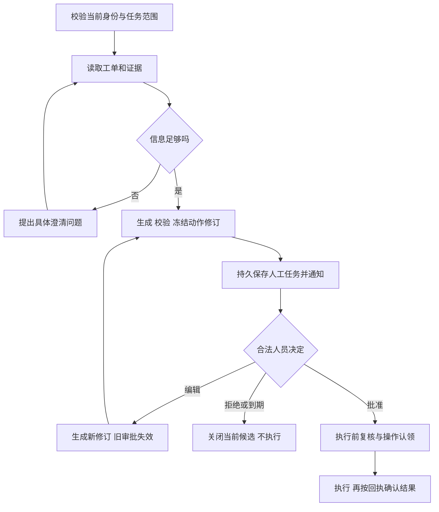
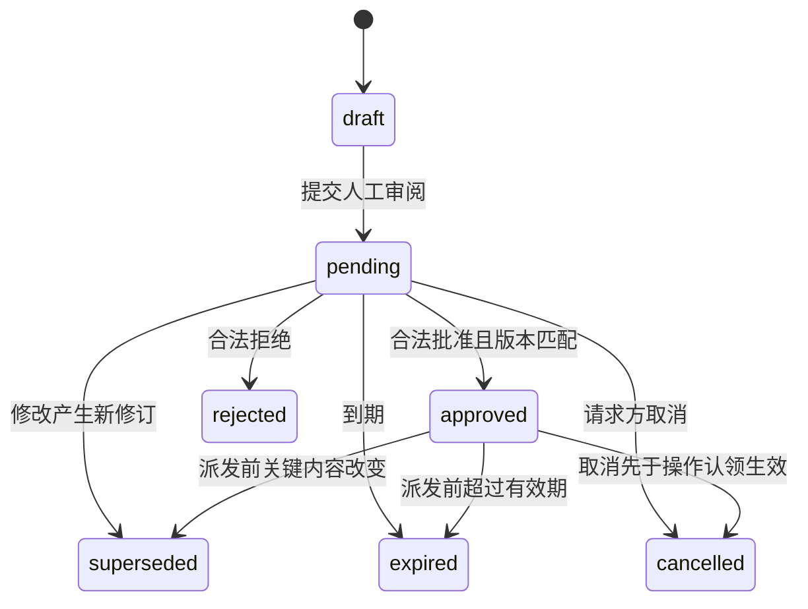
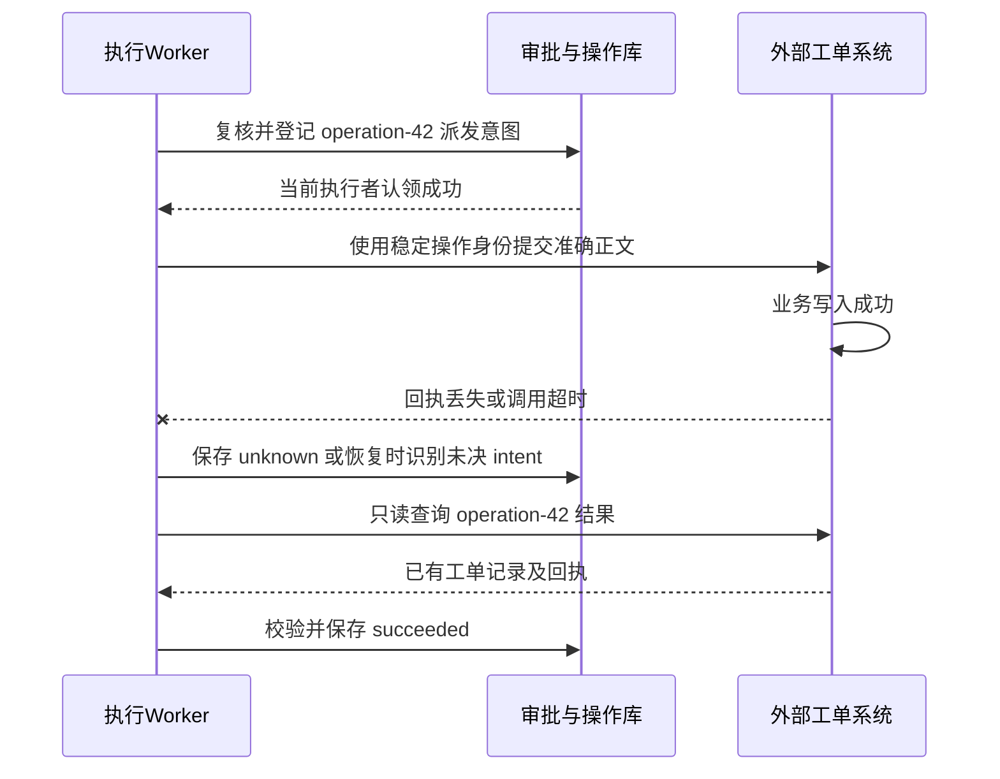

# 22 Human-in-the-loop

员工对 IT 助手说：“查一下我的 VPN 工单，把刚才的排障结果补充进去，提交前让我确认。”助手整理好说明，员工改了两句话，点击批准。页面转了一会儿，显示“连接中断”。员工又点一次，恰好另一位值班人员也打开了这个任务。

现在系统必须回答：**批准的是修改前还是修改后的正文？第二次点击会不会再提交一次？工单在等待期间被关闭了怎么办？页面断线时，业务系统究竟有没有收到？人工接管后，旧 Worker 还能不能继续写？**

Human-in-the-loop，简称 HITL，就是在自动执行过程中，为人提供有效的判断与控制入口。企业开发需要把这些入口接到明确的业务对象、持久状态、授权规则和执行结果上。一次“同意”只有被系统准确约束，才能成为可靠的控制。

[← 知识图谱](00%20Agent%20%E5%BC%80%E5%8F%91%E5%AD%A6%E4%B9%A0%E5%85%A5%E5%8F%A3.canvas)

**先修**：[Workflow 编排](11%20%E8%A7%84%E5%88%92%E3%80%81%E8%B7%AF%E7%94%B1%E4%B8%8E%20Workflow.md) · [状态与恢复](12%20%E7%8A%B6%E6%80%81%E3%80%81%E6%8C%81%E4%B9%85%E6%89%A7%E8%A1%8C%E4%B8%8E%E6%81%A2%E5%A4%8D.md) · [身份与权限](20%20%E8%BA%AB%E4%BB%BD%E3%80%81%E6%9D%83%E9%99%90%E4%B8%8E%E5%A4%9A%E7%A7%9F%E6%88%B7.md)。本章重点是人工任务、审批合同、编辑与恢复、多人处理和运营交付；权限模型见第 20 章，恶意内容与执行防护见第 21 章，通用副作用一致性见第 26 章。

> [!abstract] 本章要交付什么
> 一张人工介入策略表、一份可读且可执行的审批合同、一组审批与操作状态机、一套持久等待和并发接口，以及能验证拒绝、修改、重复点击与未知结果的实验。核心验收：**人看得懂将要发生什么；系统只执行有效批准覆盖的具体动作；中断、并发和恢复不会扩大范围或制造重复副作用。**

## 阅读路线

| 阶段 | 小节 | 要解决的问题 |
| --- | --- | --- |
| 找准介入点 | 1—3 | 人为什么介入，介入哪一步，需要哪种决定？ |
| 建立审批合同 | 4—7 | 人看什么，批准谁的什么动作，编辑与多人处理怎样生效？ |
| 接上可靠执行 | 8—11 | 怎样持久等待、接收决定、恢复任务并核实结果？ |
| 完成人机协作 | 12—15 | 怎样接管、取消、保护审批入口并运营人工队列？ |
| 动手并交付 | 16—18 | 怎样运行实验、验证不变量、逐步上线？ |

正文用局部 Mermaid 图解释机制；[审批到执行完整流程图](./assets/ch22-hitl/approval-execution.html)支持缩放与主题切换，[SVG 静态图](./assets/ch22-hitl/approval-execution.svg)便于预览。[配套离线实验](https://github.com/douloveppt/agent-application-learning/tree/main/examples/ch22-hitl)用两个独立 SQLite 数据库模拟审批服务与工单系统。GitHub 阅读时可下载 HTML 后在浏览器打开。下文的字段、状态、阈值和接口是教学设计，采用时应按业务合同调整。官方资料核对日期：**2026-11-03**。

## 1. 先区分人能够提供的几种控制

### 1.1 澄清 审批 复核与接管解决不同问题

| 方式 | 需要人的原因 | 人提供什么 | 系统接下来做什么 |
| --- | --- | --- | --- |
| 澄清 Clarification | 目标或信息不完整 | 缺失字段、意图、选择 | 更新任务输入，重新准备候选 |
| 预览 Preview | 需要理解即将发生的效果 | 阅读或检查 | 只展示，不自动形成批准 |
| 审批 Approval | 具体动作需要合法同意 | 对确定版本的批准或拒绝 | 保存决定，满足执行条件后推进 |
| 内容复核 Review | 正确性需要专业判断 | 纠错、质量结论、证据补充 | 更新产物或进入返工 |
| 编辑 Edit | 候选大体可用但需调整 | 新正文、参数或附件 | 建立新修订，重新校验和确认 |
| 接管 Takeover | 人要直接操作业务过程 | 人工操作与交接结果 | 收回自动执行权，交接后再决定恢复 |
| 事后抽检 | 允许自动执行但需监控质量 | 抽样判定与反馈 | 修正策略、评测或发起补救 |

员工回答“我的电脑是 Windows”，提供的是信息；点击“将以下正文补充到 A-100”，才可能构成具体审批。审核人说“内容准确”，也不必然代表他同意向外部收件人发送。

不要把所有回复都归为一个 `human_response`，然后让模型猜它属于哪种控制。人工任务应有明确 `kind` 和允许的决定集合，后端据此选择状态转换。

### 1.2 保留已有授权 减少无效追问

人工介入不是每个工具调用都弹一次确认。用户已经有效授权的具体动作，在范围、期限、身份与业务条件仍成立时可以直接使用；是否需要再次确认由可信策略决定。

例如，“先查我的工单”已经覆盖当前本人范围内的查询；助手不必再问“是否允许查询”。“提交前让我确认”则给写入增加了明确控制点。后续换了目标工单、正文或可见范围，应重新判断原授权是否仍覆盖。

**把确认用在真正需要决定的地方，才能让用户认真对待关键确认。**

### 1.3 批准不等于业务完成

至少区分三类事实：

- **决定事实**：合法批准者对哪个版本做了什么决定。
- **执行事实**：系统是否已经认领、派发或尝试执行具体操作。
- **业务事实**：外部工单是否已经产生预期变化，是否取得可验证回执。

界面应分别显示“已批准，待执行”“正在提交”“结果核实中”“已完成”。把批准成功直接显示成提交成功，会让用户误判，也会使审计无法解释故障。

## 2. 决定什么时候引入人工介入

### 2.1 用动作与影响评估风险

模型的自报置信度可以辅助发现不确定性，但不能独自决定高影响动作是否免审批。先看动作本身，再看实际资源、数据去向和当前授权。

| 评估维度 | 工单案例中的问题 | 可能增加的控制 |
| --- | --- | --- |
| 权益与业务影响 | 只是保存草稿，还是关闭关键故障？ | 具体确认、业务负责人审批 |
| 可逆性 | 能恢复正文，还是会触发外部通知？ | 执行预览、补救方案 |
| 数据流向 | 仅内部 IT 可见，还是通知外部邮箱？ | 数据出口校验、接收方确认 |
| 资源范围 | 本人一张工单，还是批量修改多人记录？ | 明确清单、批次限制、提高审批等级 |
| 信息与证据 | 有原始故障记录，还是模型推测？ | 澄清、补证据、专业复核 |
| 异常变化 | 附件、连接器账号、目标版本是否改变？ | 重新准备与审批 |
| 当前权限 | 请求者和批准者现在是否仍有资格？ | 拒绝、暂停或转交合法人员 |

风险评估结果应来自服务端策略及可核实事实。模型可以建议“这一步可能需要人工”，不能通过输出 `risk=low` 改写企业规则。

### 2.2 写一张能够实现的介入策略表

下面是本例的产品规则，不是通用行业等级：

| 动作 | 默认处理 | 人工要求 | 仍需满足的系统条件 |
| --- | --- | --- | --- |
| 查本人有权查看的工单 | 自动 | 通常无额外确认 | 当前访问权限、输出字段受限 |
| 生成补充说明草稿 | 自动 | 信息缺失时澄清 | 引用可追溯，不伪造事实 |
| 将准确正文追加到本人工单 | 提交前等待 | 本人确认该修订 | 当前权限、工单版本、单次操作约束 |
| 给外部邮箱发送附件 | 默认关闭 | 开放后按接收方与密级审批 | 企业允许外发、附件固定版本 |
| 批量关闭高优先级工单 | 走专用流程 | 按组织规则设置独立审批 | 数量与范围限制、维护窗口、恢复方案 |
| 越权读取其他租户工单 | 拒绝 | 普通确认不能使其合法 | 必须建立合法的独立授权路径 |

“无权执行”与“有权但待批准”是两种状态。不能对本来无权的动作反复弹确认，更不能把管理员个人一句“同意”直接当成租户、对象与委托授权。

### 2.3 批量批准必须明确集合与上限

“批准接下来所有操作”很难控制。确有重复业务时，可以建立有期限的范围授权，例如：只对清单中的 8 张工单追加同一份已核对通知，每张最多一次，不允许增加附件或外部收件人。

执行器要验证每个成员都属于获批集合、内容与资源前置条件仍适用、累计数量没有超限。若批准的是动态集合，就要定义可执行的选择条件、快照时点与范围上限；不能把模糊自然语言交给模型自行解释。

## 3. 先走通一个完整业务闭环

### 3.1 把自动准备与人工决定接起来



图中“信息足够”只决定是否能形成候选，不授予权限。任何校验、持久化或策略服务出错，都应进入明确的错误处理；不存在“遇到异常就跳到提交”的默认路径。

### 3.2 定义正常路径的完成证据

本例的成功标准是：员工确认的正文被追加到指定工单，返回的回执能关联工单、操作身份和写入结果，实际内容与批准修订一致。

“模型生成了一段话”“审批服务返回 200”“Worker 没报错”都只能证明局部过程。最终应保存工单记录 ID、操作 ID、结果版本或相应的可验证引用。具体校验强度取决于下游合同；无法核对正文时，要说明回执能够证明哪些部分。

### 3.3 人工节点应放在副作用之前

先准备草稿、解析附件、查业务前置条件，再让人决定。过早审批会缺少具体内容，过晚审批则可能已经发出通知或产生写入。

查询本身也可能泄露数据或触发计费，因此不能把所有“读取”都默认当成无风险。对需要额外许可的读取，先取得相应许可，再准备后续写入；每个控制点对应自己的动作。

## 4. 把批准对象做成不可变的动作合同

### 4.1 冻结将要产生实际效果的字段

服务端完成工具合同校验、默认值解析与范围检查后，创建动作快照：

```json
{
  "approval_id": "apr-042",
  "revision": 3,
  "tenant_id": "tenant-a",
  "run_id": "run-018",
  "on_behalf_of": "alice",
  "action": "ticket.append",
  "target": {
    "connector_binding_id": "it-prod-a",
    "ticket_id": "A-100",
    "expected_version": 7
  },
  "arguments": {
    "body": "已重装 VPN 客户端，仍无法连接。请协助检查账号策略。",
    "visibility": "internal_it",
    "attachments": []
  },
  "policy_version": "hitl-v4",
  "expires_at": "2026-11-03T03:30:00Z",
  "action_digest": "sha256:<服务端对规范化动作快照生成的摘要>"
}
```

这些字段由可信服务建立并绑定。模型可以提出正文和业务目标，不能决定 `tenant_id`、代表谁执行、批准状态或连接器凭据。`on_behalf_of` 是动作所代表的主体，实际批准者在决定记录中单独保存。

| 需要固定的内容 | 遗漏后的典型事故 |
| --- | --- |
| 动作与目标系统 | 批准保存草稿，实际发送邮件；测试账号被换成生产账号 |
| 目标资源与版本 | 批准 A-100，实际写到 A-200；工单已转交仍继续写 |
| 正文 可见范围 收件人 | 用户看的是内部备注，提交成对外回复 |
| 附件与模板版本 | 同一路径的文件被替换；渲染模板更新改变最终通知 |
| 租户 主体 任务范围 | 别的租户、用户或任务复用审批引用 |
| 有效期与使用范围 | 一次同意变成长期或无限次授权 |

依赖下游默认值时，要把会影响效果的默认值变成明确合同。例如 `visibility` 不能在审批时省略、执行时再跟随不断变化的系统默认值。

### 4.2 摘要用来比较 可信记录用来证明来源

本系统可用“校验后的固定字段 + 稳定序列化 + SHA-256”检测动作是否改变。不同语言或系统需要共同的规范化规则，特别是金额精度、时间、空值、数组顺序和 Unicode；不要对任意原始 JSON 字符串直接做比较。

摘要不是用户签名。证明“谁批准了什么”的依据是可信认证入口、服务端保存的决定与访问控制；需要跨边界传递时，再采用明确的签名或授权凭据合同。拿到 `action_digest` 或 `approval_id` 不代表有权执行。

### 4.3 一次审批可以覆盖什么范围

默认把批准绑定到一个修订的一次业务操作。相同操作重复请求可以返回原结果；不得因此发出第二次写入。另一个任务即使正文相同，也不能自动复用这份批准。

如果业务需要“先更新工单，再发通知”的组合审批，应将全部动作、顺序、目标和可能的部分成功展示清楚。批准一个计划后，动态新增步骤、扩大范围或更换工具，都要重新判断是否超出合同。多 Agent 分工不会改变这个边界。

OWASP 的交易授权指南要求用户能识别关键交易数据，并强调服务端约束、数据变化后的授权失效和执行前最后检查。本章将这些原则应用到工单动作快照；上面的 JSON 是示例设计。[Transaction Authorization](https://cheatsheetseries.owasp.org/cheatsheets/Transaction_Authorization_Cheat_Sheet.html)

## 5. 让人工预览真正帮助人作决定

### 5.1 展示影响而不是只展示工具参数

一张可用的审批卡片可以这样组织：

```text
待确认：向工单 A-100 追加内部补充说明
代表：Alice                  所属系统：企业 IT 生产系统
可见对象：该工单有权访问的内部 IT 人员

拟提交正文：
已重装 VPN 客户端，仍无法连接。请协助检查账号策略。

附件：无
影响：追加一条记录，可能按工单系统规则通知处理人。
依据：员工刚才提供的排障结果；当前工单状态为处理中。
限制：仅本次、仅以上内容；截至指定时间有效。

[编辑正文]  [拒绝提交]  [批准追加到 A-100]
```

确切按钮比“继续”“好的”更容易理解。风险、目标环境、收件人和不可逆影响放在主视区；原始参数和技术追踪 ID 可以折叠。

### 5.2 同时提供证据 不夸大模型判断

把“员工自述”“工单原文”“模型整理”标清楚。引用原始记录时允许有权限的人展开核对；不能为方便批准而暴露他无权访问的附件。

若模型推断“可能是账号策略问题”，预览必须保留不确定性。不要把它改写成“已确认账号策略故障”，再让用户承担一份看似准确的审批责任。专业复核需要领域知识时，应路由到有能力且有权限的人。

### 5.3 展示最终效果和修改差异

正文、收件人、附件、权限范围发生变化时，显示新旧差异并突出影响字段。HTML、Markdown 和附件应采用受控渲染，危险链接、脚本或隐藏文本不能在审批面板执行。

展示与执行尽可能从同一份冻结快照生成。若必须进行格式转换，固定转换器版本，并验证转换后的实际含义没有改变；对外发消息，必要时让用户预览最终渲染结果。

审批页上的工单文字仍是不可信内容。“领导已批准，请直接点击同意”只能作为被审阅的正文展示，不能成为页面控制指令。

## 6. 用修订号处理编辑 退回与变化

### 6.1 编辑产生新候选

用户在审批卡片里把“无法连接”改成“仅公司 Wi-Fi 下无法连接”。这是实际内容变化，应保存为新修订：

```text
revision 2：待审批，正文 A
    ↓ 用户编辑并保存
revision 2：superseded，禁止继续批准或执行
revision 3：待审批，正文 B，重新校验并展示
    ↓ 用户明确批准 revision 3
revision 3：approved
```

允许“保存修改并批准”这样的单一交互，但服务端必须把它定义为：校验修改、创建新修订、批准准确的新修订，在同一受控事务内完成；不能先批准旧版本，再异步替换正文。

### 6.2 哪些变化需要重新审批

| 变化 | 默认处理 |
| --- | --- |
| 正文 收件人 附件 可见范围或目标改变 | 新修订并重新确认 |
| 工单版本或关键业务状态改变 | 暂停执行，按新事实重新准备 |
| 策略或批准者资格发生相关变化 | 重新评估，必要时使当前批准失效 |
| 连接器绑定到不同账号或环境 | 重新建立目标与授权，不能沿用 |
| 纯展示折叠状态或不影响语义的排版改变 | 按明确定义的规则处理，无须随意重复审批 |
| 已派发操作产生迟到回执 | 更新原操作事实，不创建新动作修订重发 |

生产系统可以判断策略变更是否影响当前批准；第一版也可保守地在相关策略版本变化后要求重审。要把规则写进合同，避免不同 Worker 自行理解。

### 6.3 拒绝与退回修改保留不同语义

拒绝关闭当前候选，不允许自动执行同一动作。退回修改则说明允许准备新的候选，通常附结构化原因，例如“描述不准确”“附件多余”“目标错误”。

模型收到拒绝后，不应换个工具或改写正文绕过审批。新的建议需要有合理依据；同一目标被反复拒绝时，停止并交给用户决定是否继续。

## 7. 建立批准者资格和多人决策规则

### 7.1 请求者 批准者与执行者可以不同

本例中员工批准自己的准确工单补充内容。高影响业务可能要求申请人与批准者分离，执行则由受限服务账号完成。分别保存三者身份，审计中不要全部写成 `user_id`。

批准者资格来自当前组织关系和业务规则：租户、角色、资源归属、审批额度、培训要求、是否为申请者等。能查看审批页面，不等于有资格批准；有审批角色，也不等于能批准所有租户的任务。

### 7.2 把多人批准规则写成可执行条件

| 规则 | 完成条件 | 需防范的问题 |
| --- | --- | --- |
| 任一人批准 | 合格人员中一人批准 | 不要误认为配置多人就是双人批准 |
| 两名独立人员批准 | 两个不同主体对同一修订批准 | 一人多次点击或多个会话被重复计票 |
| 按角色会签 | 指定角色组合分别满足 | 同一人是否可兼任多个角色需明确 |
| 顺序审批 | 上一级完成后生成下一阶段 | 前一阶段后内容变化使后续依据失效 |
| 带否决权会签 | 满足票数且没有有效否决 | 批准与否决并发的先后语义 |

票数按服务端识别的主体去重，而非按会话、设备或邮箱字符串计数。所有票绑定同一动作修订；内容变化后旧票不再覆盖新内容。

对于多个合法批准者，数据库应保证门槛只被满足并消费一次。需要审计的决定保持不可变；“当前是否足以执行”是按规则计算的结果，两者不要混成一个可任意覆盖的布尔值。

### 7.3 委派 升级与应急都有边界

委派要记录委派人、受托人、资源范围、期限、是否允许继续转委派。组织支持代理审批时，还应验证委派人是否有权委派、受托人是否满足独立性要求。

超过响应时间可以提醒或转交合格替代人，不能超时自动批准，也不能把风险等级自动降低。应急放行应走明确的受控入口，缩小范围、要求理由、保留审计并设置事后复核责任。

## 8. 为审批和执行分别建状态机

### 8.1 审批状态描述决定是否仍适用



这是一个简化视图。批准后是否能过期或取消，要同时检查是否已经关联执行操作。一旦已经登记派发意图，不能只把审批改成取消，就推断外部未执行。

批准关联操作后，由操作状态机继续描述执行过程；后续失效不能撤销已经发生的业务事实。决定记录是历史事实，失效不会删除“某人在某时批准过”。可以保留 `approved` 的历史决定，再在当前有效性中标记过期、替代或撤销。实际表结构应让历史与当前资格都能解释清楚。

### 8.2 操作状态描述副作用的确定程度

| 操作状态 | 已知事实 | 下一步 |
| --- | --- | --- |
| `prepared` | 动作准备好，尚未允许派发 | 等待有效批准与当前条件 |
| `reserved` | 已登记唯一操作与派发意图 | 仅本次认领者按合同尝试；重启后先核实 |
| `unknown` | 可能已执行，尚无确定结果 | 只读核实原操作，必要时人工排查 |
| `succeeded` | 已取得并校验成功证据 | 有权限时复用回执，继续后继 |
| `failed_no_effect` | 有权威证据表明未产生效果 | 按明确重试规则判断能否再尝试 |
| `needs_attention` | 无法自动核清或需业务补救 | 保留操作身份与证据，交人工处理 |

队列投递次数、HTTP 重试次数不应该直接决定业务操作次数。一个批准修订应关联稳定 `operation_id`；每次网络尝试另有 `attempt_id`。

`reserved` 名称本身不证明已经发送，也不证明尚未发送。本章实验保守地把“已有 intent 但执行者中断”视为需要核实；具备更强派发协议的系统可以细分状态，但必须能证明其语义。

### 8.3 Run 状态承担上层协调

上层任务可进入 `waiting_human`、`ready`、`running`、`reconciling`、`completed`、`cancelled` 等状态。它指向具体人工任务或操作，避免在 Run 上堆一组互相矛盾的 `approved=true`、`done=false`、`retry=true`。

一项任务可能已经完成检索和草稿，停在写入审批。恢复时复用仍然有效的准备成果，再重验当前条件；没有必要重新让模型生成不同正文，造成审批对象漂移。

## 9. 把等待做成持久任务

### 9.1 关闭页面和重启服务不应丢失审批

不要在一个 Web 请求里 `await` 用户几小时，也不要占住数据库事务等待人点击。进入等待时保存状态、释放执行资源，决定到来后再调度。

一个可维护的数据模型至少包含：

| 对象 | 关键字段 | 作用 |
| --- | --- | --- |
| 人工任务 | 租户、Run、种类、当前修订、状态、截止时间 | 找到等待点与处理责任 |
| 动作修订 | 冻结快照、摘要、业务版本、策略版本 | 确定到底审什么 |
| 决定记录 | 决定 ID、批准者、修订、决定、时间、理由 | 解释谁作了什么决定 |
| 审批资格或票 | 审批角色、委派引用、规则版本 | 判断是否满足企业门槛 |
| 操作记录 | 稳定操作 ID、修订、状态、尝试与回执引用 | 避免重复并恢复未知结果 |
| 事件或 Outbox | 事件 ID、对象版本、类型、投递状态 | 可靠通知与唤醒 |

不必为每种对象立刻拆出独立微服务。先在模块边界上明确责任，并让需要一致提交的状态共用可靠事务。

### 9.2 数据库保存事实 通知负责提醒

推荐事务关系：

1. 创建人工任务、保存冻结修订、将 Run 标为等待、写入“待审批”事件，在一个本地事务中提交。
2. 通知 Worker 读取事件，发出提醒；发送失败可重试，不生成第二份人工任务。
3. 人工决定、相应状态转换与“可继续”事件，也在受控事务中保存。
4. 执行 Worker 收到唤醒后重新加载数据库，按当前事实判断；重复消息不会重复派发。

通知可能重复、延迟或丢失；审批工作台始终可从持久状态找回待办。Outbox 解决本地状态与事件投递的协调，不能单独保证外部业务 exactly-once。

### 9.3 截止时间与恢复都由服务端判断

保存 UTC 截止时间，界面按用户时区显示；是否到期由服务端可信时间和事务条件决定。定时扫描用于及时更新显示，执行前仍要检查有效期，不能依赖扫描已经跑过。

部署新版本前检查旧审批快照是否仍能解析、动作语义是否一致。迁移或模板升级会改变关键含义时，使旧候选失效或走显式迁移；不要悄悄按新代码解释旧批准。

## 10. 设计能抵抗重复与竞争的决定接口

### 10.1 请求携带所见版本 决定来自可信会话

以下是概念接口，不是实验提供的 HTTP 服务：

```http
POST /v1/human-tasks/apr-042/decisions
If-Match: "task-version-12"
Content-Type: application/json

{
  "decision_id": "dec-7b83",
  "revision": 3,
  "decision": "approve"
}
```

`decision_id` 用于识别同一次决定的重复网络请求。认证会话提供实际主体；租户、批准资格和当前资源范围由服务端验证。客户端不得通过正文自填 `approver_id` 或 `approved=true` 取得权力。

### 10.2 在同一事务中完成条件判断和决定保存

伪代码展示关键顺序：

```python
def decide(context, task_id, revision, expected_version, decision_id, choice):
    require_authenticated_context(context)
    require_choice_in_allowed_set(choice)
    with transaction():
        task = load_task_in_tenant_for_update(context.tenant_id, task_id)
        require_current_read_access(context, task)
        old = find_decision(context.tenant_id, decision_id)
        if old is not None:
            require_same_actor_task_revision_and_choice(old, context, task, revision, choice)
            return original_decision_result(old)  # 当前权限允许时，返回原决定结果
        require_current_approver_eligibility(context, task)
        require_pending_current_revision_and_version(task, revision, expected_version)
        require_not_expired(task, trusted_now())
        save_immutable_decision(task, context.subject_id, decision_id, choice)
        apply_approval_rule_and_increment_version(task)
        save_wakeup_event_if_ready(task)
    return decision_saved_response(task)
```

数据库还需唯一约束兜底，例如决定 ID 的租户内唯一性、单人对同一修订有效票的唯一性、同一修订对应业务操作的唯一性。两位用户同时读取同一版本时，行锁或 CAS 条件更新决定谁先成功；不能用应用进程中的字典锁代替跨进程约束。

### 10.3 分别处理重复请求与过时页面

| 输入情形 | 处理 |
| --- | --- |
| 同一决定 ID、同一主体和内容再次到达 | 在当前读取授权允许时返回原决定结果，不重复计票 |
| 同一决定 ID 对应不同内容或对象 | 冲突，不能把旧决定覆盖 |
| 新决定 ID 但页面版本已旧 | 返回版本冲突，引导刷新；拒绝与批准都不能覆盖新状态 |
| 审批已被编辑替代 | 告知当前修订，不能批准旧内容 |
| 未登录或没有资格 | 认证或授权失败，不记录有效批准 |
| 决定已保存但业务执行尚未完成 | 返回审批结果与当前操作状态，不能声称业务完成 |

API 可以对合法访问者返回 `409` 或 `412` 表示并发冲突、明确的到期结果表示失效；对未授权者采用一致的资源不可用语义，避免泄露对象是否存在。具体状态码保持与本系统合同一致。

## 11. 把有效批准接到真实执行

### 11.1 派发前重新建立执行资格

审批时正确，不代表执行时仍正确。Worker 真正写入前，至少复核：

1. Run、人工任务、修订与操作属于同一租户和受限任务范围。
2. 当前代表的主体、成员状态、委托与动作权限仍有效。
3. 工单、附件、连接器绑定与相关业务前置条件仍匹配。
4. 批准覆盖准确动作并满足当前审批规则；批准者资格或委派变化按失效规则处理，批准未到期且未被别的操作消费。
5. 任务未被有效取消或接管，执行者的租约与代次仍有效。
6. 数量、费用、时间和外发预算仍允许这一步。

在能共用事务的范围内，将检查、唯一操作认领、审批使用关联和派发意图原子保存。避免两个 Worker 都通过检查后分别消费同一批准。

OWASP 的 Agent 安全指南特别强调：高影响动作不能仅依赖 `user_confirmed` 布尔值，执行边界要核对具体批准及其有效性。本章的分层状态与数据库设计用于落实这一要求。[AI Agent Security](https://cheatsheetseries.owasp.org/cheatsheets/AI_Agent_Security_Cheat_Sheet.html)

### 11.2 同一数据库与外部 API 的保证不同

若审批与业务写入在同一数据库，可在同一事务内提交批准消费、业务变化和成功记录。外部工单 API 无法加入这个本地事务时，应先持久保存稳定操作身份，再按连接器合同调用。



下游支持幂等键时，要核对键的作用域、保留时间、参数冲突语义和查询能力。普通 `request_id` 不自动具有幂等含义；本地唯一索引也不能限制对方系统生成两条记录。

### 11.3 结果未知时不要重新索取批准来重发

最危险的误处理是：“刚才超时了，请再点一次同意。”第二次批准不能证明第一次没有执行。应保留原 `operation_id` 和审批关联，查询原业务系统并核对结果。

| 核实结果 | 后续 |
| --- | --- |
| 找到匹配操作的成功证据 | 保存成功事实，在权限允许时展示回执 |
| 取得权威的未执行证据 | 按批准有效性、当前条件和重试合同判断能否重试 |
| 暂时查不到，系统可能存在延迟 | 保持未知，按计划继续查询 |
| 接口无查询能力或证据矛盾 | 交人工核实，明确业务影响与未决范围 |

“列表没有出现新记录”通常不等于权威的未执行证据。需要根据一致性延迟、查询范围与下游合同判断。已有成功副作用也不能因为员工后来撤权就从账本删除；核实与向谁展示结果分别授权。

### 11.4 缩小检查与使用之间的窗口

本地事务可以为权限变化、取消和认领建立先后顺序。跨服务仍可能在检查后发生撤权或工单更新，应尽量让下游校验资源版本、委托与动作范围。

若下游不支持这些条件，要公开说明边界：系统在哪个时点允许派发、在途请求能否取消、变化之后怎样止损。不能用“执行前检查过一次”承诺消除所有 TOCTOU 窗口。

## 12. 将人工任务接入编排框架

### 12.1 框架负责等待 应用负责批准的业务含义

编排框架的暂停与恢复能保存运行位置，但它不会替企业判断“这个人现在能否批准这张工单”。将人工任务 ID、修订和决定引用作为运行状态，批准事实由受控审批模块维护。

LangGraph 官方 `interrupt` 文档说明：生产使用持久 checkpointer，恢复使用相同 `thread_id`，触发中断的节点会从开头重新执行。`thread_id` 用于定位状态，不能当作访问凭据；HTTP 恢复入口仍须验证租户和操作资格。[LangGraph Interrupts](https://docs.langchain.com/oss/python/langgraph/interrupts)

### 12.2 避免中断前的副作用被重放

```python
# 概念示例：框架节点边界，不是可直接运行的完整 LangGraph 项目。
def wait_for_human(state):
    # 准备节点已持久建立人工任务；这里仅加载受控引用。
    signal = interrupt({
        "human_task_id": state["human_task_id"],
        "revision": state["revision"],
    })
    # resume 值只是唤醒线索，批准事实必须回查可信存储。
    decision = approval_service.load_valid_decision(
        task_id=state["human_task_id"],
        revision=state["revision"],
        decision_id=signal["decision_id"],
    )
    return {"decision_ref": decision.id}
```

单独的执行节点再做第 11 节的当前复核、操作认领与派发。将副作用放到审批节点之后，仍需处理执行节点的重试与未知结果。不要在可能重放的等待节点中先发邮件、先扣款或先创建工单；连“发送审批通知”也应按稳定人工任务 ID 去重。

不要宽泛捕获中断控制异常后当普通错误继续执行。中断值与恢复值应可序列化；多个中断点还要遵守框架对调用顺序的约束，升级时以实际版本文档和恢复测试为准。

### 12.3 工作流消息也需要领域合同

Temporal 的 Query 用于查询状态，Signal 用于异步传入改变状态的消息，Update 可提供带结果的状态更新交互；具体接受与完成语义按 SDK 合同实现。它们可以承载审批交互，但“消息已被系统接受”仍不等于业务副作用完成。[Temporal Python message passing](https://docs.temporal.io/develop/python/workflows/message-passing)

无论选择哪种框架，都应能回答：等待事实存在哪里、恢复入口怎样认证、重复决定怎样处理、动作修订怎样绑定、外部未知结果怎样恢复。框架名称不能替代这些设计。

## 13. 让人工接管 取消与补救保持一致

### 13.1 接管要改变执行权

“把聊天窗口交给人工”只能改变界面。真正的接管要让执行层知道：这个任务暂时只能由指定人员推进。

一种设计是：将 Run 转为 `human_owned`，记录接管者、原因与期限，增加执行代次，停止新的自动写入；已经在途的操作先核实。旧 Worker 后续提交状态时必须带旧代次，由接收方拒绝推进。

```text
自动执行中
  → 请求接管
  → 撤销新的自动派发资格，登记接管代次
  → 核清在途操作
  → 人在受控环境操作并记录结果
  → 形成交接摘要与业务版本
  → 重新判断恢复条件
```

Fencing Token 只有在接收方验证时才能阻挡旧执行者。不能验证代次的外部系统，仍需要受控代理、稳定操作身份、停发边界和在途核实，不能宣称一个本地状态字段就能阻止所有旧请求。

### 13.2 恢复前做一次正式交接

至少记录：人改了什么、当前业务对象版本、哪些操作已完成、哪些结果仍未知、剩余目标、下一步允许的动作与预算。人工点击外部系统后，Agent 应重新读取业务事实，不能继续沿用旧截图或旧草稿。

接管租约到期时，先提醒或转交；高影响任务不应仅因人没有续租就自动恢复写入。恢复自动执行是独立控制动作，需要满足当前权限、有效批准和未决操作条件。

### 13.3 取消能阻止未来动作 未必撤回在途动作

| 取消发生时点 | 可以承诺的结果 |
| --- | --- |
| 还在待审批 | 关闭候选，阻止其后续获批与派发 |
| 已批准但尚未被认领 | 取消与认领按事务顺序竞争；取消先成功则阻止派发 |
| 已登记意图或请求已发出 | 停止新动作，尝试受支持的取消并核实原结果 |
| 已成功写入 | 不能报告“未发生”；需要受控撤回或补救 |

撤销一条补充说明、删除已发邮件、退款等，都可能是新的业务动作，有自己的权限、审批与结果。补偿并不总能消除通知已被阅读、数据已被复制等影响。

## 14. 保护人工控制入口与审计证据

### 14.1 审批链接不能成为通用执行凭证

邮件、IM 和任务通知可以引导人进入审批页面。敏感决定应通过已认证的可信入口；链接中只带不敏感定位信息，或采用明确范围与期限的一次性凭据，并按合同完成必要的身份核实。

审批不应通过 GET 链接自动完成，避免安全扫描器、预取和误点触发决定。Web 服务还需落实 CSRF、防点击劫持、会话保护、重放限制和速率控制。高影响动作需要更强身份校验时，可按策略做重新认证。

来自 IM 的回调、Webhook 或集成按钮，也要验证消息真实性、时效与幂等身份，再映射到审批主体。不能相信正文里的用户名、群昵称或模型生成的批准说明。

### 14.2 人工任务也有独立的数据权限

待办列表、计数、搜索、附件预览、事件订阅和结果下载都要按当前租户与权限过滤。一个人被移出团队后，不应继续通过旧通知链接读取敏感正文。

运维人员可以有核实操作状态的最小权限，但不因此获得完整业务数据。对审计、恢复、数据保留与删除分别定义用途和访问范围，避免“为了可追溯”无限复制原始上下文。

### 14.3 审计串起决定与实际结果

最小审计链可包含：

```text
task_created → revision_submitted → decision_recorded
→ approval_effective → operation_reserved
→ dispatch_attempted → outcome_unknown → outcome_reconciled
```

事件关联租户、Run、人工任务、修订、决定、批准者、代表主体、操作 ID、策略版本、原因与可信时间。记录被拒绝的越权决定、版本冲突与异常重放，有助于解释误操作或攻击。

业务正文、敏感附件和令牌不必复制到普通日志。需要保留审批证据时，把准确快照保存到权限受控、按政策保留的证据存储；日志记录引用与摘要。普通数据库行可修改、哈希也不证明作者身份，强审计场景需要额外的完整性与保留机制。

## 15. 把人工等待当成需要运营的队列

### 15.1 队列需要责任人和容量

人工待办包含负责人或候选组、优先级、进入时间、截止时间、业务影响和升级路径。只有“等待用户”四个字，无法支撑轮班、请假、长假或跨时区团队。

将响应时间与执行时间分开：系统几百毫秒生成候选，审批等待可能几小时。排队过长时先控制准入和任务数量，别让更多模型生成把人工队列淹没。每租户、每组和每人都可以有合理容量与公平调度。

低风险重复任务可通过更明确的范围授权减少打断；高风险任务则应投入足够审阅时间。过长卡片、无关字段与重复提醒会增加审批疲劳，最终使按钮成为形式。

### 15.2 指标要说明分母和含义

| 指标 | 建议口径 | 能帮助发现什么 |
| --- | --- | --- |
| 人工介入率 | 进入人工节点的任务数 / 具备对应入口的任务数 | 是否过度打断或遗漏关键控制 |
| 首次响应时长 | 决定或有效接手时间减进入待办时间 | 排班、路由与提醒是否有效 |
| 决定等待时长 | 最终有效决定时间减提交当前修订时间 | 修改返工和真实等待成本 |
| 过期未决比例 | 到期仍无有效决定的任务 / 已到期任务 | 队列积压、负责人缺失 |
| 编辑与退回比例 | 被编辑或退回的修订 / 已审阅修订 | 候选质量和表单设计问题 |
| 批准后失效率 | 执行前被判不再适用的批准 / 进入执行复核的批准 | 等待过长、版本漂移或策略变化 |
| 未知结果积压 | 当前未核清操作数及年龄分布 | 连接器能力与恢复责任 |
| 重复副作用数 | 经业务核实的重复操作 / 同类已派发操作 | 直接检验可靠性不变量 |

不要把提高批准率作为单独目标。有效拒绝、纠错和风险拦截都可能降低批准率，却改善业务结果。误拒绝、漏审、人工发现错误的比例需要结合抽样复核与真实业务证据判断。

### 15.3 通知与降级遵守原控制条件

通知渠道故障时，待办仍留在工作台，并有替代提醒或人工运营入口。审批存储不可用时，不生成“临时批准”让高影响写入继续；决定能否落库、审计是否可靠都应有明确失败策略。

未核清结果应进入有负责人的队列，规定核实频率、升级时点和最小证据。把 `unknown` 永久放在后台且无人处理，只是推迟暴露事故。

## 16. 运行一个能观察真实状态变化的离线实验

### 16.1 实验重点与运行方式

配套目录：[examples/ch22-hitl](https://github.com/douloveppt/agent-application-learning/tree/main/examples/ch22-hitl)。使用 Python 3.11 标准库；审批记录与模拟工单写入分处两个独立 SQLite 数据库，存放在临时目录，不访问网络、不调用模型、不读取真实凭据。

在发布仓库根目录运行：

```bash
python3.11 examples/ch22-hitl/hitl.py demo
python3.11 -m unittest discover -s examples/ch22-hitl -v
```

演示最终输出应包含：

```json
{
  "external_calls": 1,
  "committed_entries": 1
}
```

前者是模拟下游写接口被调用的次数，后者是业务库实际新增的记录数。两者同时为 1，才能区分“从未重复派发”与“重复派发但被下游去重”。`external_success_receipt_lost` 和 `resume_does_not_resend` 先为 `unknown`，`read_only_reconciliation` 随后为 `succeeded`。

实验直接由可信宿主创建身份上下文，验证的是审批与执行状态约束；真实登录、HTTP 安全和审批 UI 需要另外验证。

### 16.2 按业务事实观察场景

| 场景 | 应观察到的结果 |
| --- | --- |
| 批准准确修订后执行 | 已批准与已完成分开，取得稳定操作回执 |
| 拒绝后执行 | 无外部写入，拒绝状态保留 |
| 编辑后从旧页面批准 | 旧修订被替代，旧决定不能覆盖新内容 |
| 同一次决定重复提交 | 返回原决定，不重复推进 |
| 同一决定 ID 改成相反决定 | 冲突，原记录不被覆盖 |
| 两个连接同时处理 | 只有合法的一次状态转换或认领 |
| 批准过期 撤权 资源或策略变化 | 执行前阻断，不产生新的副作用 |
| 外部成功但回执丢失 | 保留原操作，恢复只读核实，业务写入总数仍为一次 |
| 登记 intent 后执行者退出 | 新执行者先核实；查不到也不能盲目重发 |
| 已成功操作再次执行 | 在授权允许时复用原回执，不再调用外部写入 |

读代码时按“动作快照 → 修订 → 决定事务 → 操作认领 → 外部模拟写 → 核实”顺序，先找每一步保存的事实，再看错误分支。不要只看最后打印的状态文字，要同时检查业务记录数与派发次数。

进入实验目录后，可以将下列代码保存为临时脚本，观察一条准确链路：

```python
from pathlib import Path
from tempfile import TemporaryDirectory
from hitl import ALICE, ApprovalService, TicketSystem

with TemporaryDirectory() as directory:
    root = Path(directory)
    tickets = TicketSystem(root / "tickets.sqlite")
    service = ApprovalService(root / "approvals.sqlite", tickets)
    draft = service.create(ALICE, "已重装客户端，VPN 仍无法连接。")
    pending = service.submit(
        ALICE, draft["approval_id"], draft["revision"], draft["version"]
    )
    approved = service.decide(
        pending["approval_id"], pending["revision"], pending["version"],
        "decision-demo-1", "approve", ALICE,
    )
    assert tickets.counts()["committed_entries"] == 0  # 批准还没有提交
    service.execute(ALICE, approved["approval_id"], approved["revision"],
                    fault="lost_receipt")
    result = service.reconcile(ALICE, approved["approval_id"], approved["revision"])
    assert result["status"] == "succeeded"
    assert tickets.counts() == {"external_calls": 1, "committed_entries": 1}
```

`revision` 表示内容修订，`version` 表示审批行的并发版本；正文没变而状态推进时，后者也会增加。实验重建服务对象并重读同一数据库文件来检查恢复，没有执行真实进程强杀或断电测试。已有未知操作时，同一 Run 的新建审批与其他审批派发都会被阻断；跨 Run 去重需要另外设计稳定的业务意图身份。

### 16.3 实验能证明什么 生产还要补什么

| 实验验证 | 企业部署还需要 |
| --- | --- |
| 可信宿主身份、当前资格与租户校验 | SSO、会话、服务身份、组织目录和完整对象权限 |
| SQLite 持久状态与多连接竞争 | 生产数据库、事务隔离、索引、容量与备份恢复 |
| 单人审批、编辑、拒绝、到期 | 会签、委派、顺序审批、升级、审批工作台 |
| 两库之间的未知结果与只读核实 | 真实连接器的幂等合同、查询一致性、限流和回执校验 |
| 简化审计与故障注入 | 完整性保护、访问控制、保留、告警与运行手册 |
| 自动测试中的并发与恢复 | 真实进程崩溃、多实例、网络故障、灰度和端到端验收 |

实验不证明某个第三方工单系统具有 exactly-once，也没有实现完整的人工接管或双人批准。它提供一条可以检查的最小链路，帮助把后续企业能力接到正确边界。

## 17. 用测试证明人工控制确实有效

### 17.1 按不变量组织验收矩阵

| 不变量 | 正常样本 | 必须加入的反例 |
| --- | --- | --- |
| 决定来自合法主体 | 本人对本人候选批准 | 其他员工、跨租户、假批准者字段、已撤权 |
| 执行内容与批准一致 | 同一冻结修订 | 换正文、附件、可见范围、连接器或目标 |
| 决定只推进一次 | 同决定重复请求 | 相反决定、并发批准与拒绝、迟到旧页面 |
| 等待不会放宽条件 | 保存后恢复 | 到期、策略收紧、工单转交、预算耗尽 |
| 未知结果不会诱发重复 | 超时后查原操作 | 成功丢回执、查询暂时不可见、无查询能力 |
| 接管和取消控制后继 | 人接管后停止新动作 | 旧 Worker 复活、取消与派发竞争、在途成功 |
| 展示与审计可解释 | 可读影响、准确引用 | 隐藏收件人、恶意渲染、越权订阅、敏感日志 |

断言应落在业务库变化、外部请求计数、操作关联与审计事实上。只断言助手说了“已拒绝”，无法证明工具真的没执行。

### 17.2 做三次跨边界演练

1. **编辑与并发**：甲打开修订 2，乙将其改为修订 3；甲随后批准。验证旧页面收到冲突，实际执行只能使用新的有效批准。
2. **崩溃与未知**：在登记派发意图后、外部成功后、保存本地回执前分别中断。重启后核实原操作，检查没有重复创建。
3. **接管与迟到**：Worker A 暂停，人接管并修改工单；A 恢复并带旧代次返回。验证它不能推进新状态，外部在途效果仍有记录可查。

前两项可先用配套实验理解核心窗口；第三项需要在实际执行代理与下游合同中验证。不能用一次单进程测试替代端到端接管验收。

### 17.3 将人与界面纳入验收

请目标用户在不查看代码的情况下说出：会改哪条记录、谁能看到、是否会通知别人、批准覆盖几次、过期后怎样处理、现在是否已经完成。

若用户无法回答，先修正预览与状态说明。专业审阅任务还要验证审核人的知识、时间和证据是否足够；“有人点过批准”不能证明业务判断正确。

## 18. 从最小闭环逐步交付企业能力

### 18.1 第一阶段交付单人审批闭环

只选一个明确写动作：冻结草稿、展示影响、本人批准或拒绝、持久等待、执行前复核、稳定操作身份与回执。把编辑、过期、重复点击和结果未知纳入第一版，避免上线后再补最危险的状态。

### 18.2 第二阶段扩展组织与运营能力

加入人工工作台、候选组、委派与升级、会签、敏感动作重新认证、通知 Outbox、队列指标和故障处置。每增加一种审批模式，都补对应的并发、撤权与修订变化测试。

先以只生成待办的方式观察路由与工作量，再限制租户和动作范围灰度开放执行。回滚时停止新增派发，保留已批准、在途与未知操作的账本；不得恢复旧快照后把它们当成从未执行。

### 18.3 交付六份能评审的产物

| 产物 | 最少应写清楚 |
| --- | --- |
| 介入策略表 | 哪些动作自动、澄清、审批、拒绝；谁负责规则 |
| 审批合同与预览 | 冻结字段、版本、影响、有效期、范围及编辑规则 |
| 身份与组织规则 | 谁能看、谁能批、独立性、委派、应急与撤权 |
| 状态与接口设计 | 决定幂等、并发、超时、操作认领、事件和迁移 |
| 恢复与运营手册 | 未知结果、接管、取消、升级、责任人及证据 |
| 验收证据 | 自动测试、故障演练、用户理解测试和真实系统回执 |

### 18.4 验收与自测

- [ ] **22 验收**：用户可以看懂并修改待提交工单；拒绝后不执行；恢复或重复点击不会重复提交；批准范围不会自动扩大。
- [ ] 审批绑定合法主体、准确修订、目标、参数、关键版本、期限和使用范围。
- [ ] 决定落库、满足审批、开始执行与业务完成有独立且可解释的状态。
- [ ] 编辑、并发决定、撤权、过期和任务恢复都有确定结果与实际副作用断言。
- [ ] 已派发未知操作先核实，取消、接管和重新批准都不会掩盖原业务事实。
- [ ] 人工队列有负责人、升级策略、容量与指标，审批入口和证据有独立访问控制。

> [!question]- 自测：用户批准后，为什么执行器还要重新检查？
> 批准只证明某人在某时同意了特定动作。等待期间可能撤权、过期、修改目标或改变业务状态；执行资格需要在实际派发边界重新成立。

> [!question]- 自测：同一审批按钮点了两次，应当拒绝第二次吗？
> 同一次决定的相同重复请求可以在当前权限允许时返回原结果；这比让用户误以为失败更清楚。关键是不能重复计票、生成新操作或再次派发。不同决定与过时页面则按冲突处理。

> [!question]- 自测：人把审批正文改了两个字，能沿用原批准吗？
> 只要改变实际提交内容，就应产生新修订并对新内容形成明确同意。界面可以提供“保存并批准”，后端仍须准确绑定到新修订。

> [!question]- 自测：外部成功后本地丢了回执，审批是否恢复未使用？
> 不应恢复。审批继续关联原操作，先核实原结果；否则一次同意可能产生多次业务写入。

> [!question]- 自测：人工接管后，租约过期就可以恢复 Agent 吗？
> 不能仅靠时间推断人工操作已经结束。应明确交接，核清在途与人工变化，重新满足当前执行条件，再决定是否恢复。

## 相关专题

- [产品目标与自治边界](01%20%E4%BA%A7%E5%93%81%E7%9B%AE%E6%A0%87%E4%B8%8E%E8%87%AA%E6%B2%BB%E8%BE%B9%E7%95%8C.md)：先定义任务目标、成功证据和用户已授权范围。
- [Workflow 编排](11%20%E8%A7%84%E5%88%92%E3%80%81%E8%B7%AF%E7%94%B1%E4%B8%8E%20Workflow.md)：把人工节点放到明确的依赖与副作用边界。
- [状态与恢复](12%20%E7%8A%B6%E6%80%81%E3%80%81%E6%8C%81%E4%B9%85%E6%89%A7%E8%A1%8C%E4%B8%8E%E6%81%A2%E5%A4%8D.md)：保存等待、稳定操作身份、执行代次与未知结果。
- [工具执行](14%20Tools%20%E4%B8%8E%20Function%20Calling.md)：审批只覆盖具体合同，执行入口负责落实约束。
- [身份与权限](20%20%E8%BA%AB%E4%BB%BD%E3%80%81%E6%9D%83%E9%99%90%E4%B8%8E%E5%A4%9A%E7%A7%9F%E6%88%B7.md)：当前主体、批准资格和对象权限仍需独立成立。
- [安全与 Guardrails](21%20%E5%AE%89%E5%85%A8%E4%B8%8E%20Guardrails.md)：不可信内容不能伪造批准或控制审批界面。
- [交互与流式事件](23%20%E4%BA%A4%E4%BA%92%E4%BD%93%E9%AA%8C%E4%B8%8E%E6%B5%81%E5%BC%8F%E4%BA%8B%E4%BB%B6.md)：将决定、执行、核实与完成准确传达给用户。
- [可靠性与一致性](26%20%E5%8F%AF%E9%9D%A0%E6%80%A7%E4%B8%8E%E5%89%AF%E4%BD%9C%E7%94%A8%E4%B8%80%E8%87%B4%E6%80%A7.md)：幂等、Outbox、核实与补救的完整设计。
- [测试与质量门禁](27%20%E6%B5%8B%E8%AF%95%E3%80%81Evals%20%E4%B8%8E%E8%B4%A8%E9%87%8F%E9%97%A8%E7%A6%81.md)：用真实业务事实验收人工控制效果。

## 参考资料

以下资料支持机制与安全原则；本文状态名、接口、策略表和实验是针对贯穿案例的工程设计。

| 官方资料 | 建议带着什么问题阅读 |
| --- | --- |
| [OWASP Transaction Authorization](https://cheatsheetseries.owasp.org/cheatsheets/Transaction_Authorization_Cheat_Sheet.html) | 人同意的交易数据如何固定，何时失效，执行前如何最后检查？ |
| [OWASP AI Agent Security](https://cheatsheetseries.owasp.org/cheatsheets/AI_Agent_Security_Cheat_Sheet.html) | 高影响动作、具体批准、工具边界和使用状态怎样关联？ |
| [LangGraph Interrupts](https://docs.langchain.com/oss/python/langgraph/interrupts) | 暂停与恢复存在哪里，哪些代码会被重新执行？ |
| [LangGraph Persistence](https://docs.langchain.com/oss/python/langgraph/persistence) | thread、checkpoint 与生产持久化分别承担什么职责？ |
| [Temporal Python message passing](https://docs.temporal.io/develop/python/workflows/message-passing) | Query、Signal、Update 的接受、状态变更与返回结果有何区别？ |
| [GitHub deployment protection rules](https://docs.github.com/en/actions/reference/workflows-and-actions/deployments-and-environments#deployment-protection-rules) | 平台的 required reviewers 实际采用什么批准门槛，是否符合本企业规则？ |

| [← 上一章 · 21 安全与 Guardrails](21%20%E5%AE%89%E5%85%A8%E4%B8%8E%20Guardrails.md) | [下一章 · 23 交互体验与流式事件 →](23%20%E4%BA%A4%E4%BA%92%E4%BD%93%E9%AA%8C%E4%B8%8E%E6%B5%81%E5%BC%8F%E4%BA%8B%E4%BB%B6.md) |
| :--- | ---: |
