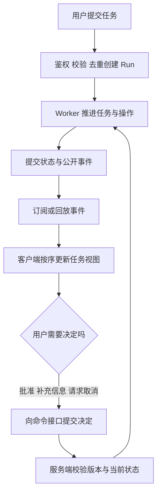
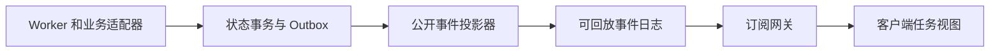
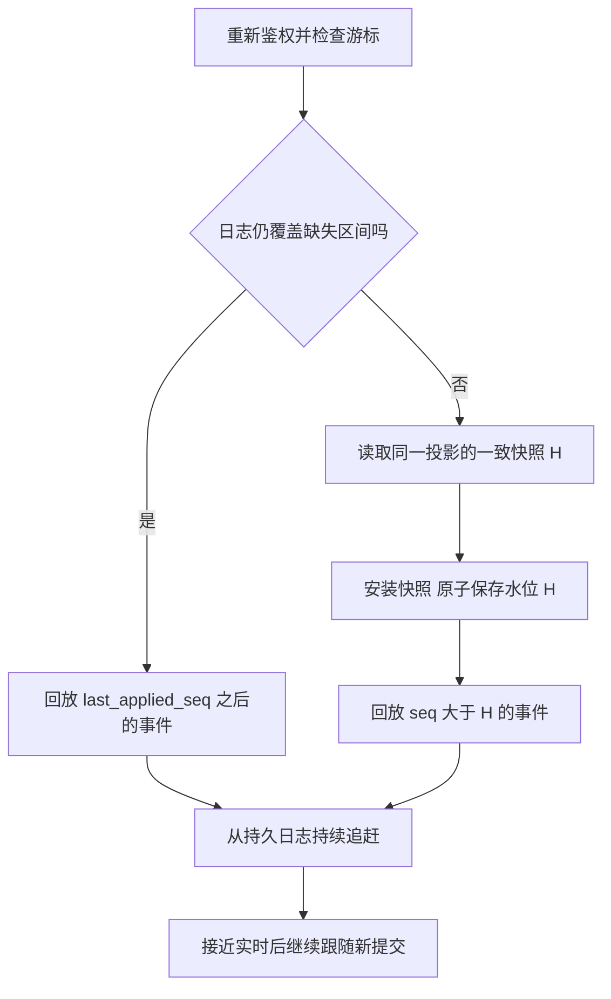

# 23 交互体验与流式事件

员工对 IT 助手说：“查一下我的 VPN 工单，把排障结果补进去，提交前让我确认。”页面立即出现文字：“正在查询，即将为你提交。”几秒后网络断开。员工刷新页面，看到另一段回答，却不知道原任务还在不在运行；点击“停止”后，又收到工单更新通知。

这些问题不能只靠优化打字动画解决。企业交互需要让用户始终回答四个问题：**现在发生了什么，有什么证据，我还能控制什么，离开后怎样继续查看。**

流式事件就是连接后端事实与用户界面的合同。文字可以逐步生成，任务状态必须由可信服务确认；网络可以中断，任务身份与业务结果必须保留。一个可靠的界面，既让用户及时感知变化，也不把“还不知道”包装成“已经成功”。

[← 知识图谱](00%20Agent%20%E5%BC%80%E5%8F%91%E5%AD%A6%E4%B9%A0%E5%85%A5%E5%8F%A3.canvas)

**先修**：[Agent 运行闭环](10%20Agent%20%E6%89%A7%E8%A1%8C%E5%BE%AA%E7%8E%AF%E4%B8%8E%E8%BF%90%E8%A1%8C%E6%9C%BA%E5%88%B6.md) · [状态与恢复](12%20%E7%8A%B6%E6%80%81%E3%80%81%E6%8C%81%E4%B9%85%E6%89%A7%E8%A1%8C%E4%B8%8E%E6%81%A2%E5%A4%8D.md)。本章负责交互合同、公开事件、前端投影和恢复体验；服务承载见[第 25 章](25%20%E5%90%8E%E7%AB%AF%E3%80%81%E8%B0%83%E5%BA%A6%E4%B8%8E%E5%AD%98%E5%82%A8.md)，副作用幂等与对账见[第 26 章](26%20%E5%8F%AF%E9%9D%A0%E6%80%A7%E4%B8%8E%E5%89%AF%E4%BD%9C%E7%94%A8%E4%B8%80%E8%87%B4%E6%80%A7.md)，审批合同见[第 22 章](22%20Human-in-the-loop.md)。

> [!abstract] 本章要交付什么
> 一份任务界面设计、一套有版本的事件协议、一组创建／查询／订阅／取消接口、一个可恢复的客户端状态模型，以及覆盖断线、重复、未知结果和权限变化的验收方案。核心要求：**页面展示能够回溯到真实事件，用户控制能够到达执行层，刷新和重连不会制造新的业务操作。**

## 阅读路线

| 阶段 | 小节 | 先解决的问题 |
| --- | --- | --- |
| 设计用户可理解的任务 | 1—3 | 界面显示什么，哪些状态不能混用？ |
| 建立前后端合同 | 4—7 | 事件由谁产生，状态怎样落库，接口怎样分工？ |
| 打通实时与恢复 | 8—10 | 怎样传输、去重、补发和衔接实时事件？ |
| 做好结果与控制 | 11—14 | 如何呈现文本、证据、错误、取消与审批？ |
| 验证并交付 | 15—19 | 如何控制容量、保护数据、运行实验并验收？ |

正文用局部流程图解释机制；[断线恢复交互图](./assets/ch23-streaming-events/streaming-recovery.html)支持缩放和主题切换，[SVG 静态图](./assets/ch23-streaming-events/streaming-recovery.svg)便于预览。[配套离线实验](https://github.com/douloveppt/agent-application-learning/tree/main/examples/ch23-streaming-events)演示事件重复、缺口、快照恢复与取消竞态。GitHub 阅读时可下载 HTML 在浏览器打开。下文的字段、接口、状态和容量数字是教学设计，采用时应结合业务合同；官方资料核对日期为 **2026-11-03**。

## 1. 从用户任务出发设计界面

### 1.1 聊天输入与任务执行可以共存

聊天适合表达目标、澄清信息和讨论结果；任务视图适合查看长过程、具体步骤、待处理决定和正式交付。企业助手通常需要两者结合。

在工单案例中，聊天区保存“为什么要补充这些内容”；任务卡保存“哪张工单、哪次执行、哪个修订、是否收到回执”。用户在另一个页面打开同一任务，看到的执行状态应当一致，不需要重新向模型追问。

| 界面区域 | 用户需要理解的事 | 内容来自哪里 |
| --- | --- | --- |
| 任务摘要 | 目标、本人有权访问的对象、任务 ID | 已校验的任务输入 |
| 当前状态 | 排队、查询、待批准、核实中、终态 | 后端任务投影 |
| 步骤时间线 | 哪一步开始、完成或受阻 | 步骤与操作事件 |
| 决定与控制 | 补充信息、审批、请求停止 | 当前状态与服务端能力合同 |
| 结果与证据 | 工单回执、引用、文件与未完成部分 | 已确认的业务结果和产物清单 |

一个最小布局可以是：

```text
VPN 工单补充                                      任务 run-018
正在核实提交结果                     连接已恢复 · 状态更新于 10:32

✓ 查询本人有权访问的工单     ✓ 准备并确认正文     … 核实写入结果

工单：A-100      已批准正文：修订 3
提交请求已经发出，暂未收到业务回执。核实期间请勿重复提交。

[查看已批准正文]  [查看执行记录]  [请求停止后续动作]
```

“核实中”旁边要说明原因与下一步。只放一个无限旋转图标，会让用户把刷新、重复点击和重新提交当成恢复手段。

### 1.2 提交之后立即给出稳定的任务身份

用户提交请求后，先反馈“请求已接收”与 `run_id`，再逐步呈现执行结果。任务进入后台队列后，即使用户关闭页面，也能通过任务列表重新找到它。

首次点击时可以立即显示本地占位卡“正在提交请求”。拿到服务器确认之前，不把它显示为“任务已创建”。请求超时后，应按请求标识查询创建结果；不能直接生成另一个请求标识重做同一件事。

### 1.3 把重要信息留在稳定区域

审批提示、错误原因、取消状态和最终交付不要只混在不断增长的聊天文本里。用户应能定位到固定的状态栏、待办卡和结果区。

长任务允许用户离开，短任务允许用户快速获得结果；两者共享相同的任务身份与恢复入口。是否发送站内或外部通知，应由产品订阅与通知规则决定，页面获得焦点不等于用户同意被外部通知。

## 2. 先分清对象与状态

### 2.1 一条消息不等于一次任务

| 对象 | 含义 | 为什么需要独立身份 |
| --- | --- | --- |
| Session | 一段持续的用户会话 | 可以包含多次任务与消息 |
| Message | 用户输入或某条输出 | 可以有多个内容块与修订 |
| Run | 一次明确的任务执行 | 创建、恢复、取消和终态的主要对象 |
| Step | Run 中的逻辑步骤 | 并行步骤与步骤重试需要分别识别 |
| Operation | 一次具体业务操作 | 关联幂等约束、派发状态和外部回执 |
| Artifact | 文件、报告等可交付对象 | 独立管理版本、权限与有效期 |

例如，某条用户消息可以先引发一次查询 Run，之后在用户补充信息时形成另一次 Run；一次 Run 也可以输出多条消息。必须明确产品采用的关系，不能仅凭聊天位置推断业务身份。

步骤重试应有 `attempt` 或独立尝试 ID。否则第一次尝试的失败事件迟到时，可能覆盖第二次尝试已经成功的结果。

### 2.2 至少分开四个状态维度

| 维度 | 示例 | 它不代表什么 |
| --- | --- | --- |
| 任务状态 `run_status` | `queued`、`running`、`reconciling`、`succeeded` | 不代表浏览器连接是否正常 |
| 连接状态 `connection_status` | `connecting`、`live`、`reconnecting`、`offline` | 不代表任务失败或停止 |
| 控制状态 `cancel_status` | `none`、`requested`、`confirmed`、`too_late` | 请求已接收不代表取消已完成 |
| 结果完整性 | 已确认、部分确认、存在未知操作结果 | 文字生成结束不代表业务结果已确认 |

“正在执行，连接已断开”是合法组合；“取消请求已接收，正在核实已发出的提交”也是合法组合。强行把它们压缩进一个前端 `isLoading`，会丢掉关键业务语义。

### 2.3 为任务状态写出明确含义

下面是一套用于本章的状态设计，不要求所有系统采用相同名字。

| 状态 | 用户文案 | 允许继续发生的事 |
| --- | --- | --- |
| `queued` | 已接收，等待执行 | 开始执行、取消 |
| `running` | 正在处理 | 步骤推进、等待人工、进入核实或终态 |
| `waiting_input` | 需要补充信息 | 提交具体信息、取消、按合同到期 |
| `waiting_approval` | 等待批准此版本 | 批准、拒绝、编辑形成新版本、到期 |
| `reconciling` | 正在核实已发出操作的结果 | 查询回执、人工核实、确认真实结局 |
| `succeeded` | 已完成 | 查询、下载、审计 |
| `partially_succeeded` | 部分完成 | 查看已交付与未完成部分 |
| `failed` | 任务失败 | 查看影响，按条件发起新的恢复操作 |
| `cancelled` | 已停止后续执行 | 查看已发生效果与停止范围 |

终态为最后四项。是否允许部分成功，必须按任务完成标准决定：用户要求的核心写入未完成，不能仅因生成了草稿就算“部分成功”。如果某项关键外部写入结果未知，本例保持 `reconciling`，不抢先归入失败或取消。

终态后不再为同一个 Run 派发工作。用户要求重新尝试时，创建有关联的新 Run，明确原操作哪些已确认、哪些禁止重做。业务记录后来被别人修改，可以展示当前业务状态，但不能悄悄改写原 Run 的历史结论。

## 3. 把用户动作与后端事件接成闭环



这里有两条方向相反的通路：**命令表达用户希望系统做什么，事件表达系统已经确认发生了什么。**

点击“请求取消”走命令接口；收到 `cancel.requested` 只能显示请求已接收；收到后端确认终态的事件，才显示任务最终如何结束。界面可以乐观显示“正在发送取消请求”，不能乐观宣告“业务已撤销”。

任务执行不应挂在某一个浏览器连接的生命周期上。订阅服务重启后可以重新读事件日志，Worker 不需要因为浏览器重连而再执行一次任务。

## 4. 设计适合用户阅读的事件

这里把“内部发生的事，经过权限筛选后，变成用户可读的状态和内容”称为**公开投影**。例如，内部查询可能返回几十个字段，页面只显示用户有权查看的工单编号、处理阶段与安全摘要。投影不是凭模型重新讲一个故事，而是依据受控事实生成视图。

### 4.1 区分事实 文本与连接信号

| 类别 | 示例 | 谁拥有发布权 | 用途 |
| --- | --- | --- | --- |
| 任务事实 | `run.started`、`run.completed` | 任务服务或受控状态投影器 | 任务状态与结果 |
| 步骤和业务事实 | `step.completed`、`operation.receipt_recorded` | 执行器、回执核实服务 | 进度、影响与证据 |
| 内容事件 | `text.delta`、`text.snapshot`、`artifact.ready` | 经过输出控制的内容／产物服务 | 阅读与交付 |
| 控制事实 | `approval.required`、`cancel.requested` | 人工任务／控制服务 | 可操作入口与决定结果 |
| 传输信号 | 心跳、连接开启、临时断线 | 传输层 | 连接健康，通常不进入业务日志 |

模型输出“查询完成”只能成为待展示内容，不能直接生成可信的 `step.completed`。执行器必须依据查询调用确已返回、结果通过合同校验等事实推进步骤。

同样，不把供应商原始事件直接暴露给前端。供应商流可能同时包含工具调用参数片段、内部协议字段和不同形态的内容；后端适配器应转换成应用拥有的公开协议。

### 4.2 把事件映射到稳定的界面部件

| 事件 | 前端处理 | 必须避免的误读 |
| --- | --- | --- |
| `run.created` | 建立任务卡，状态为排队 | 创建成功就是业务完成 |
| `run.started` | 显示已开始，记录开始时间 | 启动说明就是已得到结果 |
| `step.started` | 对应步骤进入执行中 | 每条文本都生成一个新步骤 |
| `step.completed` | 根据结果摘要完成该步骤 | 一个步骤成功就将整个 Run 标绿 |
| `text.delta` | 追加到指定内容块 | 更新业务状态或执行工具 |
| `text.snapshot` | 用权威完整内容替换指定版本 | 与旧增量再次拼接 |
| `approval.required` | 显示当前有效的审批卡 | 仅显示“请确认”但没有对象和版本 |
| `run.status_changed` | 展示等待或核实等中间状态 | 依据自然语言猜测等待原因 |
| `run.completed` | 读取最终状态与交付清单 | 总是显示成功 |

协议还应说明事件是否属于核心能力。对于影响状态或内容一致性的未知类型，停止推进并恢复或要求升级；只有协商为可忽略、且不会影响状态的扩展事件，才允许安全跳过并推进序号。不能对所有未知类型一律 `continue`。

### 4.3 展示执行摘要 保留内部推理边界

用户需要知道“正在查询本人有权访问的工单”“已读取 3 条排障记录”“等待你批准修订 3”。这些摘要可以来自真实操作事件和明确的业务结果。

不需要将模型的隐藏推理、完整 Prompt、工具密钥或内部调试轨迹展示成“思考过程”。解释为什么需要某项输入、依据哪些文档作出结论，与公开内部推理记录是不同的产品需求。

## 5. 定义事件信封与排序合同

### 5.1 一条可实现的公开事件

```json
{
  "schema_version": 1,
  "event_id": "evt-018-42",
  "tenant_id": "tenant-a",
  "run_id": "run-018",
  "seq": 42,
  "type": "step.completed",
  "occurred_at": "2026-11-03T02:31:08.412Z",
  "payload": {
    "step_id": "lookup-ticket",
    "attempt": 1,
    "result": "succeeded",
    "summary": "已读取本人有权访问的工单 A-100",
    "evidence_refs": ["evidence-07"]
  }
}
```

| 字段 | 合同 |
| --- | --- |
| `schema_version` | 决定如何解释结构与语义，破坏兼容时升级 |
| `event_id` | 该事件的稳定身份，重发时保持不变 |
| `run_id` | 事件所属任务，不接受串流到另一个任务 |
| `seq` | 同一公开流内的提交顺序，用于去重、缺口检测与恢复 |
| `occurred_at` | 诊断与展示时间，不承担可靠排序职责 |
| `payload.step_id` 与 `payload.attempt` | 步骤事件用于定位具体步骤尝试 |
| `payload` | 通过类型校验且已做字段级输出控制的内容 |

真实项目可另加 `operation_id`、`message_id`、`trace_id` 等字段；不要强迫所有事件填满一套无意义的空字段。`tenant_id` 也不是授权凭证，前端传什么租户都必须由服务器验证。

### 5.2 时间戳 事件身份与游标分别解决不同问题

多个 Worker 的时钟可能不同，同一毫秒也可能发生多件事，因此按时间戳排序不能保证业务顺序。一个随机 UUID 可以识别事件，但不自动表达先后。

本章用 `seq` 表达某个 Run 的**公开投影流**顺序。连续性规则为：第一个公开事件为 1，之后每个已提交事件递增 1；事务回滚不消耗该公开序号。它不是直接复用可能跳号的数据库自增主键。

如果不同观看者能看到不同字段或事件，不能先给全部内部事件编号，再把部分事件删掉后要求客户端检查 `last_seq + 1`。可选择：

1. 为固定可见性范围建立独立投影流，在字段脱敏与事件筛选后赋连续序号。
2. 采用非连续、不透明游标协议，并通过服务端连续性证明或快照恢复，客户端不使用“加一”规则。

本章与离线实验采用第一种。公开 `seq` 的含义、可见范围和流世代必须固定；权限范围变化或事件流重建时，重新鉴权并切换流世代，从新快照恢复。

### 5.3 游标是位置 不是访问权限

可以把游标理解为一张书签：它告诉系统从哪里继续读，不决定这本书能不能读。

生产订阅接口可将流身份、世代和位置编码为不透明 `cursor`，也可在受约束的单流接口使用序号。游标必须校验所属 Run、可见范围、有效期和合法位置；拿到别人的游标不应获得任何额外访问能力。

无论游标是否签名，每次订阅、回放、快照与下载仍要校验当前用户权限。低于保留窗口、超过当前水位或不属于此流的游标，不能安静地当作“从现在开始”。

### 5.4 让文本增量也能被确定地解释

```json
{
  "message_id": "msg-23",
  "block_id": "answer",
  "revision": 1,
  "offset": 0,
  "delta": "已找到你的工单。"
}
```

多个消息或内容块不能共用一个全局字符串。`revision` 区分替换版本，`offset` 可以校验此增量接在哪个位置；必须规定它按 UTF-8 字节、Unicode 码点还是客户端编码单元计算，不能让 Python 的长度与 JavaScript 的长度默认相等。

小型系统也可以只依赖整条公开流的连续 `seq` 与内容快照，本章实验采用这种简化：只有一个文本块，`text.delta.payload.delta` 追加文本，`text.snapshot.payload.text` 替换全文。发生文本版本不匹配、偏移不匹配或事件缺失时，请求权威内容快照，不尝试靠模糊匹配“把两段文字拼起来”。

## 6. 让状态提交与事件发布保持一致

### 6.1 企业实现需要明确的职责分工



Worker 拥有任务推进权；状态服务校验合法转换；公开投影器决定用户能看到哪些内容；事件日志保存可恢复的顺序；订阅网关负责鉴权与传输；客户端按合同生成界面状态。

这是一种教学架构，并不意味着必须部署六个微服务。早期可以在一个应用中实现这些模块，先守住事务、身份和职责边界，再按容量与团队需要拆分。

### 6.2 不要先通知成功 再尝试保存结果

以下顺序会制造“幽灵完成”：先向浏览器发送 `run.completed`，再写数据库，结果数据库写入失败。用户已经看到成功，刷新后却找不到任何结果。

推荐的实现路径有两种：

- 状态与公开事件在同一存储中时，在一个事务中更新状态、分配公开序号、追加事件。
- 执行状态与事件服务分离时，在状态事务中写入 Outbox，即“随状态一起保存的待发布记录”；投影器消费 Outbox，幂等地形成公开事件与对应的快照投影。发布通知只负责唤醒，日志负责补发。

Outbox 消费本身可能重复，投影器应以源事件身份去重，并在同一事务中提交公开事件和消费位置。否则一条源事件可能被投影成两条新的增量，客户端按公开序号去重也无法挽救。

本章不要求把整个系统改成 Event Sourcing。业务状态表、公开恢复日志、安全审计日志可以分别存在；它们的字段、保留期限与访问范围也可以不同。

### 6.3 并发事件需要在提交处统一排序

并行检索步骤可以各自执行，但不能由每个 Worker 独立生成同一 Run 的下一个 `seq`。可由事务锁、单分区有序日志或带条件更新的单一序列分配器确定公开顺序。

如果 Worker 已失去租约，提交阶段应凭 fencing token 或等价版本条件拒绝旧 Worker 继续推进。可以把它理解为“只有持有当前执行代次凭证的 Worker 才能提交”，旧代次即使恢复运行也不能覆盖新进度。仅让前端“忽略旧事件”不能阻止陈旧执行器产生业务效果。

总顺序表达提交先后，不意味着所有并行工作在物理上串行执行。步骤依赖、尝试身份与业务回执仍需明确记录。

### 6.4 完成事件必须符合交付合同

本例只有核实了工单写入回执，才允许将核心业务动作判为成功。最终事件包含 `status`、完成摘要、已确认操作、未完成项、产物引用与可用的恢复动作。

如果业务结果已确定，最后一段自然语言总结生成失败，可以交付模板化摘要和回执；不应为了修复总结重新提交工单。如果模型流结束但外部操作仍在核实，任务继续显示核实中。

**`run.completed` 表示任务已有明确结局，具体结局由 `payload.status` 表达。** 它不总是成功，也不等于模型的最后一个 token。

## 7. 将创建 查询 订阅与控制分成明确接口

### 7.1 一组最小接口

| 接口 | 作用 | 关键约束 |
| --- | --- | --- |
| `POST /runs` | 创建任务 | 当前身份、输入校验、请求去重、租户配额 |
| `GET /runs/{id}` | 查询任务摘要 | 当前对象权限，返回状态和版本 |
| `GET /runs/{id}/snapshot` | 获取可恢复视图 | 返回同一投影的一致快照与水位 |
| `GET /runs/{id}/events?after={cursor}` | 回放并订阅 | 当前权限、游标范围、限流与保留窗口 |
| `POST /runs/{id}/cancel` | 请求停止后续动作 | 决定身份、请求去重、取消范围 |
| `POST /approvals/{id}/decisions` | 提交人工决定 | 审批版本、有效期、当前批准资格 |

GET 订阅只能观察，不负责启动 Run，也不执行补偿、重试或审批。否则浏览器自动重连、网络代理重试或用户多开页面，都可能意外制造业务操作。

### 7.2 创建请求超时也要能找回原任务

```http
POST /runs
Idempotency-Key: request-018
Content-Type: application/json

{"intent":"补充 VPN 工单排障结果","ticket_id":"A-100"}
```

```json
{
  "run_id": "run-018",
  "status": "queued",
  "status_url": "/runs/run-018",
  "events_url": "/runs/run-018/events"
}
```

服务端按租户、发起身份、接口与请求标识建立去重范围；相同标识和相同请求返回原 Run，相同标识却改变正文则返回冲突。请求摘要由服务端按规范化输入计算。

创建成功但响应丢失时，客户端用原标识重试查询或创建请求，不能换新标识。去重记录的保留期限应覆盖允许重试的时间；超过期限后先通过任务列表或操作记录核实，不无限重放。

### 7.3 快照必须对应明确的事件水位

```json
{
  "schema_version": 1,
  "run_id": "run-018",
  "stream_generation": "public-v1",
  "last_seq": 42,
  "cursor": "opaque-cursor-at-42",
  "status": "waiting_approval",
  "cancel_status": "none",
  "messages": [{"message_id":"msg-23","text":"已准备好补充说明。"}],
  "steps": [{"step_id":"lookup-ticket","status":"succeeded"}],
  "pending_approval": {"approval_id":"apr-042","revision":3},
  "artifacts": []
}
```

`last_seq = 42` 的含义是：快照中的任务状态、文本、步骤和待办，都恰好反映公开事件 1—42 的效果。不能拿“业务状态库的最新值”搭配“落后十条事件的投影水位”。否则恢复后会重复应用新状态，甚至把审批卡回退到旧版本。

快照可以在投影事务中生成，也可以从带版本的一致读取获得。最终业务状态比公开投影更新时，接口应明确区分两者；恢复接口必须返回自身投影的一致版本。

## 8. 选择传输方式 并正确处理 SSE

### 8.1 按交互方向与恢复要求选协议

| 方案 | 合适场景 | 需要自己解决的部分 |
| --- | --- | --- |
| 普通查询或轮询 | 状态变化少，实时性要求不高 | 轮询间隔、版本比较、限流 |
| 原生 `EventSource` | 浏览器主要接收服务端事件 | 应用级恢复、权限变化、任务终态 |
| `fetch` 读取 SSE 流 | 需要自定义请求头或精确控制恢复 | SSE 解析、重连、游标、退避与取消读取 |
| WebSocket | 高频双向交互、协作控制等 | 消息协议、重连、鉴权续期、背压与恢复 |

工单任务通常可以采用“普通 HTTP 命令 + SSE 事件”。不是所有 Agent 都需要 WebSocket。WebSocket 的双向通信也不会自动提供持久回放或业务幂等；浏览器传统 `WebSocket` API 本身没有自动背压机制。[MDN WebSocket](https://developer.mozilla.org/en-US/docs/Web/API/WebSocket)

实时音频、媒体时钟和设备打断有额外要求，见[第 24 章](24%20%E5%A4%9A%E6%A8%A1%E6%80%81%E4%B8%8E%E5%AE%9E%E6%97%B6%E8%AF%AD%E9%9F%B3.md)，不要把文本事件协议直接当成音视频传输协议。

### 8.2 一帧 SSE 长什么样

```text
id: public-v1:42
event: agent.event
data: {"schema_version":1,"run_id":"run-018","seq":42,"event_id":"evt-018-42","type":"step.completed","payload":{"step_id":"lookup-ticket","result":"succeeded"}}

```

示例以空行结束一帧，`data` 内的 JSON 保持单行；内部事件类型放在 `type` 中。SSE 是 UTF-8 文本流，`id` 用于恢复位置，`event` 是浏览器分发的事件名称；生产环境可以把 `id` 替换为完整的不透明游标。

原生 `EventSource` 会在重建连接时使用已有的 `Last-Event-ID`。这是传输机制，服务器仍要实现“从这个位置之后读取日志”；协议本身不会替你保存历史。[WHATWG SSE](https://html.spec.whatwg.org/multipage/server-sent-events.html)

以冒号开头的行可以作为注释心跳，不必分配业务序号。多行 `data:` 会按规则组合，空行才结束消息，不能把一行网络数据默认视为一个完整事件。[MDN SSE 格式](https://developer.mozilla.org/en-US/docs/Web/API/Server-sent_events/Using_server-sent_events#event_stream_format)

### 8.3 网络分块不等于事件边界

使用 `fetch` 的读取循环时，一次 `read()` 可能得到半个 JSON、多个事件，甚至一个汉字的部分 UTF-8 字节。应使用流式文本解码器，再交给完整的 SSE 解析器；不要对每个网络 chunk 直接 `JSON.parse()`。[MDN Readable Streams](https://developer.mozilla.org/en-US/docs/Web/API/Streams_API/Using_readable_streams)

解析层至少处理 UTF-8 跨块、CRLF／LF、空行、多行数据、注释、帧大小上限和不完整尾帧。它只产出完整事件，业务层再校验信封与 payload。生产实现优先使用经过测试的解析器，并针对代理实际分块做集成测试。

### 8.4 浏览器记住的游标不等于应用成功消费的游标

这是很容易漏掉的一层：原生 `EventSource` 的最后事件 ID 随协议解析和分发推进，不以业务 reducer 是否成功为条件。因此，`JSON.parse` 抛错、版本不支持或应用状态写入失败时，浏览器的恢复位置仍可能已经前进。[WHATWG 事件分发模型](https://html.spec.whatwg.org/multipage/server-sent-events.html#parsing-an-event-stream)

应用需要单独维护 `last_applied_seq` 与 `last_applied_cursor`。处理失败时关闭现有订阅，从最后成功位置重新创建订阅，或安装权威快照；新建的 `EventSource` 不会继承旧对象的内部恢复位置，可通过经过校验的 `after` 参数表达位置。

如果服务端同时支持查询参数与 `Last-Event-ID`，必须规定优先级与冲突处理，避免自动重连一直被初次 URL 中的旧位置覆盖。本例可约定：同流且合法的 `Last-Event-ID` 优先；应用主动恢复时先关闭旧对象，再用新的 `after` 建立对象。

### 8.5 建连错误与任务错误分别处理

建流前发生未登录、无权访问或游标失效，可以返回相应 HTTP 错误。流已经返回成功响应后，业务步骤失败需要通过结构化事件表达，不能再把已经发出的 HTTP 状态码改成 500。

原生 `EventSource` 的错误回调不提供方便读取任意响应状态与错误正文的接口。若产品需要准确区分 401、403 与游标过期，可以先调用有明确响应的恢复接口，或使用 `fetch` 管理连接。不要把所有 `onerror` 都显示成“任务失败”。

客户端成功应用 `run.completed` 后，可以主动关闭该 Run 的订阅；若只由服务器断开连接，原生 `EventSource` 可能继续重连。没有收到合法终态就遇到流结束，应恢复查询，不能将 EOF 或供应商的文本结束标记直接当成业务成功。断线前遗漏的终态也必须能通过回放或最终快照补到。

## 9. 用可回放的状态转换更新界面

### 9.1 reducer 只做确定的状态计算

Reducer 可以理解为“给定旧状态和一条事件，算出新状态”。它不调用模型、不提交工单、不自动重试外部操作。这样同一快照加同一批事件，无论回放几次都能得到相同界面。

客户端建议保存：当前 Run 与流身份、已应用序号与游标、任务状态、按 ID 管理的步骤与消息、待审批修订、产物清单、取消状态和协议错误。连接状态另行管理。

以下是控制流程伪代码，完整校验与状态转换见实验：

```text
consume(event):
    验证流身份、schema、类型、payload 与事件游标
    如果 event.seq <= last_applied_seq:
        返回 duplicate
    如果 event.seq != last_applied_seq + 1:
        暂停消费，从 last_applied_cursor 请求恢复
        返回 needs_replay
    如果事件试图在终态后修改任务或正文:
        若不属于明确允许忽略的迟到内容类型，暂停并核对快照
        否则记录诊断，保持业务结果不变
        原子推进已完整校验的连续序号与游标
        返回 late_ignored

    candidate = reduce_without_side_effects(current_state, event)
    原子提交 candidate 与 event.cursor
    再安排界面渲染
```

“原子提交”至少意味着内存里状态与消费位置同时推进；如果要跨刷新本地持久化，也要把两者存成同一个一致记录。不能先存游标，再异步保存文本。DOM 是否已绘制不影响逻辑状态是否成功提交。

### 9.2 重复 迟到与缺口需要不同处理

| 情况 | 正确处理 | 原因 |
| --- | --- | --- |
| 同一 `seq` 重发 | 不重复应用 | 防止文字、步骤计数再次追加 |
| 先到 44，当前只应用到 42 | 停止推进，请求 43 之后的连续回放 | 不能确认缺少的事件影响了什么 |
| 另一 Run 的事件 | 拒绝并记录串流错误 | 不能靠 payload 相似就接收 |
| 不支持的核心 schema | 暂停，升级或重新协商恢复 | 不能猜字段含义 |
| 旧尝试的事件 | 依据尝试身份处理，不能覆盖新尝试 | 防止旧失败压过新成功 |
| 终态后又来新的文本修改 | 保持终态并报告协议异常 | 这与旧事件重复不是同一种问题 |

生产端还应检测同一公开 `seq` 对应不同事件身份或内容的异常；这不是合法重复。客户端可以保存一个有界的近期校验窗口，完整一致性由日志约束与审计保障。

本章实验选择“合法迟到内容保留诊断、消费位置前进”的策略，避免永久反复读取同一条异常记录；它先校验完整结构与连续序号，不把这个策略用于跳过未知版本、缺口或新的状态转换。生产也可以选择立即暂停并核对快照，但必须明确规则。

### 9.3 避免旧连接和旧请求污染新页面

用户从 Run A 切换到 Run B 后，A 的订阅回调与快照请求可能才返回。组件卸载时要关闭订阅，回调处理时仍要验证当前 Run 与本地恢复世代。

同一次 Run 恢复中，若快照请求 1 比请求 2 更晚返回，也不能让旧快照覆盖已经更新的状态。可为每轮恢复分配本地 generation，只允许当前 generation 安装快照和事件。

## 10. 让断线恢复真正不丢进度

### 10.1 重连的目标是追上现有任务

断线时保留已有内容，并显示“连接中断，正在恢复任务状态”。不要清空任务卡，不把 `running` 改成 `failed`，也不要再次调用 `POST /runs`。

客户端能确定的是“失去观察连接”；后台是否继续由任务合同决定。本章采用后台持续执行的长任务设计。如果产品采用“前台离开即请求取消”，也要将其实现为明确的取消命令，并处理命令发送失败与确认，不能仅依赖 socket 关闭。

### 10.2 快照 H 加后续事件 是恢复的基本公式




快照不要求包含所有历史细节，但必须包含恢复当前视图需要的累计文本、步骤状态、待处理人工任务、结果引用和控制状态。历史详情可以按页查询。

未知 schema 不能指望“再取同一版本快照”就自动修好；恢复服务必须提供客户端支持的协商版本，否则明确要求升级。

### 10.3 重点检查回放与实时订阅之间的接缝

一个常见错误是：先查询日志到 80，再订阅消息通道；81 恰好在两步之间发布，客户端永远收不到。

一种容易说明清楚的实现是：**持久日志始终是消费源，通知只负责唤醒读取。**

1. 从已应用位置 `L` 查询日志中 `seq > L` 的记录，连续消费并推进 `L`。
2. 先注册有界的唤醒等待，再重新查询一次日志，检查注册前后的提交。
3. 如果仍没有新记录，等待唤醒或短周期超时；醒来后继续按 `L` 查日志。
4. 即使通知丢失，超时轮询也会发现新事件。完成历史追赶后，仍然用这套路径跟随新提交。

也可以用能够原子衔接历史与实时游标的日志产品。关键是证明“水位之后的每一条已提交事件最终都会被读取”，而不是假设 Pub/Sub 一定不漏。

本方案按至少一次传递设计，客户端幂等应用。它不宣称网络实现 exactly-once，更不意味着外部业务写入因此只发生一次。

### 10.4 为过期与异常位置定义产品响应

| 场景 | 恢复动作 | 用户看到什么 |
| --- | --- | --- |
| 短暂断线，游标有效 | 回放缺失区间 | 保留内容，短暂显示恢复中 |
| 日志已经裁剪 | 获取快照 H，再追随 `> H` | 恢复当前进度，历史明细可能已过期 |
| 游标超出当前水位或属于其他流 | 拒绝该位置，重新获取合法快照 | 解释需要刷新任务状态 |
| 用户权限已撤销 | 停止订阅与数据获取，按策略清理视图 | 访问权限已变化 |
| 会话凭证过期 | 暂停，完成身份恢复后重新鉴权 | 需要重新登录 |
| 日志与快照均不可用 | 不假造当前状态，提供查询与支持入口 | 最后已知状态及其更新时间 |

事件保留多久、快照保留多久、正式回执保留多久，应分别制定规则。短期 token 增量过期，可以用累计文本快照恢复；业务回执不能跟着临时增量日志一起随意消失。

## 11. 把文字 引用与产物做成可靠交付

### 11.1 流式草稿与正式结果分阶段呈现

可以尽早显示正在生成的说明，但应把它标为草稿或生成中。对需要在输出前完整检查的敏感内容，先缓冲检查再发布；已经发送到浏览器的秘密，事后撤回文本也不能消除泄露。

生成结束后，用 `text.snapshot` 或等价的最终消息提交固定版本，补齐引用与格式检查，再将它纳入最终交付。涉及工具参数的流式片段只供后端组装与校验，不因 JSON 已经凑齐几项字段就提前执行。

### 11.2 不让半截 Markdown 破坏整页

未闭合的代码块、表格、链接和数学公式可能在流式过程中反复改变布局。可以按段落或完整内容块更新：正在生成的块用受限渲染，完成后再做完整 Markdown 排版。

默认禁用不可信 HTML，输出内容经受限渲染与净化后进入 DOM；链接协议使用白名单，不允许 `javascript:` 等可执行地址。模型生成的链接不能直接获得应用内部调用权限。

长回答按帧或小批次更新，避免每个 token 重排整份 Markdown。用户向上阅读时暂停自动滚动，提供“有新内容，回到底部”，不要强行抢回滚动位置。

### 11.3 引用必须能追溯到实际证据

引用事件应绑定证据 ID、源文档版本、允许展示的片段和可访问目标。正文的引用标记应指向具体内容块与修订，文本被重写后不能把旧字符位置直接贴到新文本上。

内部文档地址不等于用户一定有权访问。点击原文仍要鉴权；原文已删除或权限变化时，给出明确解释。引用摘要本身也必须经过输出权限检查，不能先泄露片段再在链接层拒绝访问。

### 11.4 产物就绪应有可用性检查

`artifact.ready` 应意味着文件已保存为可交付版本，并且清单包含产物 ID、版本、文件名、类型、大小、校验信息和权限受控的访问入口。

“文件已生成”但文件仍只在 Worker 的临时目录里，不能算完成。预览内容采用隔离和受限策略；下载时签发短期链接或经过鉴权的响应，不在永久事件日志里保存长期有效的公开下载地址。

最终结果区应列出可打开的产物和已确认操作。如果某个附件生成失败，说明哪个交付项受影响，不能只在折叠日志中留一条异常。

## 12. 诚实展示进度与错误

### 12.1 进度来自可度量的工作

固定输入的文件处理可以显示“已完成 18／30 个文件”；动态检索任务通常只能显示阶段、已完成步骤和当前活动。不能根据 token 数估算工单已经提交了 80%。

如果展示百分比，必须定义分母、动态新增工作如何处理、重试是否重复计数以及 100% 的完成条件。权重不同的步骤不能简单平均；无法确定总量时，阶段视图更清楚。

预计完成时间需要来自可校准的历史数据与当前负载。没有估计依据时，显示已等待时长、当前阶段和可用动作，不捏造倒计时。

### 12.2 为不同等待原因提供不同动作

| 等待原因 | 应展示的信息 | 合适的动作 |
| --- | --- | --- |
| 排队 | 已接收、等待资源、开始前可取消 | 请求取消、离开后查看 |
| 等待本人批准 | 具体对象、版本、影响、有效期 | 查看、编辑、批准、拒绝 |
| 等待他人处理 | 处理角色、当前状态、升级规则 | 查看待办、按权限转交 |
| 供应商限流 | 受影响步骤、下一次允许尝试时间 | 等待、按条件停止 |
| 外部写结果未知 | 已发出什么、正在核实什么 | 查看记录、停止后续动作 |

超出静默阈值时，可以提示“较长时间没有新的进度事件，正在查询最新状态”。这是连接与运行健康诊断，不能凭静默自动判定业务失败。

### 12.3 错误反馈回答四件事

1. 哪一步出了问题，能说明到什么程度。
2. 哪些内容已完成，哪些业务效果已经发生。
3. 哪些内容未完成，哪些结果仍未知。
4. 用户现在可以做什么，何时需要转交支持人员。

例如：“已读取工单并保存补充说明草稿。提交请求已发出，暂未收到工单系统回执；正在核实，请勿重复提交。你可以离开页面稍后查看，或请求停止后续动作。”

错误结构可以包含 `code`、安全的用户文案、`affected_step`、`known_effects`、`unknown_operations`、`allowed_actions` 和支持关联 ID。堆栈、密钥、内部地址不直接展示给用户。

结果核实也需要负责人、下次检查时间与升级期限。超过自动核实预算时转入人工队列，显示“需要人工核实”及处理入口，保留未知事实；不能无期限只转圈，也不能为关闭告警随意改成失败。

### 12.4 区分恢复展示与重试业务

“重新连接”只恢复观察；“重新生成说明”只处理内容；“重试查询”执行受限的读取；“重新提交工单”可能产生新写入。这四种动作不应共用一个模糊的“再试一次”按钮。

按钮是否可用由服务端根据当前状态和权限决定，点击时仍要复核。外部写结果未知时，优先核实回执；只有能够证明未发生或满足下游幂等合同，才允许进入受控重试。

## 13. 让取消成为有确认的控制协议

### 13.1 关闭连接 停止生成与停止业务分别处理

| 用户动作 | 直接影响 | 是否保证业务停止 |
| --- | --- | --- |
| 关闭 SSE 或页面 | 不再接收更新 | 否 |
| 中断当前 `fetch` | 停止当前网络读取 | 否 |
| 停止回答生成 | 按合同停止后续模型输出 | 不保证其他操作停止 |
| 请求停止任务 | 后端处理取消意图与执行边界 | 需要等后端确认停止范围 |

如果产品只提供一个“停止”按钮，应在位置与文案中明确它控制的是当前回答还是整个任务。长任务适合显示“请求停止后续动作”，并在确认后列出已经发生的效果。

### 13.2 取消分为请求 接收与确认

```text
用户点击 → 发送带唯一标识的取消命令 → 服务端持久记录取消意图
        → 阻止尚未派发的动作 → 尝试中止可取消的在途工作
        → 核实已经派发的操作 → 发布真实终态与效果清单
```

接口返回 `202` 或 `cancel_status=requested`，只表示后端接受了请求。界面保留任务状态，额外显示“停止请求已接收”。连续点击应返回同一个控制请求的结果，不反复触发补偿或新任务。

执行器在认领、调用工具与关键提交边界检查取消意图。检查与派发必须受一致的版本或事务条件保护；“先读一个布尔值，过几秒再写外部系统”之间仍有竞态。

即使本地派发被可靠约束，已跨越网络边界的外部请求仍可能无法撤回。取消合同需要承认这个边界，而不是宣称一次按钮点击能够撤销所有副作用。

### 13.3 按取消发生的位置处理竞态

| 取消时机 | 后端处理 | 用户结果 |
| --- | --- | --- |
| 排队中，尚未认领 | 原子阻止认领 | 已取消，未开始 |
| 正在读取或生成 | 传播中止信号，停止新动作 | 已停止，说明已消耗工作 |
| 写入前，尚未派发 | 与派发竞争同一受控状态转换 | 取消获胜则不发出写入 |
| 写入已发出，结果未知 | 停止后续动作，进入核实 | 停止请求已接收，提交结果核实中 |
| 写入已确认成功 | 保留真实回执 | 已完成该写入，取消未能阻止它 |
| Run 已终态 | 返回当前终态 | 不把已完成改成已取消 |

取消是否使整个 Run 终态为 `cancelled`，取决于任务合同。若已有部分效果但剩余动作被停止，可以是 `cancelled` 并明确列出效果；若用户目标已经完成，可能仍为 `succeeded` 且 `cancel_status=too_late`。

“撤销已完成业务”属于另一项可能产生副作用的操作，需要单独的业务能力、授权和结果确认。不能在取消处理中偷偷自动退款、删记录或回滚通知。

## 14. 将审批 澄清与多人查看接入任务视图

### 14.1 审批卡需要绑定具体修订

卡片至少展示动作、对象、正文或参数、重要影响、提交身份、有效期与修订号。用户编辑后生成新修订，旧按钮失效；服务端执行时校验的版本要与用户看到的版本一致。

“收到审批事件”不等于当前仍可审批。打开任务或恢复连接时，应由快照给出当前有效待办，点击时再验证状态、资格与期限。第 22 章详细介绍审批合同与持久等待，本章重点是让界面准确呈现它们。

### 14.2 多标签页与多设备共享后端事实

用户在手机批准后，电脑可能仍显示旧卡片；两个审核人也可能同时点击。界面可以禁用正在提交的按钮，但最终由服务端条件更新决定哪一个决定生效。

旧版本返回冲突时，先拉取当前待办，说明“此修订已被处理”或“内容已更新”，不自动用新版本重发旧的批准。每个标签页可以有独立消费位置，但不能各自拥有一套互相矛盾的业务状态。

多页面订阅过多时，可以评估同源共享连接，再将经过授权的事件分发到各页面；切换账号、租户与权限后必须隔离并重建，不能沿用旧账号的本地缓存。

### 14.3 追问不应隐式改写正在执行的动作

用户在提交中说“等等，换一段正文”，这是一条新的控制意图，不是直接替换已派发操作的参数。后端需要判断原操作是否仍可停止，再准备新修订或后续操作。

界面应说明“已停止待执行版本，可以修改”或“原提交已发出，正在核实；新内容暂存为草稿”。保持人能理解的版本关系，比让模型连续回复“好的，已修改”更重要。

## 15. 控制流量 背压与代理行为

背压处理的是“产生数据比消费数据快”的情况。例如 Worker 每秒产生 50 段内容，手机每秒只能处理 10 段；系统需要限制、合并或暂停合适的环节，让落后有上限，并保留可恢复位置。

### 15.1 先写清楚各层的预算

| 层次 | 至少需要的限制 | 超出时的行为 |
| --- | --- | --- |
| 创建与订阅入口 | 每用户／租户的任务数、连接数、重连速率 | 拒绝或退避，返回可解释原因 |
| Worker | 并发、执行时长、模型与工具预算 | 停止新动作，保存可恢复状态 |
| 事件日志 | 单帧大小、发布速率、保留窗口 | 合并内容增量或转产物引用 |
| 订阅网关 | 每连接待发字节、最大落后距离 | 关闭慢连接，允许从游标恢复 |
| 客户端 | 待渲染字节、历史条数、渲染频率 | 批量更新、虚拟列表或请求快照 |

“能用队列缓存”不等于可以无限增长。慢客户端不能拖住全部 Worker，更不能迫使服务端为每个用户在内存里保留完整历史。

### 15.2 合并增量与丢弃事件不是一回事

可以在公开序号分配之前，将一小段连续文本合成一个 `text.delta`，减少帧数；也可以在完整应用事件后，合并多次 DOM 更新。

不能在已经编号的同一连续流中随意删掉文本增量，让客户端继续以为没有缺口。需要用快照替代一段历史时，必须有明确的替换水位和恢复握手。

审批、业务回执和终态事件不能因“界面太忙”而静默丢弃。客户端跟不上时，保持最后成功消费位置，断开并恢复，比无限缓存更可控。

### 15.3 用容量算式发现数量级

教学估算：若 2,000 个活跃 Run，每个每秒公开 4 帧，每帧含协议开销约 800 字节，则事件数据约为 `2,000 × 4 × 800 = 6.4 MB/s`。若每个 Run 平均有 1.5 个观看者，分发量约为 `9.6 MB/s`，还未计 TLS、重连回放和跨区域复制。

连接数应按观看者和标签页估算，不只是 Worker 数。回放风暴往往比平稳流量更高，部署和限流测试应覆盖网络恢复时大量用户同时重连。

这些数字不是性能承诺。压测要分别记录每秒事件数、带宽、CPU、内存、文件描述符、连接寿命和回放查询成本。

### 15.4 应用流式成功不代表代理也逐帧转发

反向代理、CDN、网关、压缩中间件和框架都可能缓存。出现“后端一直在发送，浏览器最后一次收到全部内容”时，应逐跳检查缓冲与超时。

在 Nginx 反向代理路径上，可以为专用事件位置使用 `proxy_buffering off`，或在允许时由上游返回 `X-Accel-Buffering: no`；后者可能被 `proxy_ignore_headers` 配置禁用。[Nginx proxy buffering](https://nginx.org/en/docs/http/ngx_http_proxy_module.html#proxy_buffering)

应用响应通常设置 `Content-Type: text/event-stream` 与适当的 `Cache-Control`，通过真实链路检查不被缓存。不要盲目照抄 `Connection: keep-alive` 到所有协议，HTTP/2 等场景有自己的连接规则。

心跳间隔应短于链路中最短的空闲超时，并留出抖动余量；心跳只能证明传输通道在工作。任务是否卡住，要看 Worker 租约、步骤时长和业务状态。

重连采用有上限的退避与随机抖动，尊重服务端限流与恢复提示；暂停中的浏览器重新激活时，优先核对快照与游标，避免逐条播放数万条过期的打字动画。

## 16. 保护事件中的数据 并支持可访问交互

### 16.1 公开投影本身就是数据出口

事件可能包含客户名称、内部文档摘要、工具参数和文件地址。不要先保存原始敏感 payload，再指望前端隐藏几列；公开投影器应在写入公开日志前完成字段筛选与脱敏。

订阅、回放、历史快照、审批详情、产物下载分别鉴权。长期连接还需要权限与凭证失效机制，例如短期订阅租约或权限变更后的主动断开，避免只在连接建立时检查一次。

已发到浏览器的数据无法保证完全收回。撤权后的行为是停止后续访问、按策略清理受控本地视图与缓存，并保留必要审计，不承诺抹除用户已经看到或复制的内容。

### 16.2 对控制接口使用正常的 Web 安全边界

Cookie 认证的决定与取消接口应有相应 CSRF 防护；跨域订阅采用明确的 Origin 与凭证策略。不要把长期访问令牌放在查询参数中，让它进入访问日志和历史记录。

如果必须使用短期订阅票据，应限制对象、受众、用途与时效，控制日志暴露，并在使用时核验当前规则。票据不能让一个只允许读事件的连接升级成业务写权限。

Run ID、游标和错误文案都视为不可信输入。限制长度、格式和查询代价，防止超大游标、恶意帧和不存在对象的高频探测耗尽服务。

### 16.3 让状态变化可以被辅助技术理解

状态变化应能被程序识别，并在不抢焦点的情况下通知用户。W3C 的状态消息说明强调成功、等待、进度和错误等变化的可感知性。[WCAG 2.2 状态消息](https://www.w3.org/WAI/WCAG22/Understanding/status-messages.html)

普通阶段变化可以使用 `role="status"`，其隐含的 `aria-live="polite"` 适合非打断性播报；重要警报与表单错误按语义选择合适机制。[W3C ARIA22](https://www.w3.org/WAI/WCAG21/Techniques/aria/ARIA22)

实际交付还要做到：

- 屏幕阅读器播报阶段摘要与完成状态，避免逐 token 朗读。
- 状态不能只靠红绿颜色，提供文字与图形含义。
- 键盘可操作取消、审批、展开证据与下载；操作后焦点位置合理。
- 用户阅读历史时不强制滚动，减少动态效果偏好生效。
- 新结果数量、连接恢复与错误提示不遮挡主要控制入口。

## 17. 用体验指标检查系统是否可信

### 17.1 不只测首 token 时间

| 指标 | 建议定义 | 用来发现什么 |
| --- | --- | --- |
| 接收确认延迟 | 用户提交到获得稳定 Run 身份 | 创建与队列入口是否迟缓 |
| 首次可信进度延迟 | 提交到收到有事实依据的阶段事件 | 用户是否长期只看到空等待 |
| 首次可读内容延迟 | 提交到出现允许展示的内容 | 内容响应体验 |
| 事件可见延迟 | 公开事件提交到客户端成功应用 | 投影、网关和前端落后 |
| 恢复追赶时长 | 重新建连到追上服务端水位 | 回放与快照性能 |
| 取消接收／生效延迟 | 点击到持久记录／确认停止范围 | 控制链路是否真正有效 |
| 结果一致性差错 | 终态或效果与权威记录不符的次数 | 假成功、假取消和状态回退 |

分别统计排队、执行、等待人工和核实时间。人工等待数小时与服务端处理数小时是不同问题；既看端到端用户耗时，也保留阶段分解。

示例 SLO 可以是“在已授权且游标有效的恢复尝试中，95% 在 3 秒内追上当前水位”，但上线前需校准设备、网络、事件量与压测结果，并明确失败尝试仍在分母中。不能只统计成功恢复的样本，再宣布恢复成功率很高。

### 17.2 连接 执行与业务记录需要可关联

一次问题排查至少能关联 `run_id`、公开事件序号、步骤尝试、操作 ID、控制请求 ID、客户端消费位置与 trace。前端反馈“卡在提交”时，支持人员应能判断：Worker 未完成、Outbox 积压、投影落后、网关缓冲，还是客户端 reducer 拒绝了异常事件。

监控事件缺口、快照安装次数、未知 schema、重复率、每连接积压、权限中断、Outbox 延迟和处于核实状态的时长。异常文本与原始业务数据不要无控制地复制到监控平台。

跨服务器和浏览器计算耗时时要考虑时钟差；同一端的持续时间优先使用单调时钟，跨端分析结合时间同步与分段 trace。可观测性细节见[第 28 章](28%20%E5%8F%AF%E8%A7%82%E6%B5%8B%E6%80%A7%E4%B8%8E%E8%B0%83%E8%AF%95.md)。

## 18. 运行离线实验 验证恢复合同

配套目录包含 `streaming_lab.py`、`test_streaming_lab.py` 和说明文档。实验使用 Python 3.11 标准库，在内存中模拟公开日志、客户端投影与业务回执，方便看清状态变化，不访问真实工单系统。

在项目的 `examples/ch23-streaming-events/` 目录中运行：

```bash
python3.11 streaming_lab.py
python3.11 -m unittest -v
```

| 实验场景 | 观察点 | 应守住的合同 |
| --- | --- | --- |
| 正常执行与文本增量 | 每条事件如何推进视图 | 完成依据来自状态与回执 |
| 重复投递 | 同一文本事件收到两次 | 文本只追加一次 |
| 断线补发 | 从最后成功位置追赶 | 不创建或重新执行 Run |
| 缺口与过期日志 | 缺失序号时暂停，安装快照再继续 | 消费位置不越过未知区间 |
| 取消与迟到结果 | 请求停止后发现写入已成功 | 展示真实效果，不假报撤销 |

实验重点验证“公开事件如何变成一致的界面”。它不实现完整 HTTP／SSE、数据库持久事务、认证、浏览器渲染或真实工具中止。把实验接到 Web 服务时，仍要补齐第 6—8 节与第 15—16 节的实现。

建议做三个修改练习：

1. 在文本增量之后模拟客户端状态保存失败，检查恢复位置是否仍停在最后成功提交处。
2. 模拟两个并行步骤与一次步骤重试，验证旧尝试失败不会覆盖新尝试成功。
3. 给用户撤销查看权限，分别检查正在连接的事件流、回放、快照和产物访问是否停止。

## 19. 按验收矩阵交付 再逐步上线

### 19.1 先验证不变量 再看视觉效果

| 场景 | 最低验收结果 |
| --- | --- |
| 创建响应丢失，用户重试 | 找回同一个 Run，不创建重复业务任务 |
| 重复、乱序、缺失事件 | 不重复追加，不越过缺口，不按到达时间猜顺序 |
| 快照获取期间有新提交 | 从快照水位之后完整追赶 |
| 回放切换实时期间有新事件 | 没有永久丢失的接缝 |
| 日志过期、游标超前或流世代变化 | 明确转快照或报错，不默默跳到最新 |
| reducer 校验失败但浏览器已记住 ID | 从应用成功位置恢复，不丢事件 |
| 旧页面和旧快照迟到 | 不覆盖当前 Run 与当前恢复世代 |
| 页面关闭或只中断网络读取 | 按任务合同执行，界面不宣称已取消 |
| 取消与派发竞争 | 不派发取消已阻止的动作，已发出操作进入核实 |
| 提交成功但回执丢失 | 核实原操作，不诱导用户再次写入 |
| 两个标签页批准不同修订 | 服务端拒绝过期决定，视图刷新有效待办 |
| 权限撤销与跨租户游标 | 停止不合法访问，不泄露快照和历史片段 |
| 代理缓冲、慢客户端、重连风暴 | 延迟可诊断，内存有上限，可以降级恢复 |
| 不完整 Markdown、恶意链接与大帧 | 内容受限渲染，尺寸受控，不触发脚本或工具 |
| 屏幕阅读器与键盘操作 | 阶段可感知，控制可达，不逐 token 干扰 |
| 最终结果与产物 | 回执可核实，文件可访问，已完成与未完成项清楚 |

### 19.2 分三步建立企业能力

**第一步，任务可查。** 先完成 Run 身份、状态查询、真实步骤、最终回执与权限控制。即使只用轮询，也要能解释任务现在在哪里。

**第二步，事件可恢复。** 加入公开协议、连续日志、幂等 reducer、一致快照、游标恢复和取消确认。先用故障注入证明断线不会重做业务，再扩大实时流量。

**第三步，服务可运营。** 加入多租户配额、慢连接策略、真实代理链路验证、协议兼容升级、体验指标和支持工具。前后端错峰发布时，在协商版本上继续服务，不能指望所有浏览器同时刷新。

降级方案也要有合同：SSE 不可用时，可回到受限轮询获取权威任务摘要；恢复链路不可用时，保留最后已知状态和查询入口；控制链路不可用时，明确说明取消尚未被接受，不展示“已停止”。

### 19.3 交付检查清单

- [ ] **23 验收**：用户能停止后续动作；断线后可恢复进度；错误会说明已完成与未完成的部分。
- [ ] Run、步骤、消息、操作与产物身份明确，连接和业务状态分开。
- [ ] 公开事件有版本、顺序、字段权限和保留合同，模型文本不能伪造完成。
- [ ] 状态与事件发布可恢复，重复 Outbox 消费不会制造重复内容。
- [ ] 快照与水位一致，历史回放与实时跟随之间没有漏事件窗口。
- [ ] 应用消费位置只在成功转换后推进，未知协议与缺口有恢复路径。
- [ ] 取消、审批和重试使用独立受控命令，所有未知写结果先核实。
- [ ] 结果、引用与产物可核对，敏感输出、权限变化与本地缓存有明确策略。
- [ ] 实际代理、慢网络、多页面、可访问性和协议升级路径已验证。

> [!question]- 自检：下面四句话为什么不能直接显示？
> **“模型说提交好了，所以任务成功。”** 模型内容不是业务回执，应由执行状态与结果合同确认。
>
> **“连接断了，所以任务失败。”** 失去观察连接不代表后台任务停止，应保留最后已知状态并恢复查询。
>
> **“取消接口返回成功，所以业务已撤销。”** 接受取消请求、停止后续动作与撤销已有效果分别需要证据。
>
> **“最后事件 ID 是 80，所以界面已处理到 80。”** 浏览器协议位置可能先于应用成功消费位置，应按已提交的客户端投影恢复。

## 资料来源与延伸阅读

以下资料用于核对协议、平台行为与可访问性要求；任务状态、事件命名、接口与容量案例是本章的应用设计。

- [WHATWG Server-sent events](https://html.spec.whatwg.org/multipage/server-sent-events.html)：SSE 格式、EventSource、恢复 ID 与事件分发规则。
- [MDN 使用 SSE](https://developer.mozilla.org/en-US/docs/Web/API/Server-sent_events/Using_server-sent_events)：浏览器接收、自定义事件和消息格式。
- [MDN Readable Streams](https://developer.mozilla.org/en-US/docs/Web/API/Streams_API/Using_readable_streams)：读取响应流与分块消费。
- [MDN WebSocket](https://developer.mozilla.org/en-US/docs/Web/API/WebSocket)：双向通信与传统 API 的背压限制。
- [Nginx 代理缓冲](https://nginx.org/en/docs/http/ngx_http_proxy_module.html#proxy_buffering)：响应缓冲与上游控制头的作用范围。
- [WCAG 2.2 状态消息](https://www.w3.org/WAI/WCAG22/Understanding/status-messages.html)与[ARIA22](https://www.w3.org/WAI/WCAG21/Techniques/aria/ARIA22)：不夺取焦点的状态通知与辅助技术支持。

## 相关专题

- [状态与恢复](12%20%E7%8A%B6%E6%80%81%E3%80%81%E6%8C%81%E4%B9%85%E6%89%A7%E8%A1%8C%E4%B8%8E%E6%81%A2%E5%A4%8D.md)：恢复的是既有任务，不能擅自重做结果未知的操作。
- [身份与权限](20%20%E8%BA%AB%E4%BB%BD%E3%80%81%E6%9D%83%E9%99%90%E4%B8%8E%E5%A4%9A%E7%A7%9F%E6%88%B7.md)：事件、快照、回放与产物都是受控数据出口。
- [安全与 Guardrails](21%20%E5%AE%89%E5%85%A8%E4%B8%8E%20Guardrails.md)：模型输出、引用与不可信内容需要进入安全边界。
- [人工控制](22%20Human-in-the-loop.md)：审批修订、并发决定、接管与持久等待。
- [多模态与语音](24%20%E5%A4%9A%E6%A8%A1%E6%80%81%E4%B8%8E%E5%AE%9E%E6%97%B6%E8%AF%AD%E9%9F%B3.md)：媒体流、打断与设备体验在通用任务事件之外扩展。
- [后端与调度](25%20%E5%90%8E%E7%AB%AF%E3%80%81%E8%B0%83%E5%BA%A6%E4%B8%8E%E5%AD%98%E5%82%A8.md)：任务服务、队列、Worker 与产物服务的承载。
- [可靠性与一致性](26%20%E5%8F%AF%E9%9D%A0%E6%80%A7%E4%B8%8E%E5%89%AF%E4%BD%9C%E7%94%A8%E4%B8%80%E8%87%B4%E6%80%A7.md)：业务幂等、Outbox、补偿与回执核实。
- [测试与质量门禁](27%20%E6%B5%8B%E8%AF%95%E3%80%81Evals%20%E4%B8%8E%E8%B4%A8%E9%87%8F%E9%97%A8%E7%A6%81.md)：故障注入、轨迹和最终状态验证。
- [可观测性与调试](28%20%E5%8F%AF%E8%A7%82%E6%B5%8B%E6%80%A7%E4%B8%8E%E8%B0%83%E8%AF%95.md)：执行链路、事件延迟与用户问题定位。

> [!note]- 我的学习记录
> - **用自己的话解释**：
> - **最小实验与结果**：
> - **失败案例与定位**：
> - **还没弄懂的问题**：

| [← 上一章 · 22 Human-in-the-loop](22%20Human-in-the-loop.md) | [下一章 · 24 多模态与实时语音 →](24%20%E5%A4%9A%E6%A8%A1%E6%80%81%E4%B8%8E%E5%AE%9E%E6%97%B6%E8%AF%AD%E9%9F%B3.md) |
| :--- | ---: |
