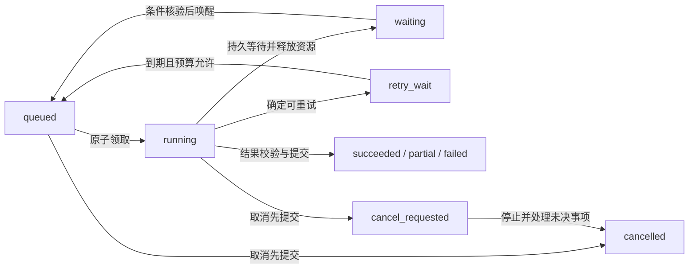
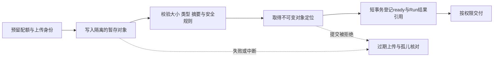

# 25 后端、调度与存储

上午九点，员工集中打开企业 IT 助手：有人问 VPN 怎么配置，有人上传日志要求生成诊断报告，夜间巡检还积压着几百个任务。员工点了两次“生成”，浏览器随即断线；一个 Worker 重启，另一个 Worker 接手；旧 Worker 恢复后，又交回一份报告。

模型回答得再好，也不能替后端回答这些问题：**任务究竟收下了没有，属于谁，由谁推进，资源够不够，结果放在哪里，什么时候可以删除？** 本章把 Agent 执行能力放进一个可服务多用户、可承受故障、可交付文件的应用系统。

[← 知识图谱](00%20Agent%20%E5%BC%80%E5%8F%91%E5%AD%A6%E4%B9%A0%E5%85%A5%E5%8F%A3.canvas)

**先修**：[软件与系统基础](02%20%E8%BD%AF%E4%BB%B6%E4%B8%8E%E7%B3%BB%E7%BB%9F%E5%9F%BA%E7%A1%80.md) · [状态与恢复](12%20%E7%8A%B6%E6%80%81%E3%80%81%E6%8C%81%E4%B9%85%E6%89%A7%E8%A1%8C%E4%B8%8E%E6%81%A2%E5%A4%8D.md) · [身份与多租户](20%20%E8%BA%AB%E4%BB%BD%E3%80%81%E6%9D%83%E9%99%90%E4%B8%8E%E5%A4%9A%E7%A7%9F%E6%88%B7.md)。本章侧重服务承载、调度和数据归属；恢复算法见第 12 章，前台流式协议见[第 23 章](23%20%E4%BA%A4%E4%BA%92%E4%BD%93%E9%AA%8C%E4%B8%8E%E6%B5%81%E5%BC%8F%E4%BA%8B%E4%BB%B6.md)，外部写入的幂等、未知结果与对账见[第 26 章](26%20%E5%8F%AF%E9%9D%A0%E6%80%A7%E4%B8%8E%E5%89%AF%E4%BD%9C%E7%94%A8%E4%B8%80%E8%87%B4%E6%80%A7.md)。

> [!abstract] 本章的工程交付
> 一套任务 API 与数据模型，一条“持久接收 → 公平排队 → 受控执行 → 正式交付”的链路，一份存储与保留策略，以及能验证并发领取、重启接手、取消和产物隔离的实验。优先保证：**接收有凭据、推进有资格、资源有上限、数据有归属、删除有依据。**

## 阅读路线

| 阶段 | 小节 | 先解决的问题 |
| --- | --- | --- |
| 建立服务合同 | 1—4 | 什么应该同步返回？Session、Run 和 Worker 各负责什么？ |
| 打通调度链路 | 5—8 | 如何防漏调度、重复领取、资源争抢和定时重复触发？ |
| 建立数据与文件边界 | 9—13 | 哪份数据可信？工作区、正式产物和清理如何协同？ |
| 完成运行与交付 | 14—18 | 如何停机、扩容、恢复、做实验和验收？ |

[后端架构交互图](./assets/ch25-backend-scheduling/backend-control-data-flow.html)支持缩放、主题切换和导出；[SVG 静态图](./assets/ch25-backend-scheduling/backend-control-data-flow.svg)用于正文预览。[配套离线实验](https://github.com/douloveppt/agent-application-learning/tree/main/examples/ch25-backend-scheduling)使用 Python 标准库和 SQLite，不调用模型或真实业务系统。GitHub 阅读时可下载 HTML 后在浏览器打开。正文接口、表名、配额和保留时间均为教学设计；产品特性按所用版本核对，官方资料核对日期为 **2026-11-03**。

## 1. 先定义一个能验收的后台任务

### 1.1 把“处理一下”变成明确合同

沿用企业 IT 助手，增加一个后台任务：员工上传自己有权使用的网络诊断日志，生成带来源的报告。报告生成不自动修改工单；如果后续要提交工单，走独立授权与操作记录。

| 合同项 | 本案例的约定 |
| --- | --- |
| 输入 | 已通过接入检查的日志产物 ID 与确定版本、分析参数 |
| 身份 | 服务端确认的租户、员工和所属会话 |
| 接收凭据 | 稳定 `run_id`、当前状态、状态查询地址 |
| 产出 | 报告、必要的中间表、输入来源与版本清单 |
| 完成 | 正式产物已登记且可按当前权限读取，运行终态已持久保存 |
| 不完整 | 部分输入不可用时返回缺失项，不能把部分分析标成完整成功 |
| 控制 | 查询进度、取消、超期停止；断线后查询同一个任务 |
| 资源 | 排队上限、执行并发、模型预算、输入与产物存储配额 |
| 生命周期 | 临时工作区可回收，正式报告按策略保留，到期有明确反馈 |

一个 `202 Accepted`、一条队列消息、模型输出“报告已生成”，分别只证明链路中的一部分。**成功应由持久状态和可访问的交付物共同证明。**

### 1.2 区分短请求 长任务和持续连接

| 类型 | 适合的处理方式 | 需要注意 |
| --- | --- | --- |
| 查询任务状态、读取会话元数据 | 有界的同步 API | 控制查询范围、超时和响应大小 |
| 快速问答、首段文本生成 | 可采用请求内流式响应 | 连接断开与任务取消的关系要写进合同 |
| 解析大文件、批量检索、生成报告 | 先持久接收，再由 Worker 执行 | 不能依赖某个 Web 进程一直存活 |
| 实时语音 | 专门的低延迟会话链路 | 不逐帧经过普通任务队列，见第 24 章 |

异步函数 `async def` 表示可以协作让出执行权，并不自动提供任务持久化。Web 进程内的后台回调，也没有天然的跨重启接手能力。FastAPI 官方把跨进程、跨服务器的大型后台计算列为考虑独立任务工具的场景；选框架仍要核对实际持久性和执行语义。[FastAPI Background Tasks](https://fastapi.tiangolo.com/tutorial/background-tasks/)

### 1.3 企业级从明确边界开始

第一版可以是一个模块化应用、一个关系数据库、一个 Worker 进程和受控文件存储。逻辑上分开 API、任务登记、调度、执行与产物管理，部署上可以先合并。

当 Web 请求和后台任务互相争抢资源，再独立扩容 Worker；当 SQL 轮询或跨服务投递成为实际瓶颈，再引入消息队列；当文件容量、下载带宽与跨机器共享有明确需求，再采用对象存储。每增加一个系统，都增加配置、权限、监控和故障恢复的成本。

## 2. 建立稳定身份与清晰的数据所有权

### 2.1 一次请求不等于一次任务

| 对象 | 含义与生命周期 | 不应混用的身份 |
| --- | --- | --- |
| Request | 一次 HTTP 尝试 | 浏览器重试会产生新的请求追踪 ID |
| Session | 一组对话与协作上下文 | 不能作为某个任务正在执行的证明 |
| Run | 一次被持久接收的逻辑任务 | 同一任务接手执行时保留 `run_id` |
| Attempt | 某次执行尝试 | Worker 接手后形成新尝试与新租约代次 |
| Operation | 一次具体的外部业务动作 | 重试 Run 不能随意生成新写入身份 |
| Artifact | 可引用、版本明确的文件产物 | 临时路径与下载 URL 都不能代替它 |
| Queue message | 一次投递或唤醒 | 多条消息可能指向同一个 Run |

例如：员工点一次按钮产生 `run-42`；第一次请求回执丢失，重试仍返回 `run-42`；Worker A 执行到一半失联，Worker B 接手同一 Run，但使用新的 Attempt 和 `lease_epoch`。这些身份让日志能够把网络重试、执行接手和业务效果区分开。

### 2.2 资源归属沿整条链保存

Run 保存 `tenant_id`、`requester_id`、`session_id`、输入引用和执行配置版本。数据库查询、队列消费、检查点、缓存、产物登记与下载都要沿用经过验证的归属。

客户端提供 `session_id` 只是指出目标；服务端还要证明当前主体有权在该会话中创建任务。模型候选、队列载荷中的任意 `tenant_id`、文件名中的用户编号，都不能替代授权判断。

执行身份和请求身份也要分开：Worker 是执行服务账号，Run 的数据范围来自有效委托。出队、恢复和正式交付时按所需动作重新检查当前权限；历史上“当时允许”的快照只用于解释，不能永久授权。具体身份与撤权机制见第 20 章。

### 2.3 同一会话的并发要有产品策略

两个 Run 同时读取会话版本 12，分别生成不同后续，直接把“最新消息”覆盖回去会丢失其中一条路径。

| 策略 | 适用场景 | 后端约束 |
| --- | --- | --- |
| 会话内串行 | 强顺序的助手对话 | 维护会话执行资格，后续轮次排队或明确拒绝 |
| 独立分支 | 比较两份报告、并行研究 | 每个 Run 固定输入版本，结果作为分支交付 |
| 乐观并发 | 并行生成，提交时合并 | 带 `expected_session_version` 条件更新，冲突进入明确处理路径 |

会话串行不意味着整个 Run 期间持有数据库行锁。通常保存一个可恢复的运行资格，短事务校验版本；等待模型、审批或外部网络时释放数据库连接与锁。

## 3. 设计任务 API 与接收边界

### 3.1 先公开稳定资源 再暴露进度

| 接口示例 | 作用 | 合同重点 |
| --- | --- | --- |
| `POST /v1/sessions/{id}/runs` | 创建报告任务 | 归属、输入版本、幂等键、预算与准入 |
| `GET /v1/runs/{id}` | 查询事实快照 | 当前状态、版本、缺失项、结果引用 |
| `GET /v1/runs/{id}/events?after=...` | 读取授权范围内的事件 | 游标、重连与保留窗口见第 23 章 |
| `POST /v1/runs/{id}/cancel` | 请求停止任务 | 反复调用不会产生新任务，反馈真实取消状态 |
| `GET /v1/artifacts/{id}/versions/{v}` | 读取产物元数据或取得下载入口 | 每次鉴权，校验状态与确切版本 |

创建请求不接受客户端指定任意 Worker、任意对象存储地址或任意凭据。允许传业务目标和受限选项，由服务端选择执行配置。

```http
POST /v1/sessions/session-7/runs
Idempotency-Key: report-submit-08
Content-Type: application/json

{
  "task_type": "network_diagnostic_report",
  "input": {"artifact_id": "artifact-input-9", "version": 3},
  "parameters": {"language": "zh-CN", "include_summary": true}
}
```

服务端持久接收后可以返回：

```http
HTTP/1.1 202 Accepted
Location: /v1/runs/run-42

{
  "run_id": "run-42",
  "status": "queued",
  "status_url": "/v1/runs/run-42",
  "accepted_at": "2026-11-03T01:00:00Z"
}
```

HTTP 的 `202` 表示请求已接受处理，处理尚未完成；响应应说明当前情况并给出状态监视入口。本应用进一步承诺：发出接收回执之前，Run 已在约定的持久存储中提交。后一个保证来自应用实现与数据库耐久配置。[RFC 9110 §15.3.3](https://www.rfc-editor.org/rfc/rfc9110.html#section-15.3.3)

### 3.2 Admission 是真正接收前的准入

接收前依次检查：可信身份与会话归属、请求结构、输入是否可读且已就绪、任务类型与版本是否支持、租户是否可用、排队和存储配额、预算及截止时间。

不同拒绝要有稳定错误码。例如参数无效采用 `422`，幂等键绑定不同内容采用 `409`，调用方限额不足采用 `429`，平台暂时无法接收采用 `503`；这些是本案例的 API 约定。可恢复错误给出适当重试信息，错误响应中不泄漏其他租户的存在性和内部路径。

**排队配额与执行配额分别计算。** 前者防止用户一次积压百万任务；后者限制同时执行的 Run。已成功接收的任务不能因为服务重启就无声消失；系统如果允许排队超期，必须把 `expired` 和原因写回状态。

### 3.3 幂等接收需要键 指纹 归属和事务

建议将键绑定到明确作用域，例如 `(tenant, caller, API operation, key)`；对校验并规范化后的业务请求计算指纹，覆盖输入版本和实际影响任务含义的参数。相同作用域与键，指纹相同则返回同一 Run，指纹不同则拒绝。

查重前仍要验证当前身份；返回既有 Run 前仍要鉴权。不能让员工通过猜测别人的幂等键取得报告。键的最长重试窗口与保存期限写进合同，清理键记录之后，旧请求可能被当作新任务，不能继续声称永久去重。

接收事务可按以下顺序设计；这是协议伪代码，行锁与隔离级别需要在目标数据库中实现：

```text
校验身份、请求、输入归属与当前授权
BEGIN
  锁定该租户的准入/配额记录（各写路径使用一致的锁顺序）
  查找幂等登记
    已存在：验证归属与指纹，返回原 Run，不再占额度
  原子检查并预留排队额度与必要预算
  INSERT Run(status=queued, input_version=固定版本)
  INSERT 幂等登记 -> run_id（唯一约束兜底）
  INSERT 待调度记录 -> run_id
COMMIT
提交成功后才返回接收凭据
```

如果进程在提交后、响应前退出，客户端可以带原键重试找回同一 Run。如果提交结果未知，服务端也先按键核实。不要绕过登记直接另建任务。外部业务写入还需要独立幂等与对账，接收去重不能替代它。

## 4. 把服务职责画出来


这是一个教学参考架构，图中的逻辑模块可以先部署在同一应用中。

| 模块 | 负责什么 | 主要读取或写入 |
| --- | --- | --- |
| API / Admission | 身份、校验、准入、接收、查询和取消 | 会话归属、Run、幂等登记、配额 |
| Run Registry | 保存权威任务状态与推进资格 | 状态、版本、租约、输入与输出引用 |
| Dispatcher | 找出到期可执行任务并安排唤醒 | 待调度记录、`next_run_at`、投递状态 |
| Queue | 解耦速度、投递唤醒 | 小型任务引用与消息元数据 |
| Worker | 领取资格，调用执行引擎，提交进度和结果 | 当前 Run、租约、检查点、产物引用 |
| Artifact Service | 上传、版本、归属、引用、下载和删除 | SQL 元数据与底层文件／对象 |
| Reconciler / Sweeper | 核对遗漏、租约过期、孤儿对象和清理状态 | 持久登记与实际存储状态 |

需要区分三层调度：第 11 章的 Workflow 调度决定“哪个业务节点依赖已满足”；本章的任务调度决定“哪个租户的哪次执行现在拿到资源”；基础设施调度决定“哪个进程／容器放在哪台机器”。有 Kubernetes 并不会自动获得租户公平，选了 Agent 框架也不会自动得到持久接收。

## 5. 让任务从接收可靠地走到执行

### 5.1 先解决数据库与队列之间的断点

“先写 Run，再发消息”存在写库成功、发消息失败的窗口；反过来则可能让 Worker 读到一个尚未存在的任务。不要用一句“都成功了就算成功”掩盖这个断点。

本案例将 Run 与待调度记录在同一数据库事务提交。Dispatcher 反复扫描未完成投递的记录，向队列发送唤醒，发送成功后更新投递记录。发送成功但登记前退出，会再次投递；由领取协议处理重复。若使用 Outbox，落地方式和跨系统保证见第 26 章。

小规模场景可让 Worker 直接按索引轮询 SQL，就不需要为“通知 Worker”额外引入一个队列。此时仍须有原子领取、租约、配额和故障核对。

### 5.2 队列传引用 事实从登记服务读取

```json
{
  "message_schema": "run-wakeup.v1",
  "run_id": "run-42",
  "dispatch_generation": 4,
  "trace_context": {"correlation_id": "corr-19"}
}
```

这条消息表达“请检查这个 Run 是否可以推进”。Worker 从可信登记读取任务归属、版本、状态与预算，不把消息当授权票据。不同租户的 `run_id` 如果并非全局唯一，还需要经过验证的租户路由字段，并和登记记录一致。

消息中不放大文件、完整聊天历史、长期令牌或一次性下载链接。引用可以重新鉴权加载；过期 URL 和大消息则会让重试、审计和数据删除更难管理。

### 5.3 ACK 表示消费边界 要与实现配套

本案例采用“短唤醒消息 + SQL 持久任务”的设计：Worker 领取或判定当前无需处理后，可确认消息，后续执行由 SQL 中的租约、恢复器和再次调度保证。只有在这些恢复路径存在并经过验证时，提前确认才成立。

另一种队列以消息本身承载待执行工作，通常要在结果持久提交后确认，并在执行中按协议续期可见性。两种设计的确认时点不能随意混用。

Amazon SQS 的 visibility timeout 会让收到的消息暂时不可见，但官方明确说明仍可能重复投递；可见性超时也不会使旧消费者的进程停止。它不能代替应用中的执行资格校验。[SQS visibility timeout](https://docs.aws.amazon.com/AWSSimpleQueueService/latest/SQSDeveloperGuide/sqs-visibility-timeout.html)

### 5.4 定期核对让遗漏可被发现

恢复器扫描的是持久事实：长时间未投递的待调度记录、到期的 `retry_wait`、无人持有有效租约的可恢复任务、取消请求与实际执行不一致、终态缺少应有的产物引用。

扫描应分批、有索引、有速率上限。发现异常后按状态决定补唤醒、核实或人工处理，不能把所有“长时间没更新”统一改回 `queued`。如果运行可能已发出外部写入，先核实动作记录，见第 12、26 章。

## 6. Worker 的领取 租约与状态提交

### 6.1 将运行状态与执行资格分开

| 运行状态 | 表达什么 | 是否占用执行槽位 |
| --- | --- | --- |
| `queued` | 已接收，等待被领取 | 通常不占执行槽位，占排队额度 |
| `running` | 已进入执行阶段，当前推进资格由有效租约确定 | 有效租约占用，到期后按协议核对回收 |
| `waiting_input` / `waiting_approval` | 等外部条件满足 | 保存状态后释放执行资源 |
| `retry_wait` | 确认可重试，等待指定时间 | 通常释放执行槽位 |
| `cancel_requested` | 已请求停止，尚未确认收敛 | 活跃执行者仍须受约束 |
| `succeeded` / `partial` / `failed` / `cancelled` / `expired` | 运行终态及结果类别 | 释放租约与对应配额 |

状态名称是本案例约定。外部操作的 `unknown`、`confirmed` 等确定性状态单独记录，避免一个 Run 的 `failed` 掩盖已经发生的业务效果。



图省略了超期等支线。`waiting` 是两类等待的合称，正式数据模型应保留具体等待原因和唤醒条件。

### 6.2 领取必须把竞争收敛到一个原子边界

错误实现是先 `SELECT status`，随后执行普通 `UPDATE`；两个 Worker 可能都读到 `queued`。正确方式使用事务锁或带前置条件的原子更新，在同一事务里检查资源名额、改变状态、记录 Attempt、分配租约。

领取结果至少包含 `worker_id`、`lease_epoch`、`lease_until` 和固定输入版本。每次接手增加代次。心跳只允许当前持有者在原租约尚有效时续期；旧持有者不能在过期后靠迟到心跳“复活”。持久截止时间采用统一的服务端时间依据，避免各机器各自判断。

PostgreSQL 的 `FOR UPDATE SKIP LOCKED` 可用来让消费者跳过已锁定的候选行，但会提供不一致视图，适合队列式消费；它本身不保证严格 FIFO、租户公平或防饥饿。[PostgreSQL SELECT](https://www.postgresql.org/docs/current/sql-select.html#SQL-FOR-UPDATE-SHARE)

### 6.3 旧执行者必须在提交点被拒绝

以条件提交表达推进资格，下面使用 PostgreSQL 语法，只展示关键条件，不是一份完整的完成事务：

```sql
UPDATE runs
SET status = 'succeeded', state_version = state_version + 1
WHERE tenant_id = :tenant_id AND run_id = :run_id
  AND status = 'running'
  AND worker_id = :worker_id
  AND lease_epoch = :lease_epoch
  AND lease_until > clock_timestamp()
  AND deadline_at > clock_timestamp()
  AND cancel_requested_at IS NULL;
```

`clock_timestamp()` 使用检查时的实际时刻，避免事务启动后长时间等待锁，却沿用事务开始时刻判断租约。事务仍须保持短小；这不是硬实时的进程停止保证。受影响行数必须恰好为 1。为 0 时，结果不能继续挂到正式 Run 上。产物登记、最终引用、配额释放和关键事件要与合法完成协同提交；先插正式产物、再忽略 Run 更新失败，会留下可见的错误交付。

`state_version` 用于检测基于旧状态的更新；`lease_epoch` 用于区分新旧执行者。需要乐观并发时再增加版本条件。它们不会阻止一个旧进程继续耗 CPU，也不能让外部系统自动拒绝旧写入；外部效果需要独立的操作协议。

### 6.4 心跳 取消和资源回收有先后顺序

Worker 失联时，恢复器先确认租约已过期，再按任务类型核对能否接手。只读报告计算可以从安全检查点重算；已派发业务写入需要先核实。

运行中的取消先保存停止意图，阻止新步骤与正式完成，通知执行器停止；待停止确认或按既定规则处理租约后，再回收执行名额。取消与成功同时发生时，以事务中首先提交的有效状态转移为准，终态不可互相覆盖。

**合法租约数和真实在途工作数不同。** 失联的旧进程可能还在运行，供应商请求可能还在计费。进程资源限制、下游调用限额和超时负责限制这些残余消耗，不能只看数据库把名额放回来了。

## 7. 做到有界 公平并能承受高峰

### 7.1 把四种限制放到对应位置

| 限制 | 控制对象 | 设置位置 |
| --- | --- | --- |
| 请求速率 | 每秒进入 API 的调用 | 网关与 Admission |
| 排队容量 | 已接收但尚未执行的工作 | 接收事务与队列策略 |
| 执行并发 | 同时持有执行资格的任务 | 领取事务与 Worker 池 |
| 时间与费用预算 | 总时长、调用数、Token、输出字节 | Run 与下游执行入口 |

限速不等于限并发：每秒只来一个任务，若每个执行十分钟，也会累积大量在途工作。限制 Run 数也不等于限制模型调用数：一个 Run 可能同时展开多个子任务。

需要分层预算：平台总上限 → 租户上限 → 用户／项目上限 → Run 上限 → 单次下游调用上限。并行分支共享父预算；对用量先保守预留，完成后结算，失败也记录实际发生的消耗。精确供应商账务核对见第 29 章。

### 7.2 公平调度要显式设计

全局 FIFO 容易被一个大租户占满；只有“高优先级先执行”又可能让批任务永远等不到。

一种可评审的方案是：先按租户轮转选择可服务租户，再在租户内部按优先级与入队时间取任务；给等待较久的任务适度提升机会，交互任务与批处理分别设置最小资源份额。权重由服务等级与运营规则决定，客户端不能随意声明自己是最高优先级。

并发限制必须原子生效。例如锁定租户资源记录，再检查并预留一个槽位，与 Run 领取一起提交；两个事务同时“数一下当前只有 2 个”，都认为能领取第 3 个，是典型竞态。释放、过期核对和再次领取使用一致锁顺序，配额计数由事实定期核对，避免漂移。

### 7.3 排队也是预算的一部分

将总预算拆成排队时间、执行时间和下游调用时间。例如设计目标可以是“排队最多 30 秒，执行最多 90 秒，总截止 120 秒”，这些数值需要由产品与压测证明。

领取前再次核对截止时间；剩余 3 秒时不应启动一个最少需要 20 秒的步骤。退避后的任务保存 `next_run_at`，不要占着 Worker 睡眠。审批等待按业务规则另设有效期，通常不持续占计算槽位。

对任务截止、单次网络超时、租约过期和用户取消分别记录原因，它们触发的恢复动作不同。

### 7.4 用吞吐估算解释积压

假设平均每秒进入 2 个同类报告，每个报告平均占用执行槽位 20 秒，稳定状态下平均约有 `2 × 20 = 40` 个报告在执行。若目标平均利用率按 70% 做初步估算，需要约 `40 / 0.7 ≈ 58` 个槽位。

这只是容量起点：长尾耗时、突发流量、模型限额与故障冗余会改变结果。队列每秒进入 10 个、只能完成 6 个，就会每秒积压约 4 个；无限加长队列只把拒绝变成长时间等待。

### 7.5 背压需要向上游反馈

| 现场 | 优先行动 | 避免的误操作 |
| --- | --- | --- |
| 某租户突发批量提交 | 限制该租户准入与并发，保留其他租户份额 | 全平台一刀切停收 |
| 模型供应商限流 | 降低下游并发、有限退避、保留已接收任务 | Worker 越多请求越多 |
| 数据库连接池耗尽 | 检查长事务与连接占用，限制消费者 | 继续扩容 Worker 挤爆数据库 |
| 队列最老任务持续变老 | 结合完成速率、失败率和配额找瓶颈 | 只看队列长度就盲目扩容 |
| 存储快满 | 停止超配额上传，核对保留和孤儿对象 | 删除仍被活动任务引用的输入 |

预取数量、进程内待执行队列、线程池、文件下载缓冲也要有上限。不要把消息从持久队列全部拿进内存，制造一个看不见、不可公平调度的新队列。

## 8. 定时与事件触发也走同一接收合同

### 8.1 定时任务记录“原本该在什么时候执行”

夜间巡检的身份可写为 `(tenant_id, schedule_id, scheduled_for)`。其中 `scheduled_for` 是该次计划时间，不能用每次重试时的当前时间代替。计划修订是否形成新执行，必须有版本规则，不能因配置编辑就重复巡检。

记录时区、业务统计窗口和 UTC 执行时间。跨时区还要定义夏令时重复／缺失时刻的处理。对错过的执行选择跳过、只补最近一次、按数量与时间窗受控补跑；恢复调度服务时，不能把几个月的漏跑全部瞬间灌入。

### 8.2 调度平台的并发选项有范围

Kubernetes CronJob 的 `concurrencyPolicy` 控制同一个 CronJob 创建的 Job；`Forbid` 不会阻止另一个 CronJob 或手动 API 创建同一业务任务。显式配置 `.spec.timeZone`，并结合 `startingDeadlineSeconds` 决定迟到执行是否还有效。官方也说明调度可能出现零个或多个 Job，因此业务接收仍须能处理重复。[Kubernetes CronJob](https://kubernetes.io/docs/concepts/workloads/controllers/cron-jobs/)

```yaml
# 教学配置片段，省略 jobTemplate
spec:
  schedule: "0 2 * * *"
  timeZone: "Asia/Shanghai"
  concurrencyPolicy: Forbid
  startingDeadlineSeconds: 600
```

`Replace` 终止旧 Job 不等于撤销已提交的业务写入；新的 Job 也不能不经核实重放旧动作。

### 8.3 Webhook 接收先留存 再确认

外部事件先验证来源、签名、时间窗口与载荷大小，再以 `(source, tenant, event_id)` 去重，保存接收记录与待处理任务，持久提交后按供应商协议确认。事件里的租户关联要来自已配置且经过验证的连接关系。

乱序事件不能简单按到达顺序覆盖业务状态。优先使用源系统版本；必要时只把事件作为提示，再读取源系统当前事实。故障与人工重放沿用原事件身份，另记重放记录和操作者。Connector 的协议与认证详见第 17 章。

## 9. 先定事实来源 再选择存储

### 9.1 每一份数据都有明确职责

| 数据 | 推荐职责与典型存储 | 丢失／落后时怎样处理 |
| --- | --- | --- |
| 会话、Run、权限归属、配额、产物元数据 | 关系数据库中的事务事实 | 从备份与恢复流程处理，不能假装只是缓存缺失 |
| 文件字节与大报告 | 受控文件服务或对象存储 | 按版本和校验值恢复，无法恢复时明确报告缺失 |
| 热点状态与限流计数 | 缓存或专用计数服务 | 按合同重建；影响准入正确性的计数要核对 |
| 全文与向量索引 | 面向查询的派生索引 | 可从权威来源重建，读取时复核权限和版本 |
| 待执行通知 | 队列或持久调度表 | 根据实际设计，从登记与恢复器重新投递 |
| 日志、指标、Trace | 运维与诊断系统 | 不能用一条成功日志替代运行或业务回执 |
| 长期偏好与事实 | Memory 服务及其来源记录 | 按记忆治理恢复，不能从任意旧聊天猜回 |

“Redis / SQL / 向量库都能存 JSON”不意味着可以互换。选择依据是事务范围、查询方式、耐久要求、隔离边界、恢复能力与成本。

### 9.2 控制权威数据的复制关系

任务状态可能同时显示在 SQL、Redis、搜索索引和前端缓存。先明确 SQL 是本案例的事实源，其他位置保存可重建投影，并带状态版本或更新时间。缓存未命中回源，投影落后不能覆盖更高版本。

权限敏感的数据不能因为缓存命中就跳过当前访问检查。缓存键需要包含业务范围、输入与配置版本；私人结果还要包含适当主体范围。撤权、删除与版本更新要使旧缓存不再成为泄漏通道。

如果系统采用事件溯源作为事实源，需要另外设计事件持久性、重放、版本和投影一致性；有一张 events 表还不足以宣称实现了事件溯源。

### 9.3 多副本读取要说明一致性

创建 Run 后立即从延迟副本读取，可能暂时返回“找不到”；取消刚提交，Worker 又读到副本上的旧状态，可能继续推进。关键准入、领取、取消与完成条件应在能提供所需一致性的权威路径上核验。

普通列表可允许有界滞后，并给出刷新方式。不能一边允许任意旧读，一边承诺“取消提交之后绝不再开始新步骤”。读取一致性是产品合同的一部分。

## 10. 用数据模型和事务守住边界

### 10.1 把常用关系建成结构

一个可评审的模型通常至少包含以下记录：

| 表／集合 | 关键内容 | 典型约束 |
| --- | --- | --- |
| `sessions` | 租户、会话、所有者、上下文版本 | 租户内会话唯一 |
| `runs` | 归属、输入版本、状态、截止时间、租约、状态版本 | 引用同租户 Session，状态转移受条件限制 |
| `idempotency_requests` | 键作用域、指纹、Run 引用、保留期限 | 作用域内键唯一，关键列非空 |
| `run_attempts` | 执行者、代次、开始／结束、停止原因 | 同一 Run 的代次唯一 |
| `dispatch_intents` | 应调度的 Run、代次、下次投递时间 | 防止同一调度意图重复建档 |
| `run_events` | Run、序号、事件类型、公开载荷 | Run 内序号唯一，敏感内部信息单独存 |
| `artifact_versions` | 所有者、确切版本、存储定位、摘要、状态 | 版本不可悄悄覆盖 |
| `artifact_refs` | 谁以何种用途引用哪一产物版本 | 支持保留、删除与血缘查询 |
| `tenant_capacity` | 队列／租约名额、预算预留与结算 | 原子预留、释放与周期核对 |

不要把状态、归属、可调度时间都藏进一个不受约束的大 JSON。结构化列支持约束、索引和排查；变化较大的业务参数可以放在带 `schema_version` 的受校验 JSON 中。

### 10.2 一个刻意缩小的 PostgreSQL 结构片段

下面只展示“同租户引用”和“请求去重”的结构，不包含完整生产字段，也不是实验使用的 SQLite Schema：

```sql
CREATE TABLE sessions (
    tenant_id text NOT NULL,
    session_id text NOT NULL,
    owner_id text NOT NULL,
    context_version bigint NOT NULL DEFAULT 0,
    PRIMARY KEY (tenant_id, session_id)
);

CREATE TABLE runs (
    tenant_id text NOT NULL,
    run_id text NOT NULL,
    session_id text NOT NULL,
    requester_id text NOT NULL,
    status text NOT NULL,
    state_version bigint NOT NULL DEFAULT 0,
    PRIMARY KEY (tenant_id, run_id),
    FOREIGN KEY (tenant_id, session_id)
        REFERENCES sessions (tenant_id, session_id)
);

CREATE TABLE idempotency_requests (
    tenant_id text NOT NULL,
    caller_id text NOT NULL,
    api_operation text NOT NULL,
    request_key text NOT NULL,
    request_fingerprint text NOT NULL,
    run_id text NOT NULL,
    PRIMARY KEY (tenant_id, caller_id, api_operation, request_key),
    FOREIGN KEY (tenant_id, run_id)
        REFERENCES runs (tenant_id, run_id)
);
```

复合外键可以阻止把甲租户的 Run 挂到乙租户会话，不能证明同租户里的当前员工有权使用它。唯一约束也不会替你核对同键是否绑定同一请求。关键键字段设为 `NOT NULL`；PostgreSQL 的普通唯一约束默认不会把所有含 `NULL` 的记录都视为相同。[PostgreSQL Constraints](https://www.postgresql.org/docs/current/ddl-constraints.html)

启用 PostgreSQL RLS 可以增加数据库范围约束，但要用真实应用角色验证。超级用户、`BYPASSRLS` 和通常的表所有者有绕过规则；连接池的租户上下文必须在每次受控事务正确设置并在复用时隔离，不能仅在新建连接时设置一次。[PostgreSQL Row Security](https://www.postgresql.org/docs/current/ddl-rowsecurity.html)

### 10.3 索引按工作负载设计

先列查询，再决定索引。例如：

- 调度：指定租户中 `status` 可执行、`next_run_at <= now` 的任务，按优先级与入队时间取少量记录。
- 恢复：活跃状态中 `lease_until` 已过期的记录。
- 用户列表：当前主体允许查看的 Run，按 `(created_at, run_id)` 做游标分页。
- 清理：已到期且无保留保护的产物版本，按到期时间分批扫描。

可以为热点状态使用适当的部分索引，具体以目标数据库与执行计划验证。避免深度 `OFFSET` 翻页、每次全表统计积压、把大报告直接放进普通任务列表响应。

时间分区能帮助治理大量历史记录，也会影响唯一约束和删除方式；不能先按月分区，再发现去重键跨月失效。定期归档不应删掉仍在重试窗口中的幂等登记或活动任务引用。

### 10.4 保持事务短小 处理真实冲突

将“校验执行资格、推进状态、保存小型元数据与必要事件”放在短事务内。模型调用、文件转码、对象上传和等待人工不持有数据库事务。跨 SQL、Broker、对象存储的操作拆成可恢复阶段，不能靠一个本地 `COMMIT` 宣称全部原子完成。

死锁、唯一冲突、序列化失败与连接中断分开处理。明确可重试的短事务可以有界重试；提交回执丢失先查事实；包含不确定外部写入的整个函数不能直接重跑。事务和外部副作用的衔接见第 26 章。

## 11. 工作区是临时执行空间

### 11.1 分清四个容易混在一起的概念

| 概念 | 负责什么 | 不自动提供什么 |
| --- | --- | --- |
| Workspace | 一次执行可读写的文件空间 | 跨重启持久性、完整隔离、正式交付 |
| Sandbox | 进程、文件、网络与资源隔离 | 产物长期保存、业务授权 |
| Session / Checkpoint | 小型运行状态与恢复位置 | 大文件本体、永久访问权限 |
| Artifact Service | 文件身份、版本、归属、引用和交付 | 任意代码的安全执行 |

Memory 是供未来任务复用的信息层，也不等同于文件仓库。ADK 将二进制产物及其版本管理与 Session State 区分开来；应用仍需将自己的权限和生命周期接入产物服务。[ADK Artifacts](https://adk.dev/artifacts/)

### 11.2 按 Run 与 Attempt 隔离临时目录

使用服务端生成的工作区身份，输入从已授权且固定版本的产物加载；同一 Run 的不同 Attempt 不共享可任意覆盖的临时输出目录。重启后按检查点中的产物引用恢复，不能假定 `/tmp/report.csv` 还在。

原始文件名只作展示信息，不直接拼接为磁盘路径。检查目录穿越、符号链接、压缩包解包路径、输出数量与大小；跨租户复用目录前必须有可靠清理与隔离。仅按 `tenant/run` 建目录不构成安全沙箱，执行边界见第 18 章。

### 11.3 有价值的中间结果也要明确升级

耗时很长的解析结果若对恢复有价值，可登记为中间产物，记录输入版本与处理器版本。可快速重算的缓存则不必永久保存。划分标准是重算成本、审计需求、隐私与存储预算，而不是“生成过的文件全部保留”。

工作区销毁前先完成正式交付或中间结果提交。销毁工作区后，用户仍应能够通过 Artifact Service 下载已经承诺交付的报告。

## 12. 将产物做成正式服务

### 12.1 文件字节与产物身份分别保存

```json
{
  "artifact_id": "report-17",
  "version": 2,
  "tenant_id": "tenant-a",
  "owner_id": "employee-8",
  "created_by_run": "run-42",
  "state": "ready",
  "media_type": "text/markdown",
  "size_bytes": 18420,
  "content_digest": "sha256:<完整摘要>",
  "source_refs": [{"artifact_id": "input-9", "version": 3}],
  "retention_class": "employee-report"
}
```

存储 key、Bucket、对象版本号、加密信息保存在内部定位记录中。对外引用使用稳定 ID 与确切版本；摘要用于核对字节完整性，不能证明报告结论正确。

`report-17 v1` 与 `v2` 必须可以分别定位。重跑生成新版本或新产物，不覆盖已经被消息、审批、检查点或其他报告引用的旧版本。应用版本与对象存储版本分别管理，不能假设它们天然一一对应。

### 12.2 大文件上传采用分阶段提交

一种可恢复的实现流程如下：



暂存对象尚未通过检查时不能被普通下载接口读取；最终登记时再次校验 Worker 的代次、有效租约、取消状态与输入关系。任务可以失败，但不能留下一个被当成成功报告的半文件。

若对象已写入、SQL 提交失败，保留未被引用对象供核对后回收；若提交结果未知，按上传身份／产物身份查询，避免直接重传覆盖。只有确认对象的确切版本可读取且满足约定的耐久性后，才允许元数据进入 `ready`。

这里需要应用提交协议。对象存储与 SQL 并没有因为在同一个函数里调用就形成一个事务。

### 12.3 不可变性要落实到底层对象

S3 预签名 URL 可在有效期内重复使用，同 key 上传会替换已有对象。不能把“签了一个上传链接”当作只能写一次的保证。[S3 presigned URLs](https://docs.aws.amazon.com/AmazonS3/latest/userguide/using-presigned-url.html)

可让客户端仅写暂存区，通过校验后由受控服务发布到无客户端写权限的唯一正式 key；或者使用经过验证的条件写入及对象版本绑定。若启用对象版本机制，登记和下载必须指向确切版本，不能每次解析 `latest`。[S3 Versioning](https://docs.aws.amazon.com/AmazonS3/latest/userguide/Versioning.html)

对象命名包含租户前缀有助运营管理，仍需身份策略与应用鉴权；猜不到 key 不能作为访问控制。

### 12.4 下载 分享和交付分别授权

读取元数据、预览内容、下载、创建分享与删除是不同动作。用户对 Run 可读，不代表可以看报告使用的所有原始敏感日志；输入来源和正式结果可以有不同授权规则。

签发下载链接前检查当前权限，绑定确切对象版本并设置短有效期。此类链接应按持有即可使用的敏感凭证保护，避免写进普通日志或长期聊天记录。已经签发的链接是否可立即失效，取决于底层权限与签发机制；若产品要求每次访问都受当前撤权控制，采用重新鉴权的下载代理或等效方案。

交付清单包含文件名、格式、大小、版本、来源、生成 Run、可用期限和访问入口。不要只返回 Worker 本地路径，或让用户从几百条日志里寻找下载链接。

## 13. 让保留 到期和删除成为可恢复流程

### 13.1 按用途划分保留策略

| 数据类别 | 教学策略示例 | 删除前需要核对 |
| --- | --- | --- |
| Attempt 临时文件 | 执行结束后短暂保留供定位，再清理 | 进程确已退出、输出已提交、无诊断保留 |
| 失败任务中间结果 | 保留 3 天供重试或人工排查 | 是否仍在允许恢复的窗口内 |
| 正式员工报告 | 保留 30 天，必要时显式延长 | 当前引用、用户约定、法定与组织保留规则 |
| 原始敏感日志 | 以最小必要期限保存 | 活动分析、审计要求与删除请求 |
| 幂等与操作登记 | 覆盖承诺的重试／核实窗口 | 删除后是否可能导致重复接收或失去核实依据 |

这些天数只是设计练习，不是通用合规标准。实际规则由业务目的、数据分类、组织政策和法律要求决定；应明确谁有权延长或覆盖默认规则。

### 13.2 引用检查和删除必须防竞态

仅做“查到引用数是 0，然后删除对象”不够：检查之后可能有新的 Run 引用它。

一种实现是：在事务内锁定产物记录，确认无活动引用和保留保护，标记 `deleting` 并写入删除任务；所有新增引用路径在同样的同步边界检查状态，只能引用允许使用的版本。事务提交后执行物理删除，再写回 `deleted` 墓碑与结果。删除失败保存原因并重试，不把整件事假装已经结束。

```text
ready → 满足到期条件 → deleting → 对象删除确认 → deleted
                           └─ 删除失败：保留记录，等待核对／重试
```

已确认删除的稳定身份保留最小必要的墓碑信息，使旧链接返回可解释结果，避免扫描器把旧索引当作待导入资料而“复活”数据。无权主体仍按防枚举规则响应，不泄漏其他租户是否存在该文件。

### 13.3 底层 Lifecycle 不能代替引用治理

S3 Lifecycle 按前缀、标签、年龄等规则处理对象，不会自动读取应用数据库中的 Run 引用。版本桶的当前版本过期也不等于全部历史版本都物理删除；未完成分段上传还需要单独规则。[S3 Lifecycle](https://docs.aws.amazon.com/AmazonS3/latest/userguide/intro-lifecycle-rules.html)、[S3 expiration](https://docs.aws.amazon.com/AmazonS3/latest/userguide/lifecycle-expire-general-considerations.html)

可将只有应用确认可清理的对象放入对应前缀或标签规则，但要验证标记与并发引用的协调。删除范围还包括派生产物、搜索与向量索引、缓存、预览、临时文件和按策略管理的备份。备份恢复后的系统需先应用删除记录，再重新开放读取，避免旧数据重新可见。

### 13.4 清理本身也有准入和审计

清理 Worker 只处理自己被授权的对象，使用确切对象 ID 和版本；先支持只读预览、数量与字节统计、抽样核对和限量执行。遇到引用不明、法律保留或存储状态不符时暂停该对象并记录原因。

生产清理不要依赖宽泛路径匹配，也不要因某个临时目录创建失败就扩大到修改祖先目录权限。数据生命周期需要能解释“删了什么、为什么删、谁批准、哪些仍未删”，而不是只看磁盘空出来多少。

## 14. 让 Worker 运行方式匹配资源类型

### 14.1 不同任务使用不同执行池

| 工作 | 主要瓶颈 | 常见承载方式 |
| --- | --- | --- |
| 模型、数据库与业务 API 调用 | 网络等待与供应商配额 | 有界异步并发、连接池、独立下游限额 |
| 文档解析、图片转换与音视频处理 | CPU、内存、解码器稳定性 | 独立进程／隔离容器，限制资源与输出 |
| 不可信代码执行 | 文件、网络与进程权限 | 受控 Sandbox，按执行 Profile 限制 |
| 文件上传下载 | 带宽、缓冲、存储请求 | 流式读写、有界缓冲、校验和配额 |

不要在异步事件循环里直接执行长时间阻塞的解码或计算。给所有任务一个线程池也不充分：线程数量有上限，不同工作还可能互相阻塞。按实际瓶颈拆执行池，并避免每个池单独放大后超出平台总预算。

### 14.2 管理连接和进程生命周期

每个任务结束或异常时关闭文件、响应体与数据库连接；等待模型时不占着数据库事务。设置连接建立、读取、执行与整体截止时间，并将取消信号传播到支持取消的下游。

长时间工具调用不能阻塞心跳和控制通道；心跳应能独立运行，但不能给已经停止响应、只剩续期线程的僵尸任务无限续租。结合最近有效进度、步骤超时和总截止时间，识别“活着但没有推进”的任务。

### 14.3 优雅停机也是执行协议

Worker 升级或缩容时按以下顺序处理：

1. 从领取入口退出，不再接收新执行；已领取的工作仍按协议维护状态。
2. 在有界宽限时间内完成当前安全步骤，或保存可恢复进度；等待期间继续处理取消和租约。
3. 已派发外部动作持久记录其身份与已知状态，无法确认的保留为待核实。
4. 确认停止后释放执行资格；宽限时间耗尽则让租约按规则失效，由恢复器接手。
5. 正式结果已提交后再回收工作区，未完成的候选对象留给核对流程。

如果旧代码仍可能继续执行，就不能只把 Run 改回 `queued` 并宣称安全交接。部署版本、Worker 支持的任务版本和可恢复状态版本要兼容；完整发布与迁移见第 30 章。

## 15. 让容量 故障与恢复可被运营

### 15.1 指标要能回答“为什么没完成”

| 指标／视图 | 帮助判断什么 | 典型关联维度 |
| --- | --- | --- |
| 接收量、拒绝量与原因 | 流量、配额还是平台不可用 | 任务类型、服务等级、有限错误码 |
| 排队时长 P50 / P95 / P99、最老可执行任务年龄 | 是否在积压，谁在等待 | 优先级、Worker 池、租户受控查询 |
| 吞吐、执行时长、成功／部分／失败率 | 实际完成能力与尾部延迟 | 工作流版本、输入规模 |
| 有效租约、过期接手、旧代次回写拒绝 | Worker 健康与竞争异常 | 池、部署版本、停止原因 |
| 连接池等待、CPU／内存、下游限流 | 真正瓶颈在哪里 | 执行池、下游服务 |
| 配额预留与结算差额、孤儿字节数、删除积压 | 资源账本与生命周期是否漂移 | 存储类别、保留规则 |

同时保留 `request_id → run_id → attempt/epoch → operation/artifact` 的关联。不要把每个 Run 或任意用户 ID 都做成无限增长的监控标签；高基数细节放进授权的日志和查询工具。日志尽量记录身份引用、状态和原因，避免原始敏感日志、令牌与签名链接。

成功率先定义分母：按已接收 Run 统计，还是包含准入拒绝？取消、超期和部分结果如何归类？只把成功终态计入分母，会让拥堵时的报表看起来特别漂亮，却没有反映用户体验。

### 15.2 扩容先看最紧的资源

扩容 API 可以提高接收能力，但也可能把更多积压推向 Worker；扩容 Worker 可能耗尽数据库连接或模型额度。将队列等待、有效吞吐、错误率、资源使用和下游配额一起判断，设定最小／最大实例数、扩缩容冷却与停机宽限。

数据库不可用时，不再返回“已持久接收”；对象存储不可用时，不虚报正式报告可下载；缓存不可用时，按约定回源或降级，不能绕过授权和正确性限额。控制面故障时是否允许继续已领取的只读步骤，应有明确的时间与资源边界，无法续租则停止提交新进度。

### 15.3 高可用 备份和恢复解决不同问题

副本切换减少部分服务中断，不能替代误删后的恢复；备份存在也不能证明能还原出一个 SQL 与对象存储相互一致的状态。

定义可接受的数据丢失窗口 RPO 和恢复时间 RTO，定期在隔离环境演练：恢复 Run、产物元数据、确切对象版本、策略配置与密钥引用；核对未完成任务、删除墓碑和未决业务动作；确认不会重复派发后再开放领取。备份和日志中的敏感数据也按策略保护。

SQLite 适合本机实验及明确规模下的单机部署。WAL 支持读写并发，但仍只有一个写入者，且依赖同一主机的共享机制；不能把 WAL 数据库放到网络共享目录，就当作多主机任务协调服务。[SQLite WAL](https://www.sqlite.org/wal.html)

### 15.4 运维入口需要自己的权限和防重

人工重试、补调度、改配额、删除文件、解除保留都属于正式操作。界面展示原 Run、当前状态、影响范围和执行理由；重放沿用正确的业务身份，操作本身留审计。

死信列表提供的是“需要处理的失败”，不是“全部再执行一次”的按钮。先区分配置错误、无权限、输入无效、预算耗尽、可恢复基础设施故障和外部结果未知，再选择修复、核实、重新授权或关闭任务。

## 16. 运行一个能观察竞态的离线实验

### 16.1 从可运行的服务层开始

[实验目录与完整说明](https://github.com/douloveppt/agent-application-learning/tree/main/examples/ch25-backend-scheduling)包含 `backend_lab.py`、`test_backend_lab.py` 和 README。进入下载后的实验目录，使用 Python 3.11 或更高版本：

```bash
python3.11 backend_lab.py
python3.11 -m unittest -v
```

实验使用临时目录与 SQLite，直接调用应用服务层，没有启动 HTTP 服务。固定 `Principal` 代表已经过认证的服务端身份。`claim()` 代表可信调度入口，不能直接暴露成允许用户选择租户的接口。

其主要接口可以概括为：

```python
# 本段使用全新实验库，当前租户只有这一个待执行任务。
# store 与 principal 的完整初始化见 backend_lab.py
session_id = store.create_session(principal)
run_id, created = store.submit(
    principal, session_id, "report-001", {"topic": "VPN 故障周报"}
)
lease = store.claim(principal.tenant_id, "worker-1")
if lease is not None:
    artifact_id = store.complete(lease, b"# Network report\n")
    state = store.get_run(principal, run_id)
    content = store.download(principal, artifact_id)
```

实验为了突出调度和交付，将最多 64 KiB 的正式小报告作为 SQLite BLOB，与成功状态同事务提交。工作区仍实际创建并销毁，因此可以验证临时文件和正式交付的区别；这不实现第 12 节的对象存储提交协议。

### 16.2 先预测 再运行故障现场

| 场景 | 应观察到什么 | 对应机制 |
| --- | --- | --- |
| 同一身份、同键、同一规范化请求重试 | 返回同一个 Run；重开数据库后仍成立 | 持久接收与唯一约束 |
| 同键换正文／会话 | 明确冲突，不新建任务 | 请求指纹 |
| 同租户另一员工猜到请求键 | 不返回原任务或内容比对结果 | 归属校验与统一拒绝 |
| 6 个线程争抢同租户任务 | 默认只有 1 个取得有效租约 | 原子领取与租户配额 |
| 租约到期，第二个 Worker 接手 | Run 不变、epoch 增加；旧回写被拒 | 接手与提交资格 |
| 运行中取消先提交 | 完成被拒，停止确认前保留槽位 | 持久取消与资源回收 |
| 成功先提交，随后取消 | 返回 `too_late`，保留正式产物 | 终态竞态规则 |
| 完成事务中注入更新失败 | 不留下单独成功的产物 | BLOB 与状态原子提交 |
| 销毁工作区，再重开数据库 | 所有者仍可下载，越权读取被拒 | 稳定产物引用与鉴权 |

演示会显示 `epoch=1→2`、旧 Worker 回写拒绝、工作区 `exists=False` 而正式产物仍可下载，以及运行取消后的迟到提交拒绝。测试用可控时钟推进租约，不必真实等待超时。

### 16.3 实验与生产之间还缺什么

实验的幂等键简化为 `(tenant_id, request_key)`，另行验证用户归属；正文 API 建议更完整的调用主体与动作作用域。实验未实现真实认证、共享权限、实际队列、公平调度、外部写入、周期恢复器、对象存储、保留清理和监控。

有效租约上限不能证明旧进程已经停止；测试只验证这些本地行为，不证明多主机容量、高可用或真实供应商兼容性。租户额度在实验进程配置中，生产必须采用所有调度器一致且可审计的额度来源。

18 项测试覆盖了上述主要场景。学习目标是看懂不变量在哪里被守住，再扩展真实组件；不能用“测试通过”替代生产故障注入、权限验收、容量压测和恢复演练。

## 17. 逐步交付一份能评审的后台设计

### 17.1 先交付六份材料

| 材料 | 最少需要回答 |
| --- | --- |
| 任务合同与 API | 接受什么、什么时候算收下、怎么查、怎么取消、怎么重试？ |
| 归属与数据模型 | Session、Run、Attempt、操作、产物分别由谁拥有？ |
| 调度与预算方案 | 怎样原子领取、租户如何公平、什么情况拒绝、何时超期？ |
| 存储与产物方案 | 事实源在哪、文件如何提交、哪份版本被引用、谁能下载？ |
| 故障与恢复表 | 每个崩溃窗口留下什么事实、谁发现、怎样恢复且不重复？ |
| 验收与运营方案 | 如何证明隔离、容量、取消、交付和清理成立？ |

### 17.2 按风险递增实现

**第一步：做出可信的单租户纵向链路。** 接收一个 Run，独立 Worker 读取持久状态，生成正式报告，进程退出后仍能查询和下载。先不追求高吞吐。

**第二步：引入重复 并发和接手。** 加唯一约束、原子领取、有效租约、取消与正式提交，注入回执丢失、重复唤醒和旧 Worker 迟到。把“只看一次成功运行”变成验证多个交错顺序。

**第三步：接入多租户和资源公平。** 覆盖同租户不同用户、跨租户、排队后撤权、租户额度和高峰流量，让一个大批任务不能吞掉所有交互资源。

**第四步：扩展真实存储与生命周期。** 对象上传、元数据提交、到期删除分阶段恢复；证明在 Sandbox 销毁、服务重启和备份恢复后仍满足交付合同。

**第五步：按实际瓶颈拆分部署。** 引入消息队列、多个 Worker 池、自动扩容和高可用。每多一个组件，就补对应的故障窗口和验收证据。

### 17.3 三个设计练习

1. **批处理抢占问题**：租户 A 一次提交 1 万份报告，租户 B 只有 3 个交互任务。分别设计准入上限、租户份额、交互资源保留和最长等待；说明为什么“全局 FIFO”与“无限优先级”都不充分。
2. **旧 Worker 与取消竞态**：A 失联，B 接手；用户取消与 B 完成几乎同时发生，A 最后返回。列出合法提交顺序、每次条件检查、产物状态与界面结果。若有外部工单写入，再单独列出未知结果核实路径。
3. **报告清理问题**：报告已到期，但一个审批中的 Run 引用它；清理器检查后又有人试图新增引用。设计 `deleting` 转移、引用同步、物理删除失败恢复和备份还原后的删除记录应用。

## 18. 用故障与不变量验收

### 18.1 从用户动作一路验到持久结果

| 验收场景 | 必须成立的结果 | 主要证据 |
| --- | --- | --- |
| 接收提交后 HTTP 断线 | 同键找回原 Run，不重复占额度 | 接收登记、Run 与额度记录 |
| 投递失败／投递后登记失败 | 任务最终可发现，重复消息不重复取得资格 | 派发记录、扫描与领取轨迹 |
| 两个 Worker 同时竞争 | 当前代次有权提交，旧代次失败 | 并发测试、条件更新行数 |
| 排队时撤权或租户停用 | 出队重新检查，不执行越权步骤 | 策略版本与拒绝记录 |
| 热门租户制造长队列 | 其他租户仍取得约定份额 | 分租户等待与吞吐数据 |
| 取消先于正式完成提交 | 迟到结果不作为成功交付 | 状态、产物引用与事件一致 |
| 对象上传后 Worker 退出 | 无假 `ready`，候选对象可核对回收 | 上传身份、存储与元数据 |
| 销毁 Sandbox 或重启服务 | 正式产物可按授权稳定引用读取 | 下载、版本与摘要核验 |
| 到期清理遇到活动引用 | 保护引用，新增引用与删除无竞态 | 引用事务、清理审计 |
| 数据库／对象存储故障 | 不虚报接收或完成，恢复后状态可解释 | 故障注入与恢复结果 |
| 恢复旧备份 | 先核对未决动作、产物与删除记录 | 恢复演练报告 |
| Worker 发布与缩容 | 停领新任务，旧工作受控收敛或接手 | 停机轨迹、租约与版本检查 |

- [ ] **25 验收 · 接收与隔离**：两个并发会话不串线；同键重试找回同一任务；同键不同请求被拒；Session、Run 与产物的跨用户／跨租户访问均被限制。
- [ ] **25 验收 · 调度与恢复**：重复唤醒不产生额外执行资格；Worker 重启可发现可恢复任务；旧租约不能续期或发布结果；租户并发与积压上限原子生效。
- [ ] **25 验收 · 控制与交付**：取消和完成的竞态有确定规则；等待释放资源；工作区销毁后正式产物仍可下载；候选对象不能假冒正式成功结果。
- [ ] **25 验收 · 生命周期与运营**：清理保留活动引用、拒绝删除阶段的新引用；超期、拒绝和部分结果可查询；高峰容量与备份恢复有实际证据。

### 18.2 自测 解释比记住名词更重要

> [!question]- 展开检查理解
> **1. 收到 `202`，能否告诉用户“报告已完成”？**
> 不能。它表示接受处理；本案例还要求先持久接收。完成需要终态与可访问正式产物。
>
> **2. 消息配置了五分钟不可见，旧 Worker 就绝不会和新 Worker 同时运行吗？**
> 不能这样推断。消息产品仍可能重复投递，超时也不停止进程；应用要校验租约与代次，另行限制实际资源和外部效果。
>
> **3. 用了 SQL 唯一键，为什么还要请求指纹与授权？**
> 唯一键只约束数量；指纹核对请求含义，授权决定当前主体能否使用或查看对应资源。
>
> **4. 一份报告已经上传对象存储，为什么 Run 可能还不能成功？**
> 它可能尚未通过校验、没有登记正式引用，或提交时租约已失效／取消已生效。上传只是阶段之一。
>
> **5. 为什么审批等待不让 Worker 一直 sleep？**
> 等待应持久记录并释放计算、连接和执行槽位；批准后重新核验条件并安排执行。
>
> **6. 多开十个 Worker，队列为什么反而更慢？**
> 可能把数据库连接、模型额度、CPU 或带宽耗尽，引发排队和重试放大。扩容应针对瓶颈并受总预算控制。
>
> **7. TTL 到期且引用数为零，就能直接删文件吗？**
> 还要核对保留保护，并防止检查后新增引用。通过删除状态与引用事务协调，再执行物理删除和结果确认。
>
> **8. 18 项离线测试通过，是否等于企业验收完成？**
> 只证明实验覆盖的本地约束。真实认证、队列、对象存储、多主机竞争、负载与恢复仍需独立验证。

## 官方资料与继续阅读

| 资料 | 用于核对的具体内容 |
| --- | --- |
| [RFC 9110 — 202 Accepted](https://www.rfc-editor.org/rfc/rfc9110.html#section-15.3.3) | 接受处理与完成的区别、状态监视入口 |
| [FastAPI Background Tasks](https://fastapi.tiangolo.com/tutorial/background-tasks/) | 进程内后台工作与独立任务承载的选型边界 |
| [PostgreSQL Transactions](https://www.postgresql.org/docs/current/tutorial-transactions.html) | 数据库事务的原子范围 |
| [PostgreSQL SELECT](https://www.postgresql.org/docs/current/sql-select.html#SQL-FOR-UPDATE-SHARE) | 行锁、`SKIP LOCKED` 及其适用范围 |
| [PostgreSQL Constraints](https://www.postgresql.org/docs/current/ddl-constraints.html) | 复合外键、唯一约束与空值语义 |
| [PostgreSQL Row Security](https://www.postgresql.org/docs/current/ddl-rowsecurity.html) | RLS 策略与绕过角色 |
| [Amazon SQS visibility timeout](https://docs.aws.amazon.com/AWSSimpleQueueService/latest/SQSDeveloperGuide/sqs-visibility-timeout.html) | 不可见窗口、续期与重复投递 |
| [Kubernetes CronJob](https://kubernetes.io/docs/concepts/workloads/controllers/cron-jobs/) | 计划时区、补跑截止、并发策略与调度限制 |
| [SQLite WAL](https://www.sqlite.org/wal.html) | 同机共享、读写并发与单写入者边界 |
| [ADK Artifacts](https://adk.dev/artifacts/) | 二进制产物与 Session State、产物版本接口 |
| [S3 presigned URLs](https://docs.aws.amazon.com/AmazonS3/latest/userguide/using-presigned-url.html) | 链接有效期、可重复使用与同 key 覆盖 |
| [S3 Versioning](https://docs.aws.amazon.com/AmazonS3/latest/userguide/Versioning.html) | 对象版本与删除行为 |
| [S3 Lifecycle](https://docs.aws.amazon.com/AmazonS3/latest/userguide/intro-lifecycle-rules.html) | 底层对象保留与清理规则 |

## 相关专题

- [软件基础](02%20%E8%BD%AF%E4%BB%B6%E4%B8%8E%E7%B3%BB%E7%BB%9F%E5%9F%BA%E7%A1%80.md) · [结构化输入输出](04%20%E7%BB%93%E6%9E%84%E5%8C%96%E8%BE%93%E5%85%A5%E8%BE%93%E5%87%BA.md)：接口、事务、并发与输入合同。
- [执行循环](10%20Agent%20%E6%89%A7%E8%A1%8C%E5%BE%AA%E7%8E%AF%E4%B8%8E%E8%BF%90%E8%A1%8C%E6%9C%BA%E5%88%B6.md) · [Workflow](11%20%E8%A7%84%E5%88%92%E3%80%81%E8%B7%AF%E7%94%B1%E4%B8%8E%20Workflow.md)：Worker 内部如何运行与编排业务步骤。
- [状态与恢复](12%20%E7%8A%B6%E6%80%81%E3%80%81%E6%8C%81%E4%B9%85%E6%89%A7%E8%A1%8C%E4%B8%8E%E6%81%A2%E5%A4%8D.md) · [可靠性与一致性](26%20%E5%8F%AF%E9%9D%A0%E6%80%A7%E4%B8%8E%E5%89%AF%E4%BD%9C%E7%94%A8%E4%B8%80%E8%87%B4%E6%80%A7.md)：检查点、外部动作、未知结果与对账。
- [Connectors](17%20Connectors%20%E4%B8%8E%E4%B8%9A%E5%8A%A1%E9%9B%86%E6%88%90.md) · [身份与权限](20%20%E8%BA%AB%E4%BB%BD%E3%80%81%E6%9D%83%E9%99%90%E4%B8%8E%E5%A4%9A%E7%A7%9F%E6%88%B7.md)：可信连接、归属与持续授权。
- [Sandbox](18%20Sandbox%20%E6%B2%99%E7%AE%B1.md) · [Coding Agent](33%20Coding%20Agent%20%E4%B8%8E%E8%BD%AF%E4%BB%B6%E5%B7%A5%E7%A8%8B%E4%BB%BB%E5%8A%A1.md)：工作区、执行隔离、代码补丁与构建产物。
- [交互与流式事件](23%20%E4%BA%A4%E4%BA%92%E4%BD%93%E9%AA%8C%E4%B8%8E%E6%B5%81%E5%BC%8F%E4%BA%8B%E4%BB%B6.md) · [多模态与实时语音](24%20%E5%A4%9A%E6%A8%A1%E6%80%81%E4%B8%8E%E5%AE%9E%E6%97%B6%E8%AF%AD%E9%9F%B3.md)：前台进度、控制与不同资源链路。
- [测试与 Evals](27%20%E6%B5%8B%E8%AF%95%E3%80%81Evals%20%E4%B8%8E%E8%B4%A8%E9%87%8F%E9%97%A8%E7%A6%81.md) · [可观测性](28%20%E5%8F%AF%E8%A7%82%E6%B5%8B%E6%80%A7%E4%B8%8E%E8%B0%83%E8%AF%95.md)：测试证据、诊断与效果闭环。
- [性能与成本](29%20%E6%80%A7%E8%83%BD%E3%80%81%E6%88%90%E6%9C%AC%E4%B8%8E%E6%A8%A1%E5%9E%8B%E8%B7%AF%E7%94%B1.md) · [部署与 LLMOps](30%20%E9%83%A8%E7%BD%B2%E3%80%81%E7%89%88%E6%9C%AC%E4%B8%8E%20LLMOps.md) · [数据治理](32%20%E6%95%B0%E6%8D%AE%E6%B2%BB%E7%90%86%E4%B8%8E%E6%8C%81%E7%BB%AD%E6%94%B9%E8%BF%9B.md)：容量、发布、恢复与数据保留。

> [!note]- 我的学习记录
> - **用自己的话解释**：
> - **最小实验与结果**：
> - **失败案例与定位**：
> - **还没弄懂的问题**：

| [← 上一章 · 24 多模态与实时语音](24%20%E5%A4%9A%E6%A8%A1%E6%80%81%E4%B8%8E%E5%AE%9E%E6%97%B6%E8%AF%AD%E9%9F%B3.md) | [下一章 · 26 可靠性与副作用一致性 →](26%20%E5%8F%AF%E9%9D%A0%E6%80%A7%E4%B8%8E%E5%89%AF%E4%BD%9C%E7%94%A8%E4%B8%80%E8%87%B4%E6%80%A7.md) |
| :--- | ---: |
