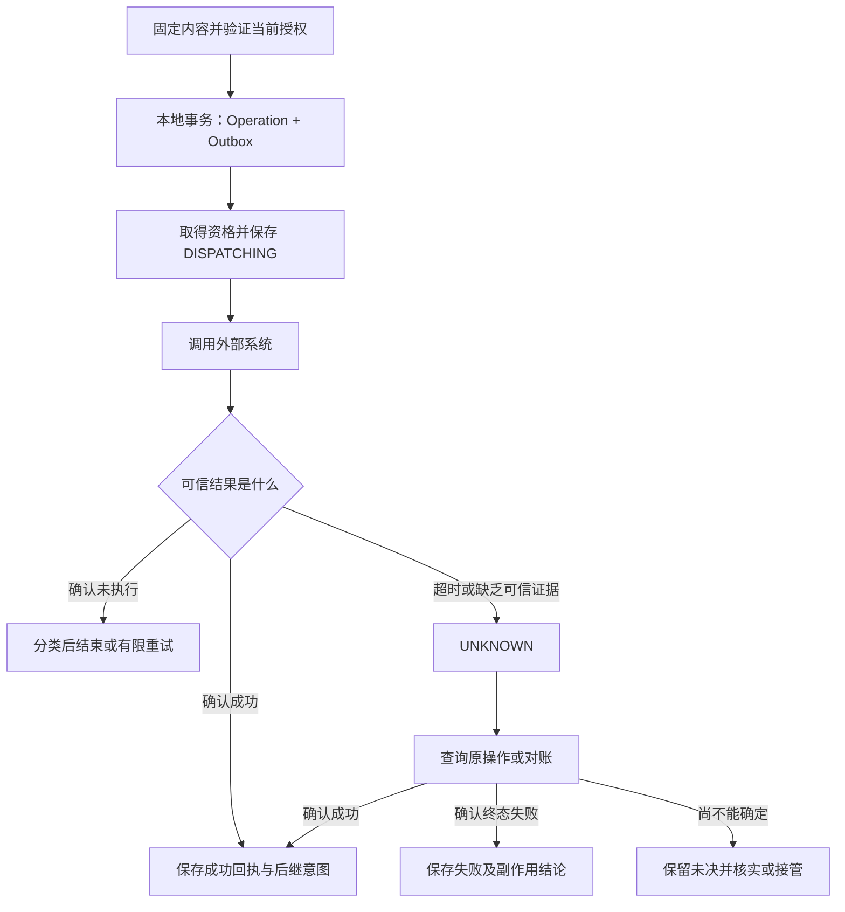
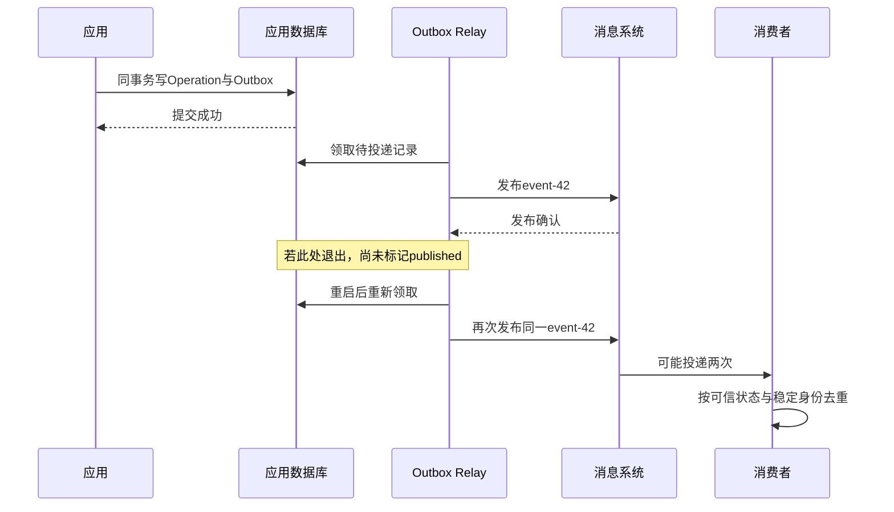
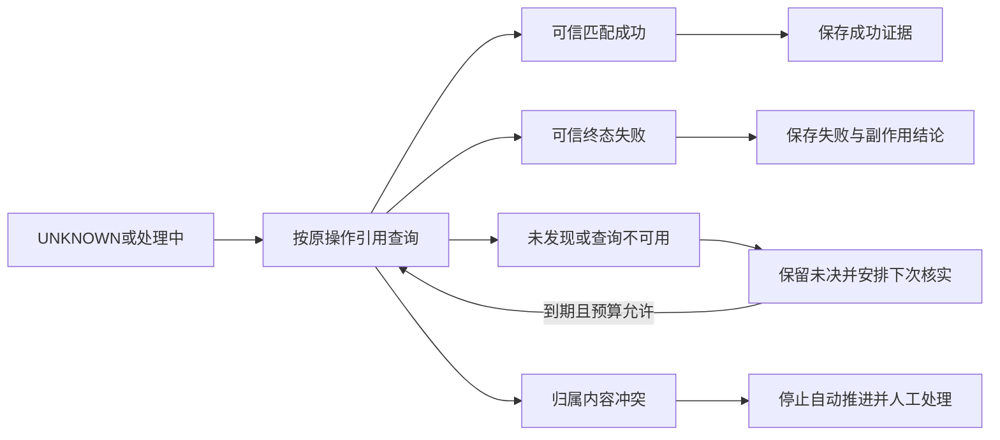

# 26 可靠性与副作用一致性

员工让企业 IT 助手提交 VPN 故障工单。助手已经获得批准，工单系统也已创建 INC-2048，但回执在返回途中丢失。助手只看见“请求超时”，于是又提交一次。员工最终收到两张工单，两个值班组分别开始处理。

这类问题不能靠“多重试几次”解决。企业应用需要在不稳定的网络、会重启的进程、会重复的消息和会变化的权限之间，回答三个问题：**动作到底发生了没有，我们凭什么知道，接下来允许做什么？** 本章从这一条写入链路出发，逐步建立可恢复、可核实、可运营的可靠性协议。

[← 知识图谱](00%20Agent%20%E5%BC%80%E5%8F%91%E5%AD%A6%E4%B9%A0%E5%85%A5%E5%8F%A3.canvas)

**先修**：[状态与恢复](12%20%E7%8A%B6%E6%80%81%E3%80%81%E6%8C%81%E4%B9%85%E6%89%A7%E8%A1%8C%E4%B8%8E%E6%81%A2%E5%A4%8D.md) · [Connectors 集成](17%20Connectors%20%E4%B8%8E%E4%B8%9A%E5%8A%A1%E9%9B%86%E6%88%90.md) · [后端与调度](25%20%E5%90%8E%E7%AB%AF%E3%80%81%E8%B0%83%E5%BA%A6%E4%B8%8E%E5%AD%98%E5%82%A8.md)。第 12 章解决“中断后从哪里继续”，第 25 章解决“任务由谁承载和调度”，本章解决“跨系统执行之后，业务事实怎样保持正确并最终收敛”。

> [!abstract] 本章的工程交付
> 一份外部操作合同、一套错误与重试政策、一条 Operation／Outbox／Inbox 链路、一份未知结果对账协议，以及补偿和人工接管方案。最重要的验收：**提交成功但丢回执时，不重复制造业务效果；无法确认时，诚实保留未决状态，并有人或服务继续负责。**

## 阅读路线

| 阶段 | 小节 | 要解决的问题 |
| --- | --- | --- |
| 建立判断依据 | 1—3 | 什么算可靠？怎样表达业务意图、失败和未知？ |
| 管住再次尝试 | 4—7 | 何时能重试？怎样控制预算、流量和重复效果？ |
| 打通一致性链路 | 8—11 | 本地事务、消息、外部写入和对账怎样衔接？ |
| 处理复杂业务与运营 | 12—15 | 部分完成怎样补救？撤权、死信和恢复如何处理？ |
| 形成可验证交付 | 16—19 | 看什么指标？怎样实验、验收并分阶段上线？ |

[写入与核实交互图](./assets/ch26-reliability/reliability-write-workflow.html)支持缩放、主题切换与导出；[静态 SVG](./assets/ch26-reliability/reliability-write-workflow.svg)便于预览。[配套离线实验](https://github.com/douloveppt/agent-application-learning/tree/main/examples/ch26-reliability)用 Python 标准库与两个 SQLite 数据库观察事务、重复投递和丢回执。GitHub 阅读时可下载 HTML 后打开。正文表结构、状态、时间与预算均为教学设计，资料核对日期为 **2026-11-03**；实际接口以所用版本的合同和实测结果为准。

## 1. 可靠性首先是业务结果正确

### 1.1 三种成功必须分开

| 层次 | 例子 | 能证明什么 |
| --- | --- | --- |
| 通信成功 | 收到 HTTP 响应、消息得到 Broker 确认 | 一段通信完成到合同规定的位置 |
| 执行成功 | 工单服务接受并处理创建命令 | 一个动作按外部系统语义执行 |
| 业务完成 | 创建的是本人获批内容，只有一张工单，编号可核实 | 用户目标与约束得到满足 |

返回 200 但回执属于另一租户，不是业务成功；202 可能只是接收异步任务；发送邮件接口成功也不等于收件人已经阅读。为每个工具明确“成功证据到哪一层”，完成判定才能落地。

### 1.2 同时写下安全性与活性

**安全性**约束不该发生的事：同一操作不重复创建工单，不把不同参数当成同一次请求，不允许旧 Worker 覆盖新进度，不在未知时宣称失败后重新创建。

**活性**要求该推进的事最终得到处理：已接收任务不会一直失去调度，未知结果会被再次核实，待补偿动作有人处理，人工工单不会无人负责。

只追求安全性，系统可能永久卡住；只追求活性，系统可能靠重复写入“终于成功”。工程目标是在明确的故障、权限和外部能力假设下，让结果正确并可收敛。外部系统永久不可达时，不能承诺自动得到确定答案，但仍可承诺保留证据、阻断冲突写入并升级处理。

### 1.3 为贯穿案例列出五条不变量

1. 每次创建都对应一个持久保存、内容确定的业务操作。
2. 同一逻辑操作的重试、接手和消息重投保持相同身份与参数。
3. 可能已发送但没有可信终态证据的操作进入 `UNKNOWN`，不得随意变回待发送。
4. 本地成功必须关联经过校验的外部回执；任务停止后仍记录迟到的业务事实。
5. 重试、核实、补偿和人工恢复都有责任人、预算、权限与审计。

后面的机制都要说明自己支撑哪一条。引入队列、缓存或 Workflow 框架本身不构成这五条的证明。

## 2. 先定义一份可实现的操作合同

### 2.1 把自然语言目标收敛为确定命令

模型可以提出“创建工单”的候选；正式派发前，应用必须把身份、资源、参数和批准内容固定下来。不能在每次网络重试时重新询问模型生成标题、优先级和描述。

```json
{
  "operation_id": "op-42",
  "tenant_id": "tenant-a",
  "connection_id": "itsm-prod-a",
  "action": "ticket.create",
  "operation_key": "intent-8f2c",
  "request_schema_version": 3,
  "payload": {
    "requester_id": "employee-17",
    "title": "VPN 连接失败",
    "description": "已核实的故障描述",
    "priority": "normal"
  },
  "approval_ref": "approval-9/revision-4"
}
```

这些字段由可信服务校验和绑定；让模型输出 `tenant_id` 并不使它可信。批准引用还要绑定批准者、准确修订、作用范围、有效期及撤销规则，见[第 22 章](22%20Human-in-the-loop.md)。摘要是完整性校验，不能代替身份认证或授权。

### 2.2 区分四种身份

| 身份 | 稳定范围 | 作用 |
| --- | --- | --- |
| `run_id` | 整个用户任务 | 串联规划、读取、审批和多个业务动作 |
| `operation_id`／`operation_key` | 一次确定的业务意图 | 跨恢复和合法重试关联同一效果 |
| `attempt_id` | 一次发送或执行尝试 | 解释第几次调用、耗时与错误 |
| `message_id`／`event_id` | 一个逻辑消息的身份 | 去除同一消息的重复消费 |

一次 Run 可以创建工单并发送通知，二者是不同 Operation。一次 Operation 可以有多个 Attempt。一次逻辑消息可被多次投递；即使消息系统为重投生成新信封，也不能因此生成新的业务操作。

“又点一次”也有两种含义：用户没有收到回执而重试原操作，应复用原身份；用户明确要提交第二张工单，则是新意图。标题相同不代表操作相同，语义相似搜索不能充当业务幂等约束。

### 2.3 在接入前核对外部恢复能力

| 外部能力 | 能采用的恢复路径 | 仍需验证 |
| --- | --- | --- |
| 强幂等合同 + 按键查询 | 查询优先；合同允许时受控同键重放 | 作用域、保留期、并发、参数冲突、失败缓存 |
| 无幂等键，但客户端引用唯一且可权威查询 | 依靠外部唯一约束和核实 | 唯一性是否原子成立、查询何时可见 |
| 可查询但引用不唯一或最终一致 | 查询是证据来源，阴性通常不能证明未执行 | 延迟、分页、匹配歧义、终结证明 |
| 无可靠幂等，也无可靠查询 | 限制自动写入，未知转人工核实，必要时只生成草稿 | 人工能否取得确定证据与承担恢复责任 |

“SDK 有重试参数”不属于恢复能力证明。先把供应商能力做成经过验证的接入合同，再决定自动化程度，见[第 17 章](17%20Connectors%20%E4%B8%8E%E4%B8%9A%E5%8A%A1%E9%9B%86%E6%88%90.md)。

## 3. 用两个维度分类失败

### 3.1 原因与执行确定性分别判断

原因回答“为什么没得到预期结果”，确定性回答“外部效果发生了没有”。二者不能合并为一个 `retryable=true`。

| 观察到的情况 | 可能原因 | 对业务效果的判断 | 默认处理 |
| --- | --- | --- | --- |
| 本地校验失败，尚未进入派发 | 无效参数 | 确定本次未发送 | 修正输入，改变内容时形成新修订 |
| 已验证的外部拒绝，合同保证未执行 | 无权限、配额或业务前置条件不满足 | 确定这次未执行 | 按原因结束、等待或有限重试 |
| 读取请求暂时失败 | 网络故障、下游过载 | 没有该读取的业务写入效果 | 有界重试，重新校验读取权限 |
| 写入后连接重置、读取超时 | 回执丢失、处理太慢 | 可能执行，可能没执行 | `UNKNOWN`，进入核实 |
| “成功”响应格式损坏或归属不符 | 协议错误、代理错误、回执串线 | 缺少可信完成证据 | 保留证据，核实原操作 |
| 外部返回异步受理编号 | 尚在处理中 | 已受理，未确定完成 | 保存受理证据，查询终态 |
| 收到可信终态回执 | 已完成或明确业务拒绝 | 可确定 | 持久保存证据并推进对应分支 |

HTTP 状态码只是证据的一部分。429、503、500 是否意味着“写入尚未发生”，需要具体端点合同；中间代理返回的状态也可能无法代表业务服务。SDK 抛出 `TimeoutError` 更无法回答业务结果。

### 3.2 后一次拒绝不能抹掉前一次未知

第一次发送后超时，第二次收到 403，只能证明第二次因权限被拒绝。它不能证明第一次没有创建工单。同理，当前查询 404、令牌失效、连接被撤销，也不能自动把历史未知操作标成失败。

因此要同时保留 **Attempt 的观察记录**与 **Operation 的确定性状态**。Operation 依据累计可信证据变化，不能简单复制“最近一次 HTTP 状态”。

### 3.3 用明确状态承载确定性

| 操作状态 | 含义 | 允许的后续 |
| --- | --- | --- |
| `PREPARED` | 已持久登记且确定尚未派发 | 条件有效时竞争派发资格 |
| `DISPATCHING` | 已越过本地派发标记，当前执行者正在处理 | 等待回执；失联后转未知 |
| `SUCCEEDED` | 已保存可信成功证据 | 在当前权限范围内复用结果 |
| `FAILED_CONFIRMED` | 有可信失败及副作用结论 | 按原因终止、补偿或合法重试 |
| `UNKNOWN` | 可能已执行，尚无可信终态 | 核实、对账或人工接管 |

异步“已受理”不是成功终态，可另存 `remote_status=processing`、受理编号与下一次查询时间。人工接管、取消意图、自动处理暂停是**控制维度**，不应覆盖结果确定性。具体字段可以扩展，但每次转移都要有可解释的证据和前置条件。

### 3.4 给用户可行动的反馈

程序使用稳定类别，例如 INVALID_INPUT、AUTHORIZATION_DENIED、RATE_LIMITED、DEPENDENCY_UNAVAILABLE、RESULT_UNKNOWN、RECEIPT_MISMATCH，另存供应商错误码与观察阶段。

用户则需要：“请求可能已提交，正在核实，请勿再次创建；可通过此操作编号查看进度。”不要显示“创建失败，请重试”，同时让后台继续核实同一个操作。

模型生成不合格属于另一类失败：可以在预算内重新生成候选，但已批准和派发的命令不能随之变化。读、生成、写入、核实采用不同政策。

## 4. 重试是一项受控决策

### 4.1 一次重试必须通过四道门

1. **语义允许**：只读，或有证据确定未执行，或受经过验证且仍有效的幂等恢复合同保护。
2. **条件仍成立**：内容未变、当前执行授权有效、业务版本匹配、没有取消或冲突控制。
3. **资源仍允许**：剩余总时间、尝试次数、费用、租户与下游额度足够。
4. **故障值得重试**：存在暂态恢复的合理依据；参数错误、策略拒绝不靠重复调用解决。

任意一项不满足，都不能落入“捕获所有异常然后继续”的默认循环。

### 4.2 明确本章的未知结果政策

本章默认采用**查询优先**：未知操作先只读核实，普通重试器不能直接重新派发。离线实验也遵守这个政策。

一些供应商允许未知后以相同键、完全相同内容安全重放。这可以是专门的恢复策略，但必须证明目标端点、作用域、有效期和失败语义满足要求，且当前授权允许再次发送。它不等于生成新键重新创建，也不等于所有 POST 都能重试。合同到期、参数不匹配或能力不明时，停止这种自动恢复。

只有取得“原请求确定未执行，而且旧请求已不可能稍后执行”的可信结论，才能仅凭未执行证据重新准入。某次查询暂时没查到，不满足这个条件。

### 4.3 每条调用链指定一个重试责任层

假设网关、业务服务、SDK 各最多尝试 3 次，一次用户请求可能触发 3 × 3 × 3 = 27 次下游调用。用户又点击一次，还会继续放大。

为每条依赖指定重试责任层，审查 SDK 和代理的默认行为；其他层关闭重试或只执行明确不重叠的恢复。记录尝试次数、触发原因、等待时间、累计消耗和剩余预算。[AWS：Timeouts, retries, and backoff with jitter](https://aws.amazon.com/builders-library/timeouts-retries-and-backoff-with-jitter/)

### 4.4 不通过新 Run 或新键绕过限制

同一意图在重试、恢复或用户重连时，累计预算不清零。原操作仍未知时，不允许模型把“创建工单”改写为另一个工具名称、另一个 Run 或另一个连接来绕过保护。业务层需要维护未决意图与冲突范围，而不仅检查某次 Tool Call ID。

## 5. 统一时间预算、退避与抖动

### 5.1 总截止时间覆盖整条链路

一项操作可能消耗排队、连接与 TLS、外部处理、读取响应、退避、保存结果。只给每次 HTTP 调用配置 5 秒，不能保证整体任务在 5 秒内结束。

```text
总执行预算 12 秒（教学例）
  ├─ 排队与本地处理：已经消耗 2 秒
  ├─ 第一次请求：最多 3 秒
  ├─ 退避：0～0.5 秒
  ├─ 第二次请求：最多 3 秒，且只在重试门槛通过后发生
  └─ 留出结果持久化和响应的余量
```

开始下一次尝试前，检查“等待 + 本次超时 + 保存余量”是否仍在剩余时间内。进程内耗时使用单调时钟；跨进程保存绝对截止时间及累计预算，恢复时重新计算，不能把进程内单调时钟数值交给别的机器直接使用。

### 5.2 用抖动打散同步重试

指数退避让间隔逐渐增加，上限防止等待无限增长；抖动使大量客户端不在同一瞬间再次冲击下游。一种常见形式是 Full Jitter：

```python
import random

def retry_delay(retry_index: int, base: float = 0.2,
                cap: float = 5.0) -> float:
    # retry_index从0开始；调用方先限制索引与总尝试次数。
    ceiling = min(cap, base * (2 ** retry_index))
    return random.uniform(0.0, ceiling)
```

这个函数只产生等待时间，没有证明动作可以重试。生产代码还要校验参数、处理取消、持久安排 `next_attempt_at`，并使用可注入随机源做可重复测试。长时间等待应交还调度器，避免 Worker 睡眠并占住执行名额。

### 5.3 尊重供应商等待指示与取消边界

若端点提供有效 `Retry-After`，按合同解析秒数或 HTTP 日期，结合时钟偏差和剩余预算；不能为了赶截止时间提前重试。等待过长时转异步处理或返回稍后继续的凭据。

传输超时只表示调用方停止等待。取消本地协程、关闭 Socket、容器退出，都不自动撤销远端动作；对已经跨过派发边界的写入，仍要保存未知结果并核实。

## 6. 过载保护让重试有机会成功

### 6.1 四种机制各有职责

| 机制 | 控制什么 | 不能代替什么 |
| --- | --- | --- |
| 限流 | 单位时间请求量或令牌消耗 | 不能限制所有长请求同时在途 |
| 并发上限 | 同时占用下游的数量 | 不能自动保证长期速率合规 |
| 有界排队与准入 | 等待任务数、等待时长和拒绝策略 | 不能把无限队列当容量扩展 |
| 熔断 | 故障窗口内暂缓调用，之后有限探测 | 不能消除已发请求的未知结果 |

按供应商、端点和租户建立必要隔离，避免批量任务占满所有连接。新写入、正常查询和未决核实可有不同配额；为核实保留容量，否则故障时越积越多未知，却没有资源查明它们。

### 6.2 熔断器也是受控状态机

`CLOSED` 正常采样；失败达到阈值后 `OPEN` 暂缓请求；冷却后 `HALF_OPEN` 只放少量探测，成功才逐步恢复。业务校验拒绝通常不该计入“依赖不可用”，不同错误需分类。

半开时不释放整个积压队列。多实例的熔断状态与限额也要协调，防止每个实例都认为“自己只探测几次”，合起来形成洪峰。阈值依赖实际流量和故障成本，不从示例数字直接复制。

### 6.3 降级必须保留业务语义

知识查询可在合同时效内使用带来源与时间的缓存；创建工单不可用时，可保存草稿并显示待提交。不能返回看起来像真实工单号的占位值，也不能把当前权限查询失败替换为旧的允许结论。

切换供应商对读取或模型生成可能可行；已在工单系统 A 产生未知结果时，直接改向 B 再创建会制造新的副作用。先处理原操作，再决定是否形成独立新动作。

## 7. 幂等协议要落实到最终业务效果

### 7.1 幂等不等于“请求只到达一次”

网络可能投递多次，Worker 也可能执行多次。目标是在合同范围内反复尝试同一操作，最终业务效果与一次有效执行一致，并能返回可核实结果。

| 概念 | 典型保障 | 遗漏的部分 |
| --- | --- | --- |
| 请求去重 | 相同键命中已有请求记录 | 外部效果是否与记录原子关联 |
| 消息去重 | 相同事件不重复消费 | 不同事件是否表达同一业务操作 |
| 业务唯一性 | 同一业务键不能插入第二条对象 | 修改、通知等其他效果是否重复 |
| 幂等结果复用 | 相同操作返回原结果 | 当前读取授权、保留期、参数冲突 |

“同一消息只处理一次”与“同一员工只允许一张同类工单”是不同规则。后者是产品约束，不能凭消息 ID 推导。

### 7.2 键的作用域与意图必须明确

可采用 (`tenant_id`, `connection_id`, action, `operation_key`) 作为内部唯一范围。`connection_id` 绑定稳定外部账户归属；刷新令牌不能改变这个范围。

键通常由可信应用在业务意图形成时生成并持久保存，不在每次请求时根据时间戳或 Tool Call ID 临时生成。客户端可提出键，但服务端要绑定当前身份与资源，防止跨租户命中。幂等键不能当密码，也不能绕过读取结果时的鉴权。

### 7.3 同键同参复用，同键异参冲突

对确定业务字段形成稳定指纹，保存规范化规则与 Schema 版本。JSON 字段排序、明确的空值规则可纳入规范；不要把所有空白、大小写或数字精度随意抹平，也不要将时间戳、追踪 ID 等每次变化的传输字段纳入业务指纹。

第一次收到键 K、内容 A：原子建立操作。再次收到 K、A：返回已有状态及当前有权读取的回执。收到 K、B：明确冲突，不能覆盖 A 或“帮用户纠正”。用户确实改变内容时，形成新修订和必要的新批准；原操作未知时先解决冲突写入问题。

幂等键体现调用者意图，比“所有参数的哈希相同”更有用：用户可以合理地两次发送相同内容。[AWS：Making retries safe with idempotent APIs](https://aws.amazon.com/builders-library/making-retries-safe-with-idempotent-APIs/)

### 7.4 并发重复不能靠先查再插

两个请求都先查询“没有 K”，然后各自发送外部创建，最后才插入去重记录，保护已经太晚。

在本地唯一约束下先建立操作，再竞争派发资格；发送前保存 `DISPATCHING`。只有取得当前资格的执行者能发送。其他执行者看见在途或未知，返回现状或触发核实。外部仍须有独立幂等或恢复合同，因为本地锁不能阻止已在网络中的旧请求。

### 7.5 保留期与失败缓存属于合同

内部幂等与墓碑记录的保留应覆盖允许重试、离线重投、消息保留、灾备恢复与核实所需窗口，并遵守数据治理要求。外部幂等保留期是另一条边界：内部保留一年，不能让只保留短期去重的供应商一年后仍安全重放。

Stripe 当前文档区分 API v1/v2。例如 v1 说明首次执行响应会被保存并复用，包含 500；键在至少 24 小时后可以被清理，同键参数不一致会报错。不能套用到所有 Stripe API 或其他供应商；v2 有单独的恢复与响应规则。[Stripe Idempotent requests](https://docs.stripe.com/api/idempotent_requests)

到期后不应偷偷换新键继续。需要查询原业务事实、确认旧请求不再可能执行，或进入人工处理；删除幂等记录也是影响业务正确性的生命周期操作。

## 8. 分清本地事务与外部边界

### 8.1 三个时间点留下两个关键窗口

```text
本地保存操作意图 ──→ 外部执行 ──→ 本地保存可信结果
                 窗口A       窗口B
```

窗口 A 崩溃时，要区分“确定尚未派发”与“可能派发”；窗口 B 崩溃时，外部可能已成功而本地没有回执。检查点保存得更频繁，不能让两个独立数据库自动变成一个事务。



图展示查询优先政策。终态失败也要说明有无部分副作用；“没有完整成功”不等于“完全没有执行”。

### 8.2 一份最小关系模型

下面是 PostgreSQL 风格的设计片段，展示约束关系；不是可以直接上线的完整 Schema。

```sql
CREATE TABLE operations (
    operation_id UUID PRIMARY KEY,
    tenant_id TEXT NOT NULL,
    connection_id TEXT NOT NULL,
    action TEXT NOT NULL,
    operation_key TEXT NOT NULL,
    request_hash TEXT NOT NULL,
    request_schema_version INTEGER NOT NULL,
    state TEXT NOT NULL,
    version BIGINT NOT NULL DEFAULT 0,
    next_reconcile_at TIMESTAMPTZ,
    receipt_ref TEXT,
    UNIQUE (tenant_id, connection_id, action, operation_key)
);

CREATE TABLE outbox (
    event_id UUID PRIMARY KEY,
    operation_id UUID NOT NULL REFERENCES operations(operation_id),
    event_type TEXT NOT NULL,
    payload JSONB NOT NULL,
    created_at TIMESTAMPTZ NOT NULL,
    published_at TIMESTAMPTZ
);

CREATE TABLE inbox (
    consumer_scope TEXT NOT NULL,
    event_id UUID NOT NULL,
    payload_hash TEXT NOT NULL,
    handled_at TIMESTAMPTZ NOT NULL,
    PRIMARY KEY (consumer_scope, event_id)
);
```

生产还需状态约束、受控载荷引用、Attempt 表、租约、审批引用、证据、时间、索引与保留策略。`receipt_ref` 指向持久且受权限控制的证据，不能只是会过期的临时下载 URL。

### 8.3 用短事务同时保存相依事实

接收写入意图时：校验并建立 Operation，写 Outbox，提交后才返回“已持久接收”。唯一键冲突时，读取已提交记录并核对指纹，返回已有状态或参数冲突。

确认结果时：校验回执，条件更新 Operation，保存证据，写下一步事件，放进同一本地事务。持有旧版本或过期租约的 Worker 不能覆盖新状态；迟到证据经独立、受控路径合并，见第 12 章。

行锁只在本地短事务中使用，不在等待模型、审批或 HTTP 时长时间持有。`SKIP LOCKED` 可用于队列表竞争领取，但它会跳过被锁行，不适合作为一般查询的完整一致视图。[PostgreSQL SELECT locking clause](https://www.postgresql.org/docs/current/sql-select.html#SQL-FOR-UPDATE-SHARE)

## 9. Outbox 解决本地状态与消息的双写

### 9.1 两种直觉写法都可能丢失

先提交数据库再发消息：提交后进程退出，消息永远没发。先发消息再提交数据库：消息已触发处理，本地事务却回滚。它们把两次独立写入误当成一次成功。

Outbox 把“业务状态变化”与“之后需要投递的意图”放进同一本地事务。Relay 稍后读取待投递记录并发送；扫描、调度与告警保证它持续工作。[AWS Transactional outbox pattern](https://docs.aws.amazon.com/prescriptive-guidance/latest/cloud-design-patterns/transactional-outbox.html)

### 9.2 Relay 允许重复，消费者负责安全处理



为避免重复而在发送前标记 `published`，又会制造永久丢失。通常在发布确认后标记已投递，接受“已发但未标记”带来的重投。领取、租约与重试有界，本地事务不跨越发布网络调用。

### 9.3 事件应唤醒可信状态机

载荷带稳定操作引用、事件类型、序列和必要完整性信息，消费者重新读取受控业务记录。不能仅因消息写着“已批准”就相信当前仍有权限，也不能收到消息便无条件调用 `create_ticket`。

操作已成功则复用结果；未知则核实；尚未派发且条件有效才竞争资格。消息重复时，业务决策仍由当前持久事实决定。

### 9.4 发布确认、消费确认与业务回执不同

Publisher Confirm 表示消息系统按配置接受发布；Consumer Acknowledgement 表示消费者通知 Broker 如何处理投递。二者彼此独立，都不自动证明外部工单已创建。RabbitMQ 也明确连接失效后重发可能产生重复，应用需准备处理。[RabbitMQ Consumer Acknowledgements and Publisher Confirms](https://www.rabbitmq.com/docs/confirms)、[Reliability Guide](https://www.rabbitmq.com/docs/reliability)

未投递 Outbox 不能按普通日志过期；已投递记录按审计与定位需求保留；重放保存原事件和操作身份。宣称“队列为空”前，还需检查 Outbox、延迟任务与对账积压。

## 10. Inbox 解决消费侧的本地重复处理

### 10.1 去重记录与业务写入必须同事务

假设工单服务自己消费创建命令，且 Inbox 与工单表位于它的同一数据库：

```text
BEGIN
  尝试插入 (consumer_scope, event_id, payload_hash)
  若已存在：核对内容；相同则复用已有处理结果
  若首次出现：校验业务规则，创建工单并关联 operation_key
  保存业务结果与需要继续发送的 Outbox
COMMIT
然后向 Broker ACK
```

提交后 ACK 丢失，重新投递时 Inbox 使本地变化不再重复。先标记去重再单独写工单会丢业务；先单独写工单再记去重会重复业务。同一事件 ID、不同内容应被隔离并告警，不能悄悄忽略。

### 10.2 不同事件也可能携带同一命令

Inbox 处理消息身份，业务层还需 Operation 或业务唯一约束。两个不同 `event_id` 都指向同一创建意图，不能创建两张工单。反过来，独立意图即使内容相同，也不应被错误合并。

消费者作用域需要稳定且有版本策略。随意更改消费者名称，使历史消息看起来“从未消费”，可能重新执行效果；恢复、迁移与重放都要检查这一点。

### 10.3 下一次 HTTP 调用又是新边界

若 Inbox 在应用数据库，工单在外部 SaaS，“写 Inbox + 调用 SaaS”仍不是一个事务。

消费者可以在本地事务中登记持久 Operation 与后续处理意图，再 ACK；真正写入由派发协议负责。Inbox 此时只证明消息已可靠转成工作，不能提前声称工单已创建。同库算法不能机械套到跨系统调用。

### 10.4 去重之外还要处理乱序

同一工单的“关闭 v12”先于“更新 v11”到达，不应让旧更新复活已关闭状态。事件带聚合对象和业务版本，约定旧版本忽略、缺口暂存／补拉、不可交换动作串行等政策。

忽略、暂存、隔离都是明确处理结果，应持久记录；不能为让队列变短而 ACK 后遗忘。顺序要求限制在必要业务对象范围，避免为一个工单的顺序而全局串行。

## 11. 对账让未知结果收敛为业务事实

### 11.1 即时核实与周期对账互补

即时核实处理刚出现的超时与丢回执；周期扫描查找长期 `DISPATCHING`、到期 `UNKNOWN`、外部长期处理中，以及本地与外部不一致的记录。Webhook 可加速发现，但会重复、延迟或丢失，不能替代所有周期核对。

对账是独立持久任务，有当前负责人、领取资格、下一次时间、次数、最近证据与升级期限。Run 已取消、Worker 已退出或用户离线，都不能让未决操作失去归属。

### 11.2 查询结果也需要证据校验

| 核对项 | 原因 |
| --- | --- |
| 租户、连接、外部账户 | 防止在错误环境找到同名记录 |
| 原操作键或可信客户端引用 | 关联准确业务意图 |
| 目标资源、请求字段或可核验指纹 | 防止键复用、映射错误与回执串线 |
| 状态与版本 | 区分受理、处理中、完成、失败或后续修改 |
| 外部对象 ID、查询时间、证据来源 | 支持审计、重复核实与人工复查 |

外部 API 未必返回全部原始请求字段，不能凭空宣称能比较完整哈希。接入合同需说明哪些可信引用和字段足以确认；证据不足时保留未决，多个候选时进入冲突处理。

### 11.3 阴性结果的证明力有限

查询“未发现”可能来自索引延迟、分页未遍历完、查错账户、权限变化或请求仍在排队。即使权威存储此刻没有记录，也不保证旧请求下一秒不会提交。

只有接口提供可靠的终结信息，例如原受理任务已确认拒绝且不会再执行，才能据此认定未执行。暂未发现、查询失败与确定业务失败保存为不同观察结果。



### 11.4 一个对账决策骨架

```python
def reconcile(operation, evidence):
    # 伪代码：已完成受限读取授权与证据真实性校验。
    if evidence.matches_success(operation):
        return "RECORD_CONFIRMED_SUCCESS"
    if evidence.proves_terminal_failure(operation):
        return "RECORD_CONFIRMED_FAILURE"
    if evidence.conflicts_with(operation):
        return "HOLD_FOR_REVIEW"
    return "KEEP_UNRESOLVED_AND_SCHEDULE"
```

这里没有 `else: create_again`。真实实现还需条件更新版本、防重复保存、证据完整性、下一次时间与审计；外部确认失败也要记录有无部分副作用，不能一律认定“什么都没发生”。

自动核实达到次数或时间上限，控制状态可转为人工接管，业务结果仍保持未知。达到上限是自动化停止的理由，不是失败证据。

## 12. 部分完成用 Saga 与补偿处理

### 12.1 先确定什么时候需要回退

扩展案例：创建工单 → 预留远程协助时段 → 通知员工。通知失败是否要关闭已创建工单？通常未必，可能只需独立重试通知。先定义可接受的部分交付，再选择补偿，避免机械地“后一步失败就撤销所有前面步骤”。

| 动作 | 失败后的可能政策 | 限制 |
| --- | --- | --- |
| 创建工单 | 保留工单并说明预约未完成；必要时按规则关闭 | 工单可能已被处理，不能直接删除 |
| 预留时段 | 仍归当前预约且版本未变时释放 | 不能释放已转交或已使用的时段 |
| 发送通知 | 有界重试、换授权渠道或人工联系 | 已读邮件无法真正撤回成没发生 |

### 12.2 Saga 组织多个本地事务

Saga 把跨服务流程分为多个本地提交，每步保存结果与必要补偿意图。它不是覆盖所有服务的数据库回滚，也通常不提供隔离于其他并发业务的全局事务视图。

可由编排器显式推进，也可由事件协作驱动。无论采用哪种方式，都应列出完成步骤、未决操作、补偿状态与责任方；复杂流程、人工等待多时，显式编排通常更易审查。框架能保存流程，不会自动设计正确的补偿业务规则。[Azure Saga distributed transactions](https://learn.microsoft.com/en-us/azure/architecture/patterns/saga)

### 12.3 补偿是一次新的业务动作

补偿有自己的 `operation_id`、稳定幂等键、原操作引用、准确目标、当前授权、前置版本与回执。原“创建成功”不被改写为“从未创建”，而是追加“后来因何原因被关闭”。

补偿自身也可能超时并进入未知，需要核实与人工路径。不要从一个 except 中调用 delete，随后立即把整个流程标成已回滚。

### 12.4 顺序由业务依赖决定

简单链路常按逆序补偿，但有些可并行，有些必须先冻结再释放；不能直接倒序循环所有步骤。对于已被其他用户修改的对象，用版本条件与业务规则防止覆盖新的合法工作。

某一步结果未知时，先核实或进入明确处置协议，再决定后继与补偿。不可逆动作尽量放在必要校验和可撤销准备之后，但这不能消除派发后的不确定性。[Azure Compensating Transaction pattern](https://learn.microsoft.com/en-us/azure/architecture/patterns/compensating-transaction)

## 13. 权限、审批与取消纳入同一恢复协议

### 13.1 历史批准与当前授权分别检查

批准证明某主体在当时同意确定内容；当前授权决定现在能否再派发。恢复不能扩展资源、增加费用或替换外部账户，也不能为修复错误自动扩大权限。

同一次合法重试无需机械地重复索要同一个批准，但要验证原批准的修订、有效期、使用语义和撤销规则。参数变化、补偿或超出原范围是新的决策，按政策处理。

### 13.2 历史核实使用独立最小权限

员工撤权后，不应继续以其名义创建；但原操作可能已发生，系统仍有核实责任。可由经过治理的对账服务按原账户归属进行最小范围查询，界面再按当前权限显示允许的结果。

这不意味着自动借用管理员身份。若没有合法核实路径，保留未决并交给具备职责的人处理，不能因查询被拒绝就清除账本。

### 13.3 取消不能伪造业务事实

尚未派发时可阻止创建；已派发时尽力停止等待或调用供应商撤销接口，但最终仍需确认。界面可显示“任务已停止继续执行，已有提交正在核实”。

迟到成功更新操作事实，不自动恢复已取消的后继步骤。是否关闭已创建工单，是独立取消／补偿动作。流程预算用尽也一样：停止新业务推进，为未决核实保留独立、有上限的治理预算与升级路径。

## 14. 死信与人工恢复是正式产品能力

### 14.1 死信保存待处理问题

消息超过重试次数、内容无效或版本无法处理时，持久隔离到死信或等价故障工作表，记录原事件、操作、失败类别、次数、时间、版本和证据。敏感原始载荷受控引用，不散落在日志与通知里。

先核实 Broker 的路由、持久化、转移与确认语义；“配置了 DLQ”不自动证明消息绝不丢失。死信本身有监控、保留、读取权限和负责人。

### 14.2 按原因决定恢复动作

| 原因 | 合理动作 | 禁止的快捷操作 |
| --- | --- | --- |
| Schema 不兼容 | 修复消费者或显式迁移，再验证重放 | 清空载荷字段强行消费 |
| 暂态故障且确定未执行 | 恢复依赖后有限重试原操作 | 每次生成新键 |
| 写入结果未知 | 查询、补证据、对账或人工核实 | 直接改成 `PREPARED` |
| 权限撤销 | 停止派发，合法核实历史 | 提升权限强行重放 |
| 业务部分完成 | 按合同交付部分结果或创建补偿 | 删除历史成功记录假装回滚 |

### 14.3 人工工作台提供事实与受控动作

展示目标、确切系统、已批准修订、Attempt 时间线、外部回执、查询结果、冲突原因、责任人与期限。允许受限操作：再次只读核实、附证据确认、停止后继、发起独立补偿、移交负责人。

每个动作都经过后端鉴权、版本检查与审计。确认成功要有证据；无证据时可以停止自动处理并承担未决责任，但不能用“人工已关闭”覆盖“外部结果未知”。高影响处置按组织规则复核。

### 14.4 恢复后限量放行积压

依赖恢复后先抽样核实，按租户与操作类型限量放行，观察错误和重复效果后逐步加速。死信重放保留原事件与操作身份，经过当前状态机；业务内容要变则走新修订路径。

每次处置形成问题记录、修复证据与回归用例。可靠性不能长期依赖某位工程师记得“这个表应该怎么手改”。

## 15. 灾备、迁移与保留期不能破坏去重

### 15.1 旧备份会重新制造未知

应用数据库回到凌晨，外部工单系统仍保留上午的创建结果。备份里没有那些操作，不代表动作没发生；直接重新执行任务可能重复创建。

恢复方案明确备份时点、可能缺失的 Operation／Outbox／Inbox／审批区间，以及可补齐的日志、外部审计和引用。不能恢复稳定操作身份时，冻结受影响范围并核实，不能生成新键跳过历史。

### 15.2 数据保留影响协议有效性

未决操作、未投递 Outbox、必要 Inbox 去重记录与墓碑，不能按普通运行日志清理。按恢复窗口设计最小保留，必要时保留不含敏感正文的键、指纹和处置结论。

隐私删除、审计与幂等保护共同设计；哈希也可能关联个人或业务信息，不能默认匿名。生产清理先预览准确对象、范围与引用，再限量执行，不使用宽泛路径删除去重证据。

### 15.3 升级保护在途操作

新版本可能改变默认值、指纹算法、外部账户映射或回执结构。已派发操作保留原 Schema 和内容，新代码能解释旧版本，或经受控迁移处理。

迁移不把未知批量改成待发，不重置累计次数与审批消费，不因消费者改名而重新执行业务。前后对照在途操作的身份、内容、状态和证据，并演练回退。

## 16. 用指标说明哪里还没有收敛

### 16.1 同时看业务结果与协议健康

| 指标 | 回答的问题 |
| --- | --- |
| 业务确认成功率、部分完成率 | 用户目标实际完成多少 |
| 重复业务效果、回执冲突、越权事件 | 是否违反关键安全约束 |
| `UNKNOWN` 数量、年龄分布、最老未决 | 未决是否正在积累 |
| 核实延迟与最终收敛时间 | 多久能得到可信结论 |
| 重试次数与流量放大倍数 | 故障是否被重试放大 |
| Outbox 最老未投递年龄、投递失败率 | 工作是否卡在发布 |
| Inbox 命中、参数冲突、版本缺口 | 重复与乱序是否被正确处理 |
| 补偿／死信积压与人工超期数 | 自动处理之外是否有人负责 |

幂等命中率高可能意味着前台反馈差、用户反复点击；重试后成功率高也可能掩盖高负载。指标结合原因与业务状态解释。

### 16.2 明确分母与观察窗口

例如取某一天持久接收的创建操作作为固定批次，在观察截止时分别统计确认成功、确认失败、仍未知、等待条件与人工接管。业务结果与控制维度分开，避免把“未知且人工接管”重复计数。未知不从分母消失，Attempt 次数不当作用户操作数。

SLO 可分别约束“规定时间内取得可信终态的比例”与“未决进入责任人队列的时效”，阈值由业务风险与外部 SLA 决定。重复效果是独立正确性指标，不靠平均延迟好看来抵消。

### 16.3 证据连接整条时间线

日志与 Trace 关联 `run_id`、`operation_id`、`attempt_id`、`event_id`、受控租户与连接标识、指纹版本、外部请求 ID、结果分类和状态版本。保存“为何重试／核实／停止”，避免只留异常堆栈。

指标标签不放无限增长的操作 ID 或工单号，这些用于日志和 Trace 查询。凭据、完整敏感正文、未脱敏外部响应不直接写通用日志。告警指向可执行处置手册，见[第 28 章](28%20%E5%8F%AF%E8%A7%82%E6%B5%8B%E6%80%A7%E4%B8%8E%E8%B0%83%E8%AF%95.md)。

## 17. 动手实验：观察两个数据库之间的窗口

### 17.1 运行并观察持久事实

[实验目录](https://github.com/douloveppt/agent-application-learning/tree/main/examples/ch26-reliability)使用 `runtime.db` 保存 Operation 与 Outbox，`provider.db` 模拟独立工单系统。后者在自己的事务内保存 Inbox 与工单，不与前者共享事务。

在项目根目录执行：

```bash
python3.11 examples/ch26-reliability/lab.py
python3.11 -m unittest discover -s examples/ch26-reliability -p 'test_*.py' -v
```

演示使用临时目录，不连接真实业务系统。先预测再观察：

| 场景 | 本地事实 | 外部事实 |
| --- | --- | --- |
| 本地事务中途失败 | Operation 与 Outbox 一起回滚 | 没有工单 |
| 正常派发 | 保存可信回执并成功 | 一张工单 |
| 外部成功，回执丢失 | 崩溃点留下 `DISPATCHING`；恢复按未知处理 | 已有一张工单 |
| 按原操作核实 | `UNKNOWN` → `SUCCEEDED`；发送次数不增加 | 仍只有原工单 |
| 相同事件或新事件重复携带同一操作 | 复用结果或保持当前状态 | 不新增相同操作的工单 |
| 同键异参 | 报冲突，保留原内容 | 原对象不被替换 |
| 未知操作查询暂未发现 | 保持 `UNKNOWN`，不重新提交 | 不因阴性查询创建 |

演示中特意保留“外部已提交、本地还来不及写 `UNKNOWN`”的现场。恢复时不能把残留 `DISPATCHING` 当作未发送，必须先转入核实。

不要只看 CLI 的 success；同时观察 Operation、Outbox、供应方 Inbox、工单数量与操作引用。测试以持久事实作为断言依据。

### 17.2 实验与生产保障的边界

实验以显式 `SimulatedCrash` 异常注入已提交边界，并重建 Store、重新打开数据库模拟应用重启；它不是操作系统杀进程，也没有验证断电写盘。模拟器的 Inbox、稳定操作查询和原子业务去重，是给定能力，真实 SaaS 未必具备。

它不证明生产多 Worker 租约／fencing、真实身份审批、网络分区、供应商保留期、Broker 持久化、真实查询一致性、完整 Saga、自动后台对账或灾备。实验将 Outbox 直接交给模拟供应方，没有实现真实 Broker 与 Relay 确认协议；第 9 节的消息窗口需另行集成验证。

正文企业协议是设计要求，需逐步实现并在实际接入环境验收；实验只是其中一组可运行证据。

### 17.3 三个进一步练习

1. **能力降级**：供应商不支持幂等，只能按标题搜索。哪些动作不能自动恢复？人工需要什么证据？界面怎样解释未决？
2. **时间竞争**：请求超时，查询暂未发现，随后外部提交成功。画出时间线，解释“查不到就重发”为何会重复。
3. **补偿冲突**：创建工单后预约失败，但值班员已开始处理。定义部分交付、人工决定或有条件关闭的政策，说明版本与权限检查。

## 18. 按故障窗口与不变量验收

### 18.1 最少覆盖这些场景

| 故障或竞争 | 必须观察到的行为 |
| --- | --- |
| 并发同键同参 | 一个稳定操作，归属与状态一致 |
| 同键异参、跨租户猜键 | 冲突或隔离，无泄漏和覆盖 |
| 意图事务提交前退出 | 不对外执行；事务未提交即无待发工作 |
| 本地提交后消息未发 | Outbox 补投，不丢已接收工作 |
| 发布未标记、消费提交后 ACK 丢失 | 重复事件安全处理，效果不重复 |
| 写入成功但回执丢失 | 核实原操作，保持原键 |
| 查询暂未发现、稍后出现 | 不重发、不提前宣布失败 |
| 原请求未知、后续收到 403／429 | 原未知保留，单次拒绝不改写历史 |
| 旧 Worker、迟到回执 | 无越权推进，可信事实受控保存 |
| 撤权、批准过期、用户取消 | 禁止未获当前允许的派发，核实仍有责任人 |
| 幂等到期、预算耗尽 | 停止自动写入，保留证据与接管路径 |
| 部分完成、补偿失败或超时 | 正确展示部分结果，补偿可核实和接管 |
| 旧备份恢复、升级、事件重放 | 操作身份不重置，不重复历史效果 |

故障点放在真实边界附近：事务提交前后、发布确认前后、外部提交后本地保存前、租约接手与迟到返回交错处。仅让函数抛异常不能替代跨进程与真实依赖验收。

### 18.2 同时断言四类结果

检查本地状态、外部业务数量与内容、授权和预算轨迹，以及未来仍能推进或有人接管的条件。既验证“不多做”，也验证“不丢失、不遗忘”。观察窗口覆盖迟到结果，不能在外部请求尚可能完成时就结束断言。

确定性规则用程序校验；用户解释是否清楚、补偿是否符合业务预期可加入人工评审。效果评测见[第 27 章](27%20%E6%B5%8B%E8%AF%95%E3%80%81Evals%20%E4%B8%8E%E8%B4%A8%E9%87%8F%E9%97%A8%E7%A6%81.md)。

### 18.3 归档可审查的验收证据

- [ ] **26 验收**：模拟外部创建成功但回执丢失；保留未知，按原操作查询或对账，确认后复用原结果，不因超时重放无幂等保障的写入。
- [ ] **一致性验收**：Operation 与 Outbox 同事务；Inbox 与同库业务变化同事务；下一条跨系统边界有独立协议。
- [ ] **恢复验收**：重投、乱序、旧 Worker、撤权、取消、幂等到期、补偿未知与旧备份恢复有对应轨迹与处置结论。
- [ ] **运营验收**：未决、Outbox／死信／补偿积压可见；人工动作有鉴权、证据、审计、责任人与期限。

## 19. 分阶段建设并形成完整交付

### 19.1 先交付最小可靠写入

先固定一个端点、账户范围和一种业务动作：稳定身份、冻结内容、准确授权、持久操作、派发边界、回执校验、未知后只读核实、人工接管。先通过丢回执验收，再扩大动作种类。

业务与待处理工作本来就在同一数据库时，可以先用受控扫描器调度；第一版不必为了完整机制清单引入 Broker。核心是意图不丢失、重复唤醒安全、结果可核实。

### 19.2 再扩展吞吐与复杂流程

随需求加入 Relay、Inbox、限流隔离、周期对账、死信与补偿。每增加一种机制，明确事务边界、故障窗口、恢复政策和证据。多服务 Saga、跨区域恢复等能力，在真实需求和验证能力具备后扩展。

评审围绕六份产物：操作与供应商能力合同、状态与数据模型、错误／重试矩阵、对账与补偿手册、故障注入报告、指标与责任分工。

### 19.3 自测与常见误区

> [!question]- 为什么“超时重试三次”可能比不重试更危险？
> 超时没有证明未执行，重复发送可能制造多个效果；多层重试还会放大故障流量。先判断确定性、幂等合同、当前授权和总预算。

> [!question]- 有 Outbox、Inbox 和分布式锁，是否就是端到端 exactly-once？
> 各机制有自己的范围。Outbox 关联本地状态与投递意图，Inbox 关联同库去重与业务变化，锁控制检查它的参与者。外部旧请求、保留期和恢复仍有边界，必须明确哪种业务效果在何种条件下得到保障。

> [!question]- 人工把流程标成“已处理”，能否清掉 `UNKNOWN`？
> 只有证明外部结果的证据才能改变业务确定性。人工可以结束自动处理、承担未决责任或发起补偿，控制流程关闭不能代替业务事实。

> [!question]- 哪些信息必须穿过恢复与重放一直保留？
> 稳定身份、确定内容与版本、原归属、审批与授权解释、累计预算、Attempt 与证据、未决责任和处置记录。追踪 ID 可以变化，业务意图不能被暗中替换。

## 相关专题

- [状态与恢复](12%20%E7%8A%B6%E6%80%81%E3%80%81%E6%8C%81%E4%B9%85%E6%89%A7%E8%A1%8C%E4%B8%8E%E6%81%A2%E5%A4%8D.md)：Checkpoint、派发边界、租约、CAS 与恢复判断。
- [Tools 工具](14%20Tools%20%E4%B8%8E%20Function%20Calling.md) · [Connectors](17%20Connectors%20%E4%B8%8E%E4%B8%9A%E5%8A%A1%E9%9B%86%E6%88%90.md)：受控调用、供应商合同、回执与接入能力。
- [身份与多租户](20%20%E8%BA%AB%E4%BB%BD%E3%80%81%E6%9D%83%E9%99%90%E4%B8%8E%E5%A4%9A%E7%A7%9F%E6%88%B7.md) · [人工控制](22%20Human-in-the-loop.md)：当前授权、准确审批、撤权与接管。
- [交互与流式事件](23%20%E4%BA%A4%E4%BA%92%E4%BD%93%E9%AA%8C%E4%B8%8E%E6%B5%81%E5%BC%8F%E4%BA%8B%E4%BB%B6.md) · [多模态与语音](24%20%E5%A4%9A%E6%A8%A1%E6%80%81%E4%B8%8E%E5%AE%9E%E6%97%B6%E8%AF%AD%E9%9F%B3.md)：断线、取消、播放与工具副作用。
- [后端与调度](25%20%E5%90%8E%E7%AB%AF%E3%80%81%E8%B0%83%E5%BA%A6%E4%B8%8E%E5%AD%98%E5%82%A8.md)：任务接收、Worker、队列与数据生命周期。
- [测试与 Evals](27%20%E6%B5%8B%E8%AF%95%E3%80%81Evals%20%E4%B8%8E%E8%B4%A8%E9%87%8F%E9%97%A8%E7%A6%81.md) · [可观测性](28%20%E5%8F%AF%E8%A7%82%E6%B5%8B%E6%80%A7%E4%B8%8E%E8%B0%83%E8%AF%95.md) · [部署与版本](30%20%E9%83%A8%E7%BD%B2%E3%80%81%E7%89%88%E6%9C%AC%E4%B8%8E%20LLMOps.md)：测试、证据与发布门禁。

## 参考资料

- [AWS Timeouts, retries, and backoff with jitter](https://aws.amazon.com/builders-library/timeouts-retries-and-backoff-with-jitter/)：时间预算、多层放大、退避与抖动。
- [AWS Making retries safe with idempotent APIs](https://aws.amazon.com/builders-library/making-retries-safe-with-idempotent-APIs/)：请求身份、相同意图、参数变化与迟到请求。
- [AWS Transactional outbox pattern](https://docs.aws.amazon.com/prescriptive-guidance/latest/cloud-design-patterns/transactional-outbox.html)：本地双写与重复投递。
- [RabbitMQ Confirms and Acknowledgements](https://www.rabbitmq.com/docs/confirms)、[Reliability Guide](https://www.rabbitmq.com/docs/reliability)：消息确认与连接故障。
- [Stripe Idempotent requests](https://docs.stripe.com/api/idempotent_requests)：按 API 版本核对幂等合同。
- [Azure Saga](https://learn.microsoft.com/en-us/azure/architecture/patterns/saga)、[Compensating Transaction](https://learn.microsoft.com/en-us/azure/architecture/patterns/compensating-transaction)：跨本地事务流程与补偿。
- [PostgreSQL SELECT](https://www.postgresql.org/docs/current/sql-select.html#SQL-FOR-UPDATE-SHARE)：锁定读取与 `SKIP LOCKED` 范围。

> [!note]- 我的学习记录
> - **用自己的话解释**：为什么未知不是失败，幂等键为何需要合同？
> - **最小实验与结果**：记录丢回执、重复投递与只读核实的两库状态。
> - **失败案例与定位**：哪个边界缺少证据、原子性或当前授权？
> - **还没弄懂的问题**：外部能力缺失时，我能承诺哪一层自动恢复？

| [← 上一章 · 25 后端、调度与存储](25%20%E5%90%8E%E7%AB%AF%E3%80%81%E8%B0%83%E5%BA%A6%E4%B8%8E%E5%AD%98%E5%82%A8.md) | [下一章 · 27 测试、Evals 与质量门禁 →](27%20%E6%B5%8B%E8%AF%95%E3%80%81Evals%20%E4%B8%8E%E8%B4%A8%E9%87%8F%E9%97%A8%E7%A6%81.md) |
| :--- | ---: |
