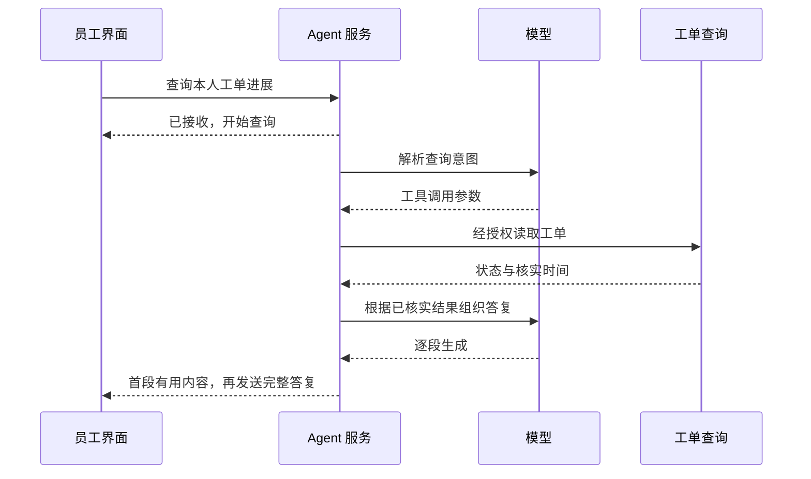
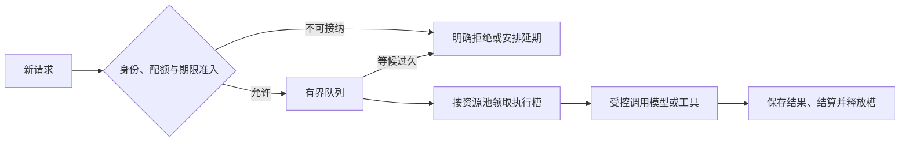
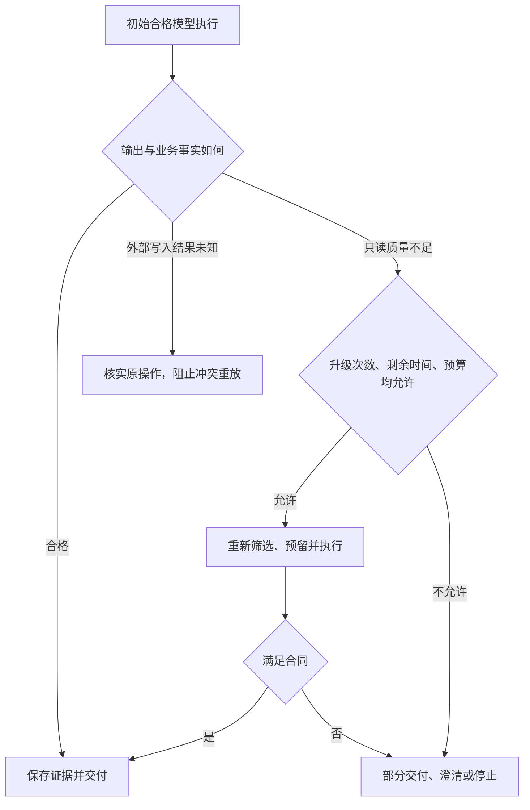

# 29 性能、成本与模型路由

企业 IT 助手上线后，团队接到两个要求：“用户等得太久了”“这个月模型费用太高了”。工程师把默认模型换成便宜的小模型，又提高了并发。单次调用确实便宜了，演示也更快了，但生产中开始出现反复检索、模型升级和接口限流。最后，**每完成一项正确任务反而更贵，高峰时的等待也更长**。

问题在于，优化对象是一整条业务链路。模型单价、每秒生成多少 Token、缓存命中率都只是其中一部分；必须把质量、权限、任务完成、排队、重试和真实费用放在同一个合同中判断。

本章继续使用“查询 VPN 资料 → 准备工单草稿 → 等待批准 → 创建并核实工单”的案例，逐步建立企业 Agent 的性能与成本控制体系。目标是：**解释一项任务为什么慢、钱花在哪里，证明优化确实改善了合格交付，并在资源不足或供应商异常时保持受控。**

[← 知识图谱](00%20Agent%20%E5%BC%80%E5%8F%91%E5%AD%A6%E4%B9%A0%E5%85%A5%E5%8F%A3.canvas)

**先修**：[模型接入](03%20LLM%20%E4%B8%8E%E6%A8%A1%E5%9E%8B%E6%8E%A5%E5%85%A5.md) · [质量评测](27%20%E6%B5%8B%E8%AF%95%E3%80%81Evals%20%E4%B8%8E%E8%B4%A8%E9%87%8F%E9%97%A8%E7%A6%81.md) · [可观测性](28%20%E5%8F%AF%E8%A7%82%E6%B5%8B%E6%80%A7%E4%B8%8E%E8%B0%83%E8%AF%95.md)。本章决定资源怎样分配；外部副作用与未知结果的处理遵循 [可靠性与一致性](26%20%E5%8F%AF%E9%9D%A0%E6%80%A7%E4%B8%8E%E5%89%AF%E4%BD%9C%E7%94%A8%E4%B8%80%E8%87%B4%E6%80%A7.md)，生产配置激活与回滚见 [部署与 LLMOps](30%20%E9%83%A8%E7%BD%B2%E3%80%81%E7%89%88%E6%9C%AC%E4%B8%8E%20LLMOps.md)。

> [!abstract] 本章的工程交付
> 一份性能与费用合同、一组可复现的基线、一套经过评测的模型路由、一份隔离与失效规则明确的缓存设计、一个可并发结算的共享预算账本，以及有退路的容量与上线方案。**先守住质量与权限，再在允许的方案中优化延迟、吞吐和成本。**

## 阅读路线

| 阶段 | 小节 | 先解决的问题 |
| --- | --- | --- |
| 建立正确口径 | 1—4 | 优化什么？延迟、吞吐和费用应怎样计算？ |
| 找到主要瓶颈 | 5—7 | 怎样减少无效工作、控制并发，并传播期限？ |
| 安全复用与选路 | 8—11 | 什么能缓存？模型怎样选择、升级和降级？ |
| 执行资源合同 | 12—14 | 多个执行者怎样共享预算？容量与批处理如何取舍？ |
| 证明优化有效 | 15—17 | 怎样比较策略、监控真实成本，并完成一次优化？ |
| 动手与验收 | 18—19 | 运行离线实验，形成团队可接手的交付证据 |

[预算准入与模型路由交互图](./assets/ch29-performance-routing/model-routing-workflow.html)支持主题切换、缩放与导出；[静态 SVG](./assets/ch29-performance-routing/model-routing-workflow.svg)便于预览。GitHub 阅读时可下载 HTML 后打开。[配套离线实验](https://github.com/douloveppt/agent-application-learning/tree/main/examples/ch29-performance-routing)演示路由升级、预算预留和缓存隔离。


本章业务、模型档位、价格、阈值、时延和统计数据均为**教学设计**，资料核对日期为 **2026-11-03**。金额算例使用虚构“费用单位”；实验使用固定模拟结果，不能证明供应商性能、真实账单或模型质量。实际接口的计费字段、额度、缓存与数据保留行为，需要按选定产品和版本核实。

## 1. 先决定什么不能被优化掉

### 1.1 质量是准入条件，成本与速度是优化目标

如果把质量、延迟和费用简单相加，可能出现“少花一点钱，就可以多产生一次越权”的错误结论。企业项目应先定义不可突破的约束，再比较其余方案。

| 类别 | 企业 IT 助手中的约束或目标 | 判断依据 |
| --- | --- | --- |
| 身份与权限 | 只能读取当前身份有权访问的资料和本人工单 | 服务端身份、策略结果、资源归属 |
| 业务正确性 | 提交前取得有效批准；结果未知时不重复创建 | 审批记录、动作账本、外部回执 |
| 最低质量 | 建议有适用资料支持，草稿关键字段正确 | 分层评测、证据与字段校验 |
| 体验 | 在线咨询的首次有用内容和完整答复及时出现 | 客户端与服务端的明确时间边界 |
| 费用与容量 | 限制任务、租户和全局消耗，控制峰值资源 | 使用量账本、容量指标与账单对账 |

可以把选型问题写成：在**合规、能力适配、质量达标、期限与预算可行**的候选集合中，选择预期业务代价较小的方案。候选集合为空时，正确动作可能是澄清、排队、部分交付、延期或拒绝。

这里的“质量达标”是对目标任务分布的经验估计，不是保证每次生成都正确。因此还要保留运行时字段校验、证据检查和升级机制。

### 1.2 从任务类别制定目标

不要给所有任务共用一个“3 秒完成”的指标：

| 类别 | 本次交付合同 | 主要关注 | 允许的退路 |
| --- | --- | --- | --- |
| 只读知识咨询 | 返回适用建议和来源 | 首次有用内容、完整回答、证据质量 | 澄清或交付已有依据 |
| 查询本人工单 | 返回核实后的当前状态 | 数据新鲜度、接口时延 | 明确说明暂未确认 |
| 准备报修草稿 | 生成可供确认的结构化草稿 | 字段正确率、草稿到达时间 | 补问缺失信息 |
| 已批准的创建操作 | 按批准内容创建且核实回执 | 副作用正确性、活动执行时间 | 保留未知状态并核实 |
| 夜间知识重加工 | 在约定窗口完成一批文档 | 总吞吐、单位合格产物成本 | 受控重排、延期与补处理 |

人工审批可能等待数小时，后台活动执行只有数秒。两者都应保留，但不能用“用户还没批准”解释模型变慢，也不能把人工等待从产品整体完成时间中悄悄删除。

### 1.3 写一张可执行的优化需求卡

本章假设在线只读咨询的教学目标是：合格交付率不低于基线；完整答复 p95 不超过 8 秒；首次有用内容 p95 不超过 2 秒；每次合格交付的可归属变动成本不超过基线的 80%。所有指标都必须写明任务范围、统计窗口、样本数与观察截止时间。

硬违规、长期未结束任务和费用未知项单独列出，不能被平均值抵消。目标数值来自产品需要和容量验证；它们不是适用于所有 Agent 的行业标准。

## 2. 把用户的等待拆成不同时间

### 2.1 首 Token、首个有用内容与最终完成不同

| 指标 | 本章采用的起止边界 | 容易产生的误解 |
| --- | --- | --- |
| 接纳延迟 | 服务端收到请求 → 持久接纳或明确拒绝 | 返回 202 不等于任务完成 |
| 队列等待 | 任务可运行并入队 → 获得执行资源 | 它不属于模型生成时间 |
| 模型 TTFT | 适配器发出模型请求 → 收到该次调用的首个输出 Token | SDK 首个事件可能只是元数据或工具事件 |
| TPOT / ITL | 后续 Token 的平均时间 / 相邻 Token 间隔分布 | 不是端到端用户体验；聚合算法必须注明 |
| 首次有用内容 | 客户端发起操作 → 客户端显示有业务价值的内容 | “正在思考”不能充作有用结果 |
| 活动执行时间 | 各活动执行区间之和，单独记录排队与暂停 | 暂停期间不应持续占用 Worker |
| 完整交付时间 | 用户发起本次任务 → 客户端收到符合合同的最终交付 | 流开始、模型结束都可能早于业务完成 |

有些平台把网络往返、排队或首字节包含在 TTFT 中，有些从引擎接纳开始计时。跨平台比较时先对齐定义。对 Tool Calling 来说，首个输出可能是调用参数，用户真正有用的内容要等工具完成后才出现。

一个常见估算是 `平均 TPOT = (末 Token 时间 - 首 Token 时间) / (输出 Token 数 - 1)`，只适用于至少两个 Token 且记录口径一致的样本。流式事件可能批量携带多个 Token，直接以事件间隔冒充 Token 间隔会产生偏差。

### 2.2 流式输出改善感知，不自动缩短业务完成时间



用户能更早看到进展，但尚未核实的工单状态不能提前说成事实。需要严格校验的结构化写入参数，也不能边生成边执行。流式处理还要考虑客户端背压、断开、缓冲和连接关闭。

### 2.3 分位数必须对应同一个样本集合

p50 描述中间位置，p95 描述较慢一端的边界。报告至少附带样本数、窗口、分位数算法或直方图边界，以及是否含失败、超时、取消和排队。

只对成功任务计算完成延迟会隐藏慢到超时的任务。可同时报告“全部接纳任务的状态分布与到达期限比例”和“已完成任务的延迟分布”；尚未完成项作为未决数据保留。**不能把各阶段 p95 相加得到端到端 p95，也不能平均各实例 p95 得到全局 p95。** 应聚合兼容直方图或原始样本，重新计算。

## 3. 用关键路径找到真正的瓶颈

### 3.1 先画单次运行时间线

假设一次已获资源的只读咨询经历以下阶段：

```text
入口与身份检查                 30 ms
确定检索条件                   40 ms
并行：查适用知识               280 ms ─┐
      查本人工单               420 ms ─┴─ 依赖两项结果，等待 420 ms
模型组织回答                 1100 ms
结果与来源校验                350 ms
交付收尾                       40 ms
```

忽略调度开销时，活动关键路径为：

`30 + 40 + max(280, 420) + 1100 + 350 + 40 = 1980 ms`。

两项查询的资源消耗仍都发生了；并行节省的是等待时间，不能把费用也只算较慢的那一项。父 Span 已包含子 Span 时，也不能再把两者耗时相加。

如果用户实际等了 6 秒，先检查另外约 4 秒发生在入口、队列、连接池、网络、流式缓冲还是客户端。直接更换模型可能只影响 1.1 秒中的一部分。

### 3.2 优化收益取决于它在总链路中的占比

若模型时间占总时间 40%，把模型加速一倍，在其他部分不变时，总时间只降到原来的 `60% + 40% / 2 = 80%`。并发、队列和缓存状态变化后，真实收益还可能不同。

这是确定优化顺序的直觉：先找关键路径中占比大、可改进、风险可控的部分。并行分支中已经明显更快的那条，再省 50 ms 可能不改变整体完成时间。

### 3.3 建一份能够重跑的基线

基线至少固定：

- 任务集与类别、语言、输入长度、知识版本和期望完成条件；
- 代码、Prompt、工具 Schema、路由、模型配置与可获得的模型版本；
- 负载到达方式、并发、输出长度分布、长短任务比例和外部接口响应；
- 冷缓存与热缓存、连接复用与预热条件、测量窗口和错误处理政策。

负载测试只设置“同时 20 个用户”还不够。固定并发的闭环测试中，服务变慢时发起速率也可能下降，从而低估高峰排队；应补充符合真实到达规律的测试，记录**计划到达、实际发起、接纳、完成与拒绝**。压测器自身排队和 CPU 饱和也要监测。

## 4. 先算对一项任务真正花了多少钱

### 4.1 使用量事实、费用估算与账单实付分开

| 层次 | 应保存什么 | 用途与限制 |
| --- | --- | --- |
| 使用量事实 | 实际模型、输入输出分类、缓存读写、工具次数、GPU 或沙箱时长 | 来自响应、适配器或用量接口；可能暂时缺失 |
| 估算费用 | 使用量 × 当时有效费率，附币种、费率版本、估算时间 | 支持及时控制与归因；未必包含所有折扣与费用 |
| 账单实付 | 提供方账单、优惠、承诺消费、税费与币种转换 | 支持财务对账；归属时间和粒度可能不同 |

费用记录应关联 `run_id → call_id → attempt_id → external_request_id`。逻辑调用被网关重试两次，不能只记一次；模型 SDK Span 与 HTTP Span 描述同一尝试时，也不能重复入账。

未知不是零。超时、断流或取消后，如果拿不到完整 usage，应标记 `usage_pending`，保留估算或风险敞口，随后通过提供方记录核对。[OpenAI 的流式 usage 说明](https://developers.openai.com/api/reference/resources/chat/subresources/completions/streaming-events)也提示：流中断时可能收不到最终使用量事件。

### 4.2 统一账单模型使用互斥费用桶

不要假设所有提供方都只有“输入价”和“输出价”。可先建立这样的规范化模型：

```text
模型费用 = 普通输入费用 + 缓存读取费用 + 缓存写入费用
         + 输出费用 + 其他单列费用
总任务费用 = 各次模型尝试费用 + 检索/重排/工具费用
           + 沙箱/存储/传输等可归属资源费用
```

每个桶必须互斥。缓存写入若有不同保留期，应按保留期再划分，不同时把父总桶和子桶加一次。推理 Token、音频、图像、内置工具等也按接口计费定义映射；例如某个 reasoning 计数若已包含在输出总计中，就不能作为额外输出重复收费。

**教学算例**：某接口的总输入 10,000 Token，其中缓存读取 4,000、缓存写入 1,000，其余普通输入 5,000；输出 500。假设每百万 Token 的虚构费率依次为普通输入 2、缓存读取 0.2、缓存写入 2.5、输出 8：

| 互斥项目 | 算式 | 费用单位 |
| --- | --- | ---: |
| 普通输入 | `5000 / 1000000 × 2` | 0.0100 |
| 缓存读取 | `4000 / 1000000 × 0.2` | 0.0008 |
| 缓存写入 | `1000 / 1000000 × 2.5` | 0.0025 |
| 输出 | `500 / 1000000 × 8` | 0.0040 |
| 合计 | 四项相加 | **0.0173** |

这里“总输入包含缓存读写”是本算例采用的接口语义。其他接口可能把缓存 Token 与普通输入分别报告；应先规范化，再计算。[OpenAI Prompt Caching](https://developers.openai.com/api/docs/guides/prompt-caching)与 [Anthropic Prompt Caching](https://platform.claude.com/docs/en/build-with-claude/prompt-caching)的字段和计费规则需分别适配，不能复制一套减法到所有提供方。

| 官方接口中的示例语义 | 规范化方式 | 必须防止的错误 |
| --- | --- | --- |
| 部分 OpenAI Responses 配置：`input_tokens` 为总输入，详情含缓存读取与写入 | 按所用模型合同减去互斥的读写桶，得到普通输入 | 把缓存写入既算普通输入又按写入价收费 |
| Claude Messages：`input_tokens` 为未缓存输入，缓存读写另有字段 | 普通输入直接采用该值，另记录 `cache_read_input_tokens`、`cache_creation_input_tokens` | 再减一次缓存，产生负数或少计输入 |

这张表说明为什么需要适配层，并非保证每个模型代际都拥有相同字段。遇到未知字段或无法对应的费用，应保留原始使用量与适配版本并报警核对，不静默丢弃。

### 4.3 以同一批接纳任务计算合格交付成本

假设在同一观察窗口内，100 项已接纳任务共花费 12 单位，80 项达到约定完成条件。那么：

- 每项接纳任务的平均成本：`12 / 100 = 0.12`；
- 每次合格交付的摊销成本：`12 / 80 = 0.15`，分子包含该批失败、重试与未决任务已发生的费用。

只统计那 80 项成功任务自身的费用，会隐藏失败消耗。未决费用、尚未成熟的任务和观察截止时间要附在报告中；不同策略若截止窗口不同，不能直接比较。全部任务都未合格时，第二项指标不可计算，不能报告为零。

此外区分三种成本：**边际调用成本、每次合格交付的可归属变动成本、含固定容量与人工的完整业务成本**。自部署 GPU 即使暂时没请求，也有闲置成本；需要人工修复的便宜回答，还会产生业务返工成本。

## 5. 优先减少无效工作，再选择更快的模型

### 5.1 一次模型调用应承担清楚的职责

检查链路是否存在这样的浪费：“模型判断是工单查询 → 模型提取工单号 → 模型选择唯一可用工具 → 模型把查询结果转成 JSON”。稳定规则可以交给程序，能够安全合并的语言处理可以合并，但不要因此删除必要的验证边界。

| 优化对象 | 可做的改变 | 必须验证的退化风险 |
| --- | --- | --- |
| 调用轮数 | 稳定路由用规则；合并可合并的抽取 | 多意图遗漏、复杂输入解析失败 |
| 输入长度 | 去重复文档、过滤不适用版本、选择必要字段 | 丢失限定条件、证据或否定信息 |
| 输出长度 | 使用任务适合的简洁格式、合理限制长度 | 截断关键结论、工具参数与来源 |
| 工具结果 | 返回受控摘要、分页和稳定引用 | 摘要失真、漏掉关键错误 |
| 循环 | 无新增证据停止，设置修订和检索上限 | 过早停止、没有完成必要查证 |

缩短输出通常能减少生成时间，但不能给所有任务套同一个极小上限。结构化输出被截断时，应作为未完成处理，不能把残缺对象自动补齐后执行写入。

### 5.2 上下文优化需要保留来源与约束

将“这台设备 VPN 5.2 报 E104，已经校过时间”压缩成“VPN 故障”会丢失适用版本和已尝试步骤。建议把上下文拆成：稳定系统规则、可信身份引用、当前任务结构化状态、相关证据、近期必要对话。

权限与批准属于可信状态，不应依赖一次摘要恰好保留下来的自然语言。检索文档是待使用的资料，也不能因为被放在靠前位置就获得指令权限。上下文工程的具体组织见 [Context Engineering](06%20Context%20Engineering.md)。

### 5.3 不要用“更少 Token”代替最终效果

输入少了 30%，如果漏证据导致重新检索两次，总成本可能上升。必须比较完整任务的轮数、完成率、延迟与费用，而不是只看第一次调用。

优化顺序通常是：消除明显冗余 → 改善证据选择 → 调整串并行与缓存 → 在合格模型中选型 → 扩容。每一步保留可回滚对照，避免同时改五处却无法归因。

## 6. 并发、吞吐与排队怎样相互影响

### 6.1 增加并发不等于增加处理能力

并发是同时在途的工作数，吞吐是单位时间完成的工作量。提高并发可能先提高资源利用率；当模型、连接池、数据库或外部 API 饱和后，继续放入任务会增加排队、超时与内存，而吞吐几乎不再增长。



有界队列需要容量、最大等待、取消语义和恢复规则。单纯把队列变大，只是让更多用户等待。达到过载条件时要停止接纳、降低允许的非必要工作，或按合同延期。[Google SRE 的过载处理](https://sre.google/sre-book/handling-overload/)讨论了接纳控制和负载丢弃等机制。

### 6.2 用 Little 定律建立容量直觉

在系统稳定、统计边界一致的条件下：`平均在系统中的任务数 L = 平均通过率 λ × 平均停留时间 W`。

若已接纳流量为每秒 4 项任务，任务在所定义系统内平均停留 6 秒，则平均约有 24 项任务在其中。这里用的是**平均值**；不能把 p95 时延代入，当成所需 Worker 数。24 项中还可能包含队列等待和网络在途，不等于 24 核 CPU。

需要进一步区分模型并发、工具并发、连接池、CPU Worker、GPU 活跃序列与排队任务。一个“全局并发 100”的参数不足以管理这些不同资源。

### 6.3 同时控制请求速率与资源消耗速率

提供方限制可能包括 RPM、TPM、并发、每日额度和模型级容量。长输入与长输出任务即使请求数很少，也可能先耗尽 Token 配额。

假设某资源池允许每分钟 120,000 个被计入限额的 Token，平均每次调用消耗 3,000，则理想均值上界为约 40 次调用/分钟；如果每项任务需要两次调用，任务吞吐还要相应降低。真实系统需要峰值余量，并遵循提供方对输入预估、输出预留及限额窗口的实际规则。

实践中可组合：令牌桶限制速率、信号量限制在途量、加权许可限制 Token 或内存占用、按租户公平排队。只限制请求数会让长任务挤占资源；只按到达顺序服务可能使短查询被大文档任务拖住。

## 7. 总期限、重试与取消必须统一控制

### 7.1 传播剩余期限，不让每一层重新获得完整超时

某任务总期限 8 秒，排队和前置检查已经花了 2 秒，则模型、工具、校验和交付共享余下 6 秒。不能让模型再等 8 秒、工具再等 8 秒、重试再等 8 秒。

```text
剩余时间 = 任务截止时间 - 当前时间
本步上限 = min(本步政策上限, 剩余时间 - 必要收尾余量)
若本步无法在合理范围内启动并完成：不派发，采用允许的退路
```

单进程计算用单调时钟；跨进程保存带时区截止时间并考虑时钟偏差，接收端重建本地相对计时。必要收尾包括保存状态、关闭连接、结算和向用户说明，不能把时间全部用来生成文本。

长任务可以有不同期限：接纳响应期限、单次活动执行期限、审批有效期、整体业务期限，以及未知结果的核实期限。它们不是一个可无限续期的 timeout。

### 7.2 重试是一种要付费的再次执行

只有错误类别允许、动作语义允许、剩余时间足够且预算重新准入，才考虑重试。常用机制包括有限次数、指数退避、随机抖动和提供方 `Retry-After`；还要限制整体重试流量。[AWS Builders' Library](https://aws.amazon.com/builders-library/timeouts-retries-and-backoff-with-jitter/)说明了重试如何放大下游负载。

如果 SDK、网关、Workflow 各做 3 次尝试，一个上层操作在最坏组合下可能触发 `3 × 3 × 3 = 27` 次底层请求。应指定主要重试责任层，记录实际尝试总数，给重试设置共享预算与容量份额。

读操作也并非毫无代价：重复检索会消耗资源，读取结果可能随时间变化。写操作还需要第 26 章的幂等与结果核实合同；请求超时不能证明外部未执行。

### 7.3 取消要区分意图、停止调度与已发生费用

| 事件 | 可以确认什么 | 不能据此确认什么 |
| --- | --- | --- |
| 用户关闭页面 | 客户端不再等待 | 后台或提供方已经停止 |
| Runtime 接受取消 | 不再安排不允许的新工作 | 在途请求全部未完成 |
| 调用返回取消错误 | 本地调用停止等待或读取 | 外部没有计算、写入或计费 |
| 提供方确认终止与使用量 | 按其接口合同确认终止事实和已知使用量 | 原业务副作用自动被撤销 |

停止后仍需释放本地执行槽、保存已知结果、处理未决费用和未知业务写入。不要一收到取消就把预留金额全部释放，也不要为了核实写入而自动恢复用户已经取消的后续动作。

## 8. 缓存应当先设计隔离、有效性与失效

### 8.1 四类缓存复用的是不同东西

| 缓存层 | 复用对象 | 主要收益 | 主要风险 |
| --- | --- | --- | --- |
| 提供方 Prompt / 前缀缓存 | 已处理的共同输入前缀或缓存区块 | 降低部分输入处理成本或时延 | 把命中误认为答案可信，误判保留与计费 |
| 检索 / Embedding 缓存 | 查询向量、检索候选或重排结果 | 减少重复检索工作 | 忽略索引版本、过滤条件与权限变化 |
| 只读结果缓存 | 已验证回答或业务查询结果 | 可能跳过多段链路 | 旧状态、跨租户泄漏、来源失效 |
| 工具资源缓存 | 只读元数据、Schema、允许复用的资源 | 降低连接和元数据查询开销 | 把过期能力或凭据当作有效授权 |

本章讨论的结果缓存面向只读复用。外部创建操作返回过回执，应由操作账本和幂等协议决定能否复用；不能通过“相似问题命中缓存”来认定这次创建已经完成。

### 8.2 缓存键是一份正确性合同

对企业私有回答，一个保守的逻辑缓存键可以包括：

```text
tenant_id + principal_scope + authorization_epoch
+ task_type + canonical_query + locale
+ resource_scope + evidence_snapshot + retrieval_config_version
+ prompt_version + model_config_version + output_schema_version
+ cache_policy_version
```

身份与权限范围来自可信服务端，不接受模型或客户端自报。`authorization_epoch` 可以是权限修订号、相关策略版本或其他可验证的失效依据；它只是一种设计方式，并非通用标准字段。

不是每个缓存都需要所有字段：公共手册、用户私有工单与 Embedding 向量可以使用不同合同。字段省略必须有理由，例如“内容确认公开且与用户无关”。只用问题文本或其哈希作为企业私有回答的键，通常无法证明隔离正确。

### 8.3 命中后仍要检查当前有效性

缓存项应保存输出 Schema、生成依据、资源范围、创建与过期时间、版本引用以及允许复用的政策。读取时先检查当前访问权、资源是否仍可用和是否满足新鲜度要求，再决定返回。

TTL 只能限制陈旧时间，不能替代权限撤销与删除联动。某员工今天失去文档权限，即使缓存还剩 10 分钟，也不能继续返回私有内容。对要求实时的工单状态，可能需要重新读取或明确展示核实时间。

“先返回旧值，后台刷新”只适合业务允许陈旧的只读内容；不能用于当前授权结论、审批有效性或尚未核实的写入状态。

### 8.4 防止缓存击穿与错误复用

热门缓存同时过期时，大量相同请求可能一起穿透。可以采用限定在同一授权范围内的 single-flight、过期时间抖动和有界刷新并发；不同租户或权限范围不能为了合并请求而混在一起。

语义缓存还增加了“相似是否等价”的判断。VPN 5.1 与 5.2、普通员工与管理员、测试环境与生产环境，即使语义很近也可能需要不同答案。优先从精确缓存开始；语义复用需要版本、适用条件、误命中评测和运行时重新核验。

## 9. Prompt 缓存怎样带来收益，怎样避免误判

### 9.1 稳定前缀有利于复用，但不能改变信任边界

在支持相同前缀复用的接口中，可把稳定指令、工具定义和稳定资料放在合适位置，把本次动态内容放在后部；实际匹配单位、最小长度、TTL、显式标记和工具顺序要求，以提供方文档为准。

例如“统一支持规则 + 固定工具 Schema”可能是稳定部分，“本次已授权资料 + 员工问题”是动态部分。时间戳、随机 ID 或频繁变化的长对象若放在前面，可能打断后续前缀匹配；应按接口语义调整位置，仍保留任务需要的真实时间和身份信息。

但不要为了凑稳定前缀，把员工私有数据放进公共模板，或把检索资料提升为系统指令。应用的授权检查仍在每次任务中执行。提供方组织隔离与 `cache_key` 也不能替代应用自己的租户和资源访问控制。

### 9.2 缓存收益必须按真实流量测量

设一次请求未命中的平均成本为 `C_miss`，命中后的平均成本为 `C_hit`，命中概率为 `h`。忽略其他差异时，期望成本近似为：

`E[C] = h × C_hit + (1 - h) × C_miss`。

如果缓存创建、刷新、存储或额外路由另行收费，还要加入对应项。不要把已包含在 miss 成本中的写入费再加一次。

Prompt 缓存通常仍然要进行后续生成。输出很长或多轮工具占主导时，即使输入缓存命中率很高，完整任务的延迟下降也可能有限。应同时看缓存 Token 比例、调用命中比例、冷暖启动、输入阶段耗时与最终任务指标。

### 9.3 数据政策也属于选择条件

不同缓存选项可能影响保留期、部署位置、可删除性与适用的数据控制配置。敏感项目应在选路之前筛除不满足数据政策的配置；不能只因为缓存更便宜就切到另一区域或另一保留策略。

本章不写死某个产品当前的折扣和保留时长。将它们配置成有来源、可更新的产品事实，并把实际选用的模式记入运行版本，才便于长期维护。

## 10. 模型路由：先筛资格，再比较预期收益

### 10.1 分清三种“路由”

| 层次 | 决定什么 | 例子 |
| --- | --- | --- |
| 业务路由 | 进入哪条 Workflow | 知识咨询、查工单、准备草稿 |
| 模型路由 | 某个模型步骤由哪个合格配置执行 | 简单抽取用轻量配置，复杂证据整合用较强配置 |
| 部署路由 | 发到哪个区域、端点或资源池 | 同一合格模型的可用部署 |

这些决策可以组合，但政策不同。模型能力相似，不代表部署的数据地域、凭据范围与工具行为相同。模型网关负责统一适配、记录和资源控制，不应擅自扩大业务动作权限。

### 10.2 硬筛选不能交给模型自评

先根据可信配置筛选：

- 数据处理地域、保留政策、允许的提供方与安全能力；
- 任务模态、上下文窗口、输出上限、结构化输出与工具调用要求；
- 已批准的模型与配置版本、健康状态和可用额度；
- 本次剩余期限、共享预算和资源池准入条件。

“支持工具调用”还不够，需要验证参数 Schema、工具返回消息、错误处理和实际模型行为。上下文窗口也不等于可以把业务内容无条件填满；必须留出输出、工具回执和协议开销。

### 10.3 软选择需要真实任务数据

在合格集合里，再参考任务类别、输入长度、证据复杂度、历史完成率、延迟与预期总成本。可以从可解释规则起步，例如“短文本字段抽取走 A，跨多份冲突证据的总结走 B”。

路由器可以使用分类模型，但它本身也消耗时间和费用。模型说“我有 90% 信心”不是经过校准的正确率；需要在独立样本中检查该分数对应的实际通过率，特别是低频高风险任务。

若采用综合分数，质量阈值与硬约束应先单独通过，再对成本、时延和负载评分。权重、阈值、特征与候选版本需要可追踪，避免把政策藏在一个看不懂的分数里。

### 10.4 记录一次可解释的路由决定

以下是自定义教学字段：

```json
{
  "route_policy_version": "it-route-v3",
  "task_type": "knowledge_answer",
  "eligible_profiles": ["reader-small-eu", "reader-strong-eu"],
  "selected_profile": "reader-small-eu",
  "reason_code": "single_source_supported",
  "deadline_remaining_ms": 5600,
  "reservation_id": "res-104",
  "max_escalations": 1,
  "quality_contract": "vpn-grounded-answer-v2"
}
```

`reason_code` 是程序能解释的决定依据，无需记录或要求模型暴露内部思维过程。还应能查到被筛除候选及原因、实际使用的配置、升级次数和最终交付状态。

## 11. 升级、降级与故障切换是三种不同政策

### 11.1 小模型优先是否划算，要计算全链路

假设小模型一次花 0.01 单位，较强模型花 0.05，检查结果花 0.003；小模型有 20% 的任务需要升级。忽略其他差异时：

`级联期望成本 = 0.01 + 0.003 + 20% × 0.05 = 0.023`。

它看起来比直接使用较强模型便宜，但尚未包含：升级时可能更长的上下文、重复检索、漏检错误、最终完成率差异，以及慢尾上的两次串行等待。若升级率提高或评审器漏掉关键错误，策略可能失去收益或失去准入资格。

运行时的合格判定要尽量结合确定性校验、证据覆盖和受校准的评审机制。所有检查都通过，也不能把一次模型评估当成绝对正确证明。

### 11.2 三种变化要分别设计

| 政策 | 触发条件 | 允许改变什么 | 必须保留什么 |
| --- | --- | --- | --- |
| 能力升级 | 当前候选未满足质量合同 | 换更合适的模型或补充必要只读证据 | 同一任务目标、权限、已知结果、总预算 |
| 服务降级 | 容量或预算不足 | 按产品合同缩减非必要内容，或返回部分结果 | 来源、正确性边界、真实未完成项 |
| 故障切换 | 端点异常或明确不可用 | 切到通过同等政策准入的替代部署 | 数据政策、工具语义、审批和操作身份 |

“换便宜模型”不一定构成合法降级：若低于最低质量要求，只能停止、延期或转交。缓存旧状态也不能伪装成实时结果。替代端点必须提前验证，不能在事故中临时假设兼容。

### 11.3 每次升级都重新准入



如果创建工单已经派发但结果未知，不能让备用模型再创建一张。模型切换只能改变后续合格的计算步骤；它不消除已存在的业务事实与不确定性。

发生流式部分输出时，也不能简单把备用模型的续写拼在原输出后。需要定义替换或重新开始策略，避免用户看到相互冲突的结论、重复工具调用或无法解析的结构化结果。

## 12. 预算要成为执行控制，不只是事后报表

### 12.1 同时定义金额、时间与工作量

任务预算可以包含：金额或内部费用单位、活动时间、模型调用数、输入输出 Token、检索与重排次数、工具调用、升级轮数、并行子任务数、沙箱 CPU/内存/时长和产物大小。

这些限制分别解决问题：金额控制费用，调用上限避免低价循环，期限限制用户等待，并发和内存保护共享服务。不能因为“还有钱”就允许无限等待，也不能因为 Token 很少就忽略昂贵的外部工具。

预算可分为全局、租户、用户、Run 和步骤等层次。一个步骤同时受各层约束。子 Agent 获得的是父任务划出的受控额度，不能复制父任务的完整额度给每个孩子。

### 12.2 用预留处理并发竞争

错误实现是：两个子任务都读到“剩余 0.10”，然后各花 0.08。每个子任务的本地检查都通过，总额却超标。

应把共享账本建成受控状态转移：

```text
可用额度 = 上限 - 已确认消耗 - 仍未释放的预留

准入：以原子方式检查各层额度，并为 attempt_id 建立预留
执行：只有持有有效预留与执行许可的适配器才能派发
完成：记录完整实际使用量，幂等结算，释放不再需要的差额
未知：保留风险预留，标记待核对；取得事实后再幂等结算
取消前未派发：确认不会派发后释放预留
```

在“实际消耗不超过对应预留”的适配器合同下，可维护 `spent + reserved <= limit`。预留要覆盖本次最大允许输出、可能的缓存写入模式、工具费和其他适用项目，重试另行申请；依赖无法约束的项目需要风险限额。

> [!warning] 账本不能创造供应商的硬限额
> 应用只能控制自己允许派发的工作。若提供方实际收费超过预留、报价发生变化、在途取消不能停止，仍可能发生财务超额。必须记录完整实际费用、暴露超额并阻止后续准入，不能把 actual 截断到预留金额来伪造预算未超。对必须严格封顶的场景，还需要提供方支持的消费控制、充分保守预留及受控适配器；不能仅凭本地计数作保证。

### 12.3 费用未知的预留不能按 TTL 自动当作未花费

预留可以有租约用于检测失联，但“租约过期”只说明执行者可能失联。请求可能已经发出，不能据此把额度还给其他工作。先核实派发状态、提供方用量或其他可靠证据，再决定结算与释放。

如果预留长期待核对，会造成可用额度减少。这是要处理的风险敞口：设置核对任务、最老待核对年龄、责任人和保守政策，而不是把未知改成零让仪表盘变绿。

### 12.4 持久化和幂等是上线要求

生产账本通常需要：

- `reservation_id`、`attempt_id` 唯一约束，金额使用整数最小单位或精确十进制；
- 准入、父子额度转移和结算的事务或等价原子协议，固定加锁顺序；
- 重复回执相同则幂等，不同金额则冲突核对，不重复扣费；
- 派发前后崩溃、旧 Worker、重复消息和账本服务不可用时的明确政策；
- 独立于采样 Trace 的必要持久记录、费率版本和对账入口。

金额余额、调用次数、速率许可和执行槽是相关但不同的资源。一次调用必须满足需要的全部条件；部分申请失败后，已经取得的许可应按各自语义回收，不能让许可泄漏造成假性饱和。

## 13. 把路由、预算和多 Agent 放在同一个控制面

### 13.1 一份资源政策应该能审查

下面是**自定义设计示例**，不是任何框架的现成配置：

```yaml
policy_version: it-online-v3
task_type: knowledge_answer
data_policy: internal-approved-region
quality_contract: vpn-grounded-answer-v2
limits:
  active_deadline_ms: 8000
  model_attempts_total: 3
  quality_escalations: 1
  parallel_read_tools: 2
  child_tasks_total: 2
  max_output_tokens_per_call: 700
  spend_limit_microcredits: 100000
on_insufficient_resources: partial_or_defer
on_unknown_write: reconcile_without_replay
on_unknown_usage: retain_reservation
```

这些字段需要对应到执行代码：`model_attempts_total` 是否包含重试、路由器与评审器？本例要求全部计入适用调用的共享总数，升级上限另设。实际项目应明确范围，不能由每个组件自行解释。

### 13.2 将政策落在明确的组件边界

一套可以逐步实现的职责划分如下；早期可以在同一进程内实现这些模块，不必立即拆成微服务。

| 模块 | 负责什么 | 不应信任什么 |
| --- | --- | --- |
| 任务入口与 Runtime | 验证身份、建立 Run、传播目标和期限、记录派发状态 | 客户端或模型自报的租户、批准和剩余额度 |
| 政策与模型目录 | 维护允许的能力、区域、配置版本和费用规则 | 未经验证的模型别名与临时端点 |
| 预算账本与准入器 | 原子预留、执行次数、层级额度、结算与核对 | 执行者在锁外读取后自行计算的余额 |
| 模型 / 工具适配器 | 强制参数上限、记录实际尝试与 usage、传播取消 | 上层声称“已付费”“应该没执行”的自然语言 |
| 缓存与证据存储 | 按可信范围复用、校验版本与新鲜度、关联来源 | 只有问题文本相似、缺少依据的缓存项 |

一次典型调用按“Runtime 提交步骤 → 政策筛选 → 原子准入 → 受控适配器派发 → 保存使用量与结果 → 幂等结算”推进。错误路径同样经过受控适配器；不能让某个 SDK 直接绕过网关、账本和尝试计数。

生产凭据应限制在对应适配器或受控网关中；若任意子 Agent 都能直接拿凭据调用提供方，本地预算即使设计完整也可以被绕过。账本暂时不可用时，本章教学政策停止新的付费派发，已有在途调用仍需保存结果与后续核对；实际项目若允许备用额度，必须预先分配且保证不能重复消费。

### 13.3 多 Agent 的成本来自整棵执行树

三个研究 Agent 各检索三次、各生成一轮，再由汇总 Agent 合并，不只是“并发一次”。应计入所有分支的模型、工具、上下文复制、汇总与失败重做。并行通常降低部分等待，却可能增加总工作量和慢分支风险。

父调度器应掌握子任务数量、预算分配、剩余期限、必需与可选分支，以及取消后的在途工作。多个子任务共用只读查询可以考虑受控合并，但不能因此混用身份或缓存范围。

### 13.4 推测执行只适合明确受控的情况

为了降低慢尾，可以向两个合格的只读计算端点发送相同任务，采用先到且合格的结果。这会增加费用、数据发送和容量占用；较慢请求即使被取消也可能继续计费。

只有在数据政策允许、额外费用已预留、结果有可验证标准、容量允许并限制推测比例时才考虑。不能并行向两个端点创建同一工单，再希望取消慢的那次就避免重复副作用。

## 14. 在线、批处理与自部署使用不同容量策略

### 14.1 把不同服务等级分开

| 资源池 | 优先目标 | 适合的机制 | 应避免的问题 |
| --- | --- | --- | --- |
| 在线短任务 | 可预测的尾延迟 | 小而有界的队列、快速接纳控制 | 被长文档和夜间任务占满 |
| 在线复杂任务 | 质量与有界等待 | 独立并发、阶段交付、明确期限 | 无限占用前台连接 |
| 离线批处理 | 总吞吐和单位成本 | 批量 API、弹性排程、按截止时间调度 | 把批处理折扣当成立即响应承诺 |
| 未知结果核实 | 消除业务和费用风险 | 保留专用配额、可恢复只读核对 | 过载时连核实通道都被挤掉 |

异步批处理要保存每项输入身份、结果关联键、校验状态和失败清单。只能补处理允许重做的项目；不能把整批重跑当成所有写动作都可重放。提供方的处理窗口、支持能力和数据选项需要核实。[OpenAI Batch API](https://developers.openai.com/api/docs/guides/batch)和 [Anthropic Message Batches](https://platform.claude.com/docs/en/build-with-claude/batch-processing)面向异步批量工作，不能直接替代低延迟在线链路。

### 14.2 自部署模型先区分 Prefill 与 Decode

Prefill 处理输入上下文并建立后续生成所需状态；Decode 逐步生成输出。长输入、长输出和并发序列对计算、显存与调度的影响不同。不能只看一个“Token/s”数字决定容量。

常见优化包括连续批处理、KV Cache 管理、量化、前缀复用以及 Prefill / Decode 调度。它们可能改善吞吐，也可能改变首 Token、生成间隔和任务质量。量化或换推理引擎后仍需评测，不能把权重相同视为行为必然相同。

一个可比较的 serving 基准应报告硬件、引擎版本、模型配置、输入输出长度分布、到达流量、并发、TTFT、TPOT、端到端时延和失败率。容量指标更有用的形式是“满足指定质量和时延约束时能承载多少任务”，而不只是最大总 Token/s。[vLLM Serving 基准文档](https://docs.vllm.ai/en/latest/cli/bench/serve/)展示了多种相关测量选项。

### 14.3 便宜的计算资源未必带来更低的业务成本

自部署成本还包括空闲与峰值余量、显存、存储、网络、值班、扩缩容和升级验证。共享服务则可能有单价、最低消费、承诺额度和产品限制。比较时使用相同任务分布与完成合同，计算单位合格交付成本，并说明固定成本摊销假设。

自动扩容需要提前量：镜像、权重加载和缓存预热不会瞬时完成。观测队列年龄、在途任务、Token 压力和资源饱和度，比只看 CPU 更接近实际瓶颈。接纳控制仍然需要存在，因为扩容有速度和容量上限。

## 15. 证明路由和优化有效，需要公平的实验

### 15.1 将策略与单个模型分别比较

至少比较：当前基线、固定合格模型方案、候选路由策略。路由策略的成绩包括分类、选择、检查、升级、失败和共享资源开销。

先建立固定且版本化的评测集，覆盖短长输入、不同语言、证据缺失与冲突、多意图、权限撤销、缓存陈旧、限流与超时。调参集、校准集和最终保留集分开；不能在同一批题上反复挑阈值，再把最好的结果当成泛化能力。

### 15.2 处理选择偏差与分层退化

小模型只处理简单任务、强模型处理困难任务，直接比较两者生产完成率没有意义。应在可比较的样本上离线配对，或在政策允许的候选间随机分组；同时保留被路由任务的分布。

影子评测可以评估输出或建议动作，但不能重复执行真实写入。涉及工具时使用只读路径、模拟接口或隔离环境，并记录由此造成的外推限制。

报告总体指标外，还要按任务类别、长度、语言、用户群体和负载层级拆分。总体平均变好，可能掩盖某类任务明显变差。样本不足的低频高风险任务，保留人工审查或较保守路线。

### 15.3 一份完整报告至少有五组指标

| 组别 | 应报告的内容 |
| --- | --- |
| 合同与安全 | 越权、审批绕过、重复副作用、未知写入处理是否符合规则 |
| 任务效果 | 合格交付率、证据充分率、必要澄清、部分交付与未决比例 |
| 用户体验 | 首次有用内容、完整交付的分布；超期、取消与拒绝 |
| 资源经济性 | 整批费用、每次合格交付成本、升级率、调用轮数、待核对费用 |
| 容量稳定性 | 各负载下吞吐、排队、限流、执行槽与依赖饱和度 |

注明样本数和不确定性；差异很小时要补充重复实验或更大样本，不凭一个小数点宣布胜出。p95 尤其需要足够慢尾样本和可靠的测量覆盖。

### 15.4 从离线到灰度逐级增加真实影响

建议按“离线回放与评测 → 隔离负载与故障测试 → 只读影子 → 小流量灰度 → 逐步扩大”推进。每阶段定义回退条件、负责人和版本开关；写入场景只执行一次合法业务动作。

路由模型、候选集合、阈值、缓存政策和费率都进入版本记录。更换候选模型别名或动态配置，也可能改变行为，不能因为代码没变就跳过验证。具体发布机制见 [下一章](30%20%E9%83%A8%E7%BD%B2%E3%80%81%E7%89%88%E6%9C%AC%E4%B8%8E%20LLMOps.md)。

## 16. 用仪表盘与对账发现“越优化越贵”

### 16.1 按任务看经济性，按依赖看瓶颈

任务层看合格交付、完整延迟、总尝试、费用与用户结果；步骤层看模型、检索、工具和排队；资源层看速率、并发、显存或连接池。三层通过 Run 与版本关联，不互相冒充。

| 指标 | 能提示什么 | 可能需要的处置 |
| --- | --- | --- |
| 每次合格交付成本上升 | 失败、升级或返工变多 | 按任务与版本拆解，而非直接换小模型 |
| 队列年龄增长，处理时长稳定 | 接纳流量超过可持续容量 | 限流、隔离批任务、受控扩容 |
| 缓存命中骤降 | 前缀变化、版本更新、TTL 或流量变化 | 检查实际匹配与失效原因 |
| Token 使用稳定，估算费用变动 | 费率、模型档位、缓存写入模式变化 | 核对费率版本与互斥费用桶 |
| 预留很多但实际消耗少 | 预留过粗或核对积压 | 先检查安全余量与未决事实，再优化预留 |
| usage_pending 年龄增长 | 断流、用量接口或对账流程异常 | 保留风险敞口，交给明确负责人 |

高基数的 `run_id`、用户原文和任意模型错误文本不应直接成为 Metrics 标签；具体定位使用 Trace 或受控查询，见第 28 章。

### 16.2 把工程账本与财务账单连接起来

日常对账需要核对时间窗口、时区、实际模型、使用量、折扣、批处理、缓存、工具单列费与币种。无法逐请求匹配的费用，应以可信聚合分配并标明方法，不能编造精确归属。

建议区分“尚未到达账单”“已匹配”“存在差异”“无法归属”等状态，为差异设定负责人和处理期限。预算控制要求及时而保守，财务归因要求完整且可解释，两者可共享证据但不一定同步完成。

### 16.3 告警必须指向动作

有价值的告警是“在线资源池队列年龄持续接近任务期限，需要减少接纳”或“某租户未决预留超过阈值，需要启动核对”，而不只是“Token 多了”。

为每条告警写明窗口、分母、基线、阈值、负责人、排查入口和允许处置。预算到顶不能默认切换到不合规提供方；核对积压也不能靠清空账本解决。

## 17. 把一次优化从问题走到交付

### 17.1 先提出可检验的假设

团队观察到在线咨询变慢。按同一版本和任务类别拆分后发现：高峰队列增长；知识与工单查询被串行执行；部分简单咨询发生重复检索。模型生成只占总等待的一部分。

于是分三轮验证：先隔离夜间批处理与在线容量，再把无依赖的只读查询并行，最后减少重复检索并试验有限模型级联。每轮只引入能解释的变化，同时检查质量、安全与费用。

### 17.2 对同一批任务核算，而不只展示最好看的数字

下面是假设已经完整观察和对账的教学报告，所有比例都以同一组 100 项接纳任务为口径，费用包含失败与升级：

| 指标 | 基线 | 候选策略 | 应怎样解释 |
| --- | ---: | ---: | --- |
| 合格交付 | 92 / 100 | 93 / 100 | 差异很小，尚不足以单独证明质量提升 |
| 已结束且未合格 | 8 | 7 | 需列明原因及是否正确部分交付 |
| 截止时未决任务 / 费用 | 0 / 0 | 0 / 0 | 本例可直接比较，不代表生产永远为零 |
| 越权、审批违规、重复写入 | 0 | 0 | 只说明此样本未发现，不能证明绝对不会 |
| 完整交付 p95 | 9.2 秒 | 6.1 秒 | 定义为该批合格交付的客户端完成时间；失败另报 |
| 首次有用内容 p95 | 2.8 秒 | 1.6 秒 | 同样注明样本集与测量边界 |
| 全批可归属变动费用 | 18.4 | 13.95 | 使用同一虚构费用单位与费率版本 |
| 每次合格交付成本 | `18.4 / 92 = 0.20` | `13.95 / 93 = 0.15` | 本例下降 25%，尚需负载与分层验证 |

这里的数字用于练习解释报告，不是实验代码生成的性能结果。不同流量、冷缓存或供应商限流下，收益可能消失。继续做分层、负载和故障测试，确认无明显退化后才进入灰度。

### 17.3 预先决定发生异常时怎样退回

如果新级联策略升级率突然升高，可以关闭级联回到已验证的固定路线；若整体容量不足，还要降低接纳或安排延期，不能假设回到强模型后容量仍足够。

回退时保留已发生费用、预留、已批准操作和未知写入。缓存与新旧版本的兼容规则也要明确。配置回滚不意味着把外部业务事实和账本一起恢复到昨天。

## 18. 动手实验：让预算和路由真的约束执行

### 18.1 运行方式

配套代码位于公开仓库的 `examples/ch29-performance-routing/`，详细操作见[实验 README](https://github.com/douloveppt/agent-application-learning/blob/main/examples/ch29-performance-routing/README.md)。在该目录中运行：

```bash
python3.11 lab.py
python3.11 -m unittest -v test_lab.py
```

实验使用标准库和固定模型结果，无需 API Key，不调用真实模型或工单服务。费用采用整数 `microcredits`，用于演示精确记账；它不对应任何货币汇率或真实 Token 单价。

### 18.2 按控制路径观察，而不是把输出当成效果评测

| 场景 | 应观察的机制 | 企业项目中对应什么 |
| --- | --- | --- |
| 硬约束筛选 | 不合格区域或能力不进入候选 | 数据政策与模型适配 |
| 只读质量不足 | 有限升级，升级再次申请预算 | 级联路由与整体成本 |
| 共享额度竞争 | 并发预留不能同时花同一份余额 | 多 Worker / 多 Agent 共享账本 |
| 超时且 usage 未知 | 保留预留，后续显式核对结算 | 断流、取消与费用不确定性 |
| 跨租户或权限版本变化 | 不能复用原私有缓存 | 租户隔离与撤权失效 |
| 外部写入结果未知 | 阻止模型切换后重新写入 | 业务核实与副作用保护 |
| 写入已确认但回答检查失败 | 保留写入事实，不再派发第二次写入 | 业务操作与语言质量分别处理 |
| 实际金额超过预留 | 保存完整费用与超额，阻止后续准入 | 提供方或适配器合同违约 |

模拟“质量不合格”只是预设控制输入，不是一个真实评审器；固定模拟金额也不是生产费用预测。实验验证的是规则和状态转移，不是路由器能准确预测难题。

### 18.3 走向企业环境还缺哪些部分

进程内锁只能协调本进程，不能保证分布式事务或重启恢复。上线前需要持久账本、可信身份接入、费率与 usage 适配、跨层原子准入、崩溃核实、真实队列与限流器、访问控制、对账和故障演练。

缓存键包含身份不等于完成认证；布尔质量标记不等于完成 Evals；通过模拟测试也不等于满足线上 p95。应把这些缺口写进交付，而不是通过增加“企业级”命名来掩盖。

### 18.4 三个递进练习

1. 给同一只读任务分别设置充足与不足的升级额度，解释为什么有时能继续、有时只能停止；核对所有尝试的总费用。
2. 制造未知费用后立即提交另一项任务，观察额度为何暂时不能完全复用；核对后再次准入，说明变化依据。
3. 让同一文本在不同租户、不同权限修订和不同资料版本下查询，检查缓存命中；再写出如果要做跨用户公共缓存，需要额外证明什么。

## 19. 按企业团队交付要求验收

### 19.1 建设顺序与必须留下的产物

| 顺序 | 先交付什么 | 通过条件 |
| --- | --- | --- |
| 1 | 明确任务合同与基线 | 有固定样本、分母、时间边界、费用口径 |
| 2 | 消除冗余与主要瓶颈 | 收益可复现，质量和硬规则未退化 |
| 3 | 引入隔离缓存与有界并发 | 撤权、陈旧、击穿和过载路径可验证 |
| 4 | 接入路由与共享预算 | 每次派发有准入，升级和重试不绕过总额 |
| 5 | 验证故障与灰度 | 超时、取消、未知写入、费用差异都有负责人和退路 |

### 19.2 本章验收清单

- [ ] **29 验收**：报告单次合格交付成本和 p95 延迟；达到预算上限时能受控停止或按合同降级，且不会跨用户复用私有缓存。
- [ ] 能分别解释首次 Token、首次有用内容、活动执行、人工等待和完整业务交付。
- [ ] 能从一条运行时间线找到关键路径，不叠加并行分支、父子耗时或阶段 p95。
- [ ] 费用桶互斥，失败、重试、路由器和升级消耗被纳入正确范围，缺失 usage 不记为零。
- [ ] 路由先满足能力与数据政策，质量通过后再比较资源收益，所有决定可关联版本。
- [ ] 缓存有身份范围、版本、新鲜度、撤权和删除政策，写操作不靠相似答案去重。
- [ ] 并发预算预留、重复结算、超额 usage、Worker 失联和核实积压有明确处理。
- [ ] 队列有界，在线、批处理和核实资源有隔离与公平策略，过载不触发无限重试。
- [ ] 优化报告使用同批任务与一致观察窗口，有分层结果和不确定性说明。
- [ ] 灰度与回退不会抹去已发生费用、批准记录或未决副作用。

### 19.3 自测：能否解释这些现象

> [!question]- 1. 小模型每次调用便宜一半，为什么每次合格交付反而更贵？
> 可能需要更多轮次、检索、检查、升级与人工返工，也可能降低合格交付数。应使用同一批任务的总消耗除以合格交付数，并核对未决费用。

> [!question]- 2. 取消了慢分支，为什么还不能立即释放全部预留？
> 本地停止等待不证明提供方未计算或未计费。未派发且已确认不会发送的部分可按合同释放；已经派发但 usage 未知的部分继续核对。

> [!question]- 3. 两个阶段的 p95 分别是 1 秒和 2 秒，能否说完整任务 p95 是 3 秒？
> 不能。阶段慢尾未必发生在同一批任务上，还可能存在并行、排队与相关性。应直接测端到端分布。

> [!question]- 4. Prompt 缓存命中，是否可以跳过当前访问权检查？
> 不可以。缓存复用的是计算或数据，授权回答的是当前身份此刻能否访问资源，两者合同不同。

> [!question]- 5. 超时后切换备用模型，是不是既提高可靠性又节省等待？
> 取决于动作语义和预算。只读计算可以在重新准入后有限重试；未知写入需要核实原操作，不能由备用模型重做。额外调用还可能增加费用、数据发送和下游负载。

## 相关专题

- [LLM 模型接入](03%20LLM%20%E4%B8%8E%E6%A8%A1%E5%9E%8B%E6%8E%A5%E5%85%A5.md)：配置、usage 适配、流式协议与模型能力。
- [Context Engineering](06%20Context%20Engineering.md)：上下文选择、压缩与证据保留。
- [Workflow](11%20%E8%A7%84%E5%88%92%E3%80%81%E8%B7%AF%E7%94%B1%E4%B8%8E%20Workflow.md)：业务路径、依赖、汇合和有限重规划。
- [多 Agent 协作](13%20Multi-Agent%20%E5%8D%8F%E4%BD%9C.md)：分工收益、共享资源与子任务治理。
- [Sandbox](18%20Sandbox%20%E6%B2%99%E7%AE%B1.md)：执行环境资源、时间和产物限制。
- [可靠性与一致性](26%20%E5%8F%AF%E9%9D%A0%E6%80%A7%E4%B8%8E%E5%89%AF%E4%BD%9C%E7%94%A8%E4%B8%80%E8%87%B4%E6%80%A7.md)：幂等、超时、核实和取消后的业务事实。
- [质量门禁](27%20%E6%B5%8B%E8%AF%95%E3%80%81Evals%20%E4%B8%8E%E8%B4%A8%E9%87%8F%E9%97%A8%E7%A6%81.md)：保留集、分层比较、评审器校准与灰度证据。
- [可观测性](28%20%E5%8F%AF%E8%A7%82%E6%B5%8B%E6%80%A7%E4%B8%8E%E8%B0%83%E8%AF%95.md)：时间线、使用量、指标分母和诊断关联。
- [部署与 LLMOps](30%20%E9%83%A8%E7%BD%B2%E3%80%81%E7%89%88%E6%9C%AC%E4%B8%8E%20LLMOps.md)：配置激活、容量、回滚和生产交接。

## 参考资料

以下为一手资料。具体价格、配额、缓存模式、字段与引擎行为会变化；实施时保存实际使用的产品、版本和核对日期。

1. [OpenAI · Latency optimization](https://developers.openai.com/api/docs/guides/latency-optimization)：减少调用、输入输出工作和合适的并行策略。
2. [OpenAI · Prompt Caching](https://developers.openai.com/api/docs/guides/prompt-caching)：缓存匹配、使用量与产品约束。
3. [Anthropic · Prompt Caching](https://platform.claude.com/docs/en/build-with-claude/prompt-caching)：缓存结构、读写使用量与计费差异。
4. [AWS Builders' Library · Timeouts, retries, and backoff with jitter](https://aws.amazon.com/builders-library/timeouts-retries-and-backoff-with-jitter/)：超时、重试放大、退避与抖动。
5. [Google SRE · Handling Overload](https://sre.google/sre-book/handling-overload/)：过载、接纳控制与降载。
6. [OpenAI · Batch API](https://developers.openai.com/api/docs/guides/batch) 与 [Anthropic · Message Batches](https://platform.claude.com/docs/en/build-with-claude/batch-processing)：异步批量工作与结果处理。
7. [vLLM · bench serve](https://docs.vllm.ai/en/latest/cli/bench/serve/)：Serving 基准、流量与时延度量。

> [!note]- 我的学习记录
> - **用自己的话解释**：
> - **最小实验与结果**：
> - **失败案例与定位**：
> - **还没弄懂的问题**：

| [← 上一章 · 28 可观测性与调试](28%20%E5%8F%AF%E8%A7%82%E6%B5%8B%E6%80%A7%E4%B8%8E%E8%B0%83%E8%AF%95.md) | [下一章 · 30 部署、版本与 LLMOps →](30%20%E9%83%A8%E7%BD%B2%E3%80%81%E7%89%88%E6%9C%AC%E4%B8%8E%20LLMOps.md) |
| :--- | ---: |
