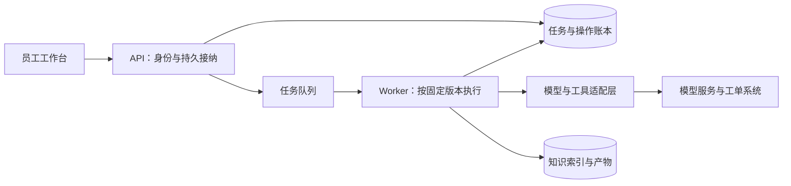
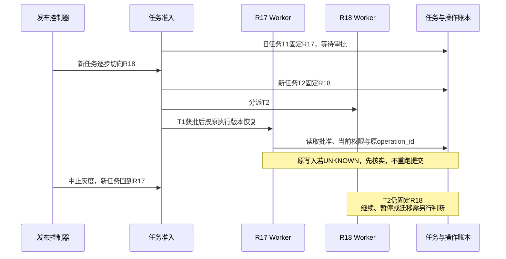

# 30 部署、版本与 LLMOps

企业 IT 助手上线两个月后，团队发布了“只修改 Prompt”的小版本。新版本在演示中表现很好，生产里却出现三类问题：一些旧工单草稿恢复后缺字段；某批员工仍然检索到旧 VPN 文档；切回旧镜像后，错误也没有全部消失。与此同时，还有一项提交请求超时了，没人能确定工单是否已经创建。

为什么改动很小，恢复却这么难？因为 Agent 的实际行为由**代码、模型、Prompt、工具契约、运行策略、状态结构和知识数据共同决定**。镜像只是其中一部分。系统中还存在等待审批的旧任务、已经写入的新数据，以及发布工具无法撤销的外部业务动作。

本章继续使用“查询 VPN 资料 → 准备工单草稿 → 等待批准 → 创建并核实工单”的案例，建立一条完整的企业交付链路：**知道要上线什么，证明它可以上线，控制谁先使用它，并在出问题后恢复服务、保住业务事实。**

[← 知识图谱](00%20Agent%20%E5%BC%80%E5%8F%91%E5%AD%A6%E4%B9%A0%E5%85%A5%E5%8F%A3.canvas)

**先修**：[状态与恢复](12%20%E7%8A%B6%E6%80%81%E3%80%81%E6%8C%81%E4%B9%85%E6%89%A7%E8%A1%8C%E4%B8%8E%E6%81%A2%E5%A4%8D.md) · [后端与存储](25%20%E5%90%8E%E7%AB%AF%E3%80%81%E8%B0%83%E5%BA%A6%E4%B8%8E%E5%AD%98%E5%82%A8.md) · [质量门禁](27%20%E6%B5%8B%E8%AF%95%E3%80%81Evals%20%E4%B8%8E%E8%B4%A8%E9%87%8F%E9%97%A8%E7%A6%81.md)。本章负责版本组合、环境交付与运行维护；外部动作的一致性见 [可靠性与一致性](26%20%E5%8F%AF%E9%9D%A0%E6%80%A7%E4%B8%8E%E5%89%AF%E4%BD%9C%E7%94%A8%E4%B8%80%E8%87%B4%E6%80%A7.md)，指标与诊断见 [可观测性](28%20%E5%8F%AF%E8%A7%82%E6%B5%8B%E6%80%A7%E4%B8%8E%E8%B0%83%E8%AF%95.md)，资源预算与模型选择见 [性能与成本](29%20%E6%80%A7%E8%83%BD%E3%80%81%E6%88%90%E6%9C%AC%E4%B8%8E%E6%A8%A1%E5%9E%8B%E8%B7%AF%E7%94%B1.md)。

> [!abstract] 本章的工程交付
> 一份可追溯的发布清单、一套隔离明确的环境、一条有证据门禁的流水线、一张版本兼容矩阵、一份灰度与恢复计划，以及团队能够接手的运行手册。**发布完成的证据，是目标用户能按约定完成业务，并且系统仍有受控的恢复路径。**

## 阅读路线

| 阶段 | 小节 | 先解决的问题 |
| --- | --- | --- |
| 定义交付对象 | 1—3 | 部署与上线有什么区别？一个 Agent 版本到底包含什么？ |
| 建立交付基础 | 4—6 | 环境怎样隔离？服务怎样组织？流水线怎样执行门禁？ |
| 处理版本共存 | 7—9 | 数据怎样迁移？旧任务怎样继续？配置怎样原子激活？ |
| 证明与控制上线 | 10—12 | 测试环境验什么？如何分流？什么时候放量、暂停或中止？ |
| 恢复与稳定运行 | 13—17 | 能否回滚？如何关闭、扩容、恢复备份和交接？ |
| 动手与验收 | 18—20 | 完成一次发布推演，运行实验，形成可评审的交付包 |

[发布生命周期交互图](./assets/ch30-llmops/release-lifecycle.html)支持主题切换、缩放与导出；[静态 SVG](./assets/ch30-llmops/release-lifecycle.svg)便于预览。GitHub 阅读时可下载 HTML 后打开。[配套离线实验](https://github.com/douloveppt/agent-application-learning/tree/main/examples/ch30-llmops)演示版本封存、稳定分桶、灰度判断与兼容性受限的回退。


本章架构、版本名、字段、事故、阈值与业务数据均为**教学设计**，资料核对日期为 **2026-11-03**。实验使用固定模拟结果，不连接真实模型、集群、工单系统或生产数据库。产品能力与平台语义应按实施时采用的版本核实；示例通过不能代替真实环境演练。

## 1. 先把“发版”拆成几种不同的改变

### 1.1 容器运行起来，只完成了一部分工作

团队里常说的“已经发布”，可能指完全不同的事情：

| 动作 | 实际改变什么 | 应保存的证据 | 还不能证明什么 |
| --- | --- | --- | --- |
| 构建与制品发布 | 把源代码和依赖变成可部署制品，存入仓库 | Commit、制品摘要、构建来源 | 生产已经运行它 |
| 环境部署 | 把指定制品与环境绑定部署到实例 | 部署记录、实际镜像和配置摘要 | 真实用户已切换 |
| 配置激活 | 改变当前采用的版本组合、功能或策略 | 配置修订、激活记录、执行者 | 所有实例同时生效 |
| 数据迁移 | 改变 Schema、状态、索引或数据内容 | 迁移记录、校验结果、兼容范围 | 旧程序仍能正确读写 |
| 流量切换 | 让某部分新任务选择候选版本 | 分流策略、任务归属、实际比例 | 候选版本业务合格 |
| 业务验收 | 验证目标用户按业务合同完成工作 | 真实回执、适用证据、用户或业务确认 | 后续不会退化 |

例如，把 `R18` 部署到一组 Worker，但新任务仍全部指向 `R17`，这叫候选环境就绪。把 5% 的合格新任务分给 `R18`，才开始生产灰度。数据库增加字段可能早于两者；旧任务也可能在全量切换后继续由 `R17` 执行。

因此，发布记录应写“哪个动作在何时完成、依据是什么”，而不是只有一个含义模糊的绿色勾。

### 1.2 LLMOps 管理的是持续改变的行为系统

在应用开发中，可以把 LLMOps 理解为：围绕模型应用的**版本、评测、交付、观测、恢复与持续改进**建立工程闭环。它与传统 DevOps 共享构建、环境、权限、监控和运行维护基础，同时增加模型与数据带来的行为变化。

| 常见变化 | 为什么代码不变也可能影响结果 | 本章要求 |
| --- | --- | --- |
| 模型或路由变化 | 工具选择、输出结构、拒答、时延可能变化 | 单独版本化，进行任务级评测 |
| Prompt / Skill 变化 | 改变任务理解、步骤和工具使用方式 | 像代码一样审查、封存、灰度 |
| 工具与 Connector 变化 | 参数、错误语义和外部动作可能变化 | 保存契约与适配器兼容范围 |
| 知识与索引变化 | 来源、适用版本、召回与排序变化 | 保存加工与索引版本，验证覆盖与权限 |
| 策略与预算变化 | 允许的动作、数据路径和降级方式变化 | 有明确生效点、权限控制与审计 |

LLMOps 不要求团队自己训练模型，也不要求购买一套名称叫 LLMOps 的平台。企业项目首先需要的是清楚的合同与可核实的流程，再选择工具承载它。

### 1.3 一次发布要同时回答四个问题

1. **可定位**：给出一个 `run_id`，能找到它实际使用的版本组合。
2. **可验证**：能说明哪些测试与评测支持本次变更，哪些能力仍未验证。
3. **可控**：能限制新版本的用户、任务、写入能力和资源消耗。
4. **可恢复**：知道异常时停什么、保留什么、如何继续已有任务，以及哪些结果必须核实。

这四项都需要工程实现。“Git 有历史”“镜像仓库有旧版本”“数据库每天备份”分别提供部分基础，并不会自动组合成恢复能力。

## 2. 定义一个可以追溯的 Agent 发布单元

### 2.1 Release 是一组经过验证的组合

假设团队把一个可交付的组合命名为 `R18`。它至少需要引用以下对象：

| 类别 | 需要定位的内容 | 重点检查 |
| --- | --- | --- |
| 应用与执行器 | API / Worker 镜像、Commit、运行时、依赖锁 | 实际制品是否与测试一致 |
| 模型与生成参数 | 供应商、区域、具体模型标识、参数、路由版本 | 数据路径、能力、退役与降级约束 |
| Prompt / Context / Skill | 模板、装配规则、技能资源包的版本和摘要 | 不是只保存一段主 Prompt |
| 工具与集成 | Tool Schema、业务适配器、MCP Server / Client、SDK | 参数与错误合同、写入与核实能力 |
| 状态与业务数据 | 数据库 Schema、持久状态 Schema、事件与审批格式 | 新旧读写与恢复兼容性 |
| 知识与检索 | 语料快照、加工配置、Embedding、索引、检索策略 | 维度、元数据、证据与访问边界 |
| 安全与资源策略 | 权限策略代码、Guardrail、预算、路由和出口规则 | 基线版本与当前强制约束的关系 |
| 发布证据 | 测试、评测集与评分器版本、评测结果、恢复演练 | 结果是否绑定这一个候选组合 |

不必把全部大文件塞进同一个镜像。发布清单可以引用多个制品，但引用必须能解析到被封存的实际内容。一个 `release_id` 应对应一个确定的清单；更换其中任何行为相关内容，产生新清单和新修订。

### 2.2 用清单表达，不靠聊天记录拼凑

下面是**结构示例**，占位摘要和名称不能直接用于部署：

```yaml
manifest_schema: agent-release/v1
release_id: it-assistant-R18
artifacts:
  api_image: registry.example/it-api@sha256:<api-digest>
  worker_image: registry.example/it-worker@sha256:<worker-digest>
  source_commit: <full-git-commit>
  dependency_lock_digest: sha256:<lock-digest>
behavior:
  prompt_bundle: {version: p12, digest: "sha256:<prompt-digest>"}
  skill_bundle: {version: s7, digest: "sha256:<skill-digest>"}
  model_route: route-v6
  approved_models: [provider-a/model-snapshot-3]
  tool_contract: ticket-tools-v4
  connector_adapter: ticket-adapter-v9
  policy_baseline: policy-v8
knowledge:
  corpus_snapshot: vpn-corpus-20261102
  index_generation: vpn-index-g42
  embedding_profile: embed-profile-v3
  retrieval_config: retrieval-v7
compatibility:
  database_schema_read: [12, 13]
  database_schema_write: [13]
  run_state_read: [3, 4]
  run_state_write: 4
  approval_schema_read: [2]
evidence:
  evaluation_dataset: it-acceptance-v15
  evaluation_report: evidence://R18/eval-03
  integration_report: evidence://R18/integration-02
  recovery_drill: evidence://R18/drill-01
```

`evidence://` 只是教学引用格式。实际系统需要检查报告是否存在、产生者是否可信、报告绑定的清单摘要是否一致、有效期和允许用途是否满足条件。一个字符串写着 `approved` 不构成质量证据。

### 2.3 分清发布清单、环境绑定和激活记录

如果把生产数据库地址、密钥和当前流量百分比也塞入同一份清单，每改一次环境就会改变制品身份。更清楚的办法是分成三个有引用关系的对象：

```text
ReleaseManifest：R18 由什么组成，兼容什么，经过什么验证
        ↓ 引用其摘要
EnvironmentBinding：生产区域、资源名称、网络与密钥引用、部署参数
        ↓ 两者绑定后验证
ActivationRecord：何时由谁，在何种证据下，把哪些新任务指向 R18
```

环境绑定本身也要版本化和验证。“在测试环境通过”不能证明生产绑定无误。跨区域部署还需核对模型可用性、数据驻留、凭据、配额和实际索引，而不是仅替换一个 URL。

激活记录通常包含 `environment`、`release_digest`、`binding_revision`、`generation`、分流范围、前一状态、执行身份、证据引用和原因。密钥只保存受控引用与必要的版本元数据，**不把明文写进清单、日志或 Git**。

### 2.4 Run 必须记录“实际用到什么”

发布清单描述允许的组合，运行记录描述某项任务的实际选择。二者不能相互替代。

```json
{
  "run_id": "run-2031",
  "release_id": "it-assistant-R18",
  "release_digest": "sha256:<manifest-digest>",
  "activation_generation": 28,
  "binding_revision": "prod-bind-11",
  "state_schema": 4,
  "resolved_model": "provider-a/model-snapshot-3",
  "prompt_digest": "sha256:<assembled-template-digest>",
  "index_generation": "vpn-index-g42",
  "current_policy_decision_ref": "decision-771"
}
```

如果任务中有多次模型调用、降级、多个索引或权限复核，实际选择应记录在对应步骤，而不是只在 Run 顶层放一个最终值。完整输入可能含敏感数据，不应为了可追溯而无限保留；可使用脱敏记录、访问受限的证据引用与适当摘要。

**版本可追溯不等于输出逐字可重现。** 外部模型服务、时间、检索数据、业务事实和生成随机性都可能影响结果。工程目标是说明当时使用了什么、依据是什么，并能在受控条件下比较行为。

## 3. 封存制品，避免“同名版本，内容变了”

### 3.1 标签方便人阅读，摘要确认具体内容

`latest`、`production`、`champion`、`default-prompt` 都适合作为可变入口，却不适合作为历史运行的唯一身份。

Docker 文档明确区分可变镜像 Tag 与内容 Digest。使用 Digest 可以固定所引用的镜像内容；同时也需要通过显式更新获取安全修复，不能因固定而长期不维护。[Docker · Building best practices](https://docs.docker.com/build/building/best-practices/)

模型与 Prompt 注册表也可能存在相同问题。例如 MLflow 的模型 Alias 是指向某个模型版本的可变引用。团队可以用 Alias 表达“当前推荐”，但应在准入时解析到具体版本并保存解析结果。[MLflow · Model Registry](https://mlflow.org/docs/latest/ml/model-registry)

对于只能提供可变模型别名、不能固定权重或服务实现的供应商，应记录这一限制：保存请求模型标识、响应中可用的实际版本信息、调用时间、区域和评测证据，并设置漂移监测与变更响应。不要给一个供应商没有承诺不可变性的名称套上“绝对复现”的保证。

### 3.2 构建一次，逐级提升同一制品

建议的交付方式是：在可信 CI 中构建一次，后续测试、预生产和生产都引用相同制品摘要。环境差异通过受控绑定表达。

如果在测试环境构建一次，生产再从相同 Commit 重新构建，仍可能下载到不同基础镜像、依赖或构建工具。**同一源代码不必然生成同一制品。** 锁文件、基础镜像摘要、构建器版本和确定的下载来源共同缩小差异。

最低制品记录可以包括：

- 源码 Commit 与审查记录；基础镜像、应用镜像和依赖锁摘要。
- SBOM，即软件物料清单，用于知道打包了哪些组件。
- 依赖与镜像扫描结果、许可证与组织准入结果。
- 构建来源证明、签名和验证结果。
- 与该制品绑定的测试、评测和兼容性证据。

扫描通过不能证明没有漏洞；签名通过也不能证明业务正确。它们分别回答不同的问题。GitHub Artifact Attestations 可提供构建来源信息，但消费方仍需验证身份与来源策略，仅生成一份证明并不足够。[GitHub · Artifact attestations](https://docs.github.com/en/actions/concepts/security/artifact-attestations)

### 3.3 内容摘要不提供授权

任何人都可以对恶意 Prompt 算出 SHA-256。因此门禁至少需要同时检查：内容摘要一致、来源受信任、产生者有权限、审查与评测适用、当前没有撤销。

同理，签名过的旧镜像可能已经不符合当前安全策略。制品不可变与制品当前可用是两个判断。注册表应支持撤销和禁止新任务使用，并保留历史证据，不能通过覆盖旧内容“修正历史”。

## 4. 隔离环境、身份、配置与密钥

### 4.1 隔离要覆盖真实的资源路径

至少区分本地开发、集成测试、预生产与生产。规模较小时，部分阶段可以共享基础设施，但必须明确共享带来的失效边界。

| 对象 | 隔离要求 | 容易遗漏的地方 |
| --- | --- | --- |
| 身份与密钥 | 独立工作负载身份、供应商项目或受控凭据 | 测试容器拿到了生产工单写权限 |
| 数据库与队列 | 明确隔离的数据库、账号、队列和消费者组 | 队列名称不同，消费者却订阅了通配符 |
| 知识与存储 | 隔离对象前缀、索引、缓存与访问策略 | 测试索引仍能读取生产原文 |
| 外部系统 | 沙箱账号、测试租户和回调入口 | Webhook 回到生产，制造真实通知 |
| 资源与费用 | 独立配额、预算和限流 | 压测耗尽了生产模型配额 |
| 观测与权限 | 日志、Trace、评测数据按环境标识与授权 | 脱敏前的数据被复制进公开报告 |

单独一个 Namespace 只能提供部分组织与隔离能力。是否足够，需要结合网络策略、RBAC、存储、身份、配额与信任边界判断。高风险测试与生产可以需要不同账号、集群或云项目。

### 4.2 配置校验应早于接收任务

启动或激活时检查的内容不只是“环境变量是否存在”：

1. 配置 Schema 合法，未知字段与重复字段有明确处理。
2. 环境身份、资源所属环境和租户范围一致。
3. 模型、索引、适配器和 Schema 组合在兼容范围内。
4. 密钥引用可解析，权限符合所需动作，网络出口符合数据策略。
5. 期限、重试、预算、并发和降级参数在批准范围内。
6. 必要资源已经就绪，并且证据与目标版本匹配。

对于敏感字段，错误应报告“哪个配置项不可用”，而不是把其内容打印出来。配置错误必须让候选实例拒绝接单或让激活失败，不能悄悄改用一个未知的默认模型、公共索引或生产凭据。

### 4.3 密钥轮换是一项可验证的变更

把凭据移出 Git 只是起点。还需要最小权限、短期身份或受控密钥引用、访问审计、轮换和撤销流程。

如果使用 Kubernetes Secret，应理解其实际保护边界：Base64 编码并不构成加密，需检查存储加密和 RBAC，并限制哪些容器能读取该 Secret。[Kubernetes · Good practices for Secrets](https://kubernetes.io/docs/concepts/security/secrets-good-practices/)

轮换时要验证新凭据具备正确的租户、区域和动作范围，再逐步切换，观察错误并在约定窗口撤销旧凭据。不能仅凭“新密钥能连通”认定权限正确。凭据已经泄露时，应按事件处置立即限制风险，不能为了照顾旧 Worker 而无限保留旧凭据。

### 4.4 测试数据也有生命周期

预生产尽量使用合成数据、脱敏样本和明确授权的隔离数据。需要真实生产样本时，应限定目的、字段、访问者、保留时间与删除方式，并防止测试结果回流污染正式业务。

部署验收需要的证据通常是“这项动作按合同发生了”，不需要把全部原始对话、客户资料和凭据保存到流水线附件。数据治理细节见 [数据治理](32%20%E6%95%B0%E6%8D%AE%E6%B2%BB%E7%90%86%E4%B8%8E%E6%8C%81%E7%BB%AD%E6%94%B9%E8%BF%9B.md)。

## 5. 设计能够部署和恢复的运行结构

### 5.1 把短请求与长任务分开考虑

一个企业 Agent 不一定需要微服务，但应明确以下职责：



API 可以较快完成接纳并返回任务标识；Worker 承担模型、检索、审批恢复和工具调用。队列负责运输，数据库中的任务与操作记录承担持久业务事实。队列、账本和外部系统之间的一致性仍需按第 25、26 章设计。

如果产品只是短时、只读咨询，同一服务内执行可能足够。出现长任务、审批等待、资源差异或独立扩容需求后，再拆出 Worker。**部署单元按失效边界、资源需求和团队能力划分，不能仅按名词数量拆分。**

### 5.2 控制平面与执行平面分清权限

发布控制器、配置注册表和版本注册表负责“允许哪个版本在哪里运行”；API、Worker 与工具执行层负责“按当前合同处理任务”。

执行 Worker 通常需要读取已批准清单，但不应能随意把自己的版本提升为生产。发布系统可能有部署权限，也不应天然获得读取所有员工对话或操作所有工单的权限。发布审批权与业务动作授权分别管理。

控制平面临时故障时，系统如何行为也应预先定义。例如：已有任务可在已验证的固定版本和仍有效的约束下继续；无法可靠决定新任务版本时暂停接纳或使用有明确有效期的受控快照。身份撤销、紧急策略和操作账本不可用时，则需按动作风险拒绝相应能力。

### 5.3 从小部署开始，也要保留恢复骨架

| 阶段 | 可以采用的结构 | 仍需具备的能力 |
| --- | --- | --- |
| 小团队与低流量 | VM 或托管容器、单体 API、独立数据库与备份 | 制品固定、进程管理、状态外置、受控发布与恢复 |
| 有后台任务 | API + Worker + 队列 + 任务账本 | 持久接纳、租约、排空、任务版本路由 |
| 多租户与较高负载 | 独立扩缩容、租户配额、分层限流、多个 Worker 池 | 失效隔离、容量验证、分组灰度、端到端观测 |
| 高可用或区域要求 | 多可用区、受控故障切换、明确主写边界 | 实测故障恢复、数据一致性与防双写 |

Kubernetes、GitOps、服务网格和注册平台可以提供支撑，但这些工具不会替你定义业务完成、兼容性或外部操作的未知结果。选择平台时，比较团队实际需要与运维成本，而不是把所有平台都列入“企业级必选项”。

## 6. 把 CI/CD 组织成一条证据链

### 6.1 每个门禁回答一个明确问题

| 阶段 | 必须回答的问题 | 阻断示例 |
| --- | --- | --- |
| 变更审查 | 为什么改？影响什么？权限与风险是否变化？ | 只说“优化效果”，没有任务范围 |
| 静态与软件检查 | 程序、配置、依赖和契约是否成立？ | Schema 不兼容、密钥进入制品 |
| 可信构建 | 候选制品来自何处？内容是什么？ | 来源无法验证、未锁定依赖 |
| 集成与恢复测试 | 真实协议与持久状态能否工作？ | 断线后重复写、旧任务无法读取 |
| 离线 Evals | 目标任务的质量、安全与资源是否达标？ | 关键组退化、出现越权或重复创建 |
| 预生产演练 | 目标环境绑定、迁移、关闭与恢复是否可行？ | 新凭据范围错误、回退不兼容 |
| 生产灰度 | 真实任务分布下能否继续放量？ | 无数据、证据过期、业务结果退化 |
| 验收与交接 | 业务达标且后续有人能维护？ | 只确认 Pod Running，没有业务证据 |

软件测试与 Evals 解决不同问题，不能相互替代。一个输出符合 JSON Schema，不代表字段符合业务；一组模型答案评分很高，也不证明数据库迁移或停止 Worker 的逻辑正确。

### 6.2 证据绑定候选摘要，避免批准错对象

流水线不能只保存“最新测试通过”。应保存：清单摘要、实际测试制品、环境绑定、数据集与评分器版本、样本范围、结果、产生时间和可信执行身份。

以下变化通常会使一部分旧证据失效：

- 更换 Prompt、模型路由或工具 Schema，需要重新验证受影响的行为。
- 更换业务适配器或依赖 SDK，需要协议与错误处理回归。
- 改变 Embedding、切块或索引，需要重新验证检索兼容与证据质量。
- 改变状态结构或迁移代码，需要旧状态恢复与回退验证。
- 只改变环境绑定，也需要验证身份、网络、资源和生产适用性。

可以按依赖图选择测试，避免所有改动都跑全部高成本评测；但选择规则本身必须可审查。证据复用要说明哪些事实没变、为什么仍适用，不能用“改动很小”代替分析。

### 6.3 发布权限应分层

一种可落地的职责安排是：开发者提出候选并查看结果；CI 只能构建、上传和生成证据；部署身份只能向指定环境写入批准的资源；生产激活由具备相应权限的控制器按规则完成；高风险变化需独立复核。

不必要求每次低风险修复都人工点击。应按风险设定自动化范围：例如只读功能的小改动满足全部证据后可自动灰度；涉及外部写入、新数据出口或不可逆迁移时，采用更强的独立复核与受控窗口。

紧急修复可以缩短流程，但仍应保留候选身份、执行者、变更原因、必要验证、风险范围和后续补验责任。紧急通道不是永久拥有超级权限的另一套日常流水线。

### 6.4 同一个环境需要防止并发发布互相覆盖

流水线加互斥锁有帮助，但锁失效、网络延迟和旧执行者恢复仍可能造成覆盖。激活状态应带单调递增的 `generation`，更新时使用事务或 Compare-And-Swap：

```text
读取生产激活状态：generation = 27，stable = R17
校验候选、证据、环境、兼容性与当前准入条件
尝试更新：仅当 generation 仍为 27，写入 generation = 28
若条件不成立：重新读取并重新判断，不能强行覆盖
```

旧控制器拿着 `generation=27` 发来的迟到“切回 R17”，必须被拒绝。CAS 解决的是状态竞争；还要验证操作身份、目标环境、证据有效性和版本可用性。激活状态更新、审计事件与后续通知需有可靠提交和重试语义，不能靠几个互不关联的 API 调用拼出“原子上线”。

## 7. 先解决兼容性，再谈滚动升级

### 7.1 兼容性是一张矩阵

新版本能启动，只证明新程序能在当前环境初始化。滚动发布时，新旧 API、Worker、任务状态和数据库会共存，必须逐项检查。

| 关系 | 应检查的合同 | 典型错误 |
| --- | --- | --- |
| 新 API → 旧 Worker | 任务与事件格式 | 新字段被旧 Worker 丢弃，改变动作含义 |
| 旧 API → 新 Worker | 缺省值与旧语义 | 把旧草稿没有的紧急度默认设为最高 |
| 新旧 Worker → 数据库 | 读写 Schema 与约束 | 新版写入旧版无法识别的状态枚举 |
| 恢复器 → 历史 Checkpoint | 状态版本与转换规则 | 反序列化成功，但步骤含义已变 |
| 模型 → 工具执行层 | Schema、枚举、错误和权限语义 | 新模型生成了旧适配器不认识的队列 |
| 检索器 → 索引 | Embedding、维度、元数据与过滤规则 | 用新 Embedding 查询旧向量索引 |
| 审批 → 待执行动作 | 批准对象、内容摘要与有效条件 | 升级后改了字段，仍复用旧批准 |

“兼容”应同时包含能否读取、能否正确解释、能否写出对方可处理的数据。只看 JSON 能解析、SQL 没报错远远不够。

### 7.2 数据库分阶段扩展、迁移、切换与收缩

假设旧工单表只有 `description`，新版本希望使用结构化 `problem_summary` 和 `diagnostic_context`。直接删除旧字段会让旧实例和恢复任务立即失效。

更稳妥的教学方案如下：

| 阶段 | 数据与程序变化 | 本阶段的退路 |
| --- | --- | --- |
| Expand 扩展 | 新增可兼容字段，保留旧字段；新程序能读旧结构 | 旧程序仍可运行 |
| Migrate 迁移 | 分批回填；明确双读写或转换规则，检查一致性 | 保留旧读路径与可核实的迁移进度 |
| Switch 切换 | 新任务与新读路径逐步使用新字段 | 经验证可切回旧读路径 |
| Contract 收缩 | 确认旧实例、旧任务和回退窗口已结束，再移除旧结构 | 此后不再承诺直接退回旧程序 |

双写两个字段也会出错，因此应明确事务边界、写入权威、冲突规则、回填与在线更新的竞争处理。能在同一数据库事务中完成的相关更新，应尽量保持原子性；跨系统迁移需要专门的一致性设计。

迁移任务通常应独立运行，记录版本、游标、完成比例和校验结果。不要让每个新 Pod 启动时都竞争执行重型 DDL。大表锁、索引构建、复制延迟和空间需求，应在相近数据规模下演练。

### 7.3 状态迁移不能只改一个版本号

旧 Checkpoint 可能保存“已经批准，准备提交”；新执行器多了“先核对资产归属”的步骤。把 `state_schema=3` 改成 `4`，并不会自动补齐该检查，也不能让程序重新创建已经存在的工单。

迁移至少要定义：

- 来源与目标状态版本，以及允许迁移的业务状态。
- 字段转换、缺失信息处理与不变量校验。
- 已批准内容如何绑定，哪些改变要求重新批准。
- 操作账本、外部回执、预算和取消状态如何保留。
- 迁移失败如何隔离，重复执行如何避免重复修改。
- 谁批准迁移、如何记录前后摘要，以及如何验证恢复。

对已经派发但结果未知的写入，应保留其操作身份和未知状态，先核实原动作。状态迁移不是抹掉操作账本后重新跑一遍任务。

### 7.4 知识索引也需要发布与切换

更换 Embedding、切块策略或元数据过滤后，往往需要构建新的索引代际。推荐流程是：读取有版本的语料 → 构建新索引 → 检查文档数量、覆盖、权限与检索质量 → 准备候选检索器 → 灰度切换新任务 → 保留约定的旧代际。

旧索引能否回用，取决于当时的检索器、Embedding 和元数据规则是否仍可用。原文已被删除、用户被撤权、内容已明确失效时，旧任务也不能因为固定索引版本而继续引用它。**固定加工与检索版本，仍要执行当前的数据可见性和有效性检查。**

如果采用索引 Alias，切换 Alias 的操作也应被审计，并保存任务实际解析出的索引代际。不能只记录 `knowledge-prod`，然后假设它始终指向相同内容。

## 8. 让长任务跨版本继续执行

### 8.1 发布切换首先作用于新任务准入

等待审批的任务可能持续数小时，批量处理可能持续数天。如果每次恢复都读取“当前默认版本”，同一任务会在中途换 Prompt、工具或状态语义。

本章采用的默认策略是：**首次持久准入时固定执行版本；恢复时使用该版本或经过验证的显式迁移路径。** 这里固定的是执行合同，不是永久授予权限。



因此，“灰度权重已经回到零”不表示候选版本的全部执行都停止了。任务系统需要显示仍在执行、等待、核实和待迁移的候选版本存量。

### 8.2 旧任务有三种合理处理方式

| 方式 | 适用条件 | 需要的证明 |
| --- | --- | --- |
| 固定旧执行器直到完成 | 旧版本仍可安全运行，资源可保留 | 旧制品、配置、协议、凭据路径仍有效 |
| 显式迁移到新执行器 | 有可验证的状态转换与恢复路径 | 迁移测试、操作身份保留、审批与预算复核 |
| 暂停并交接 | 旧版存在风险、依赖已消失、迁移不安全 | 明确状态、用户提示、接手人与后续处理 |

不应为了“排空旧版本”直接删除等待审批的任务；也不能为了避免迁移而无限保留有漏洞的旧执行器。应为旧版本设定退出条件、最长支持窗口、存量清单与责任人。

Temporal 的 Worker Versioning 提供 Pinned 与 Auto-Upgrade 等行为：固定版本和允许跟随当前版本的任务需要采用不同策略。自动升级仍有重放兼容责任，不能把“框架支持版本路由”理解为任意修改 Workflow 都可恢复。[Temporal · Worker Versioning](https://docs.temporal.io/worker-versioning)

### 8.3 固定版本与当前授权同时成立

假设 T1 在 R17 下生成草稿，员工在等待期间离职或其工单权限被撤销。R17 的历史批准不能让任务绕过当前的服务端授权检查。

恢复后至少重新验证：当前身份与租户、访问权、动作权限、批准是否仍覆盖目标和字段、资源事实、取消状态、剩余预算、凭据与当前强制安全策略。具体规则遵循第 20、22、26 章。

紧急安全策略可以禁止某个模型、工具或版本继续执行。对受影响的固定任务，应留下明确的阻断原因，选择可验证迁移或交接，而不是偷偷替换模型后继续写入。**保持历史可解释性与执行当前限制，需要同时做到。**

### 8.4 Worker 下线前要计算真实存量

“最近十分钟没有请求”无法证明旧版本可以删除。还要检查等待审批、定时唤醒、延期重试、未知结果核实、离线回调与未确认队列消息。

退役清单可包括：绑定该版本的非终态 Run 数、各状态最长等待时间、未决操作数、仍需读取的状态格式、外部回调窗口和证据保留要求。只有存量结束或完成受控迁移，并满足回退窗口后，才能逐步撤销运行资源。

## 9. 把配置激活当作一次事务

### 9.1 启动时、激活时、执行时检查不同事实

| 时点 | 确定什么 | 不应作出的假设 |
| --- | --- | --- |
| 构建与封存 | 制品内容、依赖、代码与行为资源 | 生产凭据与当前权限已经有效 |
| 环境部署与激活 | 环境绑定、兼容性、就绪能力、允许的新任务范围 | 当前批准永远有效 |
| Run 首次准入 | 执行版本、配置修订、分流结果、预算合同 | 外部世界在整个任务期间不变 |
| 每次敏感读取或动作前 | 当前访问权、批准、撤销、预算与业务前置条件 | 固定版本可以绕过当前限制 |

普通行为配置尽量在 Run 准入时快照化。影响全局准入、权限撤销、紧急禁用和资源限制的规则，按其合同及时生效，并记录实际采用的决策版本。不要把所有配置都热更新，也不要把所有策略都永久冻结。

### 9.2 一个 Run 不应读到半套配置

如果模型路由、Prompt、工具和索引分别由四个可变指针独立读取，就可能出现“新 Prompt + 旧 Schema + 新模型 + 错索引”的未验证组合。

较稳妥的激活流程是：

1. 把候选组合写成新修订，完整校验，不修改现有清单。
2. 在目标环境准备其资源，验证实际摘要与兼容性。
3. 根据适用证据建立可激活记录，准备新旧执行池。
4. 用带代次校验的原子更新改变新任务准入指针。
5. 将解析结果与 Run 一起持久保存，再交给匹配的执行器。
6. 观察实际分流与运行记录，检测期望状态和实际状态的偏差。

原子指针不代表整个分布式系统同时变化。它让每个新任务能选中一套完整组合；实例收敛、连接排空和存量执行仍需单独处理。

### 9.3 热更新需要明确失败语义

读取到无法解析、签名无效或已经撤销的配置时，不能任意回到代码默认值。可以在合同允许时继续使用已验证、未过期、未撤销且满足当前强制策略的上一修订，也可以停止新任务准入；选择取决于配置用途与风险。

例如，日志展示颜色加载失败可以使用安全默认值；租户访问策略加载失败则不能“先允许再说”。涉及写入授权的控制应拒绝受影响的动作，并保留可诊断原因。

生产中的手工热修还需回收到配置来源与版本历史。否则下一次自动部署可能覆盖修复，或者使实际系统与 Git 中描述长期不一致。紧急例外应有有效期、责任人与复核计划。

## 10. 在预生产环境验证真正的交付路径

### 10.1 测试环境不是缩小版演示

它至少应覆盖生产路径中最容易被遗漏的连接：真实认证方式、服务账号、模型协议、业务适配器、对象存储、队列、回调、流式断连和持久恢复。哪些使用真实沙箱、哪些使用模拟，应明确标注。

| 验证层 | 例子 | 能证明的范围 |
| --- | --- | --- |
| 纯离线测试 | Schema、状态转换、固定评测样本 | 程序与模拟行为的合同 |
| 协议集成 | 供应商测试项目、业务沙箱 API | 指定环境下的真实协议与凭据路径 |
| 系统演练 | 部署、滚动关闭、排空、迁移、备份恢复 | 指定拓扑与数据规模下的运行能力 |
| 业务验收 | 实际用户在批准范围内完成代表任务 | 指定业务范围的实际交付 |

离线实验通过只能覆盖第一层。生产探测也不是默认允许的读操作：模型调用可能产生费用，工具“查询”可能触发通知或审计，真实写入更需要明确的授权、目标、清理与核实方案。

### 10.2 Smoke Test 要短小，但要穿过关键链路

一个适合本章案例的候选版本 Smoke Test 可以是：

- 用隔离员工身份完成一次只读知识查询，核对来源与适用版本。
- 查询该测试员工自己的测试工单，核对归属与返回字段。
- 生成结构化草稿，检查需要批准的具体内容。
- 在允许写入的业务沙箱中，批准一次精确动作，创建并核实唯一工单。
- 注入“外部成功但回执丢失”，确认系统进入核实且没有再创建。
- 关闭并重启 Worker，确认等待任务、版本与操作身份保留。

真实写入测试的结果应单独登记。删除测试工单也是业务动作，要遵守其授权与生命周期；不能因为叫测试数据就用广泛清理脚本删除相邻资源。

### 10.3 发布演练要主动制造失败

至少演练一次：候选实例启动失败、必要配置无效、数据库迁移中断、旧状态读取失败、供应商限流、Worker 被终止、观测系统缺数据、回退目标不兼容。

演练记录应写清预期状态、实际状态、证据、恢复耗时与缺口。例如，“灰度异常后权重回零”还不够，要继续检查存量任务、未知写入、用户提示与操作账本。

对于语音、浏览器或桌面自动化，服务端测试还不能代替真实设备、真实浏览器权限或实际桌面环境验收。交付清单应把这些验收与代码部署分别列出。

## 11. 设计有边界的灰度与影子验证

### 11.1 先确定谁是实验单位

若每次 HTTP 请求都重新随机分流，同一任务的创建、审批和恢复可能落到不同版本。应先确定分流单位：本章默认按可信租户与任务标识稳定分桶，并在首次准入后固定结果。

```text
bucket = SHA256(experiment_id + tenant_id + task_id) mod 10000
bucket < 500    → 候选版本，教学权重5%
其他           → 稳定版本
首次准入结果   → 持久保存，恢复时不重新抽签
```

实际实现需使用明确的编码和字段分隔，避免拼接歧义；用户不应通过自选标识或反复创建任务随意操纵分组。涉及对抗风险时，可采用服务端分配的任务标识或受控密钥分桶。分桶用于实验归组，不提供身份认证与授权。

对于体验连续性、会话状态或企业客户要求，应按用户、会话或租户分组。租户级灰度可能导致请求比例不等于租户比例；一个大租户就能贡献大部分流量。因此同时观察任务数、用户数、租户数与能力分布。

### 11.2 灰度比例限制不了全部风险

5% 的任务也可能集中使用写入工具、耗尽供应商配额，或者都属于同一个高价值客户。除流量比例外，还应限制：

- 可进入的租户、地区、任务类别、输入长度与数据敏感级别。
- 是否允许外部写入，允许哪一类操作与哪一组目标。
- 并发、调用量、费用、运行时长和最大未决写入数。
- 当前候选版本存量任务，而不仅是新进流量。
- 可用时间窗口、值班覆盖和紧急停止机制。

可以先对内部测试租户开放只读咨询，再开放普通只读任务，最后在批准范围内逐步验证写入。业务写入样本尚未成熟时，不能用只读质量通过来宣布写入能力已验收。

### 11.3 Shadow 与 A/B 的目的和风险不同

| 方式 | 候选版本是否影响用户 | 主要用途 | 必须约束 |
| --- | --- | --- | --- |
| 离线回放 | 不直接影响当前用户 | 相同样本比较、错误归因 | 数据授权、脱敏、模拟边界 |
| Shadow 影子运行 | 输出通常不交付用户 | 观察真实输入分布与行为差异 | 工具副作用、数据出口、额外费用 |
| Canary 灰度 | 部分任务真实采用候选 | 限制影响范围并验证上线条件 | 版本固定、监控、停止与恢复 |
| A/B 实验 | 按实验分组真实采用不同方案 | 估计业务效果差异 | 实验单位、样本、统计与伦理边界 |

Shadow 不是天然安全的“复制一下请求”。如果候选 Agent 能调用真实创建工具，就可能重复提交。可采用只读能力集合、工具桩、经过授权的结果复用或隔离业务沙箱；同时在服务端执行层阻断副作用，不能只在 Prompt 写“不要真的操作”。

工具结果复用也有局限：候选可能选择不同参数和不同工具，旧结果未必适用。若只比较已记录轨迹，报告应说明它没有验证候选在真实交互中完整作决策的能力。

### 11.4 蓝绿与滚动更新解决的是部署方式

蓝绿准备两套环境再切流，便于控制入口；滚动更新逐步替换实例，节省部分并行资源。两者都需要数据库、任务状态、队列和外部系统的兼容方案。

蓝绿环境连接同一生产数据库时，并没有得到两份独立业务世界。双环境同时消费同一队列，也可能抢到彼此不兼容的任务。应按版本能力路由、隔离消费者或采用经验证的兼容协议。

采用哪种部署方式，不会自动决定业务回退是否安全。选择依据应包括状态规模、长连接、并行容量、迁移方式和可接受恢复时间。

## 12. 用明确证据决定放量、暂停与中止

### 12.1 门禁至少有三种结论

- **Pass / Promote**：证据达到当前阶段要求，允许进入下一阶段。
- **Hold**：样本、观察时间或数据完整性不足，保持当前边界，等待补证或人工决定。
- **Fail / Stop**：违反明确条件，停止继续放量并执行预定义处置。

Argo Rollouts 的分析机制区分成功、失败与 Inconclusive；后者会暂停并等待决定。它说明发布判断需要表达“尚不能下结论”，而不是强迫所有情况落在通过或失败之一。[Argo Rollouts · Analysis](https://argoproj.github.io/argo-rollouts/features/analysis/)

### 12.2 把判断写成一张灰度合同

下面是虚构的教学合同，数值仅用于说明规则，不能直接复制为企业标准：

| 维度 | 示例条件 | 不满足时 |
| --- | --- | --- |
| 观测可信 | 数据最新、分母完整、能区分版本、关键事件无已知缺口 | Hold；关键保护失明时停止接纳候选任务 |
| 最小样本 | 至少40项成熟候选任务；关键任务组有覆盖 | Hold，不能用全部HTTP请求凑数 |
| 安全与副作用 | 无已证实越权、重复写入或错误归属 | Stop，并按事件范围处置 |
| 合格交付 | 对照可比任务组，达到预先规定的非退化条件 | 退化则Stop；不确定则Hold |
| 延迟与费用 | 使用完整边界与分位数，满足目标及预算 | 超限则Stop或保持当前权重查明 |
| 未结束任务 | 超期、未知写入和核实积压不超过合同 | 超限Stop，保留原操作身份 |
| 依赖与容量 | 预留容量可承受下一阶段，稳定版仍可服务 | Hold，先解决容量或依赖问题 |

实际项目中，样本量取决于基线、预期差异、变异与风险；40项不构成统计充分性的普遍保证。关键质量比较、置信区间和分组设计应采用第 27 章的方法。

### 12.3 “零错误”可能只是没看到任何任务

门禁应显式处理空值、NaN、指标过期、采样缺口、重复上报与分母为零。Argo 官方示例也表明，空指标数组会因条件表达式不同而得到不同结论，不能依赖默认直觉。[Argo Rollouts · Handling Metric Results](https://argoproj.github.io/argo-rollouts/features/analysis/#handling-metric-results)

例如，候选接纳了50项任务，只有5项完成并进入报表；若5项均正确，不能直接宣称“成功率100%”。剩余45项可能在等待审批、卡住、超时或尚未达到观察截止时间。

应固定入组窗口和观察截止点，分别报告：接纳数、成熟数、各终态数、合法等待数、超期数与未知数。等待审批不自动算失败，也不能从整体完成体验中消失。对耗时较长的任务，先观察早期风险信号，再等待成熟业务结果，不能用早期代理指标替代最终验收。

### 12.4 分开处理安全停止与统计比较

一次确认的跨租户越权，可能足以立即停止受影响能力，不需要等样本变多。另一方面，几个随机回答的评分波动，通常不能直接证明候选显著退化。

自动停止规则应绑定可信信号，并有明确动作：停止新候选流量、禁用具体工具、暂停危险存量任务或转人工核实。可疑但未核实的高风险信号可以先暂停，随后调查；不要自动删除业务记录、撤销所有已完成动作，或重跑未知任务。

对于多租户系统，还应检查总体平均值是否掩盖某个语言、地区、任务类型或大客户的退化。A/B 中频繁偷看并择机结束也会影响统计解释；观察窗口、停止规则和例外处理尽量预先声明。

### 12.5 发布控制器需要自己的审计与失效处理

每次判断保存：候选摘要、激活代次、样本时间范围、数据源、规则版本、指标快照、结果、原因与执行动作。判定服务超时不能默认为通过；迟到的分析结果不能覆盖已经更新的发布状态。

一种发布状态模型可以是：`SEALED → VERIFIED → READY → CANARY → PROMOTED`，灰度期间可以进入 `HOLD` 或 `STOPPED`。`STOPPED` 后重新启动应有新决策与新代次。业务任务自身仍使用其 Run 状态，避免把发布已停止误当作每项任务都已取消。

## 13. 先判断恢复目标，再选择回滚或前滚

### 13.1 回滚不是把时间倒回去

发生异常时，可能有四种不同目标：阻止继续扩大影响、恢复可用服务、处理存量任务、修复已产生的业务结果。它们往往需要不同动作。

| 恢复对象 | 可以采取的动作 | 必须核对的条件 |
| --- | --- | --- |
| 新任务版本选择 | 候选权重归零，或新任务切回稳定版 | 稳定版当前仍安全、可用且兼容 |
| 应用实例 | 部署已封存旧制品，或发布修复版本 | 配置、数据库、协议与资源满足要求 |
| 行为配置 | 激活已验证的上一组合 | 当前权限、紧急禁用与外部依赖仍允许 |
| 数据库 Schema / 数据 | 前向修复、兼容层、专门迁移或恢复 | 影响范围、数据保全、业务一致性 |
| 索引 | 切回兼容旧代际或构建修复代际 | 原文有效性、权限、Embedding与检索器兼容 |
| 在途任务 | 继续固定版本、暂停、显式迁移或交接 | 操作身份、当前权限和状态可解释 |
| 外部工单等副作用 | 查询核实，必要时受控补偿 | 实际结果、补偿授权、审计与幂等 |

Kubernetes Deployment 的回滚恢复的是 Pod 模板修订，不会恢复数据库、外部配置内容、知识索引或已创建的工单。若旧模板引用同一个可变配置名称，也不保证获得旧配置内容。[Kubernetes · Rolling Back a Deployment](https://kubernetes.io/docs/concepts/workloads/controllers/deployment/#rolling-back-a-deployment)

### 13.2 一个可执行的恢复顺序

1. **确认目标与影响**：哪个环境、哪个版本、哪些租户和能力受影响；保留相关证据。
2. **限制继续发生**：停止放量，必要时停止候选新任务、禁用具体危险工具或暂停受影响存量。
3. **盘点业务事实**：哪些操作未派发、已成功、已失败、结果未知；不得把它们统一改成失败。
4. **检查恢复兼容性**：旧版本是否仍能读写当前数据、解释任务状态并访问所需依赖。
5. **选择回退或前滚**：能安全回退才执行；否则发布兼容修复、保留受限服务或交接。
6. **验证服务与业务**：确认新任务路径、存量恢复、外部回执、数据一致性与用户提示。
7. **结束事件并改进**：记录实际恢复时间、未解决项、受影响名单与复测证据。

“自动恢复”应限于已经演练、影响可控、前提明确的动作。指标异常不能直接触发数据库恢复、业务记录删除或外部工单批量撤销。

### 13.3 什么时候应当优先前滚

如果 R18 已写出 R17 无法读取的状态格式，简单回到 R17 可能使问题扩大。这时可能更适合发布 `R18.1`：修复错误，同时继续理解 R18 已产生的数据。

前滚也不是临时直接改生产。仍需明确候选制品、最低验证、当前状态覆盖、受控窗口和失败退路。对非常复杂的迁移，可以先通过兼容适配器或关闭受影响能力恢复部分服务，再完成修复。

可以在发布前填写以下决策卡：

```text
候选：R18
允许直接回退：尚未执行Contract迁移，R17仍能读写当前数据
禁止直接回退：已写入只有R18可解释的状态且无已验证转换；评估兼容前滚或暂停交接
始终保留：Run身份、批准修订、operation_id、回执与未知结果
禁止自动执行：恢复整库、删除业务记录、重放未知写入
恢复验收：新任务成功 + 存量任务可解释 + 外部结果完成核实
```

### 13.4 回退计划本身也会过期

旧模型可能退役、旧凭据已撤销、旧索引已删除，旧镜像也可能存在新发现的高危漏洞。保留镜像并不代表这个版本仍是可用退路。

应定期验证恢复目标的制品可获取性、资源、当前政策、凭据路径、数据兼容与容量。回退窗口结束后，应在发布记录中明确：“R17 不再支持直接恢复”，并提供新的恢复方案。

## 14. 健康检查与优雅关闭需要应用配合

### 14.1 三类健康探针检查不同状态

| 类型 | 适合表达 | 失败后的典型含义 |
| --- | --- | --- |
| Startup | 初始化、必要资源加载是否完成 | 启动阶段尚未成功，按平台规则继续探测或重启 |
| Readiness | 此刻是否适合接收这一类新流量 | 暂不接收常规入口流量，实例不因此自动重启 |
| Liveness | 进程是否已经陷入需要重启的失效状态 | 连续失败达到阈值后重启容器 |

Kubernetes 中，配置 Startup Probe 后，Readiness 与 Liveness 会等待其成功；Readiness 失败不等于重启条件。阈值和动作应以实际平台配置为准。[Kubernetes · Probes](https://kubernetes.io/docs/concepts/workloads/pods/probes/)

不要把每次探针都设计成完整模型调用：会增加费用、配额消耗和供应商负载。可以分为本地进程状态、受控频率的依赖探测、缓存后的能力状态，以及面向业务的低频合成监测。哪些必要依赖应使 Readiness 失败，是应用设计选择；应防止单个共享供应商短暂异常引起全部实例同步重启。

### 14.2 “活着”与“能完成业务”需要不同证据

`/live` 可以回答主循环是否可响应；`/ready` 可以回答配置已验证、任务账本可写、当前是否排空；能力状态可以区分“知识查询可用，工单创建暂不可用”。

真实用户验收仍要穿过身份、检索、模型、工具与回执链路。把所有能力合并成一个绿灯会隐藏部分故障；把所有依赖失败都变成 Liveness 失败又可能制造重启风暴。

队列 Worker 还要有自己的准入开关：HTTP Readiness 失败不会自动让它停止拉消息。调度器、消费者与工具执行层需要理解排空和紧急停止状态。

### 14.3 优雅关闭是一段协议

对有队列和外部写入的 Worker，可以设计如下顺序：

```text
进入DRAINING
  → 入口不再分配新任务；Worker停止领取新消息
  → 等待短活动到安全边界，暂停新外部写入
  → 持久保存Checkpoint、操作状态与已收到回执
  → 释放或等待到期的租约，按协议处理消息确认
  → 对未确定结果的外部动作保留UNKNOWN，安排核实
  → 关闭连接、刷新必要记录并退出
```

消息确认时机必须与任务持久状态和业务动作一致。过早确认可能丢任务；不确认则可能重投，需要去重和恢复协议。取消本地协程或杀进程不会撤销已经到达外部系统的动作。

若进程在宽限期结束前不能完成，系统应能从持久状态接手，而不是依赖“再等一会儿它总能结束”。审批等待和长时间核实不应占着即将关闭的进程；它们应成为可恢复的持久状态。

### 14.4 平台配置不能替代排空实现

Kubernetes 的 `preStop` 在 TERM 前执行，其耗时计入整体终止宽限期；超过宽限期仍未退出的进程可能被强制终止。终止中的 Endpoint 会被标为不就绪，但已有连接和长任务仍需应用处理。[Kubernetes · Pod termination](https://kubernetes.io/docs/concepts/workloads/pods/pod-lifecycle/#pod-termination)

单纯写一个 `preStop: sleep`，只能给流量收敛留时间，不能保存 Checkpoint、停止队列消费者或保证外部操作完成。应在真实负载下验证：信号是否到达应用、进程是否转发信号、任务是否排空、连接是否关闭、宽限期是否足够。

还要考虑突然断电、OOM 与节点失效，这些情况下优雅关闭可能完全没有机会运行。因此正确性必须依赖持久状态、租约与幂等保护，优雅关闭只是减少中断成本。

## 15. 把容量、可用性与依赖故障一起设计

### 15.1 灰度期间需要额外容量

旧版本服务存量、新版本接新流量、影子运行与迁移同时发生时，资源使用可能明显高于稳态。发布计划应估算 API、Worker、数据库、索引、网络、外部配额和观测链路的共同峰值。

尤其需要保留稳定版本的服务能力。若为了候选版本腾资源把稳定池缩得过小，候选停止后可能没有容量接回新任务。回退路径的容量也要经过验证，不能只保留一个镜像引用。

### 15.2 扩容不是解除所有瓶颈

| 信号 | 可能的瓶颈 | 应先检查 |
| --- | --- | --- |
| 队列持续增长 | Worker不足，也可能是供应商限流 | 入队速率、服务时间、下游配额与重试 |
| Worker CPU很低但任务很慢 | 网络等待、模型排队或连接池 | 外部时延、并发占用、期限传播 |
| 增加Worker后失败更多 | 数据库连接或下游被压垮 | 全局并发、连接数、重试放大 |
| 某租户拖慢所有人 | 缺少公平调度与隔离 | 租户限额、任务大小、资源池 |
| 发布时数据库变慢 | 迁移锁、回填或双写 | DDL、慢查询、复制延迟和空间 |

自动扩缩容应有上限、冷启动判断、下游配额约束和缩容排空协议。只按 CPU 扩容，可能看不到 I/O 密集任务的排队；只按队列长度扩容，又可能把已故障的下游打得更重。资源细节见第 29 章。

### 15.3 高可用要覆盖状态与外部依赖

两个 API 副本不代表整个系统高可用。如果它们共享一个无备份数据库、一个单点队列或一个唯一模型区域，系统仍有明显失效点。

高可用设计要写清：哪些故障能自动接管、谁是权威写入方、如何避免双主与旧Worker提交、任务如何恢复、凭据与网络是否在备用区域可用。跨区切换还需检查数据驻留与供应商区域支持。

网络分区时，允许两个 Worker 同时继续写入外部系统可能比短时暂停更危险。应依据任务账本、租约和 fencing 机制防止过期执行者覆盖新状态；外部系统不支持 fencing 时，还需依靠幂等键、核实和受控单写路径。

### 15.4 供应商故障需要预先批准的退路

备用模型至少要通过：当前数据路径允许、任务能力适配、工具与输出契约兼容、质量基线通过、剩余预算与期限可行。还要检查不同供应商的数据处理条款与组织政策。

只读咨询可以在条件满足时有限重试或降级；已派发工单结果未知时，切模型不能成为再提交一次的理由。备用供应商不可用或不满足约束时，可以降级为只读、暂停相关能力或转人工，不应绕过约束寻找“任何能返回答案的接口”。

供应商宣布模型退役、修改配额或更新可变别名时，应按行为变更处理：盘点受影响版本与在途任务，评测替代方案，安排迁移窗口，更新恢复目标，并验证观测字段是否改变。

## 16. 备份恢复要保护整个业务事实链

### 16.1 先定义 RTO 与 RPO 的业务口径

- **RTO，恢复时间目标**：从约定的中断起点，到恢复到约定服务水平的目标时间。起止点和服务范围必须写清。
- **RPO，恢复点目标**：可接受的数据恢复落后范围，通常用时间表达；不同数据类别可以有不同要求。

例如，“30分钟恢复只读查询、2小时恢复受控写入；关键操作账本不能静默丢失”，比“系统RTO两小时”更有用。目标还需与备份频率、日志归档、恢复资源、人员覆盖和实际演练能力一致。

数据库允许恢复到五分钟前，并不意味着外部工单系统也回到五分钟前。数据库中消失的操作记录，可能对应已经创建的真实工单。因此恢复后的重新执行要特别谨慎。

### 16.2 盘点必须恢复的对象

| 对象 | 为什么需要 | 恢复时的关键检查 |
| --- | --- | --- |
| Run / Checkpoint / 操作账本 | 知道任务和外部动作执行到哪里 | 是否丢失已派发记录、版本与批准 |
| 业务数据与事件 | 恢复实际业务状态 | 事务边界、事件序列、重复或缺口 |
| 制品与发布清单 | 恢复可解释这些状态的程序 | 制品可获取、摘要正确、仍允许使用 |
| 配置与密钥引用 | 重建目标环境 | 当前有效性、权限、撤销与轮换 |
| 知识原文与加工元数据 | 重建检索与引用 | 删除状态、访问权、重建耗时 |
| 索引与缓存 | 缩短恢复时间或重建派生数据 | 是否与原文、模型和策略兼容 |
| 审计与激活记录 | 确定恢复时系统真正处于什么状态 | 不可篡改性、访问控制、时间关联 |

缓存通常可以重建；操作账本通常不能随意丢弃。索引是否备份取决于重建成本与目标恢复时间，不能一概认为它只是派生数据就不需要计划。

### 16.3 “备份文件存在”与“能恢复”相差很远

恢复演练至少应在隔离环境完成：获取备份与必要日志 → 验证完整性与解密能力 → 恢复数据 → 部署兼容执行器 → 检查权限与删除规则 → 对账并运行代表任务 → 记录耗时与缺口。

以 PostgreSQL 的连续归档与时间点恢复为例，它需要基础备份和连续的 WAL 归档；数据库配置文件也不自动包含在 WAL 恢复范围内。实际恢复方案应按使用的数据库版本与拓扑验证。[PostgreSQL · Continuous Archiving and PITR](https://www.postgresql.org/docs/16/continuous-archiving.html)

加密备份还需要能取得解密密钥。若密钥、备份和恢复账号都依赖同一个已故障或被锁定的系统，恢复计划仍可能失败。访问与恢复权限应受控，但指定人员确实能在事件期间使用。

### 16.4 恢复后先对账，再开放写入

一个可靠的恢复入口可以采用受限模式：先提供必要查询，暂停外部写入，核对恢复点之后可能发生的动作与事件，再逐步开放。

重点核对：

1. 操作账本与外部工单之间是否有“外部存在、本地缺失”的记录。
2. Outbox、消费者位点与消息重投是否形成重复或事件缺口。
3. 任务的固定版本、批准、预算、取消和权限撤销是否仍可解释。
4. 备份中的已删除资料与旧授权是否会被错误重新激活。
5. 索引、原文与访问策略是否处于一致的有效代际。

无法确认的动作保留待核实状态。不能把恢复库中“不存在”当作外部“没发生”。必要时基于外部回执、操作身份和业务日志重建关联，但应记录证据来源与修复过程。

## 17. 用运行手册完成真正的生产交接

### 17.1 交接应让另一位工程师能独立行动

每项关键能力至少明确业务负责人、应用值班、平台、数据库、模型与知识负责人。事故发生时谁有权停止能力、谁批准迁移、谁确认业务结果，要在事前说清。

运行手册不需要堆满命令。应提供准确目标、触发条件、可观测证据、最小操作、预期结果、停止条件和升级路径。涉及生产写入或权限调整时，列出具体对象、影响、恢复方式和服务账号需求；不能让值班人员凭模糊路径使用递归权限修改或广泛删除。

### 17.2 一张可执行的值班卡

```text
事件：R18灰度期间，创建工单出现未知结果积压
定位：生产区域A，候选摘要X，激活代次28；按Run与operation查询
先控制：冻结放量；停止新的候选创建动作；保留只读能力
先保留：操作账本、批准修订、外部请求ID、已收到回执
先核实：逐项查询原操作，区分成功、明确失败和仍未知
再恢复：检查R17对当前状态/数据库/索引兼容后，决定新任务路径
不自动执行：重跑创建、删除记录、恢复整库、覆盖未知状态
验证：无新重复写入；积压有明确归属；用户状态与外部回执一致
交接：事件负责人、当前动作、未决Run、下一检查点与退出条件
```

具体命令应放在经过演练、受权限控制的内部手册，并使用当前环境的真实资源标识。教程里的示例名称不应直接当作生产目标。

### 17.3 发布后的观察窗口也是发布计划的一部分

全量切换后，仍需观察延迟成熟的任务、审批恢复、费用结算、供应商限流和数据回填。应约定观察窗口、值班覆盖、旧版本资源保留时间与退役条件。

生产样本进入改进流程时，应先做授权与脱敏，区分程序错误、知识错误、模型能力不足、配置与权限问题。修复样本可以进入回归集，但避免把最终保留集不断用于调参。持续改进的详细数据规则见第 32 章。

### 17.4 防止系统在无人发布时悄悄改变

定期比较期望状态与实际状态：实际镜像摘要、配置修订、模型解析结果、索引代际、工具契约与当前策略。还应盘点长时间未结束的旧版本任务和已经过期的恢复目标。

发现漂移后先判断来源与影响：是批准过的紧急变更、平台升级、供应商变更，还是未经授权的手工修改。不要一发现不一致就自动覆盖全部生产资源；应采用与风险匹配的限制、核实和修复过程。

## 18. 完成一次端到端发布推演

### 18.1 先写出本次变更的真实范围

假设 R17 已稳定运行，R18 希望提高 VPN 工单草稿质量。它同时更换 Prompt、引入新的工具可选字段，并切换到新知识索引；模型仍使用同一个已批准快照。

一张合格的变更卡可以这样写：

| 项目 | 本次计划 |
| --- | --- |
| 业务目标 | 减少遗漏操作系统与报错信息的草稿，提高可直接确认比例 |
| 变更对象 | Prompt p11→p12；工具契约v3→v4；索引g41→g42 |
| 保持的合同 | 创建前精确批准、本人资源范围、同操作身份、UNKNOWN核实 |
| 数据变化 | 先新增可空字段，R17仍能读写；本轮不执行Contract |
| 旧任务 | 继续固定R17，保留旧执行池与g41所需资源 |
| 灰度范围 | 内部租户只读，再扩大只读，再按批准范围验证创建 |
| 风险 | 新字段语义不一致、检索版本错误、旧批准被错误复用 |
| 恢复方式 | 兼容条件成立时，新任务回R17；存量单独处置 |
| 证据 | 字段与批准回归、检索评测、集成、关闭与恢复演练 |
| 责任 | 变更负责人、发布执行者、业务验收与事件接手人 |

这张卡让评审者能判断本次变化，而不是在几百行配置差异里猜测意图。

### 18.2 按依赖顺序执行，不把动作压进一个脚本

1. 构建并封存 R18 与依赖资源，保存清单摘要。
2. 执行兼容的数据库扩展；检查 R17 继续运行且没有错误写入。
3. 离线构建 g42，核对原文覆盖、访问过滤、引用与检索效果。
4. 完成绑定候选摘要的测试与 Evals，处理关键组退化。
5. 在预生产验证精确批准、丢回执核实、旧任务恢复和关闭排空。
6. 部署候选执行池，但保留生产新任务仍全部指向 R17。
7. 按批准范围开始灰度，确认真实版本归属与样本来源。
8. 满足当前阶段门禁后逐步扩大，最终完成业务验收与观察。
9. 等旧任务、回退窗口和数据校验满足条件后，另行安排旧资源退役或Contract迁移。

任何一步失败，都先停在明确状态。迁移成功、候选部署失败，属于“数据扩展已完成、流量尚未切换”，不能简单标成整个发布失败后逆序执行所有脚本。

### 18.3 用三个异常检查计划是否完整

| 异常 | 合理动作 | 为什么 |
| --- | --- | --- |
| 候选接纳很少，指标面板显示零错误 | Hold，检查流量和采集，继续受限观察 | 没有错误样本不代表有足够合格样本 |
| g42中的某类文档缺少租户过滤字段 | 停止受影响检索，修复或用已验证兼容代际 | 不能用平均回答分数抵消数据越权风险 |
| 创建已派发后回执超时，随后决定回退 | 保留Run与operation，查询原动作；新任务按恢复决策路由 | 回退改变服务路径，不改变外部已发生的事实 |

再追加一个难题：若旧模型已不可用，或者R17不能读当前状态，计划是否仍有退路？如果答案只是“到时再说”，就还没有完成企业级发布设计。

### 18.4 最终交付的是一个可复核的发布包

发布包可以是仓库中的受控目录或平台记录，至少包含：变更卡、发布清单、环境绑定、证据索引、兼容矩阵、迁移进度、灰度合同、恢复计划、实际激活记录、业务验收与遗留项。

不需要将所有日志复制成巨型附件。使用稳定、受权限控制的证据引用，说明保存位置、访问方式与保留期限。给另一位工程师这个发布包，他应能回答“为什么上线、上线了什么、目前影响谁、怎样安全恢复”。

## 19. 动手实验：看见发布控制的关键合同

### 19.1 运行方式与实验范围

打开 [第 30 章实验目录](https://github.com/douloveppt/agent-application-learning/tree/main/examples/ch30-llmops)，在项目根目录执行：

```bash
python3.11 examples/ch30-llmops/lab.py demo
python3.11 -m unittest discover -s examples/ch30-llmops -p 'test_*.py' -v
```

实验只使用 Python 3.11+ 标准库，无网络、容器或真实业务写入。它是**内存中的发布合同演示**，用于理解状态和决策，不负责真实部署。

这里的两个教学版本叫 `vpn-r1`、`vpn-r2`，与正文的 R17 / R18 是独立示例；实验使用10%候选桶位，正文5%只用于解释分桶算法。版本引用是占位字符串，不是可下载的制品。

### 19.2 按五个问题阅读输出

| 问题 | 观察的输出 | 应得到的结论 |
| --- | --- | --- |
| 改了Prompt，版本身份会变吗？ | `manifests`中的内容与`sha256` | 发布摘要绑定整个教学清单 |
| 离线失败能进入灰度吗？ | `rejected.offline_failure` | 失败证据不能激活候选 |
| 样本不够会怎样？ | `gates`中的`hold(5)` | 不因暂未发现错误而放量 |
| 旧控制器能覆盖当前状态吗？ | `rejected.stale_controller`、`events` | 过时代次请求被拒绝 |
| 回退能否改变旧任务和未知写入？ | `pinned_task`、`assertions` | 旧任务固定原版本，同操作不重派 |

实验采用固定教学门禁：少于40个不重复观察则Hold；越权或未知写入观察优先Stop；其余检查成功率、最近秩p95和平均成本。40条合成成功观察会通过，这是为覆盖控制路径设计的结果，不证明生产样本充分或业务质量可靠。

示例关键输出如下，完整版本摘要由程序计算：

```json
{
  "assertions": {
    "offline_failure_did_not_activate": true,
    "new_tasks_use_old_release": true,
    "old_task_keeps_candidate_release": true,
    "unknown_write_dispatched_once": true,
    "incompatible_rollback_did_not_advance_generation": true
  }
}
```

报告中的 `stop` 与 `rejected` 是预期场景。命令退出成功与“每个候选都获准发布”是不同概念；拒绝危险路径正是实验希望展示的行为。

### 19.3 重点阅读五处实现

1. `Release.digest`：规范 JSON 编码与 SHA-256，冻结内容对象，避免同名发布覆盖不同内容。
2. `Controller.stage()`：绑定离线证据、兼容检查与候选权重，验证当前代次。
3. `Controller.admit()`：按租户与任务稳定分桶，首次固定发布摘要。
4. `Controller.decide()`：检查观察的摘要归属与唯一性，产生Hold、Stop或Promote。
5. `Controller.rollback()` / `resume()`：回退新准入，存量保持归属，恢复前检查可读性；同操作重派由`dispatch_write()`拒绝。

本实验中的 Stop 只关闭候选的新任务准入，**不会自动取消存量任务、撤销工具权限或补偿外部结果**。生产中发现越权，还需独立的运行时紧急策略阻止后续敏感操作，并核实已经发生的效果。

### 19.4 用变更练习理解失败路径

| 练习 | 操作 | 预期 |
| --- | --- | --- |
| 空观察 | 在测试中用空列表评估候选 | Hold，不放量 |
| 混入旧版本 | 把一条观察摘要改为稳定版摘要 | 拒绝评估，不能混用分母 |
| 重复上报 | 重复同一个`run_id` | 拒绝评估，不能用重复记录凑样本 |
| 迟到控制器 | 用过时代次请求回退 | 拒绝且不改变指针 |
| 无法兼容 | 将环境状态格式改为旧版不支持的版本 | 拒绝简单回退，提示需要恢复方案 |
| 旧任务保留 | 候选任务创建后执行新任务回退 | 原任务仍绑定候选摘要 |
| 未知写入 | 模拟丢回执后，用原操作号再次派发 | 拒绝重派，次数保持1 |

这些路径已由19项测试覆盖，适合先运行、再阅读对应断言。进一步可设计一份持久化控制器方案，说明数据库事务、唯一键、证据身份和时间窗如何落实；不要仅给内存字典外面加一个HTTP接口，就把实验称为生产平台。

### 19.5 哪些能力需要到真实环境另行验证

实验没有真实并发CAS、跨进程事务、状态持久化、用户授权、签名验证、观测时间窗、完整统计比较、迁移执行、供应商探测、健康探针、流量控制或备份恢复。

未知写入也只是模拟状态，没有查询权威外部回执。禁止同操作重派不能替代业务幂等：换一个操作号仍可能制造重复，因此真实系统需要服务端业务身份、持久账本与核实协议。

完成实验后，应分别保存离线测试、集成沙箱、系统演练与实际用户验收的证据。某一层通过，只能说明该层所验证的事实。

## 20. 验收：从“会部署”走向“能交付和维护”

### 20.1 团队交付检查

- [ ] **30 验收**：能从任意Run定位实际版本组合；在隔离环境演练发布失败与恢复；恢复不破坏已产生的业务事实。
- [ ] 能区分制品发布、环境部署、配置激活、数据迁移、流量切换与业务验收。
- [ ] 发布清单包含关键行为对象和兼容范围，实际使用记录能关联到步骤。
- [ ] 使用固定制品与受控环境绑定，测试与生产不重新构建不同内容冒充同一候选。
- [ ] 环境身份、密钥、数据、队列、索引、回调、配额与观测访问边界已检查。
- [ ] 流水线证据绑定清单摘要，证据不足或过期不能默认为通过。
- [ ] 数据库、状态、事件、工具、审批与索引有兼容矩阵及迁移计划。
- [ ] 新任务与存量任务的版本路由明确，固定版本仍执行当前授权与撤销规则。
- [ ] 激活有代次或等效并发保护；迟到控制器不能覆盖新状态。
- [ ] 灰度有分组、风险范围、完整分母、成熟窗口、Hold与Stop规则。
- [ ] 影子运行不会重复执行真实业务动作，数据出口与费用有明确限制。
- [ ] 恢复计划区分新流量、实例、配置、数据、在途任务和外部副作用。
- [ ] 已演练关闭排空、突发中断、旧任务恢复与结果未知的核实路径。
- [ ] 备份完成隔离恢复演练，实际RTO/RPO与恢复后对账有记录。
- [ ] 全量后观察、值班、资源退役、模型退役与配置漂移均有责任人。

### 20.2 常见误区与判断题

| 常见说法 | 应补上的判断 |
| --- | --- |
| “只是改Prompt，不用发版流程” | Prompt改变行为，至少要有版本、适用评测与受控激活 |
| “镜像Tag相同，就是同一版本” | 需核对内容摘要及实际行为资源 |
| “所有Pod健康，就验收了” | 还需业务路径、回执、权限与真实用户证据 |
| “Deployment超时会自动回滚” | 要核对控制器语义及组织实际配置 |
| “只给5%流量，所以风险很小” | 写入、敏感数据、大租户与资源风险不由比例单独决定 |
| “旧任务按旧版本执行，授权也沿用旧的” | 当前权限与撤销仍必须执行 |
| “切回镜像，所有结果都恢复了” | 数据、索引、存量任务与外部动作需分别处理 |
| “有备份，就有恢复能力” | 需实测恢复、解密、兼容执行与业务对账 |

Kubernetes 的 `progressDeadlineSeconds` 会报告发布进度超期；它本身不自动执行回滚。若团队使用更高层控制器实现自动中止，需要明确那一层的触发条件与行为。[Kubernetes · Failed Deployment](https://kubernetes.io/docs/concepts/workloads/controllers/deployment/#failed-deployment)

> [!question]- 1. 生产中的模型Alias被切换了，Git没有变化。这算发布变更吗？
> 算行为相关变更。需要记录实际解析版本、适用评测、激活时间与影响范围；无法固定供应商内部实现时，应明确该不确定性并监测漂移。

> [!question]- 2. 候选只完成5项任务，全部正确；剩余45项未结束，可以扩大吗？
> 不能仅据此扩大。先核对完整分母、未结束原因、成熟窗口和关键任务覆盖；证据不足保持Hold，危险积压按合同Stop。

> [!question]- 3. 灰度已停止，为什么还看见候选版本调用模型？
> 停止新候选准入与停止存量执行是不同控制。固定候选的任务可能仍在继续；需按风险明确继续、暂停、迁移或交接，并继续执行当前授权。

> [!question]- 4. 新版已写入旧版不能读取的状态，最省事的做法是恢复旧数据库吗？
> 不能默认这样做。整库恢复可能丢失合法的新数据，还会与外部已发生动作不一致。应优先判断兼容修复、显式迁移或前滚方案；需要恢复时采用专门计划并对账。

> [!question]- 5. 状态恢复后，本地找不到创建记录，是否可以再创建一次？
> 不能据此认定外部没发生。恢复点后的外部动作可能仍然存在，应依据原操作身份和外部回执核实，不能把本地缺失当作明确失败。

> [!question]- 6. 已保留旧镜像和索引，为什么仍可能没有回退能力？
> 旧模型、凭据、协议、当前安全策略、数据结构和容量都可能不再满足条件。恢复目标要定期验证，并明确可支持的窗口。

## 相关专题

- [状态与恢复](12%20%E7%8A%B6%E6%80%81%E3%80%81%E6%8C%81%E4%B9%85%E6%89%A7%E8%A1%8C%E4%B8%8E%E6%81%A2%E5%A4%8D.md)：任务身份、Checkpoint、恢复与执行器版本。
- [MCP](16%20MCP%20%E8%83%BD%E5%8A%9B%E8%BF%9E%E6%8E%A5%E5%8D%8F%E8%AE%AE.md) · [Connectors](17%20Connectors%20%E4%B8%8E%E4%B8%9A%E5%8A%A1%E9%9B%86%E6%88%90.md)：协议、工具和外部系统兼容。
- [身份权限](20%20%E8%BA%AB%E4%BB%BD%E3%80%81%E6%9D%83%E9%99%90%E4%B8%8E%E5%A4%9A%E7%A7%9F%E6%88%B7.md) · [人工控制](22%20Human-in-the-loop.md)：当前授权、批准与版本变化。
- [后端与存储](25%20%E5%90%8E%E7%AB%AF%E3%80%81%E8%B0%83%E5%BA%A6%E4%B8%8E%E5%AD%98%E5%82%A8.md)：任务接纳、队列、租约和存储职责。
- [可靠性与一致性](26%20%E5%8F%AF%E9%9D%A0%E6%80%A7%E4%B8%8E%E5%89%AF%E4%BD%9C%E7%94%A8%E4%B8%80%E8%87%B4%E6%80%A7.md)：操作身份、未知结果、核实与补偿。
- [质量门禁](27%20%E6%B5%8B%E8%AF%95%E3%80%81Evals%20%E4%B8%8E%E8%B4%A8%E9%87%8F%E9%97%A8%E7%A6%81.md)：评测设计、统计比较和放量证据。
- [可观测性](28%20%E5%8F%AF%E8%A7%82%E6%B5%8B%E6%80%A7%E4%B8%8E%E8%B0%83%E8%AF%95.md) · [性能与成本](29%20%E6%80%A7%E8%83%BD%E3%80%81%E6%88%90%E6%9C%AC%E4%B8%8E%E6%A8%A1%E5%9E%8B%E8%B7%AF%E7%94%B1.md)：版本关联、容量和资源合同。
- [模型适配](31%20%E5%BE%AE%E8%B0%83%E3%80%81%E8%92%B8%E9%A6%8F%E4%B8%8E%E6%A8%A1%E5%9E%8B%E9%80%82%E9%85%8D.md) · [治理与改进](32%20%E6%95%B0%E6%8D%AE%E6%B2%BB%E7%90%86%E4%B8%8E%E6%8C%81%E7%BB%AD%E6%94%B9%E8%BF%9B.md)：模型产物、数据反馈与改进闭环。
- [Coding Agent](33%20Coding%20Agent%20%E4%B8%8E%E8%BD%AF%E4%BB%B6%E5%B7%A5%E7%A8%8B%E4%BB%BB%E5%8A%A1.md)：代码审查、验证与可评审的软件变更。

## 参考资料

以下为一手资料。正文中的整体架构、字段与发布合同是教学设计；这些资料用于核对平台的具体语义，不代表平台替应用完成了业务安全与验收。

1. [Docker · Building best practices](https://docs.docker.com/build/building/best-practices/)：镜像Tag、Digest与显式维护。
2. [MLflow · Model Registry](https://mlflow.org/docs/latest/ml/model-registry)：模型版本、可变Alias与注册元数据。
3. [GitHub · Artifact attestations](https://docs.github.com/en/actions/concepts/security/artifact-attestations)：构建来源证明及验证边界。
4. [Kubernetes · Good practices for Secrets](https://kubernetes.io/docs/concepts/security/secrets-good-practices/)：Secret存储与最小权限。
5. [Kubernetes · Deployment](https://kubernetes.io/docs/concepts/workloads/controllers/deployment/)：修订、滚动更新、回滚和进度失败。
6. [Kubernetes · Probes](https://kubernetes.io/docs/concepts/workloads/pods/probes/)：Startup、Readiness与Liveness。
7. [Kubernetes · Pod lifecycle](https://kubernetes.io/docs/concepts/workloads/pods/pod-lifecycle/#pod-termination)：终止、宽限期与流量摘除。
8. [Argo Rollouts · Analysis](https://argoproj.github.io/argo-rollouts/features/analysis/)：灰度分析、Inconclusive与空指标处理。
9. [Temporal · Worker Versioning](https://docs.temporal.io/worker-versioning)：固定版本、自动升级与兼容责任。
10. [PostgreSQL · Continuous Archiving and PITR](https://www.postgresql.org/docs/16/continuous-archiving.html)：基础备份、WAL与时间点恢复；使用其他版本时核对对应版本文档。

> [!note]- 我的学习记录
> - **用自己的话解释**：
> - **最小实验与结果**：
> - **失败案例与定位**：
> - **还没弄懂的问题**：

| [← 上一章 · 29 性能、成本与模型路由](29%20%E6%80%A7%E8%83%BD%E3%80%81%E6%88%90%E6%9C%AC%E4%B8%8E%E6%A8%A1%E5%9E%8B%E8%B7%AF%E7%94%B1.md) | [下一章 · 31 微调、蒸馏与模型适配 →](31%20%E5%BE%AE%E8%B0%83%E3%80%81%E8%92%B8%E9%A6%8F%E4%B8%8E%E6%A8%A1%E5%9E%8B%E9%80%82%E9%85%8D.md) |
| :--- | ---: |
