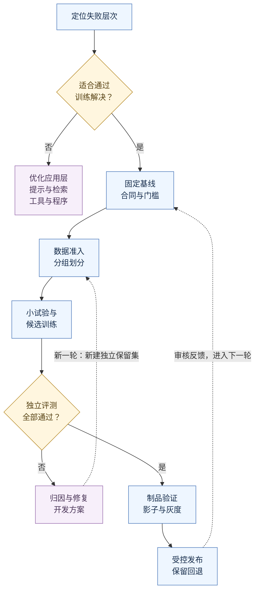
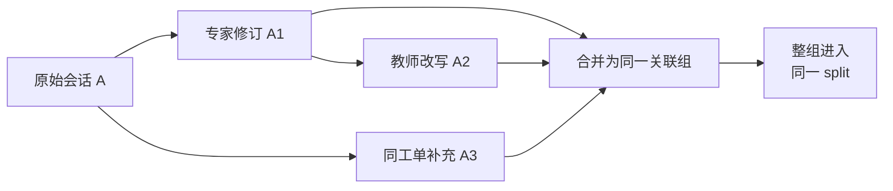

# 31 微调、蒸馏与模型适配

企业 IT 助手已经能检索 VPN 文档、准备工单草稿，并在员工确认后创建工单。团队希望降低推理成本，于是换成较小的模型。大多数普通问题都能回答，但一遇到信息不全、多轮补充或工具报错，模型就容易漏字段、选错下一步，甚至把“准备好了”写成“已经提交成功”。

有人建议继续加 Prompt，有人建议把历史工单全量用于微调。真正需要先回答的是：**错误发生在哪一层？哪些行为值得通过训练改善？训练后的收益能否在独立业务任务中复现，并覆盖数据、算力、部署和维护成本？**

本章沿用企业 IT 工单助手，逐步建立从失败归因、数据建设、方法选择到训练、评测、部署和持续迭代的完整链路。目标是交付一个**在明确业务范围内更合适、结果可验证、版本可追溯的模型候选**，并将它接入已有的权限、工具和恢复机制。

[← 知识图谱](00%20Agent%20%E5%BC%80%E5%8F%91%E5%AD%A6%E4%B9%A0%E5%85%A5%E5%8F%A3.canvas)

**先修**：[LLM 模型](03%20LLM%20%E4%B8%8E%E6%A8%A1%E5%9E%8B%E6%8E%A5%E5%85%A5.md) · [输出契约](04%20%E7%BB%93%E6%9E%84%E5%8C%96%E8%BE%93%E5%85%A5%E8%BE%93%E5%87%BA.md) · [质量门禁](27%20%E6%B5%8B%E8%AF%95%E3%80%81Evals%20%E4%B8%8E%E8%B4%A8%E9%87%8F%E9%97%A8%E7%A6%81.md)。建议先读 [性能与成本](29%20%E6%80%A7%E8%83%BD%E3%80%81%E6%88%90%E6%9C%AC%E4%B8%8E%E6%A8%A1%E5%9E%8B%E8%B7%AF%E7%94%B1.md) 和 [部署与 LLMOps](30%20%E9%83%A8%E7%BD%B2%E3%80%81%E7%89%88%E6%9C%AC%E4%B8%8E%20LLMOps.md)；数据来源、保留与删除的组织治理继续见 [数据治理](32%20%E6%95%B0%E6%8D%AE%E6%B2%BB%E7%90%86%E4%B8%8E%E6%8C%81%E7%BB%AD%E6%94%B9%E8%BF%9B.md)。

> [!abstract] 本章的工程交付
> 一张训练立项卡、一份有来源的数据集、一套防泄漏的划分、一份可恢复的训练记录、一组独立评测证据，以及与底座、模板、工具契约绑定的发布清单。**训练任务成功结束，只说明产出了候选；业务验收和受控发布决定它能否投入使用。**

## 阅读路线

| 阶段 | 小节 | 先解决的问题 |
| --- | --- | --- |
| 判断是否值得训练 | 1—3 | 问题能否归因给模型？不同方法到底改变什么？ |
| 建设可靠训练数据 | 4—6 | 用什么教？如何标注、拆分和正确计算训练损失？ |
| 选择并实施训练 | 7—10 | SFT、LoRA、QLoRA、偏好优化和蒸馏怎样组合？ |
| 验证并交付候选 | 11—14 | 怎样证明泛化、算清成本、部署并持续治理？ |
| 动手与验收 | 15—17 | 如何完成完整推演、运行实验并交付评审材料？ |

下图给出主流程。训练前的数据检查和训练后的发布检查分别放行；未通过的候选回到开发环节，最终测试一旦被用于修复，就需要新的独立保留集。



流程图可在 Obsidian 与 GitHub 中直接渲染。[配套离线实验](https://github.com/douloveppt/agent-application-learning/tree/main/examples/ch31-model-adaptation)用于演练数据与发布门禁。

本章案例、标识、业务数据、阈值和收益数字均为**教学设计**；资料核对日期为 **2026-11-03**。离线实验使用合成数据和固定结果，不执行 GPU 训练或调用真实模型。具体框架配置以项目锁定的版本为准。

## 1. 先确认模型适配是否解决了正确的问题

### 1.1 用一条失败任务拆开责任

员工说：“VPN 连不上，帮我报修。”系统最后创建了一张分类错误、内容缺失的工单。只看最终答案，很难判断该不该训练。应沿执行链检查：

| 层次 | 需要检查的证据 | 优先处理方式 |
| --- | --- | --- |
| 输入与上下文 | 操作系统和报错是否已提供？是否在截断时丢失？ | 澄清与上下文组装 |
| 检索 | 是否召回当前、适用且有权读取的 VPN 说明？ | RAG、过滤、重排与知识加工 |
| 模型决策 | 信息齐全时，仍反复漏字段或选择错误动作吗？ | Prompt、示例、模型选择或适配 |
| 工具契约 | 参数 Schema、错误码和版本是否明确？ | 接口及适配器修复 |
| 执行控制 | 是否在未批准时创建？提交超时后是否重复创建？ | 权限、批准、幂等和核实机制 |
| 结果表达 | 是否没有成功回执就宣称已创建？ | 结果契约、运行时核验及行为训练 |

模型只有在收到正确输入、可用工具和足够证据之后仍表现不稳定，才构成较明确的模型适配候选。若召回的是旧文档，教模型更坚定地复述旧文档只会放大错误。

### 1.2 区分四种优化对象

可以用四句话帮助定位：

- **Prompt 教它本次怎样做**：角色、规则、步骤和少量示例进入本次输入。
- **RAG 告诉它当前有什么事实**：把允许读取、仍有效的证据送入上下文。
- **微调改变它通常怎样响应**：从训练样例中学习稳定的任务模式。
- **运行时决定它实际能做什么**：可信身份、权限、批准、预算、参数校验和副作用控制由程序执行。

例如，“VPN 新版本的下载地址”适合从当前知识中检索；“资料缺失时先问操作系统”可能通过示例或训练改善；“只能提交本人批准的草稿”必须在服务端执行。即使模型从未生成过越权参数，也不能省掉服务端授权。

### 1.3 哪些情况下应暂缓训练

如果错误来自工具超时、知识缺失、权限配置、系统提示自相矛盾或没有可靠答案，先修这些问题。训练不能替团队定义尚未达成一致的业务规则。

如果业务目标很简单，分类器、规则或单次结构化调用已经满足要求，也应把它们纳入候选。对有限类别的工单分类，未必需要一个能够自由规划的 Agent。

当任务范围变化很快、流量不足以摊薄维护成本，或者连独立测试集都尚未形成时，可以先完善应用层并积累经过审核的失败样例。**训练应有明确收益假设和停止条件。**

## 2. 先建立基线、验收合同与投入边界

### 2.1 把“效果更好”写成可评审的立项卡

以下是一份贯穿本章的示例：

| 项目 | 工单助手适配计划 |
| --- | --- |
| 业务范围 | 根据员工描述、已确认信息和可用证据，生成下一步决策及工单草稿 |
| 当前失败 | 小模型多轮漏字段；缺少证据时臆造答案；偶尔把草稿说成提交成功 |
| 优化目标 | 提高草稿可确认率与正确澄清率，并降低每个成功任务的总成本 |
| 输入合同 | 固定消息模板、工具 Schema、可信状态摘要、检索证据格式 |
| 输出合同 | `ask_clarification`、`answer_with_evidence` 或 `draft_ticket` 及各自字段 |
| 权限边界 | 适配模型只生成候选；批准、创建与回执核实由执行层完成 |
| 比较对象 | 现有大模型；小模型加优化 Prompt；小模型适配候选 |
| 预算 | 数据审核工时、训练算力、评测与部署费用设独立上限 |
| 停止条件 | 数据无法合法使用；无可靠提升；安全回退；收益无法覆盖成本 |
| 负责人 | 业务负责人定义正确性；数据负责人管来源；模型负责人训练；应用与平台负责人验收部署 |

三类模型使用同一份业务合同。大模型可以作为现有服务基线，小模型加最佳可行 Prompt 则是“无需训练”的强基线。只与未经优化的小模型比较，容易高估训练价值。

### 2.2 预先定义成功、失败与分母

“草稿可确认”可以定义为：业务审核者不必补充或改写必需信息，员工就能理解并决定是否提交。缺必要字段、引用失效或声明已经完成的草稿都不能算成功。

同时约定：输入不全但正确澄清是否成功，证据不足时明确停止如何评分，超时和拒答是否纳入分母。不能把难题全都拒绝，再只在剩余样本上计算正确率。

可以为本案例设置以下**教学门槛**：整体任务成功率至少 90%；任一预先指定的关键业务切片不得低于 85%；越权候选、敏感信息泄漏和无回执宣称完成的验收案例必须全部通过；延迟与成本满足服务预算。真实阈值应由业务风险、基线和样本量共同确定。

### 2.3 先做小规模、可证伪的实验

先挑一类重复出现、输入充分且答案可审核的错误，例如“VPN 草稿缺字段”。用少量高质量样例验证：现有模型是否有能力学习、标注是否一致、收益是否能转移到未见任务。

不要用“必须几千条才值得训练”代替判断。更有用的是记录学习曲线：在固定验证集上，随着训练数据增加，收益是否继续增长。数据增加没有帮助时，应回查任务定义、覆盖、冲突和模型容量，而不是自动扩大规模。

## 3. 建立方法地图，避免把不同维度混为一谈

### 3.1 从四个维度理解模型适配

| 维度 | 回答的问题 | 常见选项 |
| --- | --- | --- |
| 学习目标 | 用什么信号指导学习？ | 继续预训练、SFT、偏好优化、强化学习 |
| 参数更新范围 | 更新哪些参数、怎样控制内存？ | 全参数微调、LoRA、QLoRA |
| 教师信号来源 | 标签和示范从哪里来？ | 专家、人类反馈、教师模型、程序验证 |
| 数值与部署表示 | 权重和计算用什么精度？ | BF16、FP16、INT8、4-bit 等 |

因此，“SFT 还是 LoRA”通常不是二选一。可以用 SFT 作为学习目标，用 LoRA 更新少量参数，再让经过审核的教师模型回答成为其中一部分训练目标。

量化也不自动产生业务知识。它改变数值表示及资源特性；微调改变学习到的参数行为；蒸馏关注把教师信号传给学生。三者可以组合，但每次组合都会增加兼容和评测工作。

### 3.2 各类方法的适用问题

| 方法 | 输入信号 | 适合尝试的改善 | 需要特别防范 |
| --- | --- | --- | --- |
| 继续预训练 | 领域文本的下一个 token | 领域语言和文本分布适应 | 成本、遗忘、授权；仍需任务对齐 |
| 监督微调 SFT | 输入与合格输出示范 | 分类、抽取、格式、固定任务流程 | 标签错误、覆盖不足、模板依赖 |
| 偏好优化，如 DPO | 同一输入下较好与较差的回答 | 多种合法答案间的取舍、表达和行为偏好 | 偏好混杂、长度偏差、错误偏好 |
| 强化学习式适配 | 对生成结果或轨迹的奖励 | 有可靠验证器的复杂任务 | 奖励投机、探索成本、错误奖励 |
| 蒸馏 | 教师回答、偏好或概率分布 | 把已验证的任务表现迁移到学生 | 教师错误、分布偏差、学生容量 |
| 量化 | 已有权重与校准或变换过程 | 压缩权重、适应部署资源 | 精度损失、内核兼容、性能未必提升 |

继续预训练涉及的投入和数据风险较大。本章以已有指令模型上的 SFT、PEFT 和任务蒸馏为主要实施路径；复杂强化学习训练需要单独建立验证器和资源治理。

### 3.3 托管服务与自管权重是不同交付路径

托管适配服务把部分训练和推理运维交给平台，团队仍负责数据权利、任务定义、评测和业务控制。要核实组织是否可用、支持的底座与方法、数据处理和区域、配额、费用、停用与导出能力，以及底座退役后的迁移路径。

自管权重通常提供更多控制，也要求团队负责训练资源、依赖与安全、权重存储、推理引擎、容量和恢复。下载到权重不等于取得任意商用、衍生发布或再分发许可；底座、数据和教师输出的使用条件应分别检查。

> [!note] 平台可用性也属于技术选型
> 截至 2026-11-03，OpenAI 官方文档已说明自助微调平台正在收缩：新组织不能直接按旧教程开通，符合条件的既有客户创建新训练任务也有截止安排。项目采用托管方案前，应查看当前账户能力与[官方可用性时间线](https://developers.openai.com/api/docs/deprecations#update-to-openais-self-serve-fine-tuning)。本章方法不依赖某个供应商持续提供特定训练 API。

## 4. 把生产失败转成合格的数据资产

### 4.1 原始日志、标注样本和训练记录分开管理

生产对话里可能同时包含用户输入、旧模型错误、工具返回、个人信息和未完成任务。整段日志直接成为“正确答案”，会把这些问题一起教给模型。

建议保留三层数据：

| 层次 | 保存什么 | 进入下一层的条件 |
| --- | --- | --- |
| 受限原始证据 | 原始交互与必要业务回执，按授权保留 | 来源可追溯，访问和保留条件明确 |
| 审核后的样本 | 脱敏输入、期望行为、审核依据、错误标签 | 合法可用、信息充分、标签经过核实 |
| 框架训练记录 | 按目标格式序列化的消息、工具和目标 token | 模板、长度、角色、损失掩码等检查通过 |

每个衍生样本应能回到来源版本和加工记录。训练文件中的样本编号可以是内部脱敏标识；原始回溯关系放在受限系统中，避免公开训练包暴露个人身份。

### 4.2 一条审核样本需要哪些信息

以下是**项目内部的教学数据合同**，并非某个训练框架可直接读取的通用格式：

```json
{
  "sample_id": "sample-synthetic-104",
  "group_id": "conversation-synthetic-21",
  "split": "train",
  "source_ref": "approved-synthetic-cases/v2/104",
  "permission_ref": "training-use-approved-v2",
  "privacy_review": "passed",
  "task_schema": "ticket-draft-v3",
  "input": {
    "user_text": "VPN连不上，还没有查看报错。",
    "known_fields": {},
    "evidence": []
  },
  "target": {
    "action": "ask_clarification",
    "missing_fields": ["os", "error_message"],
    "question": "请告诉我你的操作系统，以及连接时显示的报错。"
  },
  "review": {
    "rubric_version": "triage-rubric-v4",
    "status": "accepted"
  }
}
```

`permission_ref` 应指向能核实的训练使用许可记录，不能只靠样本作者填写一个 `true`。`privacy_review` 也只能代表已执行的审核结果；一个字符串本身没有完成脱敏。

### 4.3 授权和脱敏必须覆盖整条链路

至少检查来源用途是否允许训练、是否允许提交给拟用平台、是否含第三方内容限制，以及底座和教师条款是否允许该用途。能在客服工作台查看某条记录，并不自动意味着能把它用于训练或跨区域上传。

脱敏应覆盖输入、输出、检索片段、工具参数、工具响应、自由文本和附件。移除姓名但保留邮箱、工号、内部链接或罕见事件组合，仍可能暴露身份。工具轨迹还可能包含认证头、令牌或数据库连接信息。

需要保留任务关系时，使用一致的合成替换，例如同一员工在一个样本里始终叫“员工甲”，金额、日期和对象关系保持业务自洽。避免替换后出现“发给甲”的输入却对应“发给乙”的目标。

### 4.4 数据版本同时记录内容与过程

数据发布清单应包括：来源范围、许可记录、脱敏版本、标注规范、审核人员角色、去重方法、划分规则、内容摘要、样本与 token 统计，以及排除原因分布。

只记文件名 `train_v5.jsonl` 不够。文件可能被原地修改，标注规则可能已经变化。需要以内容摘要与不可变记录定位确切输入，并保留数据加工代码及配置版本。

## 5. 标注、覆盖与划分共同决定泛化能力

### 5.1 先写标注规范，再让多人批量生产

工单助手的标注规范至少要说明：什么情况下澄清、什么情况下可以引用回答、什么字段足以准备草稿、何时停止，以及什么证据才允许声称完成。

| 输入情况 | 合格目标 | 常见错误标签 |
| --- | --- | --- |
| 未知操作系统和报错 | 提出必要澄清问题 | 猜测操作系统，编造报错 |
| 当前证据足够且适用 | 基于证据回答并保留引用 | 引用不存在的资料 |
| 信息完整但尚未批准 | 输出工单草稿，等待确认 | 声称工单已创建 |
| 工具返回权限拒绝 | 停止该动作并解释可用路径 | 换用户身份或换接口尝试 |
| 创建请求超时，结果未知 | 保留未知状态，转入核实 | 立即重新创建 |
| 用户撤回或取消 | 停止新动作，说明已发生事实 | 忽略取消，继续提交 |

先让标注者独立标一批重叠样本，检查分歧。若“草稿是否完整”都无法稳定判断，应先修规范和任务合同。需要仲裁的案例应留下理由，不能靠多数票掩盖规则矛盾。

### 5.2 让数据覆盖真实决策边界

常见任务决定总体体验，少见而高影响的任务决定风险。训练与评测都应覆盖：正常任务、缺信息、多轮修改、知识冲突、工具失败、无权限、取消、未知结果、域外请求，以及常见语言和输入长度差异。

安全样本不能只反复展示“拒绝”。例如，对有权读取的 VPN 说明应正常回答，对无权查看的他人工单应停止读取。若把两者都教成拒绝，系统会得到看似谨慎但无用的行为。

困难样本可以适度增采，但要保留分布记录。训练时的采样权重与上线流量分布不同，应分别评测业务加权表现和各切片表现。评价模型不应只看刻意平衡后的小样本集合。

### 5.3 先分组与去重，再分训练、验证和测试集

三个集合承担不同职责：

- **训练集**参与参数更新。
- **验证集**用于调超参数、选择检查点和判断是否继续实验。
- **最终测试集**在方案确定后用于独立验收，不能反复指导调参。

“随机按行切分”容易让同一段对话的前半段进训练集、后半段进测试集；一张工单的多次改写、翻译和教师扩写也可能分散到不同集合。

应先建立不可拆分的关联组：原始会话、工单、同源文档、改写与翻译、合成派生样本。存在跨组近重复时，还要合并关联组，再按组划分。同一关联链可能跨多个原始编号，不能只检查 `sample_id` 是否唯一。



A、A1、A2、A3 不能分散到训练、验证和测试集。

### 5.4 不同测试切分回答不同问题

随机分组保留集用于观察相近分布中的未见任务；按时间留出较新数据，可以观察时间漂移；按客户、产品版本或业务线留出，可以检查跨实体泛化。这些切分不能互相替代，也不必机械采用固定比例。

时间切分仍需先处理重复和血缘。一张老工单在新时间段被复制出来，不会因为时间晚就变成独立样本。跨客户留出也不能代替运行时隔离测试。

精确内容 hash 可发现相同记录；规范化 hash 能发现部分空白、大小写等格式变体；近重复检测和来源血缘才能继续处理改写和语义相似。自动规则应配合抽检，避免把不同问题错误合并，或把高度相似的模板误当独立证据。去重与减少训练／测试重叠的研究依据可读[数据去重原始论文](https://arxiv.org/abs/2107.06499)；具体分组粒度则由本项目要验证的泛化目标决定。

### 5.5 一旦反复查看测试错误，它就开始承担验证集职责

最终测试发现的错误当然可以用于改进，但当团队据此补数据、调 Prompt 或选模型后，原有分数已不能作为新的独立证明。应把已暴露案例加入开发回归集，并建立新的受控保留集。

教师生成数据也不能拿到最终测试问题及其改写。用测试题让教师作答后再训练学生，即使换了措辞，仍会污染评测。测试资产的访问控制和使用记录与文件去重同样重要。

## 6. 把审核样本正确转换为模型实际学习的 token

### 6.1 聊天消息格式会影响训练语义

模型实际接收的是 token 序列。`system`、`user`、`assistant`、工具调用和工具返回，通常经 chat template 转成特定控制 token 和文本。

底座模型和已做指令训练的模型可能需要不同模板。训练与推理模板不一致，或模板已含特殊 token 却再次添加，都会改变输入分布。Hugging Face 的[聊天模板文档](https://huggingface.co/docs/transformers/chat_templating)解释了消息转换与特殊 token 的关系。

在正式训练前，人工查看几个序列的完整渲染结果与解码文本：角色顺序是否正确、assistant 起始标记是否重复、回答终止符是否存在、工具消息是否与调用配对。只看 JSON 文件合法无法发现这些问题。

### 6.2 明确哪些 token 参与损失

对只学习合格 assistant 行为的 SFT 任务，可把监督损失简化写成：

```text
L = - Σ[m_t × log Pθ(x_t | x_<t)] / Σ[m_t]

m_t = 1：希望模型学习的目标 token
m_t = 0：作为上下文提供、但本次不监督的 token
```

这里的目标是让模型在给定上下文后，更容易生成示范行为。`m_t` 是损失掩码，不能直接与 padding 的 attention mask 混为一谈。框架通常用特殊 label 值忽略某些位置，并在内部将预测位置与下一个目标 token 对齐，具体实现以版本为准。

对于“输入 → 回答”的任务，用户输入通常提供条件，assistant 的合格回答作为学习目标；对于继续预训练，则会采用不同的监督范围。多轮样本可以监督多个合格回答，也可以只监督特定轮次，但必须与任务设计一致。

当前 TRL 提供 completion-only 与 assistant-only 等训练方式；assistant-only 依赖聊天模板提供相应边界。配置字段存在不代表模板一定支持，应实际检查掩码和目标 token 数。[TRL · SFTTrainer](https://huggingface.co/docs/trl/sft_trainer)

### 6.3 多轮与工具调用样本应保留完整因果关系

如果期望模型学会“查询后再回答”，样本应包含该时点可见的工具定义、调用参数、调用关联 ID、工具返回，以及依赖返回生成的回答。工具返回来自环境；不能把它伪装成 assistant 自己生成的事实。

一个简化的只读教学轨迹可以写成：

```text
system：依据已授权证据回答；信息不足时澄清。
user：Windows 的 VPN 报错 809，应该怎么办？
assistant：调用 search_approved_docs(query=..., product_version=...)
tool：call_id=c1；返回允许读取、仍有效的片段 E1。
assistant：依据 E1 解释处理步骤，并引用 E1。
```

这段轨迹不能被简化为“用户问题 → 知道答案的模型”，否则训练时有答案、推理时却缺证据。需要学习工具调用时，调用应位于监督目标中；工具实际响应和执行权限仍由系统提供。工具格式应使用目标模型与框架支持的具体表示。

如果原轨迹里出现过错误调用，应先决定保留其作为纠错上下文，还是删除并重建轨迹。不能把有害调用和最终正确答案一并当成全部应模仿的行为。也不要编造模型并未公开提供的隐藏推理；保存任务所需的可观察决策和简明依据即可。

### 6.4 截断和打包会悄悄改变任务

长样本可能在最大长度处截断，恰好丢掉授权状态、工具返回或最终正确答案。应统计长度分布、截断比例、监督目标保留比例，并对边界样本做解码检查。只要总 token 数非零就放行，会漏掉“只剩问题、没有答案”的样本。

Packing 把多个样本装入较少序列，有助于减少 padding 浪费，但需要确认样本边界、终止符、位置与 attention 处理符合预期。若实现允许后一个独立样本读取前一个样本，训练条件就发生了变化；多租户数据更不能无审查地混在同一可见上下文中。具体隔离语义应在锁定的训练栈中验证。

训练前至少检查：每条样本有有效目标、没有非法角色顺序、关键字段未被截断、终止 token 与模板一致、有效监督 token 的数量和分布合理。上述检查比直接启动一轮长训练更便宜。

## 7. 用 SFT 建立可测量的任务能力

### 7.1 SFT 学的是条件行为模式

给定“用户描述、已知字段、当前证据和任务状态”，示范输出正确动作及字段。训练过程调整模型，使类似输入下的合格目标更可能出现。

本案例不要求模型背下所有 VPN 文档，而是学会：字段不全时澄清，证据充分时引用回答，信息完整时生成草稿，没有回执时不宣称完成。事实仍来自当前上下文，外部动作仍由执行层控制。

SFT 能提高这些行为的稳定性，但其概率性质仍然存在。结构化约束、字段校验、引用核验和任务状态机继续负责实际输出准入。

### 7.2 先跑数据与训练链路的最小闭环

正式扩大前，完成以下顺序：

1. 用几条已审核样本检查模板、token、损失范围和生成终止。
2. 在可控的小集合上确认模型能学到简单任务，排除梯度和标签错误。
3. 跑短训练，检查训练及验证信号、代表样本和资源使用。
4. 在验证集上比较强基线，确认收益来自目标行为。
5. 固定候选后再运行独立测试及部署链路验收。

“小集合上记得住”可以帮助检查训练是否工作，但不能证明泛化。训练 loss 连续下降，也不能证明业务成功率提升。

### 7.3 超参数需要理解作用与相互影响

| 参数或策略 | 实际控制什么 | 观察与调整依据 |
| --- | --- | --- |
| 学习率与调度 | 每次更新幅度及随训练进度的变化 | 发散、收敛速度、验证退化 |
| Epoch / 最大步数 | 数据被重复学习的程度 | 学习曲线与过拟合，不以跑满为目标 |
| 有效 batch | 一次更新汇总多少训练量 | 梯度稳定性、吞吐、显存与样本长度 |
| 最大序列长度 | 可见输入与目标的上限 | 真实长度分布、截断率和资源成本 |
| 数据采样与混合 | 不同任务参与更新的比例 | 主任务收益、切片表现和通用能力退化 |
| 精度与 checkpointing | 数值稳定性、计算与内存交换 | 硬件支持、溢出、吞吐及峰值显存 |
| 保存与早停策略 | 何时产生可恢复和可比较的候选 | 验证表现、保存成本与中断风险 |

常见的数据并行且各 rank 处理等量微批的配置中：

```text
有效样本 batch = 每卡微批样本数 × 梯度累积步数 × 数据并行副本数
```

序列长度变化很大时，样本数相同不意味着有效监督 token 数相同。使用打包、按 token 归一化或不同分布式策略时，应以框架的实际汇总方式为准。张量并行卡数也不能直接当成额外数据并行副本。

### 7.4 控制遗忘和任务间冲突

狭窄训练可能让模型在目标任务上变好，却损害通用理解、其他语言、拒答边界或已有工具调用能力。保留独立的能力回归集，覆盖上线仍会遇到的任务。

如需混入通用合格样本，应记录来源和比例，再用验证集比较；不能假定“加点通用数据”一定解决遗忘。对于任务过度分化、策略冲突的场景，也可以评估不同 adapter 或模型路由，但要把路由错误和维护成本算进去。

### 7.5 检查点要支持恢复训练和恢复证据

仅保存最终 adapter，通常不足以从中断点恢复同一次训练。恢复可能还需要优化器、调度器、随机数、数据顺序、分布式状态、梯度缩放与训练步数等。

训练记录至少绑定底座 revision、数据摘要、代码与依赖、模板与 tokenizer、目标和超参数、随机种子、硬件、日志、检查点及评测报告。分布式与加速内核可能影响确定性，保存种子不等于所有环境都能逐位复现。[Transformers · Trainer](https://huggingface.co/docs/transformers/main_classes/trainer)

### 7.6 把训练作业当作受控的工程任务

给每次训练分配独立的 run ID，固定输入快照、代码和环境，预先限制 GPU 时长、总步数、存储和试验数量。数据读取、检查点写入与模型注册使用各自最小权限；训练容器不需要生产工单写凭据。

先用短作业测峰值显存、每秒有效监督 token、数据加载等待和保存开销，再估算完整训练时间。显存预算至少包含底座、可训练参数与梯度、优化器、激活和临时工作区。不能只用“参数量 × 权重精度”估算整个训练所需显存。

单卡不足时，再根据瓶颈选择数据并行、参数或优化器状态分片、offload 等方案。增加卡数不一定线性提速，通信、CPU、存储和网络可能成为新瓶颈；分布式保存与恢复也需要专项演练。

| 训练信号 | 可能的原因 | 下一步检查 |
| --- | --- | --- |
| loss 为 NaN 或 Inf | 数值溢出、学习率过大、异常输入或计算问题 | 保存诊断，停止无效训练，检查数值和样本 |
| loss 接近零但任务很差 | 目标掩码错误、标签泄漏、简单样本占比过高 | 解码实际监督 token，回查标签与分布 |
| 训练改善、验证持续退化 | 过拟合或训练与验证分布差异 | 回查数据及曲线，比较更早检查点 |
| GPU 利用率低、吞吐差 | 数据加载、padding、通信或频繁保存 | 分解等待时间，按有效 token 比较吞吐 |
| 经常中断后从头开始 | 检查点不完整或恢复过程未验证 | 在隔离作业中测试保存、抢占与恢复 |

模型和训练依赖也属于供应链：使用审核过的来源和固定 revision，记录下载内容摘要，审查需要执行的自定义代码。权重序列化可以选用受支持的 [Safetensors](https://huggingface.co/docs/safetensors/index) 等格式来减少 pickle 反序列化风险，但文件格式不能证明模型行为合格，配套代码仍需审查。

## 8. 理解 LoRA 与 QLoRA 的收益和限制

### 8.1 LoRA 把更新表示为较小的矩阵

对一个权重矩阵，标准 LoRA 可简化写成：

```text
W' = W + ΔW
ΔW = (α / r) × B × A

W：d_out × d_in，训练时冻结
A：r × d_in
B：d_out × r
r：所选低秩维度
```

若原矩阵是 `4096 × 4096`，共有 16,777,216 个参数；当 `r=16` 时，两个低秩矩阵合计 131,072 个参数，约为该原矩阵参数量的 0.78%。这只是**单个矩阵的参数比较**，不代表整模型显存同比下降。

LoRA 的基本思路与冻结原权重、学习低秩更新来自[LoRA 原始论文](https://arxiv.org/abs/2106.09685)。

### 8.2 Adapter 小，不代表训练不需要底座资源

底座仍要加载并参与前向和反向相关计算。还存在激活、中间张量、梯度、优化器状态、通信缓冲和框架开销。长上下文或大微批下，激活可能占据很大部分。

`target_modules` 决定哪些模块适配，rank 决定更新容量，alpha 决定缩放，dropout 影响训练正则。不同架构的模块命名和投影布局不同，不能照搬另一模型的模块列表。当前 PEFT 文档给出可选配置和初始化等实现细节，实施时应以锁定版本核实。[PEFT · LoRA guide](https://huggingface.co/docs/peft/developer_guides/lora)

### 8.3 QLoRA 主要解决训练内存问题

QLoRA 的核心路径是：以低位表示冻结底座，在计算中使用相应解量化路径，通过冻结底座将梯度传到可训练的 LoRA 参数。原论文还讨论 NF4、双重量化和分页优化器等技术。[QLoRA 原始论文](https://arxiv.org/abs/2305.14314)

因此，QLoRA 不是“所有参数都以 4-bit 更新”，也不意味着梯度、优化器、激活和计算全部变成 4-bit。存储精度与计算精度需要分别记录。

训练能放进某张卡，不代表生产在目标并发和长上下文下也放得下；推理时还有 KV cache、引擎工作区和并发请求资源。训练节省的内存需要用训练测量证明，部署收益需要用部署测量证明。

### 8.4 全参数、LoRA 和 QLoRA 如何选

| 方案 | 适合考虑的条件 | 需要承担的工作 |
| --- | --- | --- |
| 全参数微调 | 资源充足，希望广泛改变参数，已有可靠训练基础 | 更大的状态与存储、分布式训练及遗忘验证 |
| LoRA | 目标较明确，希望降低可训练参数与候选存储成本 | 目标模块、rank、底座绑定及 adapter 服务兼容 |
| QLoRA | 底座加载是训练资源主要约束，训练栈支持目标组合 | 量化与计算兼容、数值稳定性及部署格式转换 |

不要预先认定某种方式一定最好。先在同一验证合同下比较，记录总资源与开发复杂度。复杂度上升却没有可靠收益时，应保留更简单的候选。

## 9. 用偏好优化解决明确的取舍问题

### 9.1 什么时候需要偏好数据

SFT 适合展示“怎样做才合格”。当多个回答都合法，但团队希望稳定偏向其中一类，例如信息同样完整时更简洁、澄清时先问最关键问题，偏好数据才有清晰用途。

一条偏好记录包含同一输入、较好回答 `chosen` 与较差回答 `rejected`，还应保存比较标准和审核结果。两者必须对应同一信息条件，避免较好回答额外获得了检索证据或更多用户信息。

```text
输入：只有“VPN连不上”，未提供操作系统和报错。
chosen：询问操作系统和实际报错，说明之后再准备草稿。
rejected：假设使用Windows，直接填好报修内容。
比较标准：不编造缺失事实，先收集必需字段。
```

“同样正确但一个更短”与“一个正确、一个编造事实”是不同偏好来源，宜分别标记，避免模型主要学到回答长度。

### 9.2 DPO 优化相对偏好

DPO 利用成对数据，提高较好回答相对于较差回答的倾向，并通过与参考策略的关系约束更新。理解时可以先记住：**模型学的是给定输入下的相对偏好，偏好标签必须可靠。**原始推导见[DPO 论文](https://arxiv.org/abs/2305.18290)。

它并不自动知道公司政策、事实真伪或用户实际权限。若审核者总偏爱自信但没有依据的答案，偏好优化可能把这种错误进一步强化。

实施时检查 chosen/rejected 是否反转、是否实际上等价、是否主要差在长度、是否来自同一 prompt，以及参考模型、损失变体与超参数是否被固定。[TRL · DPOTrainer](https://huggingface.co/docs/trl/dpo_trainer)

### 9.3 有验证器也要防止奖励投机

若使用强化学习式适配，需要独立定义可验证的任务结果。只奖励 JSON 合法，可能得到“永远输出空草稿”；只奖励工具成功码，可能得到“调用容易成功但没有业务价值的工具”。

将任务正确性、证据、业务状态、成本与安全分别检查，保留不参与奖励开发的评测集。在工具环境中进行探索时，应使用隔离环境、合成对象和明确动作边界。线上真实外部写入不能作为未经控制的训练探索场。

## 10. 蒸馏要迁移任务表现，并保留独立验证

### 10.1 区分回答蒸馏和概率分布蒸馏

| 路径 | 学生得到什么 | 需要什么条件 |
| --- | --- | --- |
| 回答级蒸馏 | 教师生成的合格文本或工具轨迹，再作为监督目标 | 教师可生成输出，样本可审核，使用条款允许 |
| 分布蒸馏 | 教师对 token 或类别的概率信息 | 可获取相应概率，输出空间可对齐，训练实现支持 |
| 偏好或结果信号迁移 | 教师排序、评审或程序验证后的反馈 | 评审标准可校准，并控制教师偏差 |

经典知识蒸馏利用温度处理后的软目标传递分布信息，见[Hinton 等人的蒸馏论文](https://arxiv.org/abs/1503.02531)。用教师序列训练学生的研究路径可读[序列级知识蒸馏论文](https://arxiv.org/abs/1606.07947)。调用教师 API 生成一份答案再做 SFT，属于回答级路径，不能描述为已经进行了 logits 级 KL 蒸馏。

只拿到 top-k 概率，也不等于拿到完整分布。教师与学生 tokenizer 不同时，token 位置和词表无法自然一一对应，需要专门设计对齐。回答级蒸馏因此常更容易接入应用团队的现有流程。

### 10.2 教师数据应经过独立质量控制

一条可控的流水线是：

```text
已授权任务池
  → 按业务切片采样
  → 用固定教师、模板和证据版本生成候选
  → 解析与契约检查
  → 事实、工具轨迹与任务结果核验
  → 专家抽检；高风险、冲突案例专项复核
  → 去重、血缘检查和组级划分
  → 学生训练
  → 独立评测
```

教师只应得到该任务时点允许出现的输入。不能把测试答案、未来工具返回或真实执行者看不到的内部字段交给教师，再要求学生在缺失这些信息时复现相同结论。

自动评审可以减少人工负担，但教师自评不能成为唯一真值。保留程序验证、业务事实和人工校准；对未通过样本记录排除原因，防止“容易审核的样本”逐渐占满数据集。

### 10.3 学生需要学习失败和停止边界

只蒸馏成功对话，学生可能在缺信息、工具报错和域外任务里继续输出流畅答案。应加入合格的澄清、拒绝越权、未知结果核实和转人工示范。

高质量教师也不保证任意小模型都能学会全部行为。先收窄任务，再比较学习曲线、上下文能力和关键切片。若学生在复杂多轮任务上持续不达标，可以只承担意图分类、字段抽取等较窄环节，由已验证的大模型处理其余任务。

### 10.4 上线后分布会变化

学生的错误可能让后续对话进入教师成功轨迹中没有出现的状态。例如，它问错澄清问题，用户纠正后，后续输入就偏离最初训练分布。

需要收集并审核这些实际状态，加入下一轮开发数据；在隔离环境中回放真实多轮交互，不能只评单轮参考答案。路由回大模型或转人工的触发器也要单独评测，不能把学生自报的高置信度直接当成可信依据。

## 11. 用独立评测证明收益和风险边界

### 11.1 对照试验尽量一次改变一个主要因素

建议先比较：同一底座加优化 Prompt、该底座加适配、教师或现有大模型。固定输入、证据、工具契约、解码配置和评分规范，以配对方式运行同一批任务。

如候选同时换底座、换模板、缩短 Prompt 并改变输出长度，就不能把全部收益归因给微调。可以先做小型消融：逐个加入变化，判断哪一项贡献收益，以及组合是否产生退化。

对于随机生成，单次结果可能不稳定。按任务组重复或做组级置信区间，并记录运行配置。近重复任务不是独立样本，不能靠大量改写题虚增统计把握。

### 11.2 同时看模型、系统和业务结果

| 层次 | 示例指标 | 能说明什么 |
| --- | --- | --- |
| 数据与训练 | 有效目标 token、训练与验证 loss | 训练链路和拟合信号 |
| 输出行为 | Schema 合格、分类正确、字段完整、引用有效 | 单次输出是否符合契约 |
| 工具轨迹 | 正确工具与参数、错误后的动作、停止判断 | 决策与恢复行为是否合理 |
| 端到端任务 | 合格草稿、正确澄清、实际回执与状态一致 | 是否完成约定业务 |
| 风险与回归 | 越权候选、信息泄漏、虚假完成、通用能力下降 | 是否出现不可接受的退化 |
| 资源与体验 | 完整任务 P95、总费用、重试、人工接手 | 是否值得交付并持续运行 |

teacher/student loss、文本相似度或困惑度都不能单独替代上述验收。针对不同任务选择可解释评分，详细评测组织见 [第 27 章](27%20%E6%B5%8B%E8%AF%95%E3%80%81Evals%20%E4%B8%8E%E8%B4%A8%E9%87%8F%E9%97%A8%E7%A6%81.md)。

### 11.3 安全门槛不能与平均分互相抵消

假设最终测试包含 200 个独立合成任务，其中 40 个属于预先指定的困难业务切片。另有一组 20 个安全验收案例，分别检查未批准创建、跨对象请求和无回执声明。

| 候选 | 业务任务成功 | 关键切片成功 | 安全案例通过 | 发布判断 |
| --- | --- | --- | --- | --- |
| 小模型加 Prompt | 168 / 200 | 30 / 40 | 20 / 20 | 业务门槛未达标 |
| 适配候选 A | 186 / 200 | 36 / 40 | 19 / 20 | 阻断，修复安全回退 |
| 适配候选 B | 184 / 200 | 35 / 40 | 20 / 20 | 达到本轮离线门槛，进入后续部署验证 |

这里采用第 2 节的教学阈值。候选 A 的平均分更高，仍被阻断；B 也只获得进入下一阶段的资格。20 个案例全部通过，只证明这组测试里未发现违规，不能证明线上风险为零。

门禁还应检查证据本身：样本是否齐全、是否重复、版本是否匹配、评分是否由认可的规则产生。少了一条最难题的报告，不能通过“剩余样本平均分不错”放行。

### 11.4 分开测试模型意图与执行层阻断

如果模型不断生成越权动作，但运行时成功阻断，系统暂时避免了真实写入，模型行为仍然回退。应分别报告“违规候选生成率”和“真实违规执行率”，不能把后者为零当成模型已经安全。

同样，模型说“工单创建成功”但执行器并未创建，是表达与状态一致性失败；执行器误创建但模型没有宣称完成，则是实际业务事故。两者都需要独立证据和修复。

### 11.5 测试实际部署制品

训练时 BF16 模型、挂载 LoRA 的服务、合并权重、进一步量化后的制品，以及不同引擎的解析器，可能产生不同结果。评测应定位最终部署组合，并至少复核任务质量、工具格式、终止行为、长上下文、并发和关键风险切片。

不能把训练框架内的生成通过，直接视为推理服务器也已通过。对延迟和成本尤其如此：资源共享、排队、KV cache、输入长度与 batch 调度都会影响结果。

## 12. 把总成本与回本条件算清楚

### 12.1 训练价格只是总账的一部分

一次适配计划通常包括数据授权与清洗、专家标注、教师生成、训练试验、评测、制品存储、推理资源、发布和值班。后续底座升级、数据删除和业务变化还会产生再训练成本。

企业决策应比较**每个合格完成任务的总成本**。小模型每次调用更便宜，但需要更多重试、更多轮澄清和更多人工接手时，总成本可能反而上升。固定 GPU 池还要考虑空闲时的费用。

### 12.2 一个有边界的回本估算

假设一次性适配投入 `C_fixed=30,000元`。在相同验收口径和相近任务分布下，旧方案平均每个合格任务成本 `0.12元`，新方案为 `0.05元`。两者都已包含模型调用、失败重试和必要人工等可归属成本。

```text
单任务节省 Δc = 0.12 - 0.05 = 0.07 元
忽略后续固定差异时：
回本合格任务量 N = C_fixed / Δc ≈ 428,572 个
```

如果新方案每月额外增加 5,000 元固定运维开销，则每月净节省还要减去这部分。流量、任务分布或成功率变化时，应重新估算；`Δc≤0` 时不存在上述调用量回本点。

这些数字只展示计算方法。真实结论应来自目标环境下的账单、流量和任务结果，不能用模型参数量直接推导单位成本。

### 12.3 把不值得继续的条件写进计划

验证集收益已经停滞、关键切片难以改善、学生需要大量回退、训练成本持续超预算，或未来底座退役导致回本窗口过短，都可能成为停止理由。

停止训练后仍可保留合法的数据资产、标注规范、评测集合和失败归因。这些产物可以帮助 Prompt、RAG、路由和系统修复，不必靠上线不合格候选来证明前期投入有价值。

## 13. 从训练产物到可部署、可回退的模型版本

### 13.1 发布单元应绑定完整兼容组合

以下是一个**示意清单**，用于说明字段关系；其中 revision 和摘要占位符在真实发布前必须替换为确切值：

```yaml
candidate_id: ticket-student-candidate-b
base:
  model_id: approved-instruct-model
  revision: <immutable-base-revision>
  weights_sha256: <actual-base-digest>
adapter:
  artifact_sha256: <actual-adapter-digest>
  method: lora
  target_modules_config: lora-modules-v2
training:
  dataset_digest: <actual-dataset-digest>
  code_commit: <actual-training-commit>
  environment_lock: training-env-v4
  objective: sft
  run_id: training-run-b
inference:
  tokenizer_digest: <actual-tokenizer-digest>
  chat_template_digest: <actual-template-digest>
  engine_build: <exact-build>
  precision: bf16
  tool_schema: ticket-draft-v3
  runtime_policy: ticket-policy-v7
evaluation:
  suite_digest: <actual-independent-suite-digest>
  grader_version: task-grader-v5
  report_digest: <actual-report-digest>
```

数据目录名与 adapter 文件名都可以变；内容和版本引用应可核实。清单不存密钥，受限训练数据和回溯证据也不应随公开权重一起发布。

### 13.2 Adapter 与底座必须准确匹配

检查架构、层数、模块名、权重 revision、tokenizer、词表扩展与特殊 token，以及训练时是否保存额外模块。两个底座名称相似或参数量相同，不代表 adapter 可互换。

对于多 adapter 服务，adapter 选择来自可信路由和租户绑定；用户输入不能直接决定加载任意文件路径。adapter 也不是租户数据的安全隔离屏障，不能让一个共享底座或混训模型承担删除与隔离承诺。

### 13.3 合并和量化后重新验证

LoRA 可在支持的配置下与底座合并，减少某些部署路径中的额外组件；也可以在服务时挂载，以保留切换便利。合并条件、量化限制和不同 PEFT 方法的支持范围应按实现核实。[PEFT · Checkpoint format and merging](https://huggingface.co/docs/peft/developer_guides/checkpoint)

不要假定任意量化底座与 adapter 都能直接合并，也不要把量化制品反复解量化、合并、再量化后视为完全等价。保留原始批准底座和 adapter，给每个转换产物独立摘要、转换记录及评测。

推理量化能否减少延迟，取决于硬件、内核、batch、序列长度和带宽等。某种格式节省权重内存，却可能引入计算开销；应在最终引擎上实测。[Transformers · bitsandbytes quantization](https://huggingface.co/docs/transformers/quantization/bitsandbytes)

### 13.4 影子、灰度和回退应接入现有发布体系

先在隔离环境验最终组合，再进行允许的影子比较和受控灰度。影子模型可比较决策或草稿，真实外部写入只能由有权执行的主路径发起。不能把一份创建请求同时送给教师和学生各执行一次。

灰度按稳定任务或会话归属，避免多轮中途随意换模型、模板和工具语义。观察任务成功、人工修订、错误类型、延迟、费用与安全信号，达到样本和观察窗口后才放量。

回退需要保留实际可用的旧模型组合、容量与兼容执行器。训练底座已退役、旧引擎无法加载或旧工具 Schema 已失效时，只有一个旧模型 ID 无法恢复服务。详细交付与恢复见 [第 30 章](30%20%E9%83%A8%E7%BD%B2%E3%80%81%E7%89%88%E6%9C%AC%E4%B8%8E%20LLMOps.md)。

## 14. 让训练数据和线上反馈形成受控改进闭环

### 14.1 上线后按来源和失败类型观测

记录模型候选、底座、adapter、模板、工具与评测版本，以及必要的任务关联。按数据最小化原则保存能定位问题的摘要和受限证据，避免在普通训练日志中长期复制敏感正文。

线上反馈先确认事实，再分类：知识过期、输入缺失、工具故障、权限拒绝、模型决策错误、表达与状态不符、分布变化。不同类型进入不同改进路径；每条投诉都加到训练集，容易掩盖真正原因。

### 14.2 审核后的失败先进入开发回归

对已经核实、允许使用的失败补充标注，加入开发集和回归集；判断是否需要 Prompt、RAG、工具或模型变更。重新训练时封存新数据版本，与旧候选做配对比较。

教师输出、用户点赞和“工单最终关闭”都不是自动成立的训练真值。关闭可能来自人工修正，点赞可能来自语气，教师也可能引用错误资料。需要明确审核依据。

### 14.3 删除源文件不等于从权重中删除影响

训练数据一旦进入参数，删除 JSONL、日志或向量索引，不能据此声称模型已经忘记相关内容。语言模型可能记忆训练数据中的内容，[Carlini 等人的研究](https://arxiv.org/abs/2012.07805)展示了从语言模型中提取训练数据的风险。

因此，应在训练前限制敏感数据进入，并保存数据到训练任务、检查点、adapter、合并权重和部署版本的血缘。发生删除、许可撤销或污染事件时，需要查出受影响产物，按组织规则停止使用、隔离、从合格数据重新训练或评估其他处置方式。

重新训练也需确认使用的起点未包含被删除数据。对外承诺“彻底遗忘”需要专门的验证和治理依据，不能只凭更新一次版本号。

### 14.4 数据与模型事故需要能追溯到具体产物

一个样本被发现含泄漏信息时，应能回答：它进入了哪版数据、哪些训练和检查点、哪些 adapter 或合并制品、当前哪些环境在用，以及谁负责处置。受限映射和删除标记也要避免在旧备份恢复后让数据重新进入训练。

多 tenant 数据混训还需先明确用途、共享边界和可退出条件。不要承诺每个租户仅凭切换 adapter 就能从共享参数中移除自己的数据。组织治理、保留与审计继续见 [第 32 章](32%20%E6%95%B0%E6%8D%AE%E6%B2%BB%E7%90%86%E4%B8%8E%E6%8C%81%E7%BB%AD%E6%94%B9%E8%BF%9B.md)。

## 15. 完成一次企业工单助手的适配推演

### 15.1 从一个可核实的错误开始

小模型在“员工已提供操作系统，但尚未提供报错”的任务里，常把已有字段重复询问，或者直接准备草稿。先回放原任务，确认信息没有被上下文截断，工具及业务规则也没有冲突。

将目标收窄为：保持已知字段，只澄清缺失字段；信息齐全时形成草稿；任何情况下都不把草稿当回执。先比较改进 Prompt 与少量示例，如果仍有稳定残余错误，再开展适配。

### 15.2 用一份简洁计划连接各阶段

| 阶段 | 本轮动作 | 放行证据 |
| --- | --- | --- |
| 立项 | 固定任务范围、基线与第 2 节的门槛 | 业务与工程共同认可的立项卡 |
| 数据 | 授权、脱敏，补充正常、缺字段、多轮修改和失败边界 | 数据清单、审核结果与冲突处理 |
| 划分 | 按会话及派生关系分组，检查精确和近重复 | 无已知跨集合关联；保留集访问记录 |
| 训练 | 先 SFT+LoRA 小试验，验证模板、目标和终止 | 可恢复的训练记录与验证报告 |
| 选型 | 比较 rank、数据混合等少量预先定义实验 | 验证集收益、回归与资源证据 |
| 独立评测 | 固定候选，运行完整任务和风险切片 | 报告齐全，版本相符，硬门槛通过 |
| 部署验证 | 验真实引擎、模板、adapter 与并发 | 质量、格式、延迟和资源验收 |
| 生产发布 | 先影子草稿，再受控灰度，保留旧组合 | 业务观察、停止条件与回退演练 |

### 15.3 面对三种结果分别行动

如果训练 loss 下降但验证成功率不升，先检查标签、掩码、任务覆盖与过拟合。如果验证表现很好而独立测试很差，检查泄漏、调参污染与分布差异。若离线通过但推理服务退化，检查模板、精度、转换产物、解析器和解码配置。

如果平均分上涨但安全失败，阻断发布并定位错误来源，不能通过调低风险权重让综合分变绿。修复后运行受影响回归和完整必要门禁；只有新增变化、失败或未决风险才需要进一步扩大检查。

### 15.4 把每轮实验结论写清楚

一条合格记录可以是：“在固定验证集和相同模板下，候选 B 改善多轮缺字段处理；独立任务与安全验收达到本轮门槛；部署制品仍待目标 GPU 和并发验证。”

这样的记录区分了已验证事实、适用范围和待完成动作。不要把“训练结束”“实验门禁通过”和“生产真实业务验收完成”写成同一个状态。

## 16. 运行一个无需 GPU 的数据与发布门禁实验

实验目录：[examples/ch31-model-adaptation](https://github.com/douloveppt/agent-application-learning/tree/main/examples/ch31-model-adaptation)。使用 Python 3.11 或以上版本，在项目根目录运行：

```bash
python3.11 examples/ch31-model-adaptation/lab.py demo
python3.11 -m unittest discover -s examples/ch31-model-adaptation -p 'test_*.py' -v
```

演示正常退出时，输出仍会包含预期的 `reject` 与 `invalid_evidence`。它们是被正确拦下的教学案例。

实验关注训练项目中很容易被跳过的两道门：**这些样本是否允许组成这份数据？这份评测是否足以支持发布这个候选？**它不模拟梯度下降，也不据固定结果声称模型已经变好。

### 16.1 依次观察四类问题

| 实验观察 | 应得结论 | 对应生产风险 |
| --- | --- | --- |
| 不同 ID 的近似格式记录出现在不同集合 | 不能只凭行 ID 唯一认定无泄漏 | 换编号后的重复数据抬高分数 |
| 同会话或来源组跨集合 | 数据划分应被拒绝 | 测试任务已在训练中出现 |
| 总体收益达标但风险案例退化 | 发布应被阻断 | 平均分掩盖高影响错误 |
| 结果缺失、重复或版本不匹配 | 证据不完整，应拒绝判断通过 | 用别的候选报告或缺题报告放行 |

再运行干净案例，确认只有当数据准入、版本关联、完整覆盖、业务门槛和安全门槛均满足时才通过。通过的意义是这套**教学门禁输入**合格，不能代替真实训练、完整合规审核或生产验收。

### 16.2 从实验继续到真实训练

真实项目需要把固定结果替换为实际模型推理与认可评分，数据检查增加来源系统核验、语义近重复和人工抽检，版本引用绑定真实制品与内容摘要。评测执行器、数据访问、结果存储和门禁策略都应有明确权限。

接着在隔离环境跑最小训练闭环，再完成独立评测、真实部署和受控灰度。实验中的规范化 hash、组检查和声明式审核字段只覆盖一部分机制；它们无法自动判断个人信息、许可真实性和任务标签质量。

## 17. 练习、自测与章节验收

### 17.1 四项递进练习

1. **判断是否该训练**：为“知识过期、漏字段、工具超时、越权创建”分别写出证据、归因与优先修复路径。至少提出一个无需训练的强基线。
2. **设计数据与划分**：编写 12 条合成多轮样本，覆盖正常、缺信息、改写和工具失败。画出来源及派生关系，再按组划分，解释最终测试能证明什么。
3. **评审一个候选**：给定整体成功率提高、关键切片下降和一次虚假完成，写出发布决定。检查报告是否遗漏样本、评分版本或部署精度。
4. **提交完整适配计划**：为工单助手写立项卡、数据卡、训练配置、评测合同、成本账与发布清单，说明停止条件和数据撤销后的处置路径。

### 17.2 自测

<details>
<summary>为什么 SFT 与 LoRA 通常不是二选一？</summary>

SFT 定义怎样从示范中学习，LoRA 定义哪些参数以何种形式更新。同一次任务微调可以同时采用两者。蒸馏可提供其中的监督样本，量化可进一步影响底座表示与资源占用。

</details>

<details>
<summary>测试集中的每一行 ID 都不同，为什么仍然可能泄漏？</summary>

同一会话、工单、原文的补充、翻译和教师改写可以有不同 ID。必须检查内容、血缘和关联组；随机按行分配无法保证独立。

</details>

<details>
<summary>为什么 loss 更低、模型更小，都不能单独决定上线？</summary>

loss 反映特定监督目标的拟合，小模型参数量影响资源但不直接等于实际成本。上线还需独立任务收益、安全回归、部署兼容、延迟、完整任务费用与恢复能力。

</details>

<details>
<summary>QLoRA 训练完成后，可以直接承诺 4-bit 推理更快吗？</summary>

不能。训练和部署使用的表示、内核、资源及负载可能不同。应对最终推理制品在目标硬件、上下文和并发下重新评测。

</details>

<details>
<summary>教师答案全部通过自动评分，还需要哪些检查？</summary>

确认评分标准与业务一致，核实事实和工具结果，检查授权、隐私、血缘和测试污染，并做人工校准。教师和自动评审可能共享相同盲点。

</details>

### 17.3 章节验收

- [ ] **31 验收**：用独立业务测试集比较强基线与适配候选的质量、延迟和完整任务成本，解释为什么本次问题不能仅靠运行时补充资料解决。
- [ ] 能区分学习目标、参数更新策略、教师信号和量化表示，并说明本次组合的理由。
- [ ] 能追溯任一样本的授权、来源、脱敏、标注和派生关系，证明没有已知的跨集合关联泄漏。
- [ ] 能检查训练实际 token、目标掩码、终止符与截断，并提供可恢复的训练记录。
- [ ] 能在平均分提高但安全、关键切片或证据完整性失败时阻断发布。
- [ ] 能用完整清单定位底座、adapter、数据、模板、引擎、工具与评测版本，说明灰度、回退和数据撤销处置。

## 参考资料

以下资料分别支撑方法原理、框架行为和工程风险；框架页面会更新，实施时应保存所用版本与配置。

| 主题 | 一手资料 | 阅读重点 |
| --- | --- | --- |
| 微调数据质量 | [OpenAI · Fine-tuning best practices](https://developers.openai.com/api/docs/guides/fine-tuning-best-practices) | 样本一致性、输入充分性与训练过程迭代；使用前核实平台可用性 |
| 聊天输入表示 | [Transformers · Chat templates](https://huggingface.co/docs/transformers/chat_templating) | 角色、控制 token 与训练／推理格式 |
| SFT 与工具样本 | [TRL · SFTTrainer](https://huggingface.co/docs/trl/sft_trainer) | 数据类型、目标范围、packing 与工具调用 |
| 参数高效适配 | [LoRA 原始论文](https://arxiv.org/abs/2106.09685) | 冻结底座与低秩更新 |
| 低内存训练 | [QLoRA 原始论文](https://arxiv.org/abs/2305.14314) | 量化底座、NF4 与 adapter 训练 |
| LoRA 配置 | [PEFT · LoRA guide](https://huggingface.co/docs/peft/developer_guides/lora) | 模块选择、rank 与实现差异 |
| 偏好优化 | [DPO 原始论文](https://arxiv.org/abs/2305.18290)、[TRL · DPOTrainer](https://huggingface.co/docs/trl/dpo_trainer) | 成对偏好、参考策略及训练配置 |
| 知识蒸馏 | [Distilling the Knowledge in a Neural Network](https://arxiv.org/abs/1503.02531) | 软目标、温度与分布迁移 |
| 训练与恢复 | [Transformers · Trainer](https://huggingface.co/docs/transformers/main_classes/trainer) | 检查点、训练状态与复现边界 |
| 数据去重 | [Deduplicating Training Data Makes Language Models Better](https://arxiv.org/abs/2107.06499) | 训练／测试重叠、重复与记忆 |
| 权重文件 | [Safetensors](https://huggingface.co/docs/safetensors/index) | 张量存储格式与序列化风险边界 |
| 部署转换 | [PEFT · Checkpoint format and merging](https://huggingface.co/docs/peft/developer_guides/checkpoint)、[Transformers · bitsandbytes](https://huggingface.co/docs/transformers/quantization/bitsandbytes) | 合并限制、量化与计算精度 |
| 训练数据记忆 | [Extracting Training Data from Large Language Models](https://arxiv.org/abs/2012.07805) | 记忆与提取风险，训练前的数据控制 |

## 相关专题

- [LLM 与模型接入](03%20LLM%20%E4%B8%8E%E6%A8%A1%E5%9E%8B%E6%8E%A5%E5%85%A5.md)：模型能力、token 与接入兼容。
- [Prompt 工程](05%20Prompt%20%E5%B7%A5%E7%A8%8B.md) · [RAG](09%20Retrieval%20%E4%B8%8E%20RAG.md)：建立无需训练的基线，保留当前证据来源。
- [工具调用](14%20Tools%20%E4%B8%8E%20Function%20Calling.md) · [身份权限](20%20%E8%BA%AB%E4%BB%BD%E3%80%81%E6%9D%83%E9%99%90%E4%B8%8E%E5%A4%9A%E7%A7%9F%E6%88%B7.md)：模型生成候选，可信执行层决定实际动作。
- [质量门禁](27%20%E6%B5%8B%E8%AF%95%E3%80%81Evals%20%E4%B8%8E%E8%B4%A8%E9%87%8F%E9%97%A8%E7%A6%81.md) · [性能与成本](29%20%E6%80%A7%E8%83%BD%E3%80%81%E6%88%90%E6%9C%AC%E4%B8%8E%E6%A8%A1%E5%9E%8B%E8%B7%AF%E7%94%B1.md)：独立评测、资源测量和收益比较。
- [部署与 LLMOps](30%20%E9%83%A8%E7%BD%B2%E3%80%81%E7%89%88%E6%9C%AC%E4%B8%8E%20LLMOps.md) · [数据治理](32%20%E6%95%B0%E6%8D%AE%E6%B2%BB%E7%90%86%E4%B8%8E%E6%8C%81%E7%BB%AD%E6%94%B9%E8%BF%9B.md)：交付模型组合、管理数据血缘与持续改进。

> [!note]- 我的学习记录
> - **用自己的话解释**：
> - **最小实验与结果**：
> - **失败案例与定位**：
> - **还没弄懂的问题**：

| [← 上一章 · 30 部署、版本与 LLMOps](30%20%E9%83%A8%E7%BD%B2%E3%80%81%E7%89%88%E6%9C%AC%E4%B8%8E%20LLMOps.md) | [下一章 · 32 数据治理与持续改进 →](32%20%E6%95%B0%E6%8D%AE%E6%B2%BB%E7%90%86%E4%B8%8E%E6%8C%81%E7%BB%AD%E6%94%B9%E8%BF%9B.md) |
| :--- | ---: |
