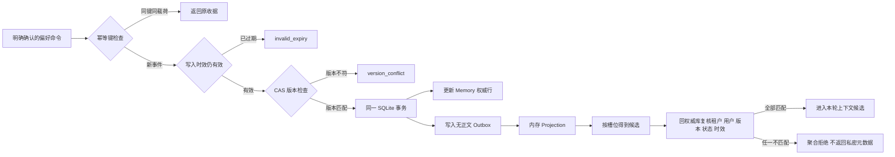

# 第七章：可纠正、可删除的长期记忆

这个离线实验把“用户明确确认的回答风格”作为一个个人偏好槽位，演示从首次写入、幂等重试、版本化纠正，到删除与派生索引失效的完整路径。它关注的是记忆生命周期的控制逻辑，不做自由文本抽取，也不调用模型替用户判断什么值得记住。

实验只使用 **Python 3.11+ 标准库和 SQLite 内存数据库**，不调用网络、模型或企业系统。身份、时钟、事件与偏好均为固定合成数据。完整讲解见[第七章：Memory 记忆系统](../../07%20Memory%20%E8%AE%B0%E5%BF%86%E7%B3%BB%E7%BB%9F.md)。

## 1. 运行演示

在仓库根目录执行：

```bash
python3.11 examples/ch07-memory/lab.py
python3.11 -m unittest discover -s examples/ch07-memory -p 'test_*.py' -v
```

演示按以下顺序运行：首次写入 → 相同事件重试 → 新版本纠正 → 旧版本写入失败 → 同租户不同用户隔离 → 删除 → 迟到的旧索引记录被版本栅栏拒绝。JSON 输出中的关键结果应为：

| 字段 | 预期结果 | 含义 |
| --- | ---: | --- |
| `write.replay_same_receipt` | `true` | 同一事件键和同一载荷只产生一次写入与 Outbox 事件 |
| `write.corrected_version` | `2` | 用户纠正通过 CAS 从版本 1 更新到版本 2 |
| `write.stale_write_error` | `version_conflict` | 仍以版本 1 为前提的迟到写入不能覆盖新值 |
| `isolation_and_expiry.rejected_candidate_count` | `1` | 另一个用户的候选只计数，不返回其身份或正文 |
| `isolation_and_expiry.visible_at_expiry_boundary` | `false` | `expires_at <= now` 时不可继续使用 |
| `delete.deleted_version` | `3` | 删除保留版本化墓碑，而非直接让版本历史消失 |
| `delete.late_v1_projection_applied` | `false` | 删除版本 3 的栅栏拒绝迟到的版本 1 |
| `persistence.outbox_contains_preference_text` | `false` | Outbox 只含不透明 ID、版本、状态和时间，不复制偏好正文 |

## 2. 输入契约

```python
store.put_preference(
    scope,
    event_key="preference-001",
    slot="response_style",
    value="默认简短清单，需要时展开。",
    expected_version=0,
    source_ref="turn-012",
    confirmed=True,
    expires_at=expires_at,
)
```

| 输入 | 作用与边界 |
| --- | --- |
| `Scope(tenant_id, actor_id, now)` | 由可信应用层注入租户、当前用户与带时区时钟；构造对象本身不完成认证 |
| `event_key` | 一次业务意图的幂等键；同键同载荷返回原收据，同键不同载荷报冲突 |
| `slot` | 稳定的偏好字段，如 `response_style`；这里只校验以字母开头的 ASCII 标识符语法，不是企业业务槽位白名单 |
| `value` | 已确认的偏好正文，最多 4 KiB；保存在权威表中，不复制到 Outbox |
| `expected_version` | CAS 前置版本；首次创建为 0，纠正或删除必须携带已读到的当前版本 |
| `source_ref` | 可定位的合成来源引用，帮助审计这次变化来自哪一轮确认 |
| `confirmed` | 只有严格的 `True` 才允许写入；模型候选不能自己把它设成可信确认 |
| `expires_at` | 可选、带时区的失效时刻；新事件等于当前时刻已经失效，已成功事件仍可按原载荷幂等重放 |

时效判断先把 `expires_at` 和 `Scope.now` 转成 UTC instant，再比较真实时间；不能直接比较夏令时回拨期间看似相同的本地钟面时间。

幂等重放返回的是这次事件首次成功时的**历史收据**。即使记忆后来到期、纠正或删除，同键同载荷仍返回最初收据，而且不会产生新 Memory 或 Outbox 行；这不表示收据中的旧状态仍是当前状态。需要当前值时必须重新读取权威表。

`delete_preference` 使用相同的作用域、事件键、CAS 版本和确认边界。删除后保留 `status=deleted`、递增后的版本与删除来源，正文设为 `NULL`。本实验不提供恢复 API；删除后的任何新 `put` 或 `delete` 都返回 `version_conflict`，只有已经成功的旧事件可以取回原历史收据。这是逻辑删除和索引失效机制，**不能证明备份、日志、缓存和下游副本已经完成物理擦除**。

## 3. 数据怎样流动



Memory 表和 Outbox 在同一事务中提交。测试使用一个会拒绝 Outbox 插入的 SQLite Trigger 模拟故障，并验证 Memory、幂等收据和 Outbox 都没有留下半成功状态。这个实验只证明单个 SQLite 事务的原子性；真实跨服务发布仍需 Outbox Worker、重试、监控和幂等消费者。

`MemoryStore` 独占传入的 SQLite 连接并自行管理事务。调用方已经在同一连接开启事务时，写 API 返回 `invalid_transaction_state`，不会尝试回滚调用方事务。生产实现应明确连接和事务所有权，不能把这段教学封装直接嵌进任意外部事务。

## 4. 为什么既要 Outbox 版本，又要读取时复核

`MemoryProjection` 是一个按槽位精确匹配的内存字典，用来模拟 Elasticsearch 或向量库这类派生读取层；它不是向量检索，也不计算语义相似度。

投影收到版本更高的事件后会保存版本栅栏。删除版本为 3 时，即使版本 1 的活动记录后来才到达，也无法重新进入投影。然而，删除事件也可能尚未送达，所以只靠投影仍然不够：`retrieve` 对每个候选都回 SQLite 权威表检查当前租户、用户、版本、状态、正文和时效。权威行已经删除或更新时，旧投影立即不可见。

本实验的 Outbox Worker 只能从当前权威行构造投影；旧事件发现权威版本已前进时会标记为 `superseded`。它按“可能重复投递”设计，投影对相同版本的重复事件幂等。它没有实现生产消息代理、租约、批量抢占、失败重试或死信队列。

## 5. 失败语义

| 错误码 | 含义与调用方动作 |
| --- | --- |
| `unconfirmed_memory` | 信息尚未得到明确确认；保留为本轮候选或请求确认，不写长期记忆 |
| `idempotency_conflict` | 相同事件键对应了不同载荷；排查调用方重用键，不猜测哪一个正确 |
| `version_conflict` | 记录不存在、属于其他作用域、已删除或版本已经变化；重新读取当前状态后再决定 |
| `invalid_expiry` | 失效时间没有时区或写入时已经失效 |
| `projection_version_conflict` | 同一投影版本出现不同内容；停止消费并排查数据源 |
| `invalid_transaction_state` | 调用方已经在共享连接中开启事务；使用本 Store 独占的连接或重新划定事务所有权 |
| `storage_failure` | SQLite 操作失败并已回滚；错误不附带 SQL、身份或偏好正文 |

跨用户写入、记录不存在和版本落后都返回同一个 `version_conflict`，避免用错误差异探测其他人的记忆。CLI 只展示当前合成用户可见的值；被拒绝候选只展示数量。

## 6. 实验验证与未实现范围

[test_lab.py](./test_lab.py) 包含 15 个测试方法，覆盖幂等重放与冲突、到期后重放、新过期事件拒绝、CAS 纠正、Memory 与 Outbox 原子回滚、外部事务所有权、明确确认、跨时区与 DST fold 边界、同租户跨用户和跨租户同名用户隔离、安全错误、读取时权威复核、删除后不可恢复、迟到索引版本栅栏，以及 Outbox 不含偏好正文。

这个教学实验没有实现自由文本记忆抽取、模型置信度、真实认证与授权、语义／向量检索、加密和密钥管理、真实多进程并发、跨区域复制、数据保留策略、备份擦除或物理删除证明。SQLite 中的串行事务与 CAS 只演示协议意图，不能替代目标数据库和部署拓扑下的并发测试。
